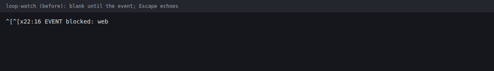
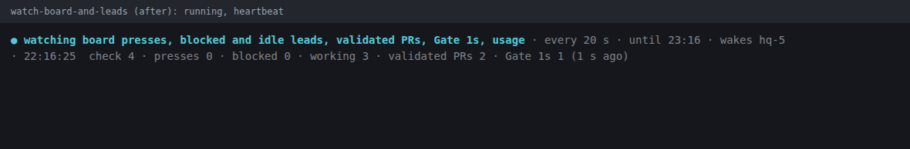
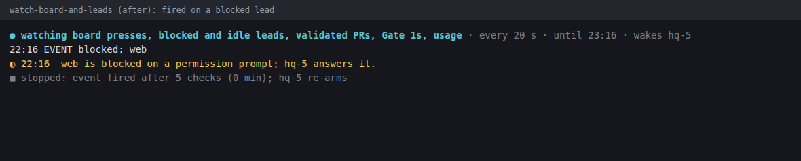
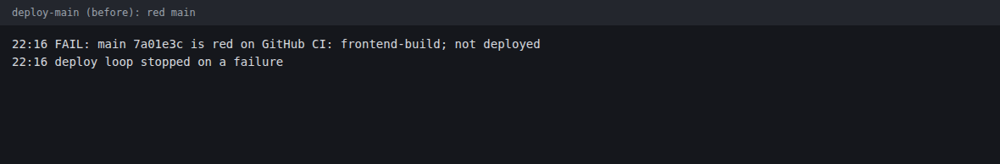
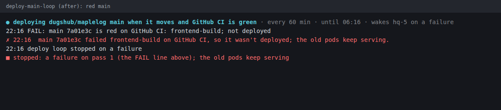
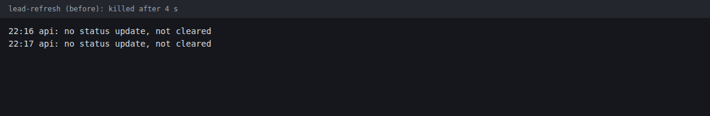
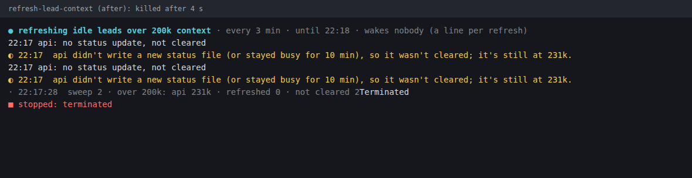

# Report: watch-style

Brief: `hq/briefs/sdlc/20261105-watch-style.md` · Gate 0: `.ai-docs/plans/watch-style.md` (approved by Doug, Nov 5, defaults).

## Status: built and checked locally; **not pushed, no PRs yet**

Both pushes were denied by this session's auto-mode permission classifier ("Out-of-Place Publication"), so the
commits are local only:

| Repo | Branch | Commit | Worktree |
|---|---|---|---|
| pattern-stack/claudecode-patterns | `dugshub/watch-style` | `ce273e9` (+ this report) | `/root/wt/claudecode-patterns/watch-style` |
| dugshub/maplelog-hq (hq) | `dugshub/watch-style` (off `origin/main` f03bd51) | `aa77edb` | `/root/wt/maplelog-hq/watch-style` |

To open them, someone with push permission runs from each worktree: `git push -u origin dugshub/watch-style`, then
`gh pr create`. Merge order: claudecode-patterns first (the plugin must reach 0.2.44 before hq's loops get the
coloured panes; until then `watch-lib.sh` falls back to plain stand-ins, so the hq PR is safe to merge either way).

## What was built

**claudecode-patterns (sdlc 0.2.44)**
- `plugin/lib/watch.sh`: `watch_header`, `watch_beat`, `watch_line`, `watch_event ok|wait|fail`, `watch_end [--fail]`,
  `watch_hhmm`, `watch_age`. The EXIT/INT/TERM trap writes `■ stopped:` if the script didn't, and keeps the exit code.
- `plugin/lib/watch.test.sh`: 28 cases, including a real pty (util-linux `script`): piped output byte-exact, no
  escapes or `\r` when piped, colours, heartbeat rewrite and clear, `NO_COLOR`, `WATCH_PLAIN`, the traps, Escape not
  echoing (against a baseline that proves the pty echoes it), echo restored on exit. Added to `verify.yml`.
- `plugin/skills/skill-authoring/watchers.md`, linked from the skill-authoring `SKILL.md`. CHANGELOG, version bump.

**hq**
- `loop-watch.sh` → `watch-board-and-leads.sh`, `deploy-main.sh` → `deploy-main-loop.sh`,
  `lead-refresh.sh` → `refresh-lead-context.sh`. The old names are one-line `exec` shims, so HQ's running re-arm
  commands keep working (remove later). Git shows these as new files rather than renames; to review the change:
  `git diff origin/main:scripts/ops/loop-watch.sh HEAD:scripts/ops/watch-board-and-leads.sh` (and the same for the other two).
- `scripts/ops/watch-lib.sh` finds the plugin's `lib/watch.sh` from `installed_plugins.json` (or `WATCH_SH`) and falls
  back to plain stand-ins.
- Every `EVENT`, `TIMEOUT`, `FAIL` and step line is byte-identical. Checked in a sandbox for the blocked-lead event and
  the red-main deploy, comparing old and new output.
- `docs/hq-operations.md`: the new names and the `hc run --name … --label role=… --label owner=…` form.
- `WATCH_OWNER` (default `HQ`) names who is woken; HQ should start the loops with `WATCH_OWNER=hq-5`.

## Screenshots (before → after)

Captured in a sandbox: stubbed `gh`, `agents.sh` and `python3` (so `project-done-sync.py --apply` and the session sweep
never ran), a private `HQ_STATE`, `sleep` shortened to 1 s, and Escape typed into the pane 1.5 s in. Rendered from the raw
pty bytes.

| Before | After |
|---|---|
|  |   |
|  |  |
|  |  |

The refresh panes repeat `api` because `sleep` was 1 s instead of 180 s.

## Checks, by exit code

- **hq** `just check`: **exit 0**.
- **claudecode-patterns** has no `just check` recipe. I ran each step `verify.yml` runs:
  - `bash plugin/lib/watch.test.sh` **0** (28/28, stable over 3 runs); `claude plugin validate ./plugin` **0** (passed with warnings);
    `verify-teammate-tools`, `verify-worktree-hooks`, `verify-preflight-shell`, `verify-version-bump` **0**.
  - `machines`, `placement`, `phase-tuning`, `delegate` tests **0** with PyYAML only (215/235/142/352 passed).
  - With `SDLC_REQUIRE_BOTH_BACKENDS=1` they fail 1-2 cases each, and `verify-tool-groups` / `verify-canvases` exit 2:
    **yq is not installed on devbox**, and fetching CI's pinned yq was denied. Untouched `origin/main` fails exactly the same
    way here (same counts), so the change doesn't cause it. CI installs yq, so GitHub's run is the real verdict.

## Deviations and notes

- **No PRs** (see the top). The brief's report, the screenshots and the CHANGELOG are ready.
- **Renamed files and terminals both**, with shims at the old file names, instead of renaming only the `hc` terminals.
- **`NO_COLOR` drops only colour.** The heartbeat and sentences are TTY features, and `WATCH_PLAIN=1` drops them too.
  The Gate 0 plan had folded these together.
- **`hc` panes are TTYs**, so `hc read` and parent notes of a pane see the escapes and `\r` rewrites (HQ: match by
  content). A machine line printed after a beat starts with `ESC[2K`; the line's text is otherwise exact.
- **Cosmetic:** when the whole process group is killed (`timeout`, maybe `hc kill`), bash prints `Terminated` onto the
  beat line before the trap's `■ stopped: terminated`.
