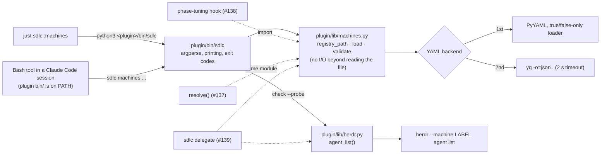

# Machine registry: schema, loader, `sdlc machines` list/check, example file

## Goal

Give sdlc a description of the boxes agents can run on. It lives in a per-person YAML registry at
`${XDG_CONFIG_HOME:-~/.config}/sdlc/machines.yaml` (override with `$SDLC_MACHINES`), kept on the
box you coordinate from. This issue ships:
- a loader and validator in `plugin/lib/machines.py`, whose failures are restrictive rather than
  permissive;
- a CLI, `sdlc machines list|check [--probe]`, that shows and checks the registry;
- a neutral example file;
- a `just sdlc::machines` recipe;
- tests wired into CI;
- a CHANGELOG entry and a README section;
- version 0.2.40.

Nothing is placed or started yet. With no registry file, the feature is off and every existing
project behaves exactly as before.

## Approach

### Layering, and where #137-#139 attach



- **`machines.py` is a pure library.**
  - It has no `print`, no `sys.exit`, no subprocess at import time, and imports `yaml` lazily
    inside `parse_yaml`.
  - `load()` never raises on bad input: every problem becomes an `Issue`.
  - The #138 hook will import it inside `phase-tuning.py`'s fail-open wrapper
    (`plugin/hooks/phase-tuning.py:18`, `:205-211`). That hook is killed after 5 s
    (`plugin/hooks/hooks.json:161`). So the only slow step, the yq subprocess, gets a 2 s timeout,
    and the inert path costs one `stat`.
- **`herdr.py` is the thin adapter #139 asks for.**
  - This issue adds only `agent_list()`. #139 adds tab/pane creation, `agent start`, `prompt` and
    `send-keys` next to it.
  - Tests drive it through a fake `herdr` on `PATH`, the technique #139 names.
- **`bin/sdlc` owns all output.**
  - It uses argparse subcommands with one dispatch function per command.
  - `check` is a list of passes. Each pass returns `Issue`s at level `error`, `warning` or `info`.
  - #137 appends a placement pass, and `machines where` and `delegate` become sibling subparsers.

### Consumer contract: what #137, #138 and #139 may rely on

The module docstring states these rules. Placement code must follow them.

1. **The registry as a whole.** `Registry.usable` is true only when all three hold:
   - the file exists;
   - it parsed into a `machines` map;
   - exactly one machine has a valid `transport: local`;
   - that local machine is `ok` (a typo in the coordinator's own entry leaves placement inert, and `check` still exits 1).

   When `usable` is false, every consumer behaves as if there were no registry:
   - the resolver (#137) keeps everything on this box;
   - the hook (#138) adds no hint;
   - `delegate` (#139) refuses, giving the first registry error as the reason, or "no registry" when the registry is inert.

   A file that is broken as a whole is therefore inert for placement. `check` still exits 1 on it.
2. **Each machine.** Errors are tracked per machine in `Machine.invalid`, the set of keys whose
   values were rejected. A machine with any invalid key (`Machine.ok` is false) is **never a
   placement target**. A placement that names it fails with a reason such as
   `machine 'box' has registry errors in: assignable, limits.cores`. Other machines are unaffected,
   so one typo disables one box, not the whole registry.
3. **Invalid values become their restrictive fallback, never their default.** For example, an
   invalid `assignable` loads as `False`, and an invalid `gaming_sensitive` loads as `True`. So
   code that forgets to check `ok` still cannot place work on a box whose assignability was
   mistyped. This is not a full guarantee for every field: an invalid `busy_flag` loads as unset
   with `gaming_sensitive: True`, and with no flag there is nothing to test, so rely on `ok`. The full list is the "Invalid →" column of the validation table.
4. **Warnings never change placement.**
5. **`Issue.where` tells registry-level problems from per-machine ones.**
   - `registry`: the file couldn't be read, parsed, or found at an explicit path.
   - `machines`: a structural problem, the local-machine count, or a bad machine name.
   - `machines.<name>[.<key>[.<sub>]]`: a problem in one machine's entry.

### D1 finding: Claude Code does put a plugin's `bin/` on PATH (for the Bash tool only)

I checked this against the installed Claude Code **2.1.310** binary on 2026-10-25.

**What happens.** On session start, the shell setup (`pluginBinPaths`) takes every enabled,
non-builtin plugin's `<plugin root>/bin` and adds it to the PATH of the **Bash tool's** shell
snapshot. Along the way it:
- keeps only paths that are a directory;
- drops any path containing `:` `"` `'` `$` `` ` `` `\` or a newline. The log line is "Dropping
  plugin bin path with shell metacharacters";
- rebuilds the snapshot on `/reload-plugins` if that set of paths changed. The log line is "Shell
  snapshot dropped on plugin refresh (plugin bin/ PATH entries changed)".

It works under `--plugin-dir ./plugin` (`just dev`) too, because the bin path is derived from the
loaded plugin's path. A probe copy of `plugin/` with `bin/sdlc` and `lib/machines.py` added passes
`claude plugin validate`, apart from the existing icon warning.

**What it doesn't reach:**
- a human's own terminal;
- hooks, which use `${CLAUDE_PLUGIN_ROOT}/...` and import the module directly;
- CI;
- a herdr agent on another box, unless the plugin is installed there;
- older CLIs. CI pins 2.1.226, which I haven't checked.

**So D1's two routes both stay:**
- Agents in a Claude Code session call `sdlc ...` bare. For that to work, `bin/sdlc` must be
  committed as mode **100755** with a `#!/usr/bin/env python3` shebang. Otherwise the bare call
  fails with "permission denied".
- Humans and CI use `just sdlc::machines ...`. It runs `python3 <plugin>/bin/sdlc` by absolute
  path, so it needs neither PATH nor the executable bit.

### Registry location (resolution order, first match wins)

1. **`--registry PATH`** on the CLI. Source is `flag`, and the file must exist.
2. **`$SDLC_MACHINES`**, if set and non-empty. Source is `env`, and the file must exist.
3. **`${XDG_CONFIG_HOME:-~/.config}/sdlc/machines.yaml`.** Source is `default`. If this file is
   absent, the registry is **inert**: it raises no issue, and `list` and `check` print a clear
   message and exit 0.

Details:
- `~` is expanded in 1 and 2.
- An empty-string `XDG_CONFIG_HOME` is treated as unset.
- The existence check runs **before** a YAML backend is chosen. So the inert case works on a box
  with neither PyYAML nor yq.

**The file lives on the coordinating box.** That is the box where you run Claude Code and start
agents. `transport: local` means *that* box, so the file is not portable between boxes. Suppose a
copy reached `worker-1` and an agent ran there with the plugin installed. It would name the wrong
box as local, and #138 would tell an agent on `worker-1` to delegate to `worker-1`. A worker with
no file is inert, which is the right behaviour for a delegated agent. The README and the example
header say this.

### YAML (D2)

`parse_yaml(path)` tries three backends in order:

1. **PyYAML**, through a private `SafeLoader` subclass whose boolean resolver accepts only
   `true|True|TRUE|false|False|FALSE`, the YAML 1.2 core set.
   - Build it by copying `SafeLoader.yaml_implicit_resolvers` without the
     `tag:yaml.org,2002:bool` entries, then calling `add_implicit_resolver` with the narrower
     pattern for first characters `tTfF`. `SafeLoader` itself must not be mutated.
   - I checked this on 2026-10-25 with PyYAML 6.0.1 against yq 4.44.3. For `yes`, `no`, `on`,
     `off`, `True`, `TRUE`, `true`, and a mapping key `on:`, the two backends now return identical
     values: `yes`/`no`/`on`/`off` stay strings, the `true` forms are booleans, and `on:` stays
     the string key `"on"`.
   - Stock `safe_load` read `yes` as `True` and the key `on:` as `True`.
2. **yq**: `subprocess.run(["yq", "-o=json", ".", str(path)], capture_output=True, text=True, timeout=2)`,
   then `json.loads`. This is the `plugin/scripts/sync-github.py:56-61` pattern, but captured
   rather than using `check=True`, and with a time limit.
   - `TimeoutExpired` → `RegistryError("yq timed out after 2s reading <path>")`.
   - A non-zero exit → `could not parse <path>: <first stderr line>`.
3. **Neither available** → `RegistryError("reading <path> needs PyYAML (pip install pyyaml) or yq (mikefarah v4) on PATH")`.

A PyYAML `YAMLError` becomes `could not parse <path>: <first line>`. `load()` turns every
`RegistryError` into one error `Issue` with `where="registry"`, and the registry is then not
`usable`.

Known divergence left in place: YAML 1.1 number forms, such as leading-zero octal `012` and
sexagesimal `1:30`, still parse differently in the two backends. No field takes such values, and
the README says to write plain decimals.

### Validation rules

The fields per machine are those in ADR-009 §1, plus D5. A few general rules:
- Every field is optional unless the table says otherwise.
- An explicit `null` means "unset".
- A `null` machine entry, such as `control:` with nothing under it, reads as `{}`.
- **The Invalid → column is the value a field loads as when its value is rejected.** It is always
  the restrictive choice. The key is also added to `Machine.invalid`, which makes the machine
  not `ok`.

| Key | Type / values | Default | Invalid → | Errors (E) / warnings (W) |
|---|---|---|---|---|
| `transport` | `local`, or a map `{herdr: <label>, ssh: <target>}` | unset | kind `none` (unreachable) | E: missing on a machine that is assignable (only `assignable: false` may omit it). E: any string other than `local`, or a non-string/non-map value. E: a map without a non-empty string `herdr`. E: `ssh` set but not a string. W: other keys inside the map. |
| `workdir` | string | unset | unset | E: wrong type. W: an **assignable** herdr machine without it (`sdlc delegate` will need it). |
| `limits` | map: `cores` int>0, `mem_gb` int/float>0, `browser_jobs` int>=0, `agents` int>=0 | all unset | the offending limit becomes `0` (a non-map gives all `0`) | E: not a map, wrong type, or out of range. W: unknown limit key. |
| `caps` | list of non-empty strings | `[]` | `()` | E: not a list, or a non-string item. Free-form vocabulary: projects name their own needs. |
| `keeps` | list of non-empty strings | `[]` | `()` | E: as for `caps`. |
| `secrets` | one of the ordered levels **`none` < `dev` < `prod`** | `none` | `none` | E: wrong type, or not one of the three. #137 compares by position in `SECRET_LEVELS`. |
| `gaming_sensitive` | bool | `false`; **`true` whenever `busy_flag` is set** (D5) | `True` | E: wrong type. W: `true` with no `busy_flag` (nothing to check). W: explicit `false` together with a `busy_flag` (the `false` is ignored). |
| `busy_flag` (alias `gaming_flag`, D5) | string path, stored unexpanded | unset | unset, and `gaming_sensitive` becomes `True` | E: wrong type. E: both keys set. Setting it alone is enough: it implies `gaming_sensitive: true`. |
| `backup` | bool | `false` | `False` | E: wrong type. |
| `persistence` | `durable` or `disposable` | unset | `disposable` | E: any other value. |
| `role` | string | unset | unset | E: wrong type. |
| `assignable` | bool | **`true`** | **`False`** | E: wrong type. |
| `first_start` | list of `trust-prompt` and/or `fullscreen-notice` | `[]` | `()` | E: not a list, or an unknown gate name. #139 has to know how to clear each one. |

**Booleans and numbers are strict, and both backends agree.**
- Only a real boolean passes as a boolean: `true` or `false`, in the forms the loader above
  accepts. `yes`, `no`, `on`, `off`, `1` and `"true"` are errors on a boolean field, under PyYAML
  and yq alike.
- A `bool` never passes as a number. This needs an explicit check, because `isinstance(True, int)`
  is true in Python.

**Registry-level rules:**
- The top level must be a map containing a non-empty `machines` map. Otherwise there is an error at
  `machines`, the registry has no machines, and it is not `usable`.
- Other top-level keys produce a warning.
- **Machine names** must be strings matching `^[A-Za-z0-9][A-Za-z0-9_-]*$`.
  - Dots are not allowed, so the dotted `where` paths stay unambiguous.
  - `any`, `auto` and `local` are reserved (`any` for #137, `auto` for #139's `--machine auto`,
    `local` as the transport word).
  - A bad or reserved name is an error at `machines` that names it. That entry is left out of
    `Registry.machines`.
- **Blank trust keys.** A null or blank `assignable`, `gaming_sensitive`, `busy_flag` (or `gaming_flag`) or `secrets` is an error and takes the restrictive fallback. For other keys null still means unset.
- **Duplicate keys.** A key written twice anywhere in a machine entry is an error; a trust key takes its restrictive fallback, `transport` loads as kind `none`, `limits` as all `0`. A repeated machine name is an error and the name is left out; a repeated top-level key is an error. Both backends report them (yq 4 keeps repeated keys in its JSON).
- **Numbers and names agree across backends.** The PyYAML loader reads plain decimal integers (`010` is 10), reads `1e3` as a number, leaves dates as strings, and keeps mapping keys as their text. A whole float (`4.0`, `1e3`) becomes an int under both. Machine names are checked with `fullmatch`, and an all-digit name is an error. `workdir` must be a non-empty string. Known gap: `0x10` and `1_000` are numbers to yq only.
- **Unknown machine keys** produce a warning with a did-you-mean suggestion
  (`difflib.get_close_matches` against the known keys plus the alias).
  - Exception: a near-miss of `assignable`, `gaming_sensitive`, `busy_flag` or `gaming_flag` is an **error**. Matching lowercases both sides and treats `-` as `_` (`ASSIGNABLE`, `BusyFlag` count); the cutoff is difflib ratio 0.8, on the first suggestion only (`available` and `assign` stay warnings). A near-miss of `assignable` loads `assignable: False`; a near-miss of a D5 key forces `gaming_sensitive: True`. Otherwise a typo of the one key that keeps work off
    a box would silently leave the box assignable.
- **Exactly one `transport: local` machine.**
  - Zero is an error at `machines`: "no machine has `transport: local`; mark the box you run
    Claude Code on".
  - Two or more is an error at `machines` that names them.
  - In both cases `Registry.local` is `None` and the registry is not `usable`. The #137 resolver
    and the #138 hook both need one unambiguous "here".

### CLI behaviour

`sdlc machines` with no subcommand runs `list`. `--registry` is accepted both on the `machines`
group parser and on each leaf (the leaf uses `default=argparse.SUPPRESS`, so a group value survives and a leaf value wins). An empty `--registry` is a usage error (exit 2), never a fallback to the default. `--timeout` takes a finite number > 0. So `sdlc machines --registry X` and
`sdlc machines check --registry X` both work.

**`list`** prints `Registry: <path>`, then a fixed-width table.
- The columns follow the issue, in this order: NAME, TRANSPORT, ROLE, ASSIGNABLE, CAPS, KEEPS,
  SECRETS.
- Rows are in file order.
- TRANSPORT shows `local`, `herdr:<label>`, or `-`. ASSIGNABLE shows `yes` or `no`.
- Lists are joined with `,`, an empty value shows as `-`, and only ASCII is used.
- **A cell whose key is invalid shows the restrictive value it loaded as, followed by `!`**, for
  example `no!`. NAME also gets a `!` when the machine has any invalid key, including keys that
  aren't shown in the table.
- When any `!` was printed, this goes to stderr:
  `! = invalid value, shown as the restrictive value it loads as; run: sdlc machines check`.
- When there are errors or warnings, stderr also gets
  `N errors, M warnings; run: sdlc machines check`.

`list` exits 0 when it could print a table or the inert message. It exits 1 when there was nothing
to show:
- the explicit path is missing;
- the file can't be parsed;
- there is no YAML backend;
- the yq call timed out;
- there is no `machines` map.

**`check`** prints, in order:
- `Registry: <path>`;
- a one-line summary such as `3 machines: 1 local, 1 herdr, 1 without transport`;
- one line per issue: `error    <where>: <message>`, `warning  <where>: <message>`, or
  `info     <where>: <message>`;
- a final line, exactly `check: ok (errors=0, warnings=N)` or
  `check: failed (errors=E, warnings=N)`.

`check` exits 1 on any error. Warnings and info lines alone exit 0. When the registry is inert,
`check` prints the inert message and exits 0, per D4: existing projects see no change.

**`check --probe [--timeout SECS]`** (default 15 s per machine) appends a probe pass.
- It probes every machine with herdr transport, one at a time, in file order, by calling
  `herdr.agent_list(label, timeout=...)`.
- On success it prints an `info` line, for example
  `info     machines.worker-1.transport: reachable via herdr:worker-1, 3 agents (limit 4)`.
  - The limit part appears only when `limits.agents` is set.
  - `, full` is appended when the count is at least the limit.
- A failure is an `error` at `machines.<name>.transport`: `herdr probe failed: <detail>`. The
  detail is one of:
  - herdr's first stderr line. herdr 0.9.5 prints
    `error: unknown machine '<label>'; use \`herdr machine list\`` and exits 2.
  - `timed out after Ns`.
  - `unexpected output`.
- `herdr` missing from PATH gives one error, `probe: herdr not found on PATH`, but only when at
  least one machine uses herdr transport.
- Local machines and machines without a transport are not probed.
- A probe failure is an error because the probe is opt-in, a script can gate on it, and an unknown
  herdr label is a configuration bug.

**The inert message**, shared by `list` and `check`:

```
No machine registry at <path>. Machines are off, so everything runs on this box.
To set one up: cp <plugin>/machines.example.yaml <path>   (or set $SDLC_MACHINES)
```

`<plugin>` is computed from `bin/sdlc`'s own resolved location, so the `cp` command is exact.

**Exit codes:**
- 0: OK, or inert.
- 1: an error was found (`check`), or `list` had nothing to show.
- 2: usage error (argparse's default).

**Startup.**
- `bin/sdlc` sets `sys.dont_write_bytecode = True`, then inserts
  `Path(__file__).resolve().parent.parent / "lib"` at `sys.path[0]`, then imports `machines`.
- `resolve()` follows symlinks, so a `~/bin/sdlc` symlink still finds `lib/`.
- The bytecode setting keeps `__pycache__/` out of the plugin install directory. It is gitignored
  here, but cache copies may be read-only.

**Python ≥ 3.8**, because macOS system Python is 3.9:
- use `from __future__ import annotations`;
- no `match` statements;
- no runtime `X | Y` unions;
- use `typing.Optional`, `Tuple` and so on wherever an annotation is evaluated.

## File-level plan

### Create

- **`plugin/lib/machines.py`** holds the registry model, path resolution, YAML backends and
  validation, with the surface given under Interfaces.
  - Keep the schema as **one data table** rather than a chain of `if`s. For each key it holds a
    type check, the default, the restrictive fallback, and a normalizer. #137 reads it, and
    unknown-key detection and did-you-mean come from it.
  - The module docstring states the consumer contract (Approach, rules 1-5) and the hook-facing
    rules: no output, no exit, `yaml` imported lazily, and `load()` never raises on bad input.
- **`plugin/lib/herdr.py`** holds `HerdrError(detail, returncode=None)`, `available()` and
  `agent_list(machine, *, timeout)`.
  - `agent_list` wraps
    `subprocess.run(["herdr", "--machine", label, "agent", "list"], capture_output=True, text=True, timeout=timeout)`.
    With `machine=None` it omits `--machine`, which #139 needs for the local server.
  - It parses `json.loads(stdout)["result"]["agents"]`, which must be a list.
  - It raises `HerdrError` if:
    - `herdr` is missing;
    - herdr exits non-zero (the detail is the first stderr line);
    - the call times out (`subprocess.TimeoutExpired`);
    - the output has the wrong shape.
  - Verified on 2026-10-25 with herdr 0.9.5:
    - `herdr --machine <label> agent list` prints
      `{"id":"cli:agent:list","result":{"agents":[...],"type":"agent_list"}}` and exits 0;
    - an unknown label prints `error: unknown machine '<label>'; use \`herdr machine list\`` on
      stderr and exits 2.
  - The module docstring says #139 extends this file and that tests use a fake `herdr` on PATH.
- **`plugin/bin/sdlc`** is the CLI. It is committed as **mode 100755**: run `chmod +x` before
  `git add`, then verify with `git ls-files -s plugin/bin/sdlc`.
  - Shebang `#!/usr/bin/env python3`.
  - Top-level argparse subparsers (only `machines` for now), with a `machines {list,check}` group.
  - The `list` and `check` handlers, the table formatter with the `!` marker, and the inert
    message.
  - `main(argv=None) -> int`, wrapped in `sys.exit(main())`.
  - The docstring lists the reserved future commands: `machines where` (#137) and `delegate`
    (#139).
- **`plugin/machines.example.yaml`** is the neutral example with three machines.
  - No MapleLog names, hosts or IPs.
  - It doubles as the field reference, with a comment on each key.
  - It must pass `check` with **0 errors and 0 warnings**.
  - The intended content:

  ```yaml
  # sdlc machine registry. Keep it on the box you coordinate from, where you run Claude Code and
  # start agents: `local` means that box. Put it at ~/.config/sdlc/machines.yaml, or point
  # $SDLC_MACHINES at it. Don't copy it to worker boxes: a box without the file runs everything
  # locally, which is right for an agent that was delegated there.
  # A machine says what it CAN do (caps) and what it HOLDS (keeps, secrets). Placement (a later
  # release) matches a step's needs against both, trust boundary first, capacity second.
  # Booleans are true/false (yes/no/on/off are errors). secrets is one of: none < dev < prod.
  # Check the file with: sdlc machines check   (--probe asks herdr too)
  machines:
    workstation:                      # the box you run Claude Code on
      transport: local                # exactly one machine is local
      role: dev
      limits: { mem_gb: 32 }
      caps: [edit, test, browser]     # what work it can take
      keeps: [checkouts, services]    # what lives only here; steps that need it stay here
      secrets: dev                    # credentials it holds: none < dev < prod (default: none)
      gaming_sensitive: true          # shares hardware with something heavy work must not starve
      busy_flag: ~/.config/sdlc/busy  # while this file exists, heavy steps aren't placed here
                                      # (setting busy_flag alone implies gaming_sensitive: true)
      backup: true
      persistence: durable

    worker-1:                         # a disposable box reached through herdr
      transport: { herdr: worker-1, ssh: agent@192.0.2.10 }   # herdr label from `herdr machine list`
      workdir: /home/agent/work       # where delegated agents start
      role: worker
      limits: { cores: 12, mem_gb: 16, browser_jobs: 3, agents: 4 }
      caps: [edit, test, browser, docker, full-suite]
      keeps: []
      secrets: none
      backup: false
      persistence: disposable         # push or lose
      first_start: [trust-prompt, fullscreen-notice]   # prompts a fresh Claude Code shows there

    control:                          # runs the infrastructure; never given work
      role: control-plane
      assignable: false               # nothing may be placed here, so it needs no transport
  ```

  `192.0.2.10` is from the RFC 5737 documentation range.
- **`plugin/lib/machines.test.sh`** is the test suite. It is plain bash plus python3, with no
  frameworks, in the style of `plugin/hooks/phase-tuning.test.sh`:
  - `ok`/`bad` counters (`:8-9`);
  - `TMP` with `trap` cleanup (`:12-13`);
  - a summary line `machines: N passed, M failed`;
  - the exit status taken from the fail count (`:114-115`);
  - every path resolved from `$0`, as `:6` does, so it runs from any directory.

  At the top it exports `HOME="$TMP/home"` and unsets `SDLC_MACHINES` and `XDG_CONFIG_HOME`, so a
  run can never read the real user's registry. Fixtures are inline heredocs. The cases are listed
  under Tests.

### Modify

- **`plugin/sdlc.justfile`**: add a new section between "Guided tours" (`:72-85`) and "Canvas
  reconciliation" (`:87`):

  ```
  # ─── Machines (where agents run) ─────────────────────────────────────

  # show the machine registry (${XDG_CONFIG_HOME:-~/.config}/sdlc/machines.yaml or $SDLC_MACHINES); `check [--probe]` validates it.
  # Runs from the project root, so a relative --registry path is relative to the root, not your cwd.
  [group('machines')]
  [positional-arguments]
  machines *args:
      @cd .. && python3 "${CLAUDE_PLUGIN_DIR:-$(dirname "$(realpath .claude/sdlc.justfile)")}/bin/sdlc" machines "$@"
  ```

  - Use `[positional-arguments]` with `"$@"`, not the house habit of interpolating `args` into the
    line as `tour` does at `:79-80`. That way a quoted path survives.
  - I checked this in a scratch `mod` with just 1.56: `check --registry "a b.yaml"` arrives as
    three arguments, and `cd ..` lands at the project root. The attribute predates the just 1.36
    that CI pins.
  - Don't add the recipe to `verify`. The registry is per person, and `verify` is about repo
    invariants.
- **`.github/workflows/verify.yml`**: add one step to the `verify` job, after "Verify preflight
  shell" (`:68-69`) and before "List canvases" (`:71`):
  `- name: Machine registry tests` / `run: bash plugin/lib/machines.test.sh`.
  - Don't rename the job. Its `name:` is a required status check.
  - The job already installs yq (`:32`). The suite needs no network and no real herdr.
  - The four existing `*.test.sh` files (driving-answer-stop, ensure-browser-agent, gate-guard,
    phase-tuning) are not in CI. This one is, because #137, #138 and #139 all build on these
    modules under `gate:auto`.
- **`plugin/.claude-plugin/plugin.json`**: `version` goes from 0.2.39 to **0.2.40**. Check it with
  `bash plugin/scripts/verify-version-bump.sh`.
- **`CHANGELOG.md`**: add a new top entry `## [0.2.40] — 2026-10-25` above `:8`, headed
  `### Added — a machine registry and \`sdlc machines\``.
  - In the house style it gives a measured "why" first, then bullets. Use generic words only, with
    no MapleLog names.
  - The why:
    - Everything sdlc spawns runs on the coordinator's box.
    - A team with more than one box (a workstation plus a disposable worker, say) has had nowhere
      to record what each box can do, what it holds, and which box must never be given work.
    - The registry is that record. There is one per person, kept on the coordinating box.
    - This release only describes and checks machines; placement comes later. With no file,
      nothing changes.
  - The bullets:
    - the file location and override;
    - `sdlc machines list|check --probe`;
    - `just sdlc::machines`;
    - the PATH finding: agents in Claude Code sessions get `sdlc` on PATH, and terminals use the
      just recipe;
    - PyYAML or yq, with the same booleans under both;
    - invalid values load as their restrictive value;
    - the tests run in CI.
- **`README.md`**:
  - Add a new `## Machines` section immediately before `## Agent governance — the workflow layer`
    (`:244`). Keep it short. It covers:
    - what a machine is: what it can do, what it holds, and that it can be made never assignable;
    - where the file lives, written as `${XDG_CONFIG_HOME:-~/.config}/sdlc/machines.yaml`, and the
      `$SDLC_MACHINES` override;
    - **keep it on the coordinating box only; `local` means that box; don't copy it to workers**;
    - `cp` the example;
    - `sdlc machines` / `just sdlc::machines` / `check --probe`;
    - the PATH note;
    - booleans are `true`/`false` only, and `secrets` is `none < dev < prod`;
    - a value that fails to validate loads as its restrictive value, and `list` marks it with `!`;
    - without a registry, nothing changes;
    - one line saying that placing phases on machines comes in a later release.
  - Extend the `plugin/` tree (`:258-277`) with three lines:
    - `bin/`: the `sdlc` CLI;
    - `lib/`: shared Python modules and the tool installer;
    - `machines.example.yaml`.

## Interfaces

```python
# ── plugin/lib/machines.py ───────────────────────────────────────────────────
# stdlib only; PyYAML optional (imported lazily). Python >= 3.8.
# Contract for importers (CLI now, phase-tuning hook in #138): no stdout/stderr,
# no sys.exit, no import-time I/O; load() never raises on bad input.
# Placement consumers (#137 resolve, #139 delegate) MUST:
#   - treat `not registry.usable` as "no registry" (everything here; delegate refuses);
#   - never place on a machine with `not machine.ok`;
#   - ignore warnings.
from __future__ import annotations

REGISTRY_ENV = "SDLC_MACHINES"
DEFAULT_RELPATH = "sdlc/machines.yaml"                  # under ${XDG_CONFIG_HOME:-~/.config}
RESERVED_NAMES = frozenset({"any", "auto", "local"})     # placement keywords (#137, #139) + transport word
NAME_PATTERN = r"[A-Za-z0-9][A-Za-z0-9_-]*"              # fullmatch; no dots; all-digit names are also rejected
SECRET_LEVELS = ("none", "dev", "prod")                  # ordered; #137 compares by index
FIRST_START_GATES = ("trust-prompt", "fullscreen-notice")
PERSISTENCE = ("durable", "disposable")
LIMIT_KEYS = ("cores", "mem_gb", "browser_jobs", "agents")
ALIASES = {"gaming_flag": "busy_flag"}                   # D5
NEAR_MISS_CUTOFF = 0.8                                   # fail-closed key typos at or above this ratio are errors
TRUST_KEYS = ("assignable", "gaming_sensitive", "busy_flag", "secrets")   # blank = error + restrictive value
# SCHEMA: Dict[str, FieldSpec(default, fallback, check, fail_closed)] is the one table #137 reads.
YQ_TIMEOUT = 2.0                                         # seconds; the #138 hook is killed at 5 s

class RegistryError(Exception): ...                      # raised by parse_yaml; load() converts it to an Issue

@dataclass(frozen=True)
class Issue:
    level: str                                           # "error" | "warning" | "info" (info: CLI passes only)
    where: str                                           # "registry" | "machines" | "machines.<name>[.<key>[.<sub>]]"
    message: str

@dataclass(frozen=True)
class Transport:
    kind: str                                            # "local" | "herdr" | "none" (absent or invalid)
    herdr: Optional[str] = None                          # label for `herdr --machine <label>`
    ssh: Optional[str] = None                            # recorded only; GitHub is the return path
    def describe(self) -> str: ...                       # "local" | "herdr:<label>" | "-"

@dataclass(frozen=True)
class Limits:
    cores: Optional[int] = None
    mem_gb: Optional[float] = None
    browser_jobs: Optional[int] = None
    agents: Optional[int] = None

@dataclass(frozen=True)
class Machine:
    name: str
    transport: Transport
    workdir: Optional[str] = None
    limits: Limits = field(default_factory=Limits)
    caps: Tuple[str, ...] = ()
    keeps: Tuple[str, ...] = ()
    secrets: str = "none"                                # one of SECRET_LEVELS
    gaming_sensitive: bool = False                       # True whenever busy_flag is set (D5)
    busy_flag: Optional[str] = None                      # raw; #139 expands it and tests existence
    backup: bool = False
    persistence: Optional[str] = None
    role: Optional[str] = None
    assignable: bool = True
    first_start: Tuple[str, ...] = ()
    invalid: FrozenSet[str] = frozenset()                # keys whose value was rejected ("assignable", "limits.cores", ...)

    @property
    def ok(self) -> bool: ...                            # not invalid: the only machines placement may target
    @property
    def is_local(self) -> bool: ...                      # transport.kind == "local"

@dataclass
class Registry:
    path: Path
    source: str                                          # "flag" | "env" | "default"
    exists: bool
    machines: Dict[str, Machine]                         # file order; bad/reserved names excluded
    issues: List[Issue]

    @property
    def inert(self) -> bool: ...                         # source == "default" and not exists
    @property
    def usable(self) -> bool: ...                        # exists, parsed, local is not None, and local.ok
    @property
    def errors(self) -> List[Issue]: ...
    @property
    def warnings(self) -> List[Issue]: ...
    @property
    def local(self) -> Optional[Machine]: ...            # the single transport: local machine; None if 0 or 2+
    def get(self, name: str) -> Optional[Machine]: ...

def registry_path(explicit: Optional[str] = None,
                  env: Optional[Mapping[str, str]] = None) -> Tuple[Path, str]: ...
def parse_yaml(path: Path) -> object: ...                # true/false-only PyYAML -> yq (YQ_TIMEOUT) -> RegistryError
def validate(doc: object) -> Tuple[Dict[str, Machine], List[Issue]]: ...    # pure; no I/O
def load(explicit: Optional[str] = None,
         env: Optional[Mapping[str, str]] = None) -> Registry: ...

# #137 adds here (not now): placement reading from sdlc.yml, resolve(role, kind) -> Placement.

# ── plugin/lib/herdr.py ──────────────────────────────────────────────────────
class HerdrError(Exception):
    def __init__(self, detail: str, returncode: Optional[int] = None): ...

def available() -> bool: ...                             # shutil.which("herdr") is not None
def agent_list(machine: Optional[str] = None, *, timeout: float = 15.0) -> List[dict]: ...
# #139 adds here (not now): tab/pane create, agent start, prompt, send-keys, pane read.

# ── plugin/bin/sdlc (CLI grammar) ────────────────────────────────────────────
# sdlc machines [--registry PATH] [list [--registry PATH]]
# sdlc machines [--registry PATH] check [--registry PATH] [--probe] [--timeout SECS]   # default 15
# reserved, not built here:  sdlc machines where <role>  (#137) · sdlc delegate <role> ... (#139)
# exit: 0 ok/inert · 1 error found (check) or nothing to show (list) · 2 usage
def main(argv: Optional[List[str]] = None) -> int: ...
```

## Tests

All tests live in `plugin/lib/machines.test.sh`, which CI runs. Run it locally with
`bash plugin/lib/machines.test.sh`; it exits 0 only when every case that ran passed.

**How cases run.**
- Most cases run `python3 "$SDLC" machines check --registry <fixture>` and assert the exit code
  plus a `<where>` substring.
- Loader-level facts are checked with `PYTHONPATH="$LIB" python3 -c 'import machines; ...'`, using
  `ok`, `invalid`, `usable`, `local`, and field values.

**Fixtures for single-field cases.** Each fixture has two machines:
- a valid local machine `here`;
- `box`, which is valid (`transport: {herdr: box}`, `workdir: /w`) except for the one key under
  test.

The case then asserts **exactly one** `error` line (`check: failed (errors=1, ...)`), so that a
stray second error can't satisfy the substring check.

**Backends.**
- `HAVE_PYYAML` is set when `python3 -c 'import yaml'` succeeds. `HAVE_YQ` is set when
  `command -v yq` succeeds.
- To run under yq, the suite hides PyYAML with a shadow package on `PYTHONPATH`:
  `$TMP/noyaml/yaml/__init__.py` containing `raise ImportError`.
- Cases marked **[both]** run once per available backend.
- **If neither backend is present, print one `skip:` line** and run only the cases that need no
  backend: 7, 8, 19, 20 and 25. Nothing fails for lack of a backend.
- No test-only switch is added to shipped code.

**PATH directories, built fresh in `$TMP`.** None of these removes anything but what the case
means to remove:
- `pybin` contains only a `python3` symlink;
- `pyyq` contains `python3`, plus a `yq` symlink when yq exists;
- `fakebin` contains the fake `herdr`, which:
  - answers `--machine worker-1 agent list` with
    `{"id":"cli:agent:list","result":{"agents":[{},{}],"type":"agent_list"}}`;
  - prints herdr 0.9.5's exact `error: unknown machine '<label>'; use \`herdr machine list\``
    and exits 2 for other labels;
  - runs `exec sleep 5` for the label `slow`, so a timeout leaves no orphan process;
- `slowyq` contains `python3` plus a fake `yq` that runs `exec sleep 5`.

| # | Case | Expect |
|---|---|---|
| 1 | **[both]** Valid: `plugin/machines.example.yaml` | `check` exits 0 with `check: ok (errors=0, warnings=0)`. `list` exits 0 and shows `workstation … local`, `worker-1 … herdr:worker-1`, and `control … - … no`, with no `!`. `usable` is true and `local.name == "workstation"`. |
| 2 | One rejected value per key, each a single-field fixture: `transport: 42` · `transport: ssh` · `transport: {herdr: box, ssh: 5}` · `workdir: [a]` · `limits: 3` · `limits.cores: twelve` · `limits.cores: 0` · `limits.mem_gb: -1` · `limits.browser_jobs: 1.5` · `limits.agents: true` · `caps: edit` · `caps: [1]` · `keeps: {a: b}` · `secrets: 3` · `secrets: staging` · `gaming_sensitive: 1` · `gaming_sensitive: "false"` · `busy_flag: 7` · `backup: "true"` · `persistence: ephemeral` · `role: [x]` · `assignable: "no"` · `assignable: 0` · `first_start: trust-prompt` · `first_start: [trust-prompt, reboot]` | Each exits 1 with exactly one error naming the key's `where` (e.g. `machines.box.limits.cores`). The loader shows `box.ok` false, the key in `box.invalid`, and the **restrictive value** from the table: e.g. `assignable` → `False`, `gaming_sensitive` → `True`, `secrets` → `"none"`, `persistence` → `"disposable"`, `transport.kind` → `"none"`, `busy_flag: 7` → `busy_flag None, gaming_sensitive True`. Meanwhile `here.ok` stays true and `usable` stays true. |
| 3 | **[both] The blocker.** Unquoted `assignable: no`, `backup: yes` and `gaming_sensitive: off`, one fixture each | Under every available backend: exit 1, and the loader gives `assignable False` / `backup False` / `gaming_sensitive True`. `list` shows `box!` and `no!` in the ASSIGNABLE column for the first, and stderr carries the `!` legend. |
| 4 | **[both] Backend parity.** A machine named `on`, plus `assignable: True` and `assignable: TRUE` (on `box`) | The key is the string `"on"`, and both forms of `True` load as `True`, identically under each backend. |
| 5 | Missing herdr label: `transport: {ssh: agent@192.0.2.10}` and `transport: {herdr: ""}` | Exit 1 at `machines.box.transport`, with `transport.kind == "none"`. |
| 6 | Unknown keys: machine key `gpus: 2`, top-level `version: 1`, `limits.gpu: 1`, `transport.port: 22` | Exit 0. Each produces a `warning` naming its path. |
| 6b | Near-miss of the trust key: `asignable: false` | Exit 1, with an error that suggests `assignable`, and `box.assignable` loads as `False`. |
| 7 | Missing file at the default path (`HOME=$TMP/home`, nothing written) | `list` and `check` both exit 0, printing `No machine registry at` and a `cp …machines.example.yaml` hint. `inert` is true and `usable` is false. |
| 8 | Explicit path missing: `SDLC_MACHINES=$TMP/nope.yaml`; then `--registry $TMP/nope.yaml` | `check` exits 1 for both. `list` exits 1. |
| 9 | `XDG_CONFIG_HOME=$TMP/xdg` with the file at `$TMP/xdg/sdlc/machines.yaml` | That file is used, as the `Registry:` line shows. |
| 10 | `assignable` default: a machine without the key | The loader gives `True`, and `list` shows `yes`. |
| 11 | Transport-less machine with `assignable: false` | No error; `ok` is true. |
| 12 | Transport-less machine that is assignable | Exit 1 at `machines.box.transport`; `box.ok` is false. |
| 13 | No `local` machine; two `local` machines | Both exit 1 at `machines`. The two-local error names both. `local is None` and `usable` is false. |
| 14 | Names `any`, `auto`, `local`, `bad name` and `a.b` | Each exits 1 at `machines` and is left out of `Registry.machines`. |
| 15 | D5. `busy_flag: /x` alone; `gaming_flag: /x` alone | Exit 0 with no warnings. The loader gives `busy_flag "/x"` and `gaming_sensitive True`. |
| 15b | D5. `busy_flag` together with `gaming_sensitive: false` | Exit 0 with a warning; the loader gives `gaming_sensitive True`. |
| 15c | D5. `gaming_sensitive: true` with no flag | Exit 0 with a warning. |
| 15d | D5. `busy_flag` and `gaming_flag` both set | Exit 1. |
| 16 | `workdir` missing on an assignable herdr machine; then missing on an unassignable herdr machine | The first gives a warning. The second gives no warning. |
| 17 | Unparseable YAML (`machines: [`) | Exit 1 with `could not parse`. `usable` is false and `machines` is empty. |
| 18 | Top level is a list; `machines: {}`; an empty file | Each exits 1, and `usable` is false. |
| 19 | No backend: PyYAML shadowed and `PATH=$TMP/pybin`, with the file present | Exit 1, with a message naming PyYAML and yq. |
| 20 | No backend, file absent | Inert, exit 0. |
| 21 | yq timeout: PyYAML shadowed and `PATH=$TMP/slowyq`, with the file present | Exit 1 with `yq timed out` within about 3 s, not 5. |
| 22 | Probe, with `PATH=$TMP/fakebin:$TMP/pyyq` | The example with `--probe` exits 0, with `info … reachable via herdr:worker-1, 2 agents (limit 4)`. A registry with an unknown label exits 1 with `herdr probe failed: error: unknown machine`. Label `slow` with `--timeout 1` exits 1 with `timed out`. |
| 22b | Probe without herdr: `PATH=$TMP/pyyq` (herdr is the only thing removed) | The example with `--probe` exits 1 with `herdr not found`. A registry with no herdr machine exits 0, with no herdr error. |
| 23 | `SECRET_LEVELS` | Equals `("none", "dev", "prod")`. `secrets: prod` passes. |
| 24 | `--registry` on the group parser | `sdlc machines --registry <example>` lists the example. |
| 25 | `plugin/bin/sdlc` | `[ -x ]` passes. |
| 6c | Near-misses: `available`/`assign` stay warnings; `gaming_sensitve`, `busyflag`, `gaming-flag`, `ASSIGNABLE`, `BusyFlag` are errors with the restrictive value | as stated |
| 24b | `sdlc machines --registry <broken> check` | exit 1, checked the broken file |
| 26 | `load()` contract: overlong path, `PermissionError` from `exists`, a 400-digit limit, a bug inside `validate`, `--registry ''`, bad `--timeout`; nothing written to stdout/stderr | an error Issue or usage error, never a raise |
| 27 | Local machine with an invalid key; with a near-miss key (both backends) | `check` exits 1; `not r.local.ok`; `not r.usable` |
| 29 | Blank trust keys; duplicate keys (both backends) | exit 1; restrictive values |
| 30 | `010`, `1e3`, `4.0`, a date, a digit-only name, a name with a trailing newline, `workdir: ''` | same result under both backends |
| 21b | yq prints non-JSON | exit 1, `could not parse`, `load()` does not raise |

With `SDLC_REQUIRE_BOTH_BACKENDS=1` (set in CI) the suite fails if PyYAML or yq is missing.

Cases 22 and 22b need a YAML backend. Under the neither-backend skip they are skipped with the
rest.

**Checks for the validator, run outside the test file:**
- `just sdlc::machines check --registry plugin/machines.example.yaml`, from the repo root, exits 0.
- `just sdlc::machines` with no registry prints the inert message and exits 0.
- `git ls-files -s plugin/bin/sdlc` shows `100755`.
- **Genericity grep.** Both of these must print nothing:
  - `grep -rniE 'maplelog|devbox|node2|10\.88\.' plugin/bin plugin/lib/machines.py plugin/lib/herdr.py plugin/lib/machines.test.sh plugin/machines.example.yaml`
  - `git diff origin/main -- README.md CHANGELOG.md .github/workflows/verify.yml | grep '^+' | grep -iE 'maplelog|devbox|node2|10\.88\.'`
- `bash plugin/scripts/verify-version-bump.sh` reports 0.2.39 → 0.2.40.
- `just sdlc::verify` exits 0.
- `claude plugin validate ./plugin` passes, apart from the pre-existing icon warning.
- The CI `verify` job, including the new step, is green on the PR.
- Optional live D1 check: inside `just dev`, the Bash tool's `command -v sdlc` resolves to
  `…/plugin/bin/sdlc`.

## Out of scope

- Placement keys in `sdlc.yml`, `resolve()`, `machines where`, and the repo pass of `check`: #137.
  #137 must follow the consumer contract above.
- The phase-tuning remote hint: #138.
- Everything about `sdlc delegate`: #139. That includes picking by load, evaluating the busy flag,
  clearing first-start gates, and using `workdir`.
- Making YAML 1.1 number forms (`012`, `1:30`) agree across backends.
- `--json` output.
- `sdlc --version`.
- Editing the registry from the CLI. It is hand-written.
- Wiring the four existing hook `*.test.sh` files into CI.
- Installing anything on remote boxes, and anyone's real registry. ADR-009's own machines go in
  Doug's hand-written file, not in the repo.

## Open questions

All have defaults, and none blocks implementation.

- **Zero or several `local` machines is an error, not a warning.** Gate 1.5 agreed. Downgrade it if
  a real setup needs a registry without a local box.
- **A `--probe` failure is an error (exit 1).** Gate 1.5 agreed.
- **`workdir` is a warning,** only on assignable herdr machines. #139 may make it an error once
  `delegate` depends on it.
- **`asignable`-style near-misses of `assignable` are errors.** This was my call, made during the
  addendum: it is the one unknown-key case where a warning would leave the trust boundary open.
- **Fallbacks for `limits` and `persistence`.** These are `0` and `disposable`. They only matter to
  code that ignores `ok`, and they lean restrictive.

---

<!--
The sections below this divider are the **phase execution log**. They are
written by phase agents (reviewer, specifier, implementer, validator) as the
issue progresses through gates. The static spec sections above are the
current implementation contract; the phase sections below are how we got
here. See `instructions.yaml.phases` for ownership and gate mapping.

When `instructions.yaml.implementer_view` is `clean`, sections below this
divider are stripped before the implementer reads the spec.
-->

## Spec Review
<!-- written by: reviewer · gate 1.5 · /sdlc:critique · lens=mixed -->

**Target:** `.ai-docs/stacks/machines/specs/136.md` @ `e2e092b`
**Against:** issue #136 (+ #137-#139 for fit) · `plan.yaml` D1-D5 · ADR-009 §1 · cited code (`phase-tuning.py`, `phase-tuning.test.sh`, `sync-github.py`, `sdlc.justfile`, `verify-version-bump.sh`)
**Verdict:** REVISE

**Blockers (1):**
- [`§ Validation rules` ("An invalid field still produces a Machine, with that field set to its default") + `assignable` row] **The trust boundary fails open.** An invalid `assignable` loads as `True`, and `list` prints `yes` for it. That is a realistic typo, not a corner case. `assignable: no` reads as `False` under PyYAML but as the string `"no"` under yq (checked: yq v4.44.3 gives `"assignable": "no"`), so on a yq-only box the control plane loads as assignable. #137 and #139 build placement on this model, and neither says it refuses a registry with errors. That breaks ADR-009 §1 ("nothing is ever placed on an `assignable: false` machine") and D4 ("never to an `assignable: false` box"). `gaming_sensitive` has the same flaw: an invalid value becomes `False`, so heavy work is allowed on the shared box. · _Fix:_
  - Make the fallback restrictive, not the default:
    - invalid `assignable` → `False`;
    - invalid `gaming_sensitive` → `True`.
  - `list` marks an errored cell (for example `no!`) instead of printing a default.
  - The module docstring states that placement consumers (#137 `resolve`, #139 `delegate`) must not place on a machine whose entry has an error.
  - Tests:
    - extend case 2 so `assignable: "no"` asserts loader `False` and `list` `no`;
    - add `assignable: no` to the per-backend matrix.

**Notes (9):**
- [`§ YAML (D2)`] **The two backends disagree on the same file.** PyYAML (YAML 1.1) reads `yes`/`no`/`on`/`off` as booleans and yq doesn't. Checked: a machine named `on:` loads as key `True` under PyYAML and as `"on"` under yq. So `check` can pass on one box and fail on another. Telling users to write `true`/`false` doesn't remove the gap. A small `SafeLoader` subclass that only resolves `true`/`false` as booleans (YAML 1.2 core) makes the backends agree. Add a `backup: yes` case to the matrix.
- [`§ Approach` "pure library" · #138 fit] **The hook needs the loader to stay inside its time limit.** The phase-tuning hook times out after 5 s (`plugin/hooks/hooks.json`, phase-tuning entry), and `parse_yaml`'s yq call has no timeout. Give it one (about 2-3 s), so that `load()` returns an error `Issue` before the hook is killed. Separately, "any error → no hint" means one typo on an unrelated machine silences every hint. `Issue.where` already names the machine, so the docstring can tell consumers to tell registry-level errors apart from per-machine ones.
- [`§ Validation rules` `busy_flag` row · plan D5] **The spec reads D5 more narrowly than its text.** D5 (binding) says "`busy_flag: <path>`: when the file exists, heavy steps are not placed there", with no `gaming_sensitive` condition. The spec makes a `busy_flag` without `gaming_sensitive: true` a warning that "has no effect", which fails open: a user sets the path, forgets the boolean, and #139 ignores the flag. Prefer "`busy_flag` set ⇒ treated as `gaming_sensitive: true` unless it is explicitly `false`". Otherwise keep the AND, which #139's wording assumes, and say why it departs from D5.
- [`§ Registry-level rules` "Exactly one `transport: local`"] **Agree with the error, but document where the file lives.** `local` only means something on the box the file sits on, while the example header says "one per person". Suppose the file is copied to a worker that runs delegated agents with the plugin installed (ADR §5). It then names the wrong box as local, and #138 would tell an agent on `worker-1` to delegate to `worker-1`. The README and the example header should say the file lives on the coordinating box only. A worker with no file is inert, which is the right behaviour for a delegated agent.
- [`§ Validation rules` `secrets` row · #137] **`secrets` levels.** Here `secrets` is free-form, but #137 has to compare levels. If #137 later fixes a vocabulary, files that pass `check` today will start failing, and under #138's "error → no hint" the hints go quiet. Either fix an ordered vocabulary now (for example `none < dev < prod`, anything else an error), or have the example and README say the levels are provisional.
- [`§ Tests` backend matrix] **The no-backend case is unspecified.** With neither PyYAML nor yq, cases 1-4, 7-18 and 21 would fail rather than skip. Say which happens:
  - print one skip line and run only the cases that need no backend (5, 6, 19, 20, 22); or
  - fail with a single clear "needs PyYAML or yq" line.

  Either way there is no new hard dependency: yq is already used by `sync-github.py:56-61` and installed in CI. Nothing in the suite is timing-sensitive under `nice -n 19`; the only timer is the 1 s vs 5 s probe case.
- [`§ Tests` case 21, "`herdr` absent from PATH"] **The PATH setup can remove yq too.** On this box `herdr`, `yq` and `just` all live in `~/.local/bin`, so taking that directory off PATH removes yq as well. On a box with only yq, the case would then get "needs PyYAML or yq" instead of "herdr not found". Build the PATH from a fresh directory that holds `python3`, plus a `yq` symlink when yq exists, the same way case 19 does.
- [`§ Out of scope` CI · `§ Open questions` CI] **Wire this suite into CI.** `machines.py` and `herdr.py` are the shared base that #137, #138 and #139 all extend under `gate:auto`. `verify.yml` already installs yq (its "Install yq" step), the suite never touches the network or a real herdr, and so the step is one line with no new dependency. The precedent the spec cites is also miscounted: there are **four** `*.test.sh` files (driving-answer-stop, ensure-browser-agent, gate-guard, phase-tuning), not three, and CI runs none of them.
- [`§ Tests` "Checks for the validator", grep] **The genericity grep misses files.** It covers `plugin/bin`, `machines.py`, `herdr.py` and the example, but not `plugin/lib/machines.test.sh` or the README and CHANGELOG additions, which is where real names usually leak. Extend it to those files, and add `node2` to the pattern.

**Nits (8):**
- [`§ Interfaces` `HerdrError(detail, returncode=None)` vs `§ File-level plan` "`HerdrError(returncode, detail)`"] The argument order differs between the two sections. Keep the Interfaces form.
- [`§ File-level plan` herdr.py] herdr 0.9.5 actually prints a lowercase `error: unknown machine '<label>'; use \`herdr machine list\`` on stderr and exits 2 (checked). The fake herdr in case 21 should print the same text.
- [`§ CLI` `check --probe`] Raise "herdr not found on PATH" only when at least one machine uses herdr transport. Also, the probe's "reachable" lines are not `Issue`s (their only levels are error and warning), so "passes return `Issue`s" needs a way to carry info lines.
- [`§ Validation rules` `workdir` W] Limit the missing-`workdir` warning to *assignable* herdr machines. An unassignable box never receives a delegated agent.
- [`§ CLI` "no subcommand runs `list`"] With `--registry` only on the leaf parsers, `sdlc machines --registry X` is a usage error. Add the flag to the group parser too.
- [`§ Registry-level rules` name regex] The name pattern allows `.`, but `<where>` paths are dotted, so `machines.a.b.limits.cores` is ambiguous. Either drop `.` from the pattern or quote the name inside `where`. Optionally reserve `local` alongside `any`/`auto`.
- [`§ Tests`] Three small fixes:
  - resolve paths from `$0`, as `phase-tuning.test.sh:6` does, so the suite runs from any directory;
  - have the fake herdr `exec sleep 5`, so the killed process leaves no orphan;
  - give the case-2 `box` a valid herdr transport and assert exactly one error, so a stray missing-transport error can't satisfy the substring check.
- [`§ Modify` sdlc.justfile] Because the recipe runs `cd ..`, a relative `--registry` resolves against the project root, not the caller's directory. That is fine for the validator's check, but worth a line in the recipe comment.

**Specifier defaults:** I agree with all five as written:
- zero or several local machines is an error;
- a failed probe is an error, because the probe is opt-in and a script can gate on it;
- a missing `workdir` is a warning;
- `XDG_CONFIG_HOME` is honored (there is a closer precedent at `plugin/scripts/gh-attach-image.mjs:38`; the README must print `${XDG_CONFIG_HOME:-~/.config}`).

The one exception is CI, where I recommend wiring the suite in (see the notes).

**Verified:**
- Cited code: every cited line is correct (`phase-tuning.py:18,205-211`, `phase-tuning.test.sh:8-9,12-13,114-115`, `sync-github.py:56-61`, `sdlc.justfile:72-87`, `CHANGELOG.md:8`, `README.md:244,258-277`).
- D1: both log strings are in the Claude Code 2.1.310 binary.
- herdr: the `agent list` JSON shape is as described.
- just: `[positional-arguments]` with `"$@"` keeps `"a b.yaml"` as one argument inside a `mod`, and `cd ..` lands at the root.
- Install: the 100755 mode survives into the plugin cache.
- Environment: CI pins just 1.36 and Claude Code 2.1.226, `__pycache__/` is gitignored, and `claude plugin validate ./plugin` passes with warnings.
- Genericity: the plugin stays generic, and the example uses neutral names and an RFC 5737 address.
- Scope creep: none. `herdr.py`, `--registry`, `--timeout`, the reserved names and the `machine=None` call are small and justified by #136 and #139.

**Reviewed by:** reviewer agent · 2026-10-25T18:02:19Z

### Re-run 1 (supersedes the REVISE above)
<!-- written by: reviewer · gate 1.5 · /sdlc:critique · lens=mixed · rerun: true -->

**Target:** `.ai-docs/stacks/machines/specs/136.md` @ `b7c3e38` (static sections rewritten, plus the Design Addendum)
**Against:** the first run's findings · the lead's decisions (note 3 follows D5 as approved, so `busy_flag` alone implies `gaming_sensitive`; note 5 makes the levels `none < dev < prod`) · issue #136 · `plan.yaml` D1-D5 · ADR-009 §1 · cited code
**Verdict:** PASS_WITH_NOTES

**Every earlier finding is resolved in the main sections, not only in the Addendum:**
- **Blocker:**
  - the § Approach consumer contract;
  - the "Invalid →" column of § Validation rules;
  - the `!` marker in § CLI;
  - the Interfaces docstring;
  - test cases 2 and 3.
- **Notes:**
  - N1 (backend booleans): § YAML, cases 3 and 4.
  - N2 (hook time limit): § Approach, § YAML, `YQ_TIMEOUT`, rule 5, case 21.
  - N3 (`busy_flag`): the D5 rows of § Validation rules, the example, cases 15-15d.
  - N4 (where the file lives): § Registry location, the example header, the README and CHANGELOG bullets.
  - N5 (`secrets` levels): the `secrets` row, `SECRET_LEVELS`, cases 2 and 23.
  - N6 and N7 (test environments): § Tests "Backends" and "PATH directories", case 22b.
  - N8 (CI): § Modify `verify.yml`, § Out of scope.
  - N9 (genericity grep): the validator checks.
- **Nits:** all eight are fixed in their home sections. The one exception is listed under the nits below.

**Checked in this run:**
- My first-run text in this section is byte-identical.
- The true/false-only `SafeLoader` subclass, built as § YAML describes, gives exactly yq's output for `yes`/`no`/`on`/`off`/`y`/`n`/`True`/`TRUE`/`true`/`false` and for an `on:` key, and stock `SafeLoader` is left unchanged (PyYAML 6.0.1, yq 4.44.3).
- These citations are correct: `hooks.json:161` (5 s); `verify.yml:32` (Install yq), `:68-69` (preflight shell) and `:71` (List canvases); the job `name:` is the required check (`:16`).
- The example still passes with 0 errors and 0 warnings under the new rules.
- No new scope creep. The `verify.yml` step, the `usable`/`ok` contract and `SECRET_LEVELS` are lead decisions or necessary consequences.

**Blockers (0)**

**Notes (3):**
- [`§ Validation rules` → Registry-level rules, the near-miss exception] **The near-miss rule fails closed, which is the right direction, but it catches too much and covers too few keys.** Keep it an error: it is loud, and the user fixes it in one line.
  - **It catches too much.** At difflib's default cutoff (0.6), some plausible annotations that are not typos also become errors that make the box unplaceable. Checked:

    | Key | Similarity to `assignable` |
    |---|---|
    | `available` | 0.63 |
    | `usable` | 0.63 |
    | `enable` | 0.63 |
    | `sizeable` | 0.67 |
    | `assign` | 0.75 |
    | `assigned` | 0.78 |

    Real typos score far higher: `asignable` 0.95, `assignabel` 0.90, `Assignable` 0.90, `unassignable` 0.91, `non_assignable` 0.83.
  - **It covers too few keys.** The same route stays open for D5 keys that the spec already gives a restrictive fallback. `gaming_sensitve` (0.97), `busyflag` (0.94), `busy-flag` (0.89) and `gaming-flag` (0.91) are only warnings today, so the busy rule silently stays off.
  - _Suggested fix:_
    - give the escalation its own cutoff of **0.8**, and keep plain did-you-mean warnings at the default;
    - say it applies to the *first* suggestion;
    - put a fail-closed-on-near-miss flag in the schema table for `assignable`, `gaming_sensitive`, `busy_flag` and `gaming_flag`; a near-miss of the D5 keys loads `gaming_sensitive: True`;
    - add test cases: `available: true` stays a warning, and `busyflag: /x` is an error.
- [`§ CLI` "a value given on the leaf wins" · case 24] **argparse can silently drop the group's `--registry`.** I checked this on Python 3.12. If both the group and the leaf declare `--registry` plainly, `sdlc machines --registry X check` parses as `registry=None`, because the leaf's default overwrites the group's value. `check` then reads the default path, and if no file is there it prints the inert message and exits 0. That is a false pass on `X`. The just recipe forwards `machines "$@"`, so `just sdlc::machines --registry X check` hits exactly this order, and case 24 (group flag, no subcommand) doesn't catch it. _Suggested fix:_
  - the leaf's `--registry` uses `default=argparse.SUPPRESS`. I checked that `machines --registry G check` then gives `G`, and a value on the leaf still wins;
  - add a case 24b: `sdlc machines --registry <broken fixture> check` exits 1.
- [`§ Approach` consumer contract, rules 1-2] **What happens when the local machine itself is not `ok` is unstated.** For example, `secrets: staging` on `workstation`. `usable` stays true, but rule 2 says a machine that isn't `ok` is "never a placement target", while rule 1 and #137 treat the local machine as where unplaced work runs. #137 and #138 would each have to guess. _Suggested fix:_
  - `usable` also requires `local.ok`. A typo in the coordinator's own entry then leaves placement inert: everything stays here, as with no file, and `check` still exits 1. The test is: `local` with an invalid key gives `usable` false.
  - Also, rule 1 says `delegate` gives "the first registry error" as its reason, but an inert registry has no error. Say "no registry" in that case.

**Nits (3):**
- [`§ Validation rules`, the `transport` row and the D5 rows] **Two rules are missing from the main sections:**
  - "An invalid `transport` gives one error, not also 'missing on an assignable machine'" appears only in the Design Addendum, which `implementer_view: clean` strips. Move it into the `transport` row.
  - The spec should say whether derived rules look at the value as written or the value as loaded. As it stands, the 15c warning ("`gaming_sensitive: true` with no flag") also fires when `True` is only a fallback. That happens for `gaming_sensitive: "false"` and for `busy_flag: 7` in case 2, so the user sees a misleading warning.
- [`§ Validation rules`, the `busy_flag` "Invalid →" cell · `§ Approach` rule 3] **Rule 3 overstates what one fallback does.** An invalid `busy_flag` loads as "unset, `gaming_sensitive: True`". #139 only skips *busy-flagged* gaming-sensitive boxes, so with no flag there is nothing to test, and heavy work isn't actually held back. The claim "code that forgets to check `ok` still cannot place work…" therefore doesn't hold for this field. It is harmless, because `ok` is false. Either reword rule 3 or have #139 treat a gaming-sensitive box with no flag as busy.
- [`§ Tests` case 21 · `§ YAML`] **Case 21 has a timing bound.**
  - "Within about 3 s" is a wall-clock limit in a suite that is meant to run under `nice -n 19`. The message `yq timed out` already proves the timeout path. Assert on the message, or keep only a bound under 5 s.
  - § YAML should also say that a `json.loads` failure on yq output (exit 0 with empty or non-JSON output) becomes a `RegistryError`, so that `load()` keeps its promise never to raise.

**Next:** `/sdlc:develop 136`. Fold the three notes in while implementing: each is a sentence in the spec plus a test case.

**Reviewed by:** reviewer agent · 2026-10-25T18:24:40Z

## Design Addendum
<!-- written by: specifier · in response to REVISE verdict on Spec Review -->
<!-- specifier · 2026-10-25 · responds to Spec Review REVISE @ 613909b; lead's decisions applied -->

**Revision:** The static sections above have been rewritten in place, so they are the current
contract on their own. This log records what changed and why. The changes follow the lead's
decision on each finding.

**Blocker: the trust boundary failed open. Adopted.**
- An invalid value now loads as its **restrictive fallback**, never its default:
  - `assignable` → `False`;
  - `gaming_sensitive` → `True`;
  - every other field has one too, listed in the new "Invalid →" column of § Validation rules.
- `Machine.invalid` and `Machine.ok` track errors per machine. `list` marks an errored cell with
  `!`, showing the value it loaded as (for example `no!`), and also marks the machine's NAME.
- The module docstring states a consumer contract (§ Approach, rules 1-5): #137 and #139 must
  never place on a machine that isn't `ok`.
- Tests: case 2 now asserts the fallback value for every key. New case 3 runs unquoted
  `assignable: no` (plus `backup: yes` and `gaming_sensitive: off`) under every available backend,
  including yq.
- One addition of my own, case 6b: `asignable: false` was an unknown-key *warning* that left
  `assignable` at `true`, which is the same hole by a different route. A near-miss of `assignable`
  is now an error and loads as `False`. Recorded under Open questions.

**Note 1: backend booleans. Adopted.** PyYAML now goes through a private `SafeLoader` subclass
that accepts only `true`/`True`/`TRUE`/`false`/`False`/`FALSE` as booleans.
- I verified on 2026-10-25 (PyYAML 6.0.1, yq 4.44.3) that it returns the same values as yq for
  `yes`, `no`, `on`, `off`, the `True` forms, and a key named `on:`.
- `SafeLoader` itself is not mutated.
- Anything else on a boolean field is an error, with the restrictive fallback.
- New case 4 checks parity under both backends.

**Note 2: hook time limit, and per-machine errors. Adopted.**
- yq runs with `timeout=2` (`YQ_TIMEOUT`); the hook is killed at 5 s (`hooks.json:161`). A timeout
  becomes a registry error. New case 21 tests it with a sleeping fake yq.
- Errors are per machine: a broken entry disables only that machine.
- `Registry.usable` is false for a file that is broken as a whole, or that has zero or several
  `local` machines. Consumers treat that as "no registry", so a whole-file breakage stays inert
  for placement.
- `Issue.where` separates `registry` and `machines` (registry-level) from
  `machines.<name>…` (per machine).

**Note 3: D5 as approved. Adopted.** Setting `busy_flag`, or its alias `gaming_flag`, is enough on
its own: it implies `gaming_sensitive: true`.
- Removed: the warning that a flag without the boolean has no effect.
- Added: a warning when an explicit `gaming_sensitive: false` sits beside a flag; the `false` is
  ignored.
- An invalid flag also forces `gaming_sensitive` to `True`.
- Cases 15, 15b, 15c and 15d cover this.

**Note 4: where the file lives. Adopted.** § Registry location, the README bullets and the example
header now say the file lives on the coordinating box only, that `local` means that box, and not
to copy it to workers. A worker with no file is inert, which is right for a delegated agent.

**Note 5: `secrets` vocabulary. Adopted.**
- `secrets` takes the ordered levels `none < dev < prod` (`SECRET_LEVELS`).
- An unknown level is an error, and an invalid value falls back to `none`.
- #137 compares by index.
- Covered by case 2 (`secrets: staging`) and case 23.

**Notes 6 and 7: test environments. Adopted.**
- With neither PyYAML nor yq, the suite prints one `skip:` line and runs only the backend-free
  cases (7, 8, 19, 20, 25).
- Every case that changes PATH builds a fresh directory that holds `python3`, plus `yq` when it
  exists. Case 22b removes **only** herdr.

**Note 8: CI. Adopted.** The new step `bash plugin/lib/machines.test.sh` goes in the `verify` job
of `.github/workflows/verify.yml`, after "Verify preflight shell". The job name is unchanged. I've
corrected the precedent count: there are **four** existing `*.test.sh` files, and CI runs none of
them.

**Note 9: genericity grep. Adopted.** It now also covers `plugin/lib/machines.test.sh` and the
lines this change adds to README, CHANGELOG and `verify.yml`, and the pattern now includes
`node2`.

**Nits: all eight fixed.**
- `HerdrError(detail, returncode=None)` is used in both places.
- herdr's stderr is quoted exactly as herdr 0.9.5 prints it (lowercase `error: unknown machine …`),
  and the fake herdr copies it.
- The "herdr not found" error is raised only when at least one machine uses herdr transport. Probe
  results are `Issue(level="info")`, so a pass can carry them.
- The `workdir` warning is limited to assignable herdr machines.
- `--registry` is accepted on the `machines` group parser too, and a value on the leaf wins.
- The name pattern drops `.`, and `local` is reserved alongside `any` and `auto`.
- The tests resolve paths from `$0`. The fake herdr uses `exec sleep 5`. Each single-field fixture
  gives `box` a valid herdr transport and `workdir`, and the case asserts exactly one error via
  `check: failed (errors=1, …)`. An invalid `transport` must produce that one error, not also a
  second "missing transport" error.
- The recipe comment notes that a relative `--registry` resolves against the project root.

**Unchanged:** the D1 finding, the layering, the file list (plus `verify.yml`), the version
(0.2.40) and the CLI grammar. The reviewer agreed with the specifier defaults, and they stand.

## Implementation notes
<!-- written by: implementer · gate 2 · /sdlc:develop -->

**Re-run 1 folds (all six).**
- Near-miss: ratio 0.8 on the first suggestion, for `assignable`, `gaming_sensitive`, `busy_flag`, `gaming_flag`; a D5 near-miss forces `gaming_sensitive: True`.
- Leaf `--registry` uses `argparse.SUPPRESS` (case 24b).
- `Registry.usable` requires `local.ok`; the docstring words delegate's refusal for the inert case.
- The invalid-`transport` and as-written rules are in the main Validation rules.
- Case 21 asserts the message only; non-JSON yq output is a `RegistryError`.
- Rule 3 reworded in the docstring.

**Gate 2.5 REVISE folds.**
- `load()` never raises: `exists()` is guarded, `_is_num` survives `OverflowError`, and a catch-all returns an unusable Registry.
- Near-miss matching lowercases and maps `-` to `_`.
- Blank trust keys and duplicate keys are errors with the restrictive value. PyYAML detects duplicates in the loader; yq 4.44.3 keeps repeated keys in its JSON, so they are detected there too.
- Backend agreement: decimal ints (`010` is 10), `1e3` is a number, whole floats become ints, dates stay strings, keys are text, digit-only names are errors. Known gap: `0x10`, `1_000`.
- `--registry ""` is a usage error; names use `fullmatch`; `workdir` must be non-empty; `--timeout` must be finite and > 0.
- The just recipe's last comment line is the summary. CI sets `SDLC_REQUIRE_BOTH_BACKENDS=1`.
- Cheap nits: the force_* flags are gone, the legend follows `not ok`, issue messages are capped at 300 characters, child processes get no stdin, the probe error uses `where=probe`, `herdr.DEFAULT_TIMEOUT` is shared.
- Not done: a bad-name entry that is `transport: local` is not counted toward the local count; `list` marks only the seven shown columns.

## Diff Review — Adherence
<!-- written by: reviewer · gate 2.5 · /sdlc:review · lens=adherence -->

**Target:** `git diff origin/main...HEAD` on `dugshub/136-machine-registry` @ `ce12a0d` (PR #140)
**Against:** this spec (main sections, Design Addendum, both Spec Review runs; the re-run's notes and nits are binding) · issue #136 · `plan.yaml` D1-D5 · ADR-009 §1
**Verdict:** REVISE

**Blockers (1):**
- [`plugin/lib/machines.test.sh` · Spec Review re-run 1, note 3] **No test covers the `usable` rule that note 3 added.** Note 3 is binding: "`local` with an invalid key gives `usable` false." The code is right: `Registry.usable` requires `local.ok` (`machines.py:137`). I checked `here: {transport: local, secrets: staging}` directly, and `usable` is false under both backends. But no case asserts it. Case 2 checks only that `usable` stays **true** while `box` is broken. **I ran a mutation test:** with `and local.ok` deleted from `machines.py:137`, the suite still passes 225/225. #137 and #138 rely on this rule under `gate:auto`, so a regression would let placement go ahead while the coordinator's own entry is broken. The PR body says all three notes are folded in; this one is only half done. · _Fix:_ add a case, run [both], for a fixture whose local `here` has one invalid key (`secrets: staging`) beside a valid `box`. Assert:
  - `check` exits 1 at `machines.here.secrets`;
  - the loader gives `r.local.name == "here" and not r.local.ok and not r.usable`.

  Add a second fixture with a near-miss on the local machine (`asignable: false` on `here`), which should give the same result.

**Notes (5):**
- [`machines.py:417-436` near-miss matching] **The near-miss rule is case-sensitive, so some spellings of the trust keys still fail open.** The code follows the spec's method exactly: difflib, the first suggestion, a ratio of at least 0.8. That method misses case and separator variants:
  - `ASSIGNABLE: false` matches nothing (ratio 0). It gives a plain `unknown key` warning with no suggestion, `list` shows `control … yes`, and `check` exits 0. I checked this.
  - `BusyFlag: ~/.busy` scores 0.71, so it is only a warning and D5 stays off.

  Rule 6b exists so that a mistyped trust key can't leave a box assignable, and these two cases defeat it. _Suggested:_ normalise both sides with `.lower().replace("-", "_")` before matching, and treat a normalised exact match of a `fail_closed` key as an error. Add `ASSIGNABLE` and `BusyFlag` cases. It costs a few lines, so fold it into this fix cycle.
- [`machines.py:170` `if explicit:`] **`--registry ""` silently falls back to the default path.** An empty explicit path counts as "not given". So `sdlc machines check --registry ""` reads `$SDLC_MACHINES` or the XDG default instead. With no file there, it prints the inert message and exits 0. That is a false pass on an explicit request, the same kind of bug re-run note 2 fixed for argparse. It is easy to hit: `just sdlc::machines check --registry "$REG"` with `REG` unset. _Suggested:_ use `if explicit is not None:`, and report an empty value as an error at `registry`.
- [`machines.py:542` `path.exists()`] **`load()` can raise.** `Path.exists()` passes on any `OSError` other than ENOENT, ENOTDIR, EBADF and ELOOP. I checked: `machines.load("a"*5000)` raises `OSError [Errno 36]`. EACCES on an unreadable parent directory is the realistic case for a non-root user. This breaks § Approach ("`load()` never raises on bad input"). The #138 hook's fail-open wrapper contains it, but the CLI prints a traceback. _Suggested:_ wrap the existence check in `try/except OSError` and turn the exception into a `registry` error `Issue`.
- [`machines.py:404-410` · § Validation rules "explicit `null` means unset"] **Two routes to an assignable box remain, and neither gives any diagnostic.** I checked both under both backends:
  - `assignable:` with a blank value (null) loads `True`, the machine is `ok`, and there is no error or warning;
  - an entry with `assignable: false` and then, further down, `assignable: true` loads `True`, because the last duplicate wins.

  Both follow the spec as written: null means unset, and the spec says nothing about duplicate keys. So neither is an adherence defect, but both should be decided before #137 starts placing work. _Suggested:_ for `fail_closed` keys, treat null as the fallback, or at least warn. Detecting duplicate keys would need a PyYAML-only constructor and break backend parity, so document it instead.
- [spec static sections · `## Implementation notes`] **The three re-run decisions are recorded only in code and in the review log.** The re-run asked for "a sentence in the spec plus a test case" for each note. The static sections, which are still the contract that #137-#139 will be specified against, still describe the old behaviour:
  - § Approach rule 1 and the Interfaces `usable` comment leave out `local.ok`;
  - § Validation rules limits the near-miss rule to `assignable`, with no 0.8 cutoff and no `fail_closed` set;
  - § CLI does not mention `SUPPRESS`;
  - § Interfaces lacks `NEAR_MISS_CUTOFF`, `SCHEMA` and `FieldSpec.fail_closed`, and the `Issue.where` values lack `registry.<key>`;
  - the Tests table lacks 6c, 24b and the non-JSON yq case.

  `## Implementation notes` still reads `_Awaiting implementation._`. The module docstring is correct, so consumers reading the code are fine. _Suggested:_ the implementer fills in Implementation notes with these points, and the specifier or lead syncs the static sections.

**Nits (6):**
- [`machines.py:67`, `:512` · `bin/sdlc:121`] **`where` values outside the spec's list:**
  - the `Issue.where` comment still lists only `registry | machines | machines.<name>…`, but unknown top-level keys are emitted at `registry.<key>`;
  - the probe's `herdr not found` error uses `registry`, which rule 5 reserves for problems reading, parsing or finding the file.
- [`machines.py:405-410`, `:449`] **Alias errors name the canonical key.** `gaming_flag: 7` is reported as `machines.box.busy_flag: busy_flag must be …`, but the user's file has no `busy_flag` key. Name the key as written.
- [`machines.py:529`] **The local count runs after bad names are dropped.** `my.box: {transport: local}` plus `here: {transport: local}` gives only the bad-name error, with `local == here` and `usable` true (checked). `check` still exits 1. Counting raw `transport: local` entries would be stricter.
- [`machines.py:517-519`] **The name check accepts a trailing newline.** `re.match` with `$` accepts `"box\n"` (checked). Use `pattern.fullmatch`.
- [`machines.test.sh:152-153`, `:165-167`] **Two assertions from the spec table are missing:**
  - case 2 doesn't assert that the key is in `box.invalid`;
  - case 3 merges stderr into stdout (`2>&1`), so it doesn't show that the `!` legend goes to stderr.
- [`README.md` Machines, "Start from the example"] **The `cp` line won't work for most readers.** `cp plugin/machines.example.yaml ~/.config/sdlc/machines.yaml` is a path inside this repo, while consumers have the plugin in the cache. It also needs `mkdir -p` first and ignores `XDG_CONFIG_HOME`. The inert message already prints the exact command, so the README could point to it.

**Verified (no finding):**
- **Suite and CI:** `nice -n 19 bash plugin/lib/machines.test.sh` gives 225 passed, 0 failed (PyYAML 6.0.1, yq 4.44.3). The CI `verify` job ran the new step under both `[py]` and `[yq]`, with the same 225/0.
- **The trust boundary:**
  - every one of the 13 keys loads the "Invalid →" value from the table;
  - a non-map entry loads fully restrictive;
  - `yes`/`no`/`on`/`off` fail closed under both backends;
  - a key named `on` stays a string;
  - YAML merge keys (`<<: *anchor`) load the same under both backends.
- **Re-run note 1:** the cutoff is 0.8, applied to the first suggestion, with `fail_closed` on `assignable`, `gaming_sensitive`, `busy_flag` and `gaming_flag`. `available`, `assign` and `assigned` stay warnings. `asignable`, `unassignable`, `gaming_sensitve`, `busyflag` and `gaming-flag` are errors, and a D5 near-miss forces `gaming_sensitive: True`.
- **Re-run note 2:** `SUPPRESS` is used, and case 24b plus the leaf-wins case are in the suite.
- **Re-run note 3:** the code (`machines.py:134-137`), and the docstring's "no registry" reason for an inert registry.
- **Re-run nits:**
  - an invalid `transport` gives one error;
  - derived rules read the value as written, so `gaming_sensitive: "false"` and `busy_flag: 7` give no misleading warning (case 2 asserts `warnings=0`);
  - rule 3 is reworded in the docstring;
  - non-JSON yq output becomes a `RegistryError`;
  - case 21 asserts only the message, with no timer.
- **The CLI:**
  - `bin/sdlc` is mode `100755` with the shebang;
  - `dont_write_bytecode` is set and the `resolve()`-based `lib/` path is used;
  - the inert message's `cp` hint is exact;
  - the column order, `!` marker, legend and counts line on stderr match the spec;
  - the `check` line format and the `ok`/`failed` final line match;
  - the probe's info, `full`, error and herdr-missing behaviour all match.
- **D1, D2 and D4:**
  - D1: the `bin/` and `just` routes are both there;
  - D2: PyYAML, then yq with a 2 s timeout, then a clear error. The existence check runs before a backend is picked (case 20);
  - D4: inert with no file, exit 0.
- **D5:** case 15-15d behaviour. ADR §1: all fields from the ADR are present.
- **Packaging:**
  - `plugin/machines.example.yaml` is byte-identical to the spec's block and gives `check` 0/0;
  - the `just sdlc::machines` recipe sits where the spec says, keeps a quoted path as one argument, and exits 0 on the example from the repo root (inert with no file);
  - `verify.yml` has the step in the right place and the job name is unchanged;
  - the version is 0.2.40 and `verify-version-bump.sh` passes;
  - `just sdlc::verify` exits 0.
- **Genericity:** both greps from § Tests print nothing.
- **Python 3.8:** all three files parse with `ast.parse(feature_version=(3, 8))`, and none uses an API newer than 3.8.
- **CHANGELOG and README:** they cover every bullet the spec lists, with generic wording.
- **Scope:** no resolver, placement or delegate code. Nothing beyond the spec except small hardening (`badyq`, `Assignable`, `assign` cases; `registry.<key>`).

**Reviewed by:** reviewer agent · 2026-10-25T18:34:16Z

## Diff Review — Quality
<!-- written by: reviewer · gate 2.5 · /sdlc:review · lens=quality -->

**Target:** `git diff origin/main...HEAD` at `ce12a0d` (PR #140, `dugshub/136-machine-registry`). Code only. I did not read this spec's prose.
**Against:** repo conventions in `plugin/hooks/phase-tuning.py`, `plugin/hooks/phase-tuning.test.sh`, `plugin/scripts/sync-github.py`, `plugin/sdlc.justfile` and the CHANGELOG house style, plus `plugin/canvases/quality-checks/categories.yaml`.
**Verdict:** REVISE

What I checked: `machines.test.sh` passes 225/225 at `nice -n 19` in 12.8 s, on 6 cores with a load average of about 9. CI run 40221148423 ran both backends (73 `[py]` and 73 `[yq]` lines). I confirmed the fake herdr against real herdr 0.9.5: the `agent list` JSON shape and the unknown-machine error text with rc 2 match. yq takes about 3 ms at nice 19, and the timeout tests assert only "timed out" with 2.5x to 5x margin, so I found no flakiness under load. `load()` writes nothing to stdout or stderr on broken files under either backend. The `argparse.SUPPRESS` handling of `--registry` is correct. The CHANGELOG entry follows the house style.

**Blockers (1):**
- [`plugin/lib/machines.py:542`, `:324`] `load()` can raise, which breaks the contract stated at `:7-9` and `:540` that #137 and #138 are built on. (a) `path.exists()` is not guarded. On Python 3.12 it raises `PermissionError` when the parent directory can't be searched. This happens even on the default path with no registry configured, which is supposed to be inert. Reproduced as uid `nobody` with `HOME=/root`: `PermissionError [Errno 13] … /root/.config/sdlc/machines.yaml`. An overlong `--registry` or `$SDLC_MACHINES` raises `OSError [Errno 36]`. (b) Under PyYAML, a limit written as an integer of more than 308 digits reaches `math.isfinite(int)`, which raises `OverflowError: int too large to convert to float`. Under yq the same file fails closed. · _Fix:_ wrap `exists()` in `try/except OSError` and turn the exception into a `registry` error Issue. Return `False` from `_is_num` on `OverflowError`. Put a last `except Exception` around `parse_yaml` and `validate` inside `load()`, so that "never raises" holds for any future bug too. Add test cases for (a) and (b).

**Notes (8):**
- [`plugin/lib/machines.py:417-436`] (`convenient_fallback`) The near-miss check is case-sensitive. `ASSIGNABLE: false` matches nothing, so it gets only an "unknown key" warning and the box loads as `assignable: True`, `ok`, `usable`. `Assignable` is caught only because its ratio happens to be 0.9. That is the exact typo the CHANGELOG says "can't open a box to work". Fold case (and `-` to `_`) before `get_close_matches`.
- [`plugin/lib/machines.py:208-239`] (`convenient_fallback`) Duplicate keys silently keep the last value under both backends. `assignable: false` followed by `assignable: true` loads as `True` with 0 issues. For a fail-closed registry, a repeated key should be an error. Detect it in the PyYAML loader (override `construct_mapping`) and document that the yq path can't detect it, or pre-scan for it.
- [`plugin/lib/machines.py:183-198`] The backends agree only on booleans. With `limits: {cores: 010}`, PyYAML loads 8 and yq loads 10, with no error from either. `role: 2026-01-01`, a machine named `123:` and `mem_gb: 1e3` are errors under PyYAML but valid under yq. Those are values that depend on the box, which is the problem the CHANGELOG says was solved. In the strict loader, also swap the YAML 1.1 int, float and timestamp resolvers for the YAML 1.2 core ones. Add these to the parity tests in case 4.
- [`plugin/lib/machines.py:50`, `:519`] `NAME_PATTERN` ends in `$`, which also matches before a trailing newline, so `"box\n":` loads as a valid `ok` machine under both backends. `where` paths then span lines. Use `re.fullmatch` or `\Z`.
- [`plugin/lib/machines.py:303`] `workdir` uses `_check_str`, so `workdir: ""` is valid. That suppresses the "workdir is not set" warning (`:469`) and hands #139 an empty start directory. Use `_check_path`, as `busy_flag` does.
- [`plugin/bin/sdlc:176`] `--timeout` is a bare `type=float`. `--timeout nan` and `--timeout inf` crash with a traceback (`ValueError`, `OverflowError` from `subprocess`) and exit 1, but the docstring promises exit 2 for usage errors. `0` and `-1` report "timed out after -1s". Use an argparse type function that accepts only finite numbers above 0.
- [`plugin/sdlc.justfile:89-90`] `just` uses only the last comment line before a recipe as its doc, so `just --list sdlc` shows "Runs from the project root, so a relative --registry path is relative to the root…" as the description of `machines`. Every other recipe has a one-line summary. Put the summary last, or use `[doc('…')]` (just 1.36 in CI supports it).
- [`plugin/lib/machines.test.sh`] The suite doesn't test the importer contract it advertises. Only test 21 checks "load() doesn't raise", and only for non-JSON yq output. Nothing covers unreadable or overlong paths, huge numbers, a local machine that is itself invalid (contract rule 1: `usable` needs `local.ok`), or an assertion that `load()` writes nothing. CI also doesn't require both backends: if the runner image drops `python3-yaml`, the PyYAML half silently stops running and CI stays green. Add those cases, plus an env switch in `verify.yml` that fails when a named backend is missing.

**Nits (9):**
- [`plugin/lib/machines.py:414-416`, `:490-491`] `force_not_assignable` and `force_gaming` repeat what is already in `invalid`. `assignable = values["assignable"] and "assignable" not in invalid` and `gaming = … or bool(invalid & {"gaming_sensitive", "busy_flag"})` give the same result (225/225 still pass with this change) and drop two flags from a 110-line function.
- [`plugin/bin/sdlc:72`] The legend is inferred from `c.endswith("!")`, so a clean registry with `caps: ["edit!"]` prints the "invalid value" legend. Use `any(not m.ok for m in reg.machines.values())`.
- [`plugin/bin/sdlc:51-61`] `list` marks only 7 columns. An invalid `gaming_sensitive`, `busy_flag`, `limits`, `workdir`, `persistence`, `backup` or `first_start` shows only as `name!`, while the CHANGELOG says "`list` shows the cell with a `!`".
- [`plugin/lib/machines.py:251-396`] Error messages embed an unbounded `%r` of the user's value (21 sites). A pasted block becomes one huge line, and under PyYAML an alias-bomb list makes the repr grow exponentially. Use `reprlib.repr`.
- [`plugin/lib/herdr.py:47`, `plugin/lib/machines.py:228`] The child processes inherit stdin. Pass `stdin=subprocess.DEVNULL`, as hook-safe code should.
- [`plugin/lib/machines.py:7-9`] The "Rules for importers" don't say to set `sys.dont_write_bytecode`. Importing the module without it writes `plugin/lib/__pycache__` into the plugin install directory (I reproduced this). `bin/sdlc` sets it, and the #138 hook will need to.
- [`plugin/lib/herdr.py:30`, `plugin/lib/machines.py:201`; `herdr.py:37`, `bin/sdlc:176-177`] `_first_line` is duplicated, and the `15.0` probe default appears three times, including the help text (`magic_constants`, below its 3-file threshold). Expose `herdr.DEFAULT_TIMEOUT`.
- [`plugin/lib/machines.test.sh:101`] The skip message lists cases 7, 8, 19, 20 and 25, but 21 and 23 also run without a backend. [`:91-94`] The `*$'\n'transport:*` branch in `box_fixture` can never match, because `"$*"` joins arguments with spaces, so a later `transport:` argument would produce a duplicate key.
- [`plugin/bin/sdlc:121`, `:134`] "probe: herdr not found" uses `where="registry"`, which contract rule 5 reserves for file-level problems. "full" counts idle and done agents: herdr's `agent list` returns every agent, and on this box that is 14 entries, of which 8 are idle, 4 done and 2 working.

**Reviewed by:** reviewer agent · 2026-10-25T18:36:49Z

## Live Validate
<!-- written by: validator · gate 3 -->
_Awaiting validation._
