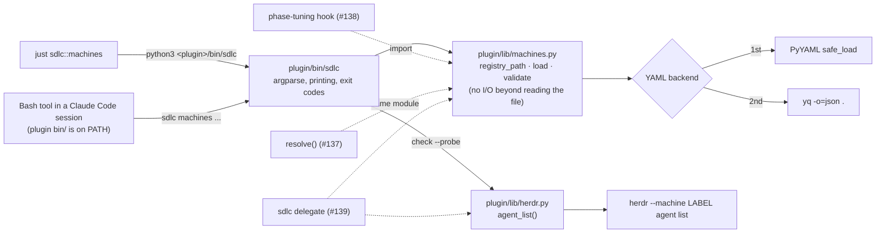

# Machine registry: schema, loader, `sdlc machines` list/check, example file

## Goal

Give sdlc a description of the boxes agents can run on. A per-person YAML registry at
`~/.config/sdlc/machines.yaml` (override `$SDLC_MACHINES`), a loader and validator in
`plugin/lib/machines.py`, and a CLI, `sdlc machines list|check [--probe]`, that shows and checks it.
The release also ships a neutral example file, a `just sdlc::machines` recipe, tests, a CHANGELOG
entry, a README section, and version 0.2.40.

Nothing is placed or started yet. With no registry file, the feature is off and every existing
project behaves exactly as before.

## Approach

### Layering, and where #137-#139 attach



- **`machines.py` is a pure library.** It has no `print`, no `sys.exit`, no subprocess at import
  time, and `import yaml` happens lazily inside `parse_yaml`. `load()` never raises on bad input:
  every problem becomes an `Issue`. The #138 hook will import it inside `phase-tuning.py`'s
  fail-open wrapper (`plugin/hooks/phase-tuning.py:18`, `:205-211`). It can then treat "any error
  issue" as "no hint", and the inert path costs one `stat`.
- **`herdr.py` is the thin adapter #139 asks for.** This issue adds only `agent_list()`. #139 adds
  tab/pane creation, `agent start`, `prompt` and `send-keys` next to it. Tests drive it through a
  fake `herdr` on `PATH`, the same technique #139 names.
- **`bin/sdlc` owns all output.** It has argparse subcommands with a dispatch per command, and
  `check` is built as a list of passes that each return `Issue`s. #137 appends a placement pass,
  and `machines where` and `delegate` become sibling subparsers.

### D1 finding: Claude Code does put a plugin's `bin/` on PATH (for the Bash tool only)

I checked this against the installed Claude Code **2.1.310** binary on 2026-10-25. On session start,
the shell setup (`pluginBinPaths`) takes every enabled, non-builtin plugin's `<plugin root>/bin` and
adds it to the PATH of the **Bash tool's** shell snapshot. It filters the list first:

- It keeps only paths that are a directory.
- It drops any path containing `:` `"` `'` `$` `` ` `` `\` or a newline. The log line is
  "Dropping plugin bin path with shell metacharacters".
- On `/reload-plugins` it rebuilds the snapshot if that set of paths changed. The log line is
  "Shell snapshot dropped on plugin refresh (plugin bin/ PATH entries changed)".

It works under `--plugin-dir ./plugin` (`just dev`) too, because the bin path is derived from the
loaded plugin's path. A probe copy of `plugin/` with `bin/sdlc` and `lib/machines.py` added passes
`claude plugin validate`, apart from the existing icon warning.

What this does **not** reach:
- a human's own terminal;
- hooks, which keep using `${CLAUDE_PLUGIN_ROOT}/...` and import the module directly;
- CI;
- a herdr agent on another box, unless the plugin is installed there;
- older CLIs. CI pins 2.1.226, which I haven't checked.

So D1's two routes both stay:
- Agents in a Claude Code session call `sdlc machines ...` bare.
- Humans and CI use `just sdlc::machines ...`, which runs `python3 <plugin>/bin/sdlc` by absolute
  path and so needs neither PATH nor the executable bit.

The bare call does need both of these, or it fails with "permission denied":
- `bin/sdlc` committed as mode **100755**;
- a `#!/usr/bin/env python3` shebang.

### Registry location (resolution order, first match wins)

1. `--registry PATH` on the CLI. Source is `flag`, and the file must exist.
2. `$SDLC_MACHINES`, if set and non-empty. Source is `env`, and the file must exist.
3. `${XDG_CONFIG_HOME:-~/.config}/sdlc/machines.yaml`. Source is `default`. If this file is absent,
   the registry is **inert**: it raises no issue, and `list` and `check` print a clear message and
   exit 0.

`~` is expanded in 1 and 2. An empty-string `XDG_CONFIG_HOME` is treated as unset. The existence
check runs **before** a YAML backend is chosen, so the inert case works on a box with neither
PyYAML nor yq.

### YAML (D2)

`parse_yaml(path)` works in three steps:
1. Try `yaml.safe_load` if `import yaml` succeeds.
2. Otherwise run `yq -o=json . <path>` and `json.loads` the output. This is the
   `plugin/scripts/sync-github.py:56-61` pattern, but captured rather than using `check=True`, so a
   failure becomes a message.
3. Otherwise raise `RegistryError("reading <path> needs PyYAML (pip install pyyaml) or yq (mikefarah v4) on PATH")`.

A non-zero exit from yq, or a PyYAML `YAMLError`, becomes `could not parse <path>: <first line>`.
`load()` turns every `RegistryError` into one error `Issue` with `where="registry"`.

Note the backend difference: PyYAML (YAML 1.1) reads unquoted `yes`/`no` as booleans, and yq does
not. Booleans must be real `true`/`false`, and the example file and README say so.

### Validation rules

The fields per machine are those in ADR-009 §1 plus D5. All of them are optional unless the table
says otherwise. An explicit `null` means "unset", and a `null` machine entry (`control:` with
nothing under it) reads as `{}`.

| Key | Type / values | Default | Errors (E) / warnings (W) |
|---|---|---|---|
| `transport` | `local`, or a map `{herdr: <label>, ssh: <target>}` | unset | E: missing on a machine that is assignable (only `assignable: false` may omit it). E: any string other than `local`, or a non-string/non-map value. E: map without a non-empty string `herdr`. E: `ssh` set but not a string. W: other keys inside the map. |
| `workdir` | string | unset | E: wrong type. W: a herdr machine without it (`sdlc delegate` will need it). |
| `limits` | map: `cores` int>0, `mem_gb` int/float>0, `browser_jobs` int>=0, `agents` int>=0 | all unset | E: not a map, wrong type, or out of range. W: unknown limit key. |
| `caps` | list of non-empty strings | `[]` | E: not a list, or a non-string item. Free-form vocabulary: projects name their own needs. |
| `keeps` | list of non-empty strings | `[]` | E: same as `caps`. |
| `secrets` | non-empty string | `none` | E: wrong type. A free-form level; #137 decides how levels compare. |
| `gaming_sensitive` | bool | `false` | E: wrong type. W: `true` with no `busy_flag` (nothing to check). |
| `busy_flag` (alias `gaming_flag`, D5) | string path, stored unexpanded | unset | E: wrong type. E: both keys set. W: set while `gaming_sensitive` is not `true` (it has no effect). |
| `backup` | bool | `false` | E: wrong type. |
| `persistence` | `durable` or `disposable` | unset | E: any other value. |
| `role` | string | unset | E: wrong type. |
| `assignable` | bool | **`true`** | E: wrong type. |
| `first_start` | list of `trust-prompt` and/or `fullscreen-notice` | `[]` | E: not a list, or an unknown gate name. #139 has to know how to clear each one. |

Booleans and numbers are strict:
- Only a Python `bool` passes as a boolean. `1` and `"true"` are errors.
- A `bool` never passes as a number. This needs an explicit check, because `isinstance(True, int)`
  is true in Python.

Registry-level rules:
- The top level must be a map containing a non-empty `machines` map. Otherwise it's an error.
- Other top-level keys produce a warning.
- Each machine name must be a string matching `^[A-Za-z0-9][A-Za-z0-9._-]*$`. Names reach herdr
  labels and CLI arguments, so anything else is an error.
- `any` and `auto` are reserved for placement (#137 `any`, #139 `--machine auto`). Either as a
  machine name is an error.
- An unknown machine key produces a warning with a did-you-mean suggestion
  (`difflib.get_close_matches` against the known keys plus the alias).
- **Exactly one `transport: local` machine.**
  - Zero is an error: "no machine has `transport: local`; mark the box you run Claude Code on".
  - Two or more is an error that names them.
  - The issue says "expected". I chose an error rather than a warning because the #137 resolver
    and the #138 hook both need one unambiguous "here".
- An invalid field still produces a `Machine`, with that field set to its default. That lets
  `list` show every entry, while `check` reports the error.

### CLI behaviour

`sdlc machines` with no subcommand runs `list`. Each leaf subcommand accepts `--registry` through
a shared argparse parent parser, so `sdlc machines check --registry X` works.

**`list`** prints `Registry: <path>`, then a fixed-width table. The columns are the issue's list,
in this order: NAME, TRANSPORT, ROLE, ASSIGNABLE, CAPS, KEEPS, SECRETS.
- Rows are in file order.
- TRANSPORT shows `local`, `herdr:<label>`, or `-`.
- ASSIGNABLE shows `yes` or `no`.
- Lists are joined with `,`, and an empty value shows as `-`. Only ASCII is used in the table.

If the registry loaded but has errors or warnings, the table is still printed. A note then goes to
stderr: `N errors, M warnings — run: sdlc machines check`.

`list` exits 0 when it could print a table or the inert message. It exits 1 when there was nothing
to show:
- the explicit path is missing;
- the file can't be parsed;
- there is no YAML backend;
- the top level is not a map with `machines`.

**`check`** prints `Registry: <path>`, then a one-line summary such as
`3 machines: 1 local, 1 herdr, 1 without transport`. After that comes one line per issue, as
`error    <where>: <message>` or `warning  <where>: <message>`. `<where>` is a dotted path, for
example `machines.worker-1.limits.cores` or `registry`.

The last line starts with `check: ok` or `check: failed` and carries the error and warning counts.
`check` exits 1 on any error, and warnings alone exit 0.

When the registry is inert, `check` prints the inert message and exits 0, per D4: existing
projects see no change.

**`check --probe [--timeout SECS]`** (default 15 s per machine) appends a probe pass.
- It probes every machine with herdr transport, one at a time, in file order, by calling
  `herdr.agent_list(label, timeout=...)`.
- On success it prints an info line:
  `probe    worker-1 (herdr:worker-1): reachable, 3 agents (limit 4)`. The limit part appears only
  when `limits.agents` is set, and ` — full` is appended when the count is at least the limit.
- A failure is an **error** issue at `machines.<name>.transport`:
  `herdr probe failed: <detail>`. The detail is the first line of herdr's stderr (for example
  "unknown machine 'x'"), `timed out after Ns`, or `unexpected output`.
- If `herdr` is not on PATH, the pass raises one error, `probe: herdr not found on PATH`.
- Local machines and machines without a transport are not probed.

A probe failure counts as an error because the user explicitly asked for the probe, and an
unknown herdr label is a configuration bug.

**The inert message**, shared by `list` and `check`:

```
No machine registry at <path>. Machines are off, so everything runs on this box.
To set one up: cp <plugin>/machines.example.yaml <path>   (or set $SDLC_MACHINES)
```

`<plugin>` is computed from `bin/sdlc`'s own resolved location, so the `cp` command is exact.

**Exit codes:**
- 0: OK, or inert.
- 1: an error was found (`check`), or `list` had nothing to show.
- 2: usage error (argparse's default).

**Entry-point details:**
- `bin/sdlc` sets `sys.dont_write_bytecode = True` before inserting
  `Path(__file__).resolve().parent.parent / "lib"` at `sys.path[0]` and importing `machines`.
  `resolve()` follows symlinks, so a `~/bin/sdlc` symlink still finds `lib/`. The bytecode
  setting keeps `__pycache__/` out of the plugin install directory; it is gitignored in this
  repo, but cache copies may be read-only.
- Target **Python ≥ 3.8**, because macOS system Python is 3.9:
  - use `from __future__ import annotations`;
  - no `match` statements;
  - no runtime `X | Y` unions;
  - `typing.Optional`, `Tuple` and so on wherever an annotation is evaluated.

## File-level plan

### Create

- **`plugin/lib/machines.py`** holds the registry model, path resolution, YAML backends and
  validation, with the surface given under Interfaces.
  - Keep the schema as **one data table** (key → type check, default, normalizer) rather than a
    chain of `if`s. #137 will read it, and unknown-key detection and did-you-mean come from it.
  - The module docstring states the hook-facing contract: no output, no exit, lazy `yaml` import,
    and `load()` never raises on bad input.
- **`plugin/lib/herdr.py`** holds `HerdrError`, `available()` and
  `agent_list(machine, *, timeout)`.
  - It wraps `subprocess.run(["herdr", "--machine", label, "agent", "list"], capture_output=True, text=True, timeout=timeout)`.
    With `machine=None` it omits `--machine`, which #139 needs for the local server.
  - It parses `json.loads(stdout)["result"]["agents"]`, which must be a list.
  - It raises `HerdrError(returncode, detail)` if `herdr` is missing, exits non-zero, times out
    (`subprocess.TimeoutExpired`), or prints output of the wrong shape.
  - Verified 2026-10-25 against herdr 0.9.5: `herdr --machine <label> agent list` prints
    `{"id":"cli:agent:list","result":{"agents":[...],"type":"agent_list"}}` and exits 0. An unknown
    label exits 2 with `Error: unknown machine '<label>'; use \`herdr machine list\``.
  - The docstring says #139 extends this module and that tests use a fake `herdr` on PATH.
- **`plugin/bin/sdlc`** is the CLI. It is committed as **mode 100755**: `chmod +x` before
  `git add`, then verify with `git ls-files -s plugin/bin/sdlc`.
  - The first line is `#!/usr/bin/env python3`.
  - It contains argparse with top-level subparsers (only `machines` for now) and a
    `machines {list,check}` group.
  - It holds the `list` and `check` handlers, the table formatter, and the inert message.
  - `main(argv=None) -> int` is wrapped in `sys.exit(main())`.
  - The module docstring lists the reserved future commands: `machines where` (#137) and
    `delegate` (#139).
- **`plugin/machines.example.yaml`** is the neutral example with three machines. It must contain no
  MapleLog names, hosts or IPs, and it doubles as the field reference, with a comment on each
  key. It must pass `check` with **0 errors and 0 warnings**. The intended content:

  ```yaml
  # sdlc machine registry. Copy to ~/.config/sdlc/machines.yaml, or point $SDLC_MACHINES at a file.
  # One per person, not per repo: the same boxes serve every repo.
  # A machine says what it CAN do (caps) and what it HOLDS (keeps, secrets). Placement (a later
  # release) matches a step's needs against both, trust boundary first, capacity second.
  # Booleans are true/false. Check the file with: sdlc machines check   (--probe asks herdr too)
  machines:
    workstation:                      # the box you run Claude Code on
      transport: local                # exactly one machine is local
      role: dev
      limits: { mem_gb: 32 }
      caps: [edit, test, browser]     # what work it can take
      keeps: [checkouts, services]    # what lives only here; steps that need it stay here
      secrets: dev                    # what credentials it holds (default: none)
      gaming_sensitive: true          # shares hardware with something heavy work must not starve
      busy_flag: ~/.config/sdlc/busy  # while this file exists, heavy steps aren't placed here
      backup: true
      persistence: durable

    worker-1:                         # a disposable box reached through herdr
      transport: { herdr: worker-1, ssh: agent@192.0.2.10 }   # herdr label from `herdr machine list`
      workdir: /home/agent/work       # where delegated agents start
      role: worker
      limits: { cores: 12, mem_gb: 16, browser_jobs: 3, agents: 4 }
      caps: [edit, test, browser, docker, full-suite]
      keeps: []
      secrets: none
      backup: false
      persistence: disposable         # push or lose
      first_start: [trust-prompt, fullscreen-notice]   # prompts a fresh Claude Code shows there

    control:                          # runs the infrastructure; never given work
      role: control-plane
      assignable: false               # nothing may be placed here, so it needs no transport
  ```

  `192.0.2.10` is from the RFC 5737 documentation range.
- **`plugin/lib/machines.test.sh`** is the test suite. It is plain bash plus python3 with no
  frameworks, in the style of `plugin/hooks/phase-tuning.test.sh`:
  - `ok`/`bad` counters (`:8-9`);
  - `TMP` with `trap` cleanup (`:12-13`);
  - a summary line `machines: N passed, M failed`;
  - an exit status from the fail count (`:114-115`).

  At the top it exports `HOME="$TMP/home"` and unsets `SDLC_MACHINES` and `XDG_CONFIG_HOME`, so the
  run can never read the real user's registry. Fixtures are inline heredocs. The cases are listed
  under Tests.

### Modify

- **`plugin/sdlc.justfile`** gets a new section between "Guided tours" (`:72-85`) and "Canvas
  reconciliation" (`:87`):

  ```
  # ─── Machines (where agents run) ─────────────────────────────────────

  # show the machine registry (~/.config/sdlc/machines.yaml or $SDLC_MACHINES); `check [--probe]` validates it
  [group('machines')]
  [positional-arguments]
  machines *args:
      @cd .. && python3 "${CLAUDE_PLUGIN_DIR:-$(dirname "$(realpath .claude/sdlc.justfile)")}/bin/sdlc" machines "$@"
  ```

  It uses `[positional-arguments]` with `"$@"` rather than the house habit of interpolating `args`
  into the line (as `tour` does at `:79-80`), so a quoted path survives. I verified this in a scratch `mod` with just 1.56: `check --registry "a b.yaml"`
  arrives as three arguments, and `cd ..` lands at the project root. The attribute predates the
  just 1.36 that CI pins.

  Don't add the recipe to `verify`. The registry is per person, CI has none, and `verify` is about
  repo invariants.
- **`plugin/.claude-plugin/plugin.json`**: `version` goes from 0.2.39 to **0.2.40**. Check it with
  `bash plugin/scripts/verify-version-bump.sh`.
- **`CHANGELOG.md`**: add a new top entry `## [0.2.40] — 2026-10-25`, above `:8`, headed
  `### Added — a machine registry and \`sdlc machines\``. In the house style, it gives a measured
  "why" first, then bullets. Points to make, all in generic words with no MapleLog names:
  - Everything sdlc spawns runs on the coordinator's box. A team with more than one box (a
    workstation plus a disposable worker, say) has had nowhere to record:
    - what each box can do;
    - what it holds;
    - which box must never be given work.
  - The registry is that record. There is one per person, because the same boxes serve every repo.
  - This release only describes and checks machines; placement comes later. With no file, nothing
    changes.
  - Bullets:
    - the file location and override;
    - `sdlc machines list|check --probe`;
    - `just sdlc::machines`;
    - the PATH finding (agents in Claude Code sessions get `sdlc` on PATH, while terminals use the
      just recipe);
    - PyYAML-or-yq.
- **`README.md`**:
  - Add a new `## Machines` section immediately before `## Agent governance — the workflow layer`
    (`:244`). Keep it short:
    - what a machine is (can do / holds / never assignable);
    - where the file lives and the `$SDLC_MACHINES` override;
    - `cp` the example;
    - `sdlc machines` / `just sdlc::machines` / `check --probe`;
    - the PATH note;
    - "without a registry nothing changes";
    - one line saying that placing phases on machines comes in a later release.
  - Extend the `plugin/` tree (`:258-277`) with three lines: `bin/` (the `sdlc` CLI), `lib/`
    (shared Python modules + tool installer), and `machines.example.yaml`.

## Interfaces

```python
# ── plugin/lib/machines.py ───────────────────────────────────────────────────
# stdlib only; PyYAML optional (imported lazily). Python >= 3.8.
# Contract for importers (CLI now, phase-tuning hook in #138): no stdout/stderr,
# no sys.exit, no import-time I/O; load() never raises on bad input.
from __future__ import annotations

REGISTRY_ENV = "SDLC_MACHINES"
DEFAULT_RELPATH = "sdlc/machines.yaml"                 # under ${XDG_CONFIG_HOME:-~/.config}
RESERVED_NAMES = frozenset({"any", "auto"})             # placement keywords (#137, #139)
FIRST_START_GATES = ("trust-prompt", "fullscreen-notice")
PERSISTENCE = ("durable", "disposable")
LIMIT_KEYS = ("cores", "mem_gb", "browser_jobs", "agents")
ALIASES = {"gaming_flag": "busy_flag"}                  # D5

class RegistryError(Exception): ...                     # raised by parse_yaml; load() converts it to an Issue

@dataclass(frozen=True)
class Issue:
    level: str                                          # "error" | "warning"
    where: str                                          # "machines.worker-1.limits.cores" | "registry"
    message: str

@dataclass(frozen=True)
class Transport:
    kind: str                                           # "local" | "herdr" | "none"
    herdr: Optional[str] = None                         # label for `herdr --machine <label>`
    ssh: Optional[str] = None                           # recorded only; GitHub is the return path
    def describe(self) -> str: ...                      # "local" | "herdr:<label>" | "-"

@dataclass(frozen=True)
class Limits:
    cores: Optional[int] = None
    mem_gb: Optional[float] = None
    browser_jobs: Optional[int] = None
    agents: Optional[int] = None

@dataclass(frozen=True)
class Machine:
    name: str
    transport: Transport
    workdir: Optional[str] = None
    limits: Limits = field(default_factory=Limits)
    caps: Tuple[str, ...] = ()
    keeps: Tuple[str, ...] = ()
    secrets: str = "none"
    gaming_sensitive: bool = False
    busy_flag: Optional[str] = None                     # raw; #139 expands + tests existence
    backup: bool = False
    persistence: Optional[str] = None
    role: Optional[str] = None
    assignable: bool = True
    first_start: Tuple[str, ...] = ()

    @property
    def is_local(self) -> bool: ...

@dataclass
class Registry:
    path: Path
    source: str                                         # "flag" | "env" | "default"
    exists: bool
    machines: Dict[str, Machine]                        # file order
    issues: List[Issue]

    @property
    def inert(self) -> bool: ...                        # source == "default" and not exists
    @property
    def errors(self) -> List[Issue]: ...
    @property
    def warnings(self) -> List[Issue]: ...
    @property
    def local(self) -> Optional[Machine]: ...           # the one transport: local machine, else None
    def get(self, name: str) -> Optional[Machine]: ...

def registry_path(explicit: Optional[str] = None,
                  env: Optional[Mapping[str, str]] = None) -> Tuple[Path, str]: ...
def parse_yaml(path: Path) -> object: ...               # PyYAML -> yq -> RegistryError
def validate(doc: object) -> Tuple[Dict[str, Machine], List[Issue]]: ...   # pure; no I/O
def load(explicit: Optional[str] = None,
         env: Optional[Mapping[str, str]] = None) -> Registry: ...

# #137 adds here (not now): placement reading from sdlc.yml, resolve(role, kind) -> Placement.

# ── plugin/lib/herdr.py ──────────────────────────────────────────────────────
class HerdrError(Exception):
    def __init__(self, detail: str, returncode: Optional[int] = None): ...

def available() -> bool: ...                            # shutil.which("herdr") is not None
def agent_list(machine: Optional[str] = None, *, timeout: float = 15.0) -> List[dict]: ...
# #139 adds here (not now): tab/pane create, agent start, prompt, send-keys, pane read.

# ── plugin/bin/sdlc (CLI grammar) ────────────────────────────────────────────
# sdlc machines [list]  [--registry PATH]
# sdlc machines check   [--registry PATH] [--probe] [--timeout SECS]      # default 15
# reserved, not built here:  sdlc machines where <role>  (#137) · sdlc delegate <role> ... (#139)
# exit: 0 ok/inert · 1 error found (check) or nothing to show (list) · 2 usage
def main(argv: Optional[List[str]] = None) -> int: ...
```

## Tests

All tests live in `plugin/lib/machines.test.sh`. Run it with `bash plugin/lib/machines.test.sh`;
it exits 0 only when every case passes. Most cases run the CLI as
`python3 plugin/bin/sdlc machines check --registry <fixture>` and assert two things:
- the exit code;
- a `<where>` substring in the output.

Loader-level facts are checked with
`PYTHONPATH=plugin/lib python3 -c 'import machines; ...'`.

**Backend matrix.** The valid-file case and a sample of the type-error cases run once per
available backend:
- **pyyaml**, if `python3 -c 'import yaml'` succeeds;
- **yq**, if `command -v yq` succeeds. PyYAML is forced off with a shadow package on
  `PYTHONPATH`: `$TMP/noyaml/yaml/__init__.py` containing `raise ImportError`.

A backend that isn't available prints a skip line and doesn't count as a failure. This approach
needs no test-only switch in the shipped code.

| # | Case | Expect |
|---|---|---|
| 1 | Valid: `plugin/machines.example.yaml` | `check` exits 0, prints `check: ok` with 0 warnings. `list` exits 0, and its rows include `workstation … local`, `worker-1 … herdr:worker-1`, and `control … - … no`. |
| 2 | One type error per field. Each fixture is a valid `local` machine plus one broken machine. Cases: `transport: 42`; `transport: ssh`; `transport: {herdr: box, ssh: 5}`; `workdir: [a]`; `limits: 3`; `limits.cores: twelve`; `limits.cores: 0`; `limits.mem_gb: -1`; `limits.browser_jobs: 1.5`; `limits.agents: true`; `caps: edit`; `caps: [1]`; `keeps: {a: b}`; `secrets: 3`; `gaming_sensitive: 1`; `busy_flag: 7`; `backup: "true"`; `persistence: ephemeral`; `role: [x]`; `assignable: "no"`; `first_start: trust-prompt`; `first_start: [trust-prompt, reboot]` | Each exits 1, and the output names the field's dotted `where` (e.g. `machines.box.limits.cores`). |
| 3 | Missing herdr label: `transport: {ssh: agent@192.0.2.10}` and `transport: {herdr: ""}` | Exit 1, `machines.box.transport` |
| 4 | Unknown keys: machine key `gpus: 2`, top-level `version: 1`, `limits.gpu: 1`, `transport.port: 22` | Exit 0. Each is a `warning` line naming its path. The `gpus` warning includes a did-you-mean suggestion. |
| 5 | Missing file at the default path (`HOME=$TMP/home`, nothing written) | `list` and `check` both exit 0 and print `No machine registry at`, along with a `cp …machines.example.yaml` hint. |
| 6 | Explicit path missing: `SDLC_MACHINES=$TMP/nope.yaml`, then `--registry $TMP/nope.yaml` | `check` exits 1 for both. `list` exits 1. |
| 7 | `XDG_CONFIG_HOME=$TMP/xdg` with the file at `$TMP/xdg/sdlc/machines.yaml` | That file is used (the `Registry:` line shows it). |
| 8 | `assignable` default: a machine without the key | Loader gives `True`, and `list` shows `yes`. |
| 9 | Transport-less machine: with `assignable: false` | No error. |
| 10 | Transport-less machine: assignable | Exit 1, `machines.box.transport` |
| 11 | No `local` machine; two `local` machines | Both exit 1. The two-local error names both machines. |
| 12 | Reserved names `any` and `auto`; a bad name such as `bad name` | Exit 1 |
| 13 | D5 alias: `gaming_flag: /x` | Loader gives `busy_flag == "/x"`. |
| 14 | D5 alias: `busy_flag` and `gaming_flag` both set | Exit 1 |
| 15 | D5 warnings: `busy_flag` with `gaming_sensitive` unset; `gaming_sensitive: true` with no flag | Exit 0 with warnings. |
| 16 | `workdir` missing on a herdr machine | Exit 0 with a warning. |
| 17 | Unparseable YAML (`machines: [`) | Exit 1, `could not parse` |
| 18 | Top level is a list; `machines: {}`; empty file | Each exits 1. |
| 19 | No YAML backend: shadow PyYAML plus `PATH=$TMP/pybin` (a dir holding only a `python3` symlink), with the file present | Exit 1. The message names PyYAML and yq. |
| 20 | No YAML backend, file absent | Inert, exit 0. |
| 21 | Probe, using a fake `herdr` in `$TMP/fakebin` on PATH. It answers `--machine worker-1 agent list` with `{"result":{"agents":[{},{}],"type":"agent_list"}}`, exits 2 with `Error: unknown machine` for other labels, and sleeps 5 for label `slow`. | Example file with `--probe`: exit 0 with `reachable, 2 agents (limit 4)`. A registry with an unknown label: exit 1 with `herdr probe failed`. Label `slow` with `--timeout 1`: exit 1 with `timed out`. `herdr` absent from PATH with `--probe`: exit 1 with `herdr not found`. |
| 22 | `plugin/bin/sdlc` is executable | `[ -x ]` passes. |

**Checks for the validator, run outside the test file:**
- `just sdlc::machines check --registry plugin/machines.example.yaml`, from the repo root, exits 0.
- `just sdlc::machines` with no registry prints the inert message and exits 0.
- `git ls-files -s plugin/bin/sdlc` shows `100755`.
- `grep -rniE 'maplelog|devbox|10\.88\.' plugin/bin plugin/lib/machines.py plugin/lib/herdr.py plugin/machines.example.yaml`
  finds nothing.
- `bash plugin/scripts/verify-version-bump.sh` reports 0.2.39 → 0.2.40.
- `just sdlc::verify` exits 0.
- `claude plugin validate ./plugin` passes. The icon warning is pre-existing.
- Optional live D1 check: in `just dev`, the Bash tool's `command -v sdlc` resolves to
  `…/plugin/bin/sdlc`.

## Out of scope

- Placement keys in `sdlc.yml`, `resolve()`, `machines where`, and the repo pass of `check`: #137.
- The phase-tuning remote hint: #138.
- `sdlc delegate`, picking by load, evaluating the busy flag, clearing first-start gates, and using
  `workdir`: #139.
- How `secrets` levels compare (#137).
- `--json` output.
- `sdlc --version`.
- Editing the registry from the CLI. It is hand-written.
- Wiring `*.test.sh` into CI. This matches the three existing hook tests; see Open questions.
- Installing anything on remote boxes, and anyone's real registry. ADR-009's own machines go in
  Doug's hand-written file, not in the repo.

## Open questions

All have defaults. None blocks implementation.

- **Zero or several `local` machines is an error, not a warning.** I chose this because #137 and
  #138 need one unambiguous "here". Downgrade it if a real setup needs a registry without a local
  box.
- **A `--probe` failure is an error (exit 1).** The alternative is to treat timeouts as warnings
  and keep "unknown label" as an error.
- **`workdir` on a herdr machine is a warning here.** #139 may promote it to an error once
  `delegate` depends on it.
- **`XDG_CONFIG_HOME` is honored.** That is a small generalization of the issue's
  `~/.config/sdlc/machines.yaml`, and it matches the statusline's use of `XDG_CACHE_HOME`.
- **CI:** should `bash plugin/lib/machines.test.sh` become a step in `.github/workflows/verify.yml`?
  The default is no, to stay consistent with the other `*.test.sh` files. A follow-up could wire
  all of them at once.

---

<!--
The sections below this divider are the **phase execution log**. They are
written by phase agents (reviewer, specifier, implementer, validator) as the
issue progresses through gates. The static spec sections above are the
current implementation contract; the phase sections below are how we got
here. See `instructions.yaml.phases` for ownership and gate mapping.

When `instructions.yaml.implementer_view` is `clean`, sections below this
divider are stripped before the implementer reads the spec.
-->

## Spec Review
<!-- written by: reviewer · gate 1.5 · /sdlc:critique · lens=mixed -->

**Target:** `.ai-docs/stacks/machines/specs/136.md` @ `e2e092b`
**Against:** issue #136 (+ #137-#139 for fit) · `plan.yaml` D1-D5 · ADR-009 §1 · cited code (`phase-tuning.py`, `phase-tuning.test.sh`, `sync-github.py`, `sdlc.justfile`, `verify-version-bump.sh`)
**Verdict:** REVISE

**Blockers (1):**
- [`§ Validation rules` ("An invalid field still produces a Machine, with that field set to its default") + `assignable` row] **The trust boundary fails open.** An invalid `assignable` loads as `True`, and `list` prints `yes` for it. That is a realistic typo, not a corner case. `assignable: no` reads as `False` under PyYAML but as the string `"no"` under yq (checked: yq v4.44.3 gives `"assignable": "no"`), so on a yq-only box the control plane loads as assignable. #137 and #139 build placement on this model, and neither says it refuses a registry with errors. That breaks ADR-009 §1 ("nothing is ever placed on an `assignable: false` machine") and D4 ("never to an `assignable: false` box"). `gaming_sensitive` has the same flaw: an invalid value becomes `False`, so heavy work is allowed on the shared box. · _Fix:_
  - Make the fallback restrictive, not the default:
    - invalid `assignable` → `False`;
    - invalid `gaming_sensitive` → `True`.
  - `list` marks an errored cell (for example `no!`) instead of printing a default.
  - The module docstring states that placement consumers (#137 `resolve`, #139 `delegate`) must not place on a machine whose entry has an error.
  - Tests:
    - extend case 2 so `assignable: "no"` asserts loader `False` and `list` `no`;
    - add `assignable: no` to the per-backend matrix.

**Notes (9):**
- [`§ YAML (D2)`] **The two backends disagree on the same file.** PyYAML (YAML 1.1) reads `yes`/`no`/`on`/`off` as booleans and yq doesn't. Checked: a machine named `on:` loads as key `True` under PyYAML and as `"on"` under yq. So `check` can pass on one box and fail on another. Telling users to write `true`/`false` doesn't remove the gap. A small `SafeLoader` subclass that only resolves `true`/`false` as booleans (YAML 1.2 core) makes the backends agree. Add a `backup: yes` case to the matrix.
- [`§ Approach` "pure library" · #138 fit] **The hook needs the loader to stay inside its time limit.** The phase-tuning hook times out after 5 s (`plugin/hooks/hooks.json`, phase-tuning entry), and `parse_yaml`'s yq call has no timeout. Give it one (about 2-3 s), so that `load()` returns an error `Issue` before the hook is killed. Separately, "any error → no hint" means one typo on an unrelated machine silences every hint. `Issue.where` already names the machine, so the docstring can tell consumers to tell registry-level errors apart from per-machine ones.
- [`§ Validation rules` `busy_flag` row · plan D5] **The spec reads D5 more narrowly than its text.** D5 (binding) says "`busy_flag: <path>`: when the file exists, heavy steps are not placed there", with no `gaming_sensitive` condition. The spec makes a `busy_flag` without `gaming_sensitive: true` a warning that "has no effect", which fails open: a user sets the path, forgets the boolean, and #139 ignores the flag. Prefer "`busy_flag` set ⇒ treated as `gaming_sensitive: true` unless it is explicitly `false`". Otherwise keep the AND, which #139's wording assumes, and say why it departs from D5.
- [`§ Registry-level rules` "Exactly one `transport: local`"] **Agree with the error, but document where the file lives.** `local` only means something on the box the file sits on, while the example header says "one per person". Suppose the file is copied to a worker that runs delegated agents with the plugin installed (ADR §5). It then names the wrong box as local, and #138 would tell an agent on `worker-1` to delegate to `worker-1`. The README and the example header should say the file lives on the coordinating box only. A worker with no file is inert, which is the right behaviour for a delegated agent.
- [`§ Validation rules` `secrets` row · #137] **`secrets` levels.** Here `secrets` is free-form, but #137 has to compare levels. If #137 later fixes a vocabulary, files that pass `check` today will start failing, and under #138's "error → no hint" the hints go quiet. Either fix an ordered vocabulary now (for example `none < dev < prod`, anything else an error), or have the example and README say the levels are provisional.
- [`§ Tests` backend matrix] **The no-backend case is unspecified.** With neither PyYAML nor yq, cases 1-4, 7-18 and 21 would fail rather than skip. Say which happens:
  - print one skip line and run only the cases that need no backend (5, 6, 19, 20, 22); or
  - fail with a single clear "needs PyYAML or yq" line.

  Either way there is no new hard dependency: yq is already used by `sync-github.py:56-61` and installed in CI. Nothing in the suite is timing-sensitive under `nice -n 19`; the only timer is the 1 s vs 5 s probe case.
- [`§ Tests` case 21, "`herdr` absent from PATH"] **The PATH setup can remove yq too.** On this box `herdr`, `yq` and `just` all live in `~/.local/bin`, so taking that directory off PATH removes yq as well. On a box with only yq, the case would then get "needs PyYAML or yq" instead of "herdr not found". Build the PATH from a fresh directory that holds `python3`, plus a `yq` symlink when yq exists, the same way case 19 does.
- [`§ Out of scope` CI · `§ Open questions` CI] **Wire this suite into CI.** `machines.py` and `herdr.py` are the shared base that #137, #138 and #139 all extend under `gate:auto`. `verify.yml` already installs yq (its "Install yq" step), the suite never touches the network or a real herdr, and so the step is one line with no new dependency. The precedent the spec cites is also miscounted: there are **four** `*.test.sh` files (driving-answer-stop, ensure-browser-agent, gate-guard, phase-tuning), not three, and CI runs none of them.
- [`§ Tests` "Checks for the validator", grep] **The genericity grep misses files.** It covers `plugin/bin`, `machines.py`, `herdr.py` and the example, but not `plugin/lib/machines.test.sh` or the README and CHANGELOG additions, which is where real names usually leak. Extend it to those files, and add `node2` to the pattern.

**Nits (8):**
- [`§ Interfaces` `HerdrError(detail, returncode=None)` vs `§ File-level plan` "`HerdrError(returncode, detail)`"] The argument order differs between the two sections. Keep the Interfaces form.
- [`§ File-level plan` herdr.py] herdr 0.9.5 actually prints a lowercase `error: unknown machine '<label>'; use \`herdr machine list\`` on stderr and exits 2 (checked). The fake herdr in case 21 should print the same text.
- [`§ CLI` `check --probe`] Raise "herdr not found on PATH" only when at least one machine uses herdr transport. Also, the probe's "reachable" lines are not `Issue`s (their only levels are error and warning), so "passes return `Issue`s" needs a way to carry info lines.
- [`§ Validation rules` `workdir` W] Limit the missing-`workdir` warning to *assignable* herdr machines. An unassignable box never receives a delegated agent.
- [`§ CLI` "no subcommand runs `list`"] With `--registry` only on the leaf parsers, `sdlc machines --registry X` is a usage error. Add the flag to the group parser too.
- [`§ Registry-level rules` name regex] The name pattern allows `.`, but `<where>` paths are dotted, so `machines.a.b.limits.cores` is ambiguous. Either drop `.` from the pattern or quote the name inside `where`. Optionally reserve `local` alongside `any`/`auto`.
- [`§ Tests`] Three small fixes:
  - resolve paths from `$0`, as `phase-tuning.test.sh:6` does, so the suite runs from any directory;
  - have the fake herdr `exec sleep 5`, so the killed process leaves no orphan;
  - give the case-2 `box` a valid herdr transport and assert exactly one error, so a stray missing-transport error can't satisfy the substring check.
- [`§ Modify` sdlc.justfile] Because the recipe runs `cd ..`, a relative `--registry` resolves against the project root, not the caller's directory. That is fine for the validator's check, but worth a line in the recipe comment.

**Specifier defaults:** I agree with all five as written:
- zero or several local machines is an error;
- a failed probe is an error, because the probe is opt-in and a script can gate on it;
- a missing `workdir` is a warning;
- `XDG_CONFIG_HOME` is honored (there is a closer precedent at `plugin/scripts/gh-attach-image.mjs:38`; the README must print `${XDG_CONFIG_HOME:-~/.config}`).

The one exception is CI, where I recommend wiring the suite in (see the notes).

**Verified:**
- Cited code: every cited line is correct (`phase-tuning.py:18,205-211`, `phase-tuning.test.sh:8-9,12-13,114-115`, `sync-github.py:56-61`, `sdlc.justfile:72-87`, `CHANGELOG.md:8`, `README.md:244,258-277`).
- D1: both log strings are in the Claude Code 2.1.310 binary.
- herdr: the `agent list` JSON shape is as described.
- just: `[positional-arguments]` with `"$@"` keeps `"a b.yaml"` as one argument inside a `mod`, and `cd ..` lands at the root.
- Install: the 100755 mode survives into the plugin cache.
- Environment: CI pins just 1.36 and Claude Code 2.1.226, `__pycache__/` is gitignored, and `claude plugin validate ./plugin` passes with warnings.
- Genericity: the plugin stays generic, and the example uses neutral names and an RFC 5737 address.
- Scope creep: none. `herdr.py`, `--registry`, `--timeout`, the reserved names and the `machine=None` call are small and justified by #136 and #139.

**Reviewed by:** reviewer agent · 2026-10-25T18:02:19Z

## Design Addendum
<!-- written by: specifier · in response to REVISE verdict on Spec Review -->
_No addendum required._

## Implementation notes
<!-- written by: implementer · gate 2 · /sdlc:develop -->
_Awaiting implementation._

## Diff Review — Adherence
<!-- written by: reviewer · gate 2.5 · /sdlc:review (lens=adherence) -->
_Awaiting adherence review._

## Diff Review — Quality
<!-- written by: reviewer · gate 2.5 · /sdlc:review (lens=quality) -->
_Awaiting quality review._

## Live Validate
<!-- written by: validator · gate 3 -->
_Awaiting validation._
