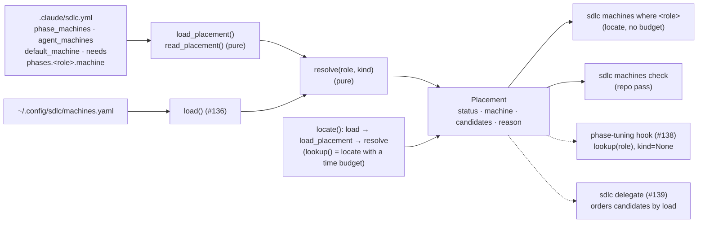
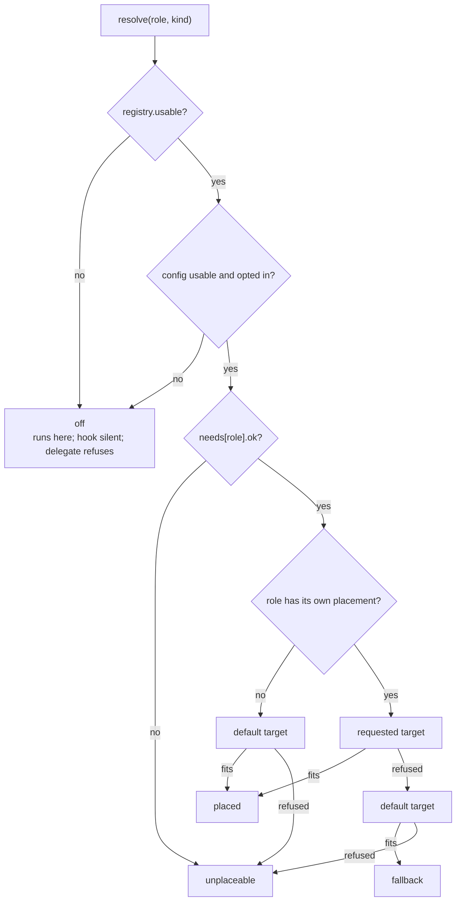

# Placement in sdlc.yml: phase_machines, agent_machines, default_machine, needs + resolver

## Goal

Let a repo say where each phase and agent runs, and answer "where does role R run?" from that
plus the person's registry (#136). This issue ships:
- four placement keys in `.claude/sdlc.yml` (`phase_machines`, `agent_machines`,
  `default_machine`, `needs`) plus the grouped `phases.<role>.machine`, documented as a commented
  block in `plugin/sdlc.example.yml`;
- a reader and a resolver in `plugin/lib/machines.py`: `resolve(role, kind) -> Placement`, and
  `lookup()`, the entry point the #138 hook imports;
- `sdlc machines where <role>`, and a repo pass in `sdlc machines check`;
- table-driven tests wired into CI, a CHANGELOG entry, README text, and version 0.2.41.

Nothing moves yet. The resolver only answers; the hint is #138 and starting work elsewhere is
#139.

**Placement applies only once a repo opts in,** by setting at least one target: `phase_machines`,
`agent_machines`, `default_machine` or a `phases.<role>.machine`. Without a registry, or with a readable
`sdlc.yml` that hasn't opted in, every role resolves `off` (it runs on this box) and `check`
reports no placement errors. That holds even when the local machine is `assignable: false`.

**Baseline.** This branch contains PR #140's **final head, 570c8d4**, which is ready for HQ to
merge. It was merged in rather than rebased: the branch was already pushed, and it must not be
force-pushed. The spec relies only on #136's **contract**, not its internals.

What this spec relies on:
- `load()` never raises. Every problem is an `Issue(level, where, message)`, including an empty
  explicit path and an `OSError` on the existence check.
- `Machine.ok` and `Machine.invalid` record problems per machine. A machine that isn't `ok` is
  never a placement target.
- `Registry.usable` requires the file to exist and parse, exactly one local machine, **and
  `local.ok`**. A top-level `machines:` key written twice loads no machines, so the registry is
  not usable. `Registry.local`, `Registry.get` and `Registry.machines` (file order) are as in
  #136's Interfaces.
- `secrets` levels are `SECRET_LEVELS = ("none", "dev", "prod")`, compared by index.
- `RESERVED_NAMES` contains `any`, `auto` and `local`, so no machine has those names.
- `parse_yaml(path)`, `RegistryError` and `YQ_TIMEOUT` work as #136 specifies. **Duplicate keys
  are reported, not rejected.** Under both backends `parse_yaml` keeps the last value and puts a
  `dups` tuple (the keys written more than once) on the mapping. Read it with
  `getattr(m, "dups", ())`. The module's `_has_dups(value)` finds a repeat at any depth.
  `validate(doc)` is pure.

**This spec adds one argument to #136's code:** an optional `timeout` on `parse_yaml` (`None`
keeps `YQ_TIMEOUT`), so that `lookup()` can stay inside its time budget.

## Approach

### Where this sits



- **Everything new goes in `machines.py`, under #136's module rules:** no output, no `sys.exit`,
  no I/O at import time, `yaml` imported lazily (through `parse_yaml`), and nothing raises on bad
  input. Every problem becomes an `Issue`, or a `Placement` whose `reason` says what went wrong.
  That is what lets #138 import it inside its fail-open wrapper
  (`plugin/hooks/phase-tuning.py:205-211`).
- **`resolve()` is pure.** It takes a `Registry` and a `PlacementConfig` and does no I/O, so the
  table-driven tests build both from Python dicts and need no YAML backend.
- **One helper, `locate()`, does the I/O in a fixed order:** registry first, then `sdlc.yml` only
  when the registry is usable, then `resolve`. `lookup()` is `locate()` with a time budget, for
  the hook. `where` calls `locate()` with no budget. Because they share the helper, `where` can't
  drift from what the hook sees.
- **`bin/sdlc` owns all output,** as in #136. `where` is a sibling of `list` and `check`. `check`
  gains a placement pass between the registry issues and the probe.

### The keys in `.claude/sdlc.yml`

ADR-009 §2 shape, plus the grouped form the issue asks for:

| Key | Shape | Meaning |
|---|---|---|
| `phase_machines` | map `<role>: <target>` | Where each phase runs. Same keys as `phase_models` (role names minus any `sdlc:` prefix). |
| `phases.<role>.machine` | `<target>` | Grouped form of the same thing. **Wins over `phase_machines.<role>`** when set (not null, not blank), as `model`/`effort` do in the hook (`phase-tuning.py:162-165`). |
| `agent_machines` | map `<agent>: <target>` | Where each non-phase agent runs (`browser-pilot`, `tour`, ...). |
| `default_machine` | `<target>` | Where a role with no placement runs, and where a refused placement falls back to, if it fits. Unset means `local`. |
| `needs` | map `<role>: <list>` or `<role>: {caps, keeps, secrets}` | What a role requires. A bare list is shorthand for `caps`. It filters **every** target, and it is how `any` is resolved. On its own it does not opt the repo in. |

**A `<target>` is one of three things:**
- a machine name from the person's registry;
- `local`, meaning the registry's `transport: local` machine. Repos can write
  `default_machine: local` without knowing what each person calls their own box. #136 already
  reserves the word, so no machine can be named `local`.
- `any`, meaning every machine that fits, with local first.

`auto` is reserved for #139's `--machine auto`. In `sdlc.yml` it is an error that suggests `any`.

**Opting in.** `PlacementConfig.opted_in` is true when the file, **as written**, sets at least one
target. That means a non-null, non-blank value, of any type, in one of these places:
- `phase_machines`, `agent_machines` or `default_machine` (a malformed block such as
  `phase_machines: [a]`, or a repeated one, counts: it is an attempt to place);
- any `phases.<role>.machine`.

**A repeat is judged on every copy, not the last.** The parser keeps the last value, which may be
blank. So the file opts in, and the repeat is an error, when a key is repeated *inside*
`phase_machines`, `agent_machines` or a `phases.<role>` map (`validator: worker-1` then a bare
`validator:`; `machine: worker-1` then `machine: null`), and when any copy of a repeated top-level
`phases` sets a `machine`. #137 records the earlier copies for this (`_Map.shadowed`). A repeated
`phases` with no `machine` in any copy, and a repeated `needs`, do not opt in.

`needs` alone does not opt in. Not opted in means:
- every role resolves `off`, with `off_cause` `no-placement`;
- `config.issues` holds at most one **warning**, at `sdlc.yml.needs` when `needs` is present:
  "needs has no effect until something is placed (set phase_machines, agent_machines,
  default_machine or phases.<role>.machine)";
- nothing about `needs` or `phases` is an **error** or a `broken` config: not its shape, not a
  repeat, not a prefixed key. But the **facts are still recorded**: `Needs.invalid` is set for a
  repeated or malformed role, and `PlacementConfig.needs_broken` is set for a repeated or malformed
  top-level `needs`, whether or not the file opted in. Only the `Issue`s are withheld. A consumer
  outside `resolve()` (#139's `--machine`) can then still fail closed on a dropped requirement;
- **file-level** problems are still errors and still make the config `broken`: unreadable,
  unparseable, or top level not a map. A file that can't be read can't show whether it opted in.

`read_placement` parses every block either way and records `Needs.invalid` and `needs_broken`
either way; it reports issues only once the file opts in. Block-level and per-entry problems below apply to an opted-in file.

### Reading rules (`read_placement`)

It is pure and takes the parsed document.

**Role keys are normalised.** In all four role-keyed blocks (`phase_machines`, `agent_machines`,
`needs`, `phases`), a key is read as `key.rsplit(":", 1)[-1].strip()`, the same way `resolve()`
and the hook strip the role they're given (`phase-tuning.py:134-135`).
- A key that changed (`sdlc:validator` → `validator`) gets a **warning** at its path: "role keys
  are written without the plugin prefix: 'sdlc:validator' is read as 'validator'".
- Two keys in one block that normalise to the same role count as a **duplicate** (below).
- Users copy the prefixed form from `subagent_type`. Without this, `sdlc:validator: {keeps: [...]}`
  would never bind, which is the same quiet loss as a misspelt `cap:`.

**Blanks:**
- A `null` block reads as `{}`.
- A `null` or blank (empty or whitespace) target means "no placement". The role goes to the
  default target, which is still filtered, so a blank target can't bypass trust.
- A `null` or blank `phases.<role>.machine` is unset, so `phase_machines.<role>` applies.
- **Inside `needs`, a blank is an error:** a `null` role value, a `null`
  `caps`/`keeps`/`secrets`, or an empty-string item. Every `needs` value is a requirement, and a
  blank one would quietly drop it. #140 applies the same rule to blank trust keys.

**Duplicates.** `parse_yaml` keeps the last value and records the repeat in `dups`. A repeat of a
key placement owns must never silently win, so `read_placement` checks `dups` on every mapping it
reads:

| Repeated | Level and where | Effect |
|---|---|---|
| a top-level `phase_machines`, `agent_machines`, `default_machine`, `needs` or `phases` | error at `sdlc.yml.<key>`: "written more than once" | `broken`: every role resolves `off` (`sdlc-errors`) |
| a role under `needs` (including a collision after normalising) | error at `sdlc.yml.needs.<role>` | the role is **unplaceable** (`Needs.invalid` gets `entry`) |
| a key at any depth inside one role's `needs` value (`_has_dups`) | error at `sdlc.yml.needs.<role>.<key>` | the role is **unplaceable** (`Needs.invalid` gets the key) |
| a role under `phase_machines` or `agent_machines`; a role under `phases`; a `machine` key under `phases.<role>` | error at that path | `Requested.error` = "written more than once", so the role **falls back** |

A repeated `phases.<role>` sets `Requested.error` **even when neither copy has `machine`**, so a
repeat that only tunes (`{model: opus}`, then `{effort: high}`) overrides a flat
`phase_machines.<role>` and the role falls back. That fails closed on purpose: the copy the parser
dropped may have set `machine`, and the reader can't tell. It does not contradict the next
sentence, which is about a repeated *knob* inside one `phases.<role>` map. The mirror case is silent
but safe: in a file with no other target, a repeated top-level `phases` that hides a `machine`
resolves `off`.

Repeats in keys placement doesn't own (`phase_models`, `develop_team`, a repeated `model` under
`phases.<role>`, ...) are ignored. A stray typo elsewhere in `sdlc.yml` therefore can't turn
placement off.

**The other keys of `phases.<role>`** (`model`, `effort`, ...) belong to the hook and are ignored
here, as is a `phases.<role>` that isn't a map. The hook ignores those too. Values quoted in
messages are bounded with `reprlib.repr`.

**Problems and their effect:**

| Problem | Level and where | Effect |
|---|---|---|
| explicit file missing; unreadable; an `OSError` on the path; unparseable; no YAML backend; yq timeout | error at `sdlc.yml` | `broken`: config not usable → every role resolves `off` |
| top level is not a map (an empty file reads as `{}`, not an error) | error at `sdlc.yml` | `broken` |
| `phase_machines`, `agent_machines`, `needs` or `phases` present but not a map; a repeated top-level placement key | error at `sdlc.yml.<key>` | `broken` |
| a role key that is not a non-empty string | error at `sdlc.yml.<block>` | that entry is skipped |
| a target that is not a string, or is `auto` | error at its own path, e.g. `sdlc.yml.phases.validator.machine` | `Requested.error` is set; at resolution that target is refused, so the role falls back |
| `default_machine` that is not a string, or is `auto` | error at `sdlc.yml.default_machine` | treated as unset (`local`) |
| `needs.<role>` that is `null`, or neither a list nor a map; a list item or `caps`/`keeps` item that is not a non-empty string; a `null` `caps`/`keeps`/`secrets`; `secrets` not in `SECRET_LEVELS`; a key other than `caps`/`keeps`/`secrets` (did-you-mean folds case and `-`/`_`, so `Caps:` suggests `caps`); a repeat | error at `sdlc.yml.needs.<role>[.<key>]` | `Needs.invalid` gets the key (`entry` for the whole value). The role is **unplaceable** |
| `phases.<role>.machine` and `phase_machines.<role>` both set and different | warning at `sdlc.yml.phase_machines.<role>`: "overridden by phases.<role>.machine ('worker-1')" | grouped wins |
| a role in both the phase maps and `agent_machines`, with different targets | error at `sdlc.yml.agent_machines.<role>` | with no `kind`, resolution uses the phase entry; `roles()` lists the role once, as a phase |
| a prefixed role key | warning at its path | read without the prefix |

**The value rules are the registry's:**
- `caps` and `keeps` are lists of non-empty strings;
- `secrets` is one of `SECRET_LEVELS`.

Reuse #136's checkers for these, since they survive on 570c8d4. The behaviour is what's specified
here, not the helper names.

Unknown keys inside a `needs` map are errors, not #136-style warnings, because every `needs` key
is a requirement: dropping a misspelt `cap:` would quietly place a browser step on a box with no
browser. This is the same fail-closed reasoning as #136's near-miss rule.

**Unknown machine names are not judged by the reader,** which never sees the registry. They are
judged at resolution and reported by the repo pass.

### Where `sdlc.yml` is found (`sdlc_path`), first match wins

1. **`--config FILE`** on the CLI. Source is `flag`, and the file must exist (a missing file is an
   error and leaves the config `broken`).
2. **`project_dir=` argument**, looked up as `<dir>/.claude/sdlc.yml`. #138 passes this. Source
   is `project`.
3. **`$CLAUDE_PROJECT_DIR`**, if set and non-empty, looked up the same way. Source is `env`.
4. **Walk up from the current directory.** The first `<D>/.claude/sdlc.yml` that is a file wins.
   The walk stops after a directory that contains `.git` (a directory, or a worktree's `.git`
   file), or at `/`. Source is `search`.

If 2 or 3 names a directory with no `sdlc.yml`, the search stops there and does not walk up. That
matches the hook, which looks only at `$CLAUDE_PROJECT_DIR` or the event's `cwd`
(`phase-tuning.py:139-142`), so `where` explains what the hook will see. No file found means
source `none`, `path` `None`, and a usable config that hasn't opted in: every role is `off`.

**Nothing here may raise.** #140 hardened `load()` against these cases. #137 adds more filesystem
checks of the same kind, so each one is guarded:
- **Every `is_file()`/`exists()` call goes inside `try/except (OSError, ValueError)`.** A path
  that is too long, or a directory that can't be searched, raises rather than returning `False`.
  - On `--config`, a `project_dir`, or `$CLAUDE_PROJECT_DIR`: an error `Issue` at `sdlc.yml`, and
    the config is `broken`.
  - On the walk-up: it ends the walk as "none found".
- **An empty explicit path is an error.**
  - In the library, `load_placement("")` returns a broken config: "--config was given an empty
    path". Test `explicit is not None`.
  - On the CLI, `--config ""` is a usage error (exit 2) from a `_config_arg` type, the way #140's
    `_path_arg` handles `--registry`, with its own message: "--config needs a path, got an empty
    value".
- **A last `except Exception`** around the parse and read in `load_placement`, and around the
  whole of `locate`, turns any future bug into a broken config (`off`, `sdlc-errors`), with the
  exception type in the message.

### Resolution: `resolve(role, kind=None, *, registry, config)`

The role's namespace is stripped first (`sdlc:validator` → `validator`).



1. **Off.** The status is `off` in four cases. Each has its own `off_cause` and `reason`:

   | `off_cause` | When | `reason` |
   |---|---|---|
   | `no-registry` | the registry is inert | `machines are off: no machine registry at <path>` |
   | `registry-errors` | the registry exists but is not usable (#136 rule 1) | `machines are off: the registry has errors (<first error message>)` |
   | `sdlc-errors` | the config is `broken` | `machines are off: sdlc.yml has errors (<first error message>)` |
   | `no-placement` | the config is usable but not opted in | `machines are off: sdlc.yml places nothing` |

   `lookup()` adds a fifth, `time-budget` (rule 7).
2. **Kind and the requested target.**
   - `kind="phase"` reads only `phases.<role>.machine`, then `phase_machines.<role>`.
   - `kind="agent"` reads only `agent_machines.<role>`.
   - `kind=None` reads the phase maps, then `agent_machines`. The kind is whichever map named the
     role, or `None` (shown as "unplaced") if neither did.
   - **#138 calls `lookup(role)` with `kind=None`,** because a hook can't tell a phase from an
     agent. So a grouped `phases.browser-pilot.machine` places an agent too, as kind `phase`.
3. **Needs.** `config.needs.get(role, Needs())`. If it isn't `ok`, the status is `unplaceable`
   with the reason `needs.<role> has errors in: <keys, sorted>`, and no target is tried. **A role
   that has needs but no placement is not `any`:** it goes to the default target like any other
   unplaced role.
4. **The target chain** is the requested target (if any), then the **default target**:
   - The default target is `default_machine` if it is valid and usable as a default: `any`,
     `local`, or a registered machine that is `ok` and `assignable`.
   - Otherwise the default target is `local`. An unknown, invalid, unassignable or not-`ok`
     `default_machine` is reported once by the repo pass and then treated as unset. **`local` is
     still filtered in full:** standing in for a bad default never skips the fit.
   - If the default target is the same single machine as a refused requested target, it is not
     tried again.
   - There is no third link. A default target that doesn't fit the role's needs leaves the role
     `unplaceable`, and the resolver does not quietly fall through to some other box.
     `default_machine: any` is the repo opting in to "wherever it fits", not a third link.
5. **Evaluating one target:**
   - `Requested.error` set → refused with that message.
   - a name → `registry.get(name)`. If it's missing, refused with
     `'<name>' is not in the registry`, plus `; did you mean '<x>'?` when
     `difflib.get_close_matches` finds a registered name. Otherwise run `unfit_reason`.
   - `local` → `registry.local`, then `unfit_reason`.
   - `any` → every registered machine that `unfit_reason` passes, with the **local machine first**
     and the rest in registry file order. An empty result is refused with
     `no machine fits: <machine>: <why>; ...`.
     **Load ordering, busy flags and `limits` are not the resolver's job**; they belong to
     `delegate` (#139).
6. **Result.**
   - The first target that yields at least one machine wins. `machine` is its first candidate.
   - The status is `placed` when that target was the role's own (or the role had none and the
     default fit), and `fallback` when the role's own target was refused and the default fit.
   - If nothing fits, the status is `unplaceable`, `machine` is `None`, and the reason names every
     refusal.

**`rejected`** holds one entry per refusal, in the order tried:
- **Keyed by the machine name** whenever a specific machine was judged. That includes every
  machine `any` turned down, even when `any` placed the role, and the machine `local` stood for.
- **Keyed by the target as written** only when the target was refused before any machine was
  judged: an invalid value, or an unknown name.

`where` prints one `refused:` line per entry.

**Hard filters, in order (`unfit_reason(machine, needs)`).** It returns `None` when the machine
fits, else the first failure. Within a filter, every missing item is listed, in `needs` order.

| # | Filter | Refusal text (tests match these substrings) |
|---|---|---|
| 1 | `machine.ok` (#136 rule 2) | `machine '<m>' has registry errors in: <Machine.invalid, sorted, ", ">` |
| 2 | `machine.assignable` | `machine '<m>' is not assignable` |
| 3 | `caps` ⊇ `needs.caps` | `machine '<m>' lacks caps: <missing>` |
| 4 | `keeps` ⊇ `needs.keeps` | `machine '<m>' lacks keeps: <missing>` |
| 5 | `SECRET_LEVELS.index(machine.secrets) >= SECRET_LEVELS.index(needs.secrets)` | `machine '<m>' holds secrets '<have>', needs '<need>'` |

Filter 1 comes before the issue's "assignable never" filter only so the reason is exact: an
invalid `assignable` already loads as `False` (#136 rule 3), so the order changes no outcome.

`needs.secrets` is a **floor**: a step that needs `dev` credentials may run where `dev` or `prod`
is held. So `any`, or `default_machine: any`, can choose a box that holds `prod` for a role that
needs no secrets. The README advises marking such a box `assignable: false` unless that is
wanted.

A machine without a transport is always caught by filter 1 or 2, because #136 makes a missing
transport an error unless `assignable: false`.

**`Placement` fields and statuses:**

| Status | `machine` | `local` | Consumers |
|---|---|---|---|
| `off` | `None` | `True` | The hook adds no hint. `delegate` refuses with `reason`. `where` exits 0 for `no-registry` and `no-placement`, and 1 for the error causes. |
| `placed` | first candidate | `machine == registry.local.name` | The hook hints only when `not local` (#138). `delegate` orders `candidates` by load. |
| `fallback` | first candidate of the default target | as above | As `placed`, but `reason` says what was refused. `check` reports an error, and `where` exits 1. |
| `unplaceable` | `None` | `False` | `delegate` refuses. #138 chooses its own text. `check` reports an error, and `where` exits 1. |

D4 calls the fallback "a warning". The issue makes it an error in `check`, and that is the one
followed here. At runtime the role still resolves, and `reason` is the warning text.

**Reason texts** (one line, plain text with no markup, because the #138 hint copies them; tests
match the phrases):
- placed, own target: `<at> places <role> on '<m>'`; for `any`: `<at> places <role> on any: <n>
  machines fit` (1 → "1 machine fits")
- placed, default:
  - `<role> has no placement; default_machine '<m>'`;
  - `<role> has no placement; runs on this box ('<local>')` when `default_machine` is unset;
  - `<role> has no placement; default_machine '<d>' is not usable (<why>); runs on this box
    ('<local>')` when a bad default was replaced. A rejected value is shown as written, bounded.
- fallback: `<at> '<value>' was refused (<why>); using default_machine '<m>' | this box
  ('<local>')`. When a bad default was replaced: `...; default_machine '<d>' is not usable;
  using this box ('<local>')`.
- unplaceable: `<role> has nowhere to run: <why for each target tried, "; ">`. It names the
  refusals only, so a replaced `default_machine` is **not** named here (`check` reports it once at
  `sdlc.yml.default_machine`); `rejected` holds the same entries (A39). **A machine is judged once
  per role.** When the own target refused it, a later target does not judge it again, so `any`
  followed by a default of `any` or `local` neither repeats `rejected` entries nor repeats the
  reason (A10, A10b, A41).

### Consumer contract additions (module docstring rules 6-9)

These are appended to #136's rules 1-5 in the `machines.py` docstring:

6. **Placement never raises and prints nothing.** `resolve()` and `lookup()` return a `Placement`
   for any `str` role, even an empty one; `locate()` returns a tuple whose first element is that
   `Placement`. `status` is one of `off`, `placed`,
   `fallback` or `unplaceable`, and `off_cause` says why a placement is `off`. Only `placed` and
   `fallback` carry a `machine`.
7. **`lookup()` time bound.** Its file reads finish within `LOOKUP_BUDGET` (2.5 s):
   - With no registry file it costs one `stat`, and `sdlc.yml` is never opened.
   - The registry parse is bounded by `YQ_TIMEOUT` (2 s). If it fails or times out, the registry
     isn't usable, the result is `off`, and nothing more is read.
   - If the registry parse took `SDLC_SKIP_AFTER` (1.0 s) or longer, `sdlc.yml` is not read. The
     result is `off` with `off_cause` `time-budget` and the reason `machines are off: time budget
     spent reading the registry (<t>s); sdlc.yml not read`.
   - Otherwise `sdlc.yml` is parsed with `timeout = min(YQ_TIMEOUT, LOOKUP_BUDGET - elapsed)`.
   - With interpreter start-up and imports, the worst case is about 3 s inside the hook's 5 s
     (`hooks.json:161`). PyYAML parses in-process and is not subject to the timeout. The hook must
     still call `lookup()` inside its try/except. `where` uses `locate()` with no budget.
8. **The resolver judges trust and fit only.** Load (`limits`, the `herdr agent list` counts), busy
   flags and `gaming_sensitive` belong to `delegate` (#139). `candidates` is fit-ordered, never
   load-ordered.
9. **Duplicate placement keys never silently win** (see Reading rules). Repeats outside the keys
   placement owns are ignored. `Needs.invalid` and `PlacementConfig.needs_broken` are recorded
   whether or not the file opted in. **A consumer that reads `config.needs` outside `resolve()`
   (#139's `--machine`) must refuse when `not config.usable`, when `config.needs_broken` is set, or
   when `not needs.ok` for the role.**

`Issue.where` (rule 5) gains a third family: `sdlc.yml` (file-level) and
`sdlc.yml.<key>[.<role>[.<sub>]]` (one entry).

### CLI

**`sdlc machines where <role> [--kind phase|agent] [--registry PATH] [--config FILE]`** prints the
resolution. The first line is the answer, so `| head -1` works. Only ASCII is used.

```
validator: worker-1
  kind:        phase
  placement:   worker-1 (phases.validator.machine)
  needs:       caps full-suite, browser
  candidates:  worker-1
  reason:      phases.validator.machine places validator on 'worker-1'
  registry:    /home/me/.config/sdlc/machines.yaml
  sdlc.yml:    /repo/.claude/sdlc.yml
```

- **First line:**
  - `<role>: <machine>`, with ` (local)` added when the machine is local, and `, fallback`
    added for a fallback;
  - `<role>: nowhere` when unplaceable;
  - `<role>: this box (machines are off)` when off.
- **Detail lines:**
  - `kind` is `phase`, `agent` or `unplaced`.
  - `placement` is `<value> (<at>)`, or `none (default target)`.
  - `needs` is `caps ...; keeps ...; secrets <lvl>`, leaving out empty parts and `secrets none`;
    it reads `-` when there are none.
  - `candidates` appears only when `machine` is set. For `any` it also carries
    `   (local first; sdlc delegate picks by load)`.
  - Each `rejected` entry gets its own line, `  refused:     <key>: <why>`.
  - `reason`, `registry` and `sdlc.yml` always appear. The `sdlc.yml` value is a path, `none found`
    when it was looked for and absent, or `not read (the registry is not usable)` when the registry
    stopped the read (`locate()` returned no config), so it never says "none found" for a file it
    did not look at. When the status
    is `off`, only `reason`, `registry` and `sdlc.yml` follow the first line.
- **Exit codes:**

  | Exit | When |
  |---|---|
  | 0 | `placed`; `off` because there is no registry (`no-registry`); `off` because the repo places nothing (`no-placement`) |
  | 1 | `fallback`; `unplaceable`; `off` caused by an error (`registry-errors`: a broken registry or a missing `--registry`; `sdlc-errors`: a broken or missing `--config`, or an unparseable `sdlc.yml`) |
  | 2 | usage error, including `--registry ""`, `--config ""`, and an empty role (`where ""`, `where sdlc:`) |

  Every error that `where` actually sees exits non-zero. `sdlc.yml` is not read without a usable
  registry (D4), so with an inert registry a missing `--config` file still exits 0 (`no-registry`),
  and `check` prints the inert message.
- `where` calls `machines.locate(..., budget=None)`, which returns the `Placement` together with
  the `Registry` and the `PlacementConfig`, so that it can print both paths.

**`sdlc machines check [--config FILE]` gains the repo pass.** The output order is fixed:
1. `Registry: <path>`
2. the summary line
3. the registry issues
4. the `Placement:` line
5. the placement issues
6. the probe issues, when `--probe` is given
7. the `check:` result line

0.2.40 appended the probe issues to the registry issues. They now print after the placement pass.

What the placement pass prints depends on the registry:
- **Inert:** output is byte-identical to 0.2.40. `sdlc.yml` is not read. D4 says existing
  projects see no change, and the inert message already says everything runs on this box.
- **Exists but isn't usable:** `Placement: not checked (the registry is not usable)`, and
  `sdlc.yml` is not read. The exit status is already 1 from the registry errors.
- **Usable:** `Placement: <path>`, or `Placement: none (no .claude/sdlc.yml found)`, with
  ` (places nothing; everything runs on this box)` added when the file hasn't opted in. Then
  `placement_issues(registry, config)` adds:
  - **always:** every `config.issues` entry;
  - **only when opted in:**
    - **Default-target checks**, as one error at `sdlc.yml.default_machine`:
      - a `default_machine` that is unknown, not `ok`, or not assignable gets `...; unplaced roles
        run on this box ('<local>') instead`;
      - the effective default target is the local machine (`default_machine` unset, unusable, or
        written `local`) and that machine is `assignable: false`: `no usable default_machine and
        the local machine '<m>' is not assignable, so unplaced roles have nowhere to run`, or for
        an explicit `default_machine: local`, `default_machine 'local' is the local machine '<m>',
        which is not assignable, ...`. When an unusable name is also replaced by that locked box,
        both facts go into the one error.
    - **One line per role the file names** (`config.roles()`, each role once): phase roles in
      file order, then agent roles, then roles named only in `needs`. Each is reported at its
      requested path, or at `sdlc.yml.needs.<role>` for a needs-only role:
      - `placed` → `info`: `<role> -> <m>`. For `any`: `<role> -> any: <c1>, <c2>`. For the
        default: `<role> -> <m> (default)`.
      - `fallback` or `unplaceable` → `error` with the reason. **But if the role's own entry
        already has a value error** (`Requested.error`, or `needs` not `ok`), the line is `info`.
        One fault gives one error.
  - **When not opted in:** `config.issues` holds at most the "needs has no effect" warning (see
    "Opting in"). A file-level error still makes the config `broken`.
  - **When the config is broken:** just its file- or block-level errors (those at `sdlc.yml` or
    `sdlc.yml.<key>` for a placement key), and no role lines and no per-entry errors.

**Flags.**
- `--config FILE` is accepted on the `machines` group parser and on the `check` and `where`
  leaves. It uses `type=_config_arg` (empty → exit 2).
- On the leaves it uses `default=argparse.SUPPRESS`, the pattern #136 uses for the leaf
  `--registry`, so a group flag survives and a leaf flag wins.
- `where` also takes `--registry` the same way, with #140's `_path_arg`.

## File-level plan

### Create

- **`plugin/lib/placement.test.sh`** is the placement suite. It follows `machines.test.sh`'s
  conventions:
  - paths resolved from `$0`;
  - `ok`/`bad` counters, and `TMP` with a `trap` cleanup;
  - `export HOME="$TMP/home"`, with `SDLC_MACHINES`, `XDG_CONFIG_HOME` and `CLAUDE_PROJECT_DIR`
    unset;
  - `PYTHONDONTWRITEBYTECODE=1`;
  - the same backend detection, `noyaml` shadow package and fresh PATH directories;
  - **`SDLC_REQUIRE_BOTH_BACKENDS=1` honoured** with the same two `required backend present`
    assertions as `machines.test.sh:52-55`;
  - a summary line `placement: N passed, M failed`, and an exit status taken from the fail count.

  It has two parts:
  - **Part A, the table.** One `python3 - <<'PY'` heredoc holds a list of rows. Each row is a
    name, a registry dict, an `sdlc.yml` dict, a role, a kind and the expected fields.
    - It builds the registry from #136's public surface: the pure `validate(doc)` plus the
      `Registry` dataclass, `Registry(Path("<fixture>"), "flag", True, *machines.validate(reg))`.
    - It builds the config with `machines.read_placement(cfg)` and calls `resolve`.
    - **It prints `rows: <N>` first,** then `ok: <name>` or
      `FAIL: <name>: <field> expected <x> got <y>` for each row.
    - **Bash checks the heredoc's exit status, and that the `ok:` count equals `N`.** A crash
      partway through is then a failure, not a short pass.
    - It needs **no YAML backend**, so it always runs. The cases are listed under Tests.
  - **Part B, YAML and the CLI.** Cases marked [both] run once per available backend. With no
    backend, Part B prints one `skip:` line, which is a failure under `SDLC_REQUIRE_BOTH_BACKENDS`.

### Modify

- **`plugin/lib/machines.py`** adds the surface under Interfaces, after `load()`:
  - **Constants:** `SDLC_RELPATH`, `PROJECT_ENV`, `KINDS`, `PLACEMENT_KEYWORDS`, `NEEDS_KEYS`,
    `PLACEMENT_KEYS`, `YQ_MIN_TIMEOUT`, `LOOKUP_BUDGET`, `SDLC_SKIP_AFTER`.
  - **Dataclasses:** `Needs`, `Requested`, `PlacementConfig`, `Placement`.
  - **Functions:** `sdlc_path`, `read_placement`, `load_placement`, `unfit_reason`, `resolve`,
    `placement_issues`, `locate`, `lookup`.
  - **`parse_yaml`** gains `timeout: Optional[float] = None` (`None` → `YQ_TIMEOUT`), used only on
    the yq path. The message reports the timeout actually used. No other #136 code changes.
  - **Docstring:** add rules 6-9 and the `sdlc.yml` `where` family.
  - **Constraints:**
    - Python ≥ 3.8 and stdlib only.
    - `load_placement` turns `RegistryError` into an `Issue` at `sdlc.yml`.
    - The duplicate checks read `dups` with `getattr(..., "dups", ())` and use `_has_dups` for
      nested repeats. They never import `_Map`.
    - Filesystem checks are guarded with `OSError`/`ValueError`, and `load_placement` and `locate`
      each end with a last `except Exception`.
    - Nothing new runs at import time.
- **`plugin/bin/sdlc`:**
  - add `_config_arg` (empty → `ArgumentTypeError("--config needs a path, got an empty value")`),
    `cmd_where`, and a `_print_where(placement, reg, cfg)` formatter;
  - add `--config FILE` to the `machines` group, to `check` and to `where` (SUPPRESS on the
    leaves), `--registry` (with `_path_arg`) to `where`, and `--kind` with `choices=KINDS`;
  - **`cmd_where`** maps statuses and `off_cause` to the exit codes in the CLI table;
  - **`cmd_check`** prints in the fixed order under CLI. Error and warning counts include
    placement issues;
  - **docstring:** add the `where` grammar and its exit codes, remove the "Reserved for later
    releases ... `sdlc machines where <role>`" sentence, keep `delegate` reserved, and update the
    subparser metavar to `{list,check,where}`.
- **`plugin/lib/machines.test.sh`:** next to its `unset SDLC_MACHINES XDG_CONFIG_HOME` line, add
  `export CLAUDE_PROJECT_DIR="$TMP/proj"` and `mkdir -p "$TMP/proj"`. This keeps the new repo pass
  deterministic: it finds no `sdlc.yml`, rather than walking up into whatever repo the suite runs
  in. Every #136 case keeps its exact `errors=`/`warnings=` counts. #140's suite has no local
  machine with `assignable: false`, and placement adds no issues for a file that hasn't opted in.
- **`plugin/sdlc.example.yml`:** add a new section after the backward-compat note that ends the
  per-phase tuning section (`:156-158`) and before "Loop iteration caps" (`:160`). It ships
  commented: zero behaviour change.

  ```yaml
  # === Machines — where each phase and agent runs (optional) ===
  # Needs a machine registry (${XDG_CONFIG_HOME:-~/.config}/sdlc/machines.yaml; start from
  # ${CLAUDE_PLUGIN_DIR}/machines.example.yaml). Without one, or until one of
  # phase_machines / agent_machines / default_machine / phases.<role>.machine is set,
  # everything runs on this box exactly as before.
  #
  # A placement is a machine name from your registry, `local` (the box you run Claude Code
  # on), or `any` (every machine that fits the role's needs, local first; `sdlc delegate`
  # picks among them by load). Trust comes first: a machine that is `assignable: false`,
  # has registry errors, or lacks a cap, keep or secrets level in `needs` is refused, and
  # the role falls back to `default_machine` if that fits; otherwise the role has nowhere
  # to run. `sdlc machines check` reports every refusal; `sdlc machines where <role>`
  # explains one.
  #
  # Machine names come from each person's registry, so `local` is the portable choice for
  # `default_machine`. `needs:` here is not the `needs:*` issue labels (those add /develop
  # teammates). Write each key once: a repeated placement key is an error, never last-wins.
  #
  # phase_machines:                 # same keys as phase_models / phases
  #   validator: worker-1           # full suite + browser off the workstation
  #   implementer: local            # needs this box's checkout and services
  #   reviewer: any                 # read-only: wherever it fits
  # agent_machines:                 # agent names as in subagent_type, minus `sdlc:`
  #   browser-pilot: worker-1
  # default_machine: local          # where unplaced roles run (default: local)
  # needs:                          # filters every placement; resolves `any`
  #   validator: [full-suite, browser]                 # a list is shorthand for caps
  #   implementer: { keeps: [checkouts, services], secrets: dev }
  #
  # Grouped form: `phases.<role>.machine: worker-1` works too and wins over
  # `phase_machines.<role>`, as for the other knobs. To unset it, delete the line or write
  # `machine: null`; never leave a bare `machine:` (the tuning hook misreads it).
  ```

  Constraints the test relies on:
  - The example's YAML lines run from `# phase_machines:` to the next line that is exactly `#`.
    Each line starts with `# `, so stripping that prefix gives valid YAML.
  - The names match `plugin/machines.example.yaml` (`workstation` local, `worker-1`, `control`).
    Against that registry the block resolves with 0 errors and 0 warnings: validator → worker-1,
    implementer → workstation, reviewer → workstation and worker-1, browser-pilot → worker-1.
  - Don't add `machine:` to the commented `phases:` block above. That block promises that
    uncommenting it as-is is a no-op (`:124-126`).
- **`plugin/machines.example.yaml`:** comments only, so #136 case 1 (0 errors, 0 warnings) still
  holds. In the header (`:5-6`), replace "Placement (a later release) matches..." with "Placement
  (`phase_machines`, `agent_machines` and `needs` in a repo's `.claude/sdlc.yml`) matches...".
- **`plugin/sdlc.justfile`:** in the `machines` recipe's comment (`:90`, "show the machine
  registry ..."), mention `where <role>`. Keep the one-line summary last, so `just --list` still
  shows it. The recipe body is unchanged: `cd ..` lands at the project root, where the walk-up
  finds `.claude/sdlc.yml`.
- **`.github/workflows/verify.yml`:** add one step after "Machine registry tests" (`:71-74`), with
  the same env:

  ```yaml
  - name: Placement resolver tests
    env:
      SDLC_REQUIRE_BOTH_BACKENDS: "1"
    run: bash plugin/lib/placement.test.sh
  ```

  Don't rename the job, because its `name:` is a required check.
- **`plugin/.claude-plugin/plugin.json`:** bump `version` from 0.2.40 to **0.2.41**.
- **`CHANGELOG.md`:** add a new top entry above `## [0.2.40]`:
  `## [0.2.41] — 2026-10-25` / `### Added — placement: where each phase and agent runs`.
  - **Why:** the registry (0.2.40) says what each box can do and hold. A repo can now say which
    box each phase and agent belongs on, and the resolver checks that against the registry,
    trust first. A box that is unassignable, has registry errors, or lacks what the role needs is
    refused. The role then falls back to `default_machine` if that fits; otherwise it has nowhere
    to run. Nothing moves yet; this release only answers "where".
  - **Bullets:**
    - the keys, including the grouped form, and the `local`/`any` targets;
    - opt-in: nothing changes until a placement key is set;
    - the fallback to `default_machine` (if it fits), never to an unassignable box;
    - `needs` as list or map, with `secrets` as a floor;
    - a repeated placement key is an error, never last-wins;
    - `sdlc machines where <role>` and its exit codes;
    - the `check` repo pass;
    - no registry → no change;
    - the tests in CI under both backends.
  - Generic names only.
- **`README.md`:** in `## Machines` (`:244-257`), replace the line "Placing phases on machines
  comes in a later release." with a short `### Placing phases and agents` subsection. It covers:
  - the keys, pointing at the commented block in `plugin/sdlc.example.yml`;
  - opt-in;
  - the targets (a name, `local`, `any`);
  - trust first: a refused placement falls back to `default_machine` if that fits, otherwise the
    role has nowhere to run, and work never goes to an unassignable box;
  - `where` and `check`;
  - that names are per person, so prefer `default_machine: local`;
  - **`prod` boxes:** `secrets` is a minimum, so `any` and `default_machine: any` can choose a box
    that holds `prod` for any role that fits. Mark such a box `assignable: false` unless that is
    wanted;
  - that nothing moves yet, and starting work on another box comes in a later release.

## Interfaces

```python
# ── plugin/lib/machines.py (additions) ───────────────────────────────────────
# Same module rules as #136: no stdout/stderr, no sys.exit, no import-time I/O,
# yaml only via parse_yaml, and nothing here raises on bad input.

SDLC_RELPATH = ".claude/sdlc.yml"
PROJECT_ENV = "CLAUDE_PROJECT_DIR"
KINDS = ("phase", "agent")
PLACEMENT_KEYWORDS = ("any", "local")          # `auto` is #139's --machine auto; refused in sdlc.yml
PLACEMENT_KEYS = ("phase_machines", "agent_machines", "default_machine", "needs", "phases")  # top-level keys placement owns; an error at one is block-level
YQ_MIN_TIMEOUT = 0.1                           # the one floor for a yq timeout (parse_yaml raises a smaller value to it)
NEEDS_KEYS = ("caps", "keeps", "secrets")
# Statuses ("off", "placed", "fallback", "unplaceable") and off causes ("no-registry", "registry-errors",
# "sdlc-errors", "no-placement", "time-budget") are the strings in the tables above; no constants.
LOOKUP_BUDGET = 2.5                            # seconds for lookup()'s file reads (hook timeout is 5 s)
SDLC_SKIP_AFTER = 1.0                          # registry read this slow -> lookup() doesn't read sdlc.yml

def parse_yaml(path: Path, timeout: Optional[float] = None) -> object: ...   # #136; `timeout` is new (None -> YQ_TIMEOUT)

@dataclass(frozen=True)
class Needs:
    caps: Tuple[str, ...] = ()
    keeps: Tuple[str, ...] = ()
    secrets: str = "none"                       # a floor: the machine must hold at least this level
    invalid: FrozenSet[str] = frozenset()       # "entry" | "caps" | "keeps" | "secrets" | an unknown or repeated key as written

    @property
    def ok(self) -> bool: ...                   # not invalid; a role whose needs aren't ok is unplaceable

@dataclass(frozen=True)
class Requested:
    value: Optional[str]                        # the target as written; None when the value was rejected
    at: str                                     # "phases.<role>.machine" | "phase_machines.<role>" | "agent_machines.<role>" | "default_machine"
    error: Optional[str] = None                 # why it can't be used (not a string, `auto`, written more than once)

@dataclass
class PlacementConfig:
    path: Optional[Path]                        # the sdlc.yml read; None when none was found
    source: str                                 # "flag" | "project" | "env" | "search" | "none"
    exists: bool
    phases: Dict[str, Requested]                # grouped phases.<role>.machine over flat phase_machines.<role>; normalised keys; file order
    agents: Dict[str, Requested]                # agent_machines.<role>
    default: Optional[Requested]                # default_machine; None when unset or blank
    needs: Dict[str, Needs]
    issues: List[Issue]                         # where: "sdlc.yml" | "sdlc.yml.<key>[.<role>[.<sub>]]"
    broken: bool = False                        # a file-level or block-level error, incl. a repeated top-level placement key
    opted_in: bool = False                      # sets at least one target (see "Opting in")
    needs_broken: bool = False                  # top-level `needs` repeated or malformed, recorded even when opted_in is False

    @property
    def usable(self) -> bool: ...               # not broken; a missing (non-explicit) file is usable and not opted in
    def roles(self) -> List[Tuple[str, Optional[str]]]: ...   # (role, kind), each role once: phases, agents, then needs-only (kind None)

@dataclass(frozen=True)
class Placement:
    role: str                                   # namespace stripped
    kind: Optional[str]                         # "phase" | "agent" | None (unplaced, no kind given)
    status: str                                 # one of STATUSES
    off_cause: Optional[str]                    # one of OFF_CAUSES when status == "off", else None
    machine: Optional[str]                      # set only for "placed" and "fallback"
    candidates: Tuple[str, ...]                 # fitting machines of the winning target; `any`: local first, then file order
    local: bool                                 # runs on this box: status "off", or machine is registry.local
    requested: Optional[Requested]              # the role's own placement; None when it has none
    rejected: Tuple[Tuple[str, str], ...]       # (machine name, or target as written when no machine was judged; why)
    reason: str                                 # one line, always set
    target: Optional[str] = None                # the winning target as written; lets `where` say "local first" for `any`

def sdlc_path(explicit: Optional[str] = None, *, project_dir: Optional[str] = None,
              env: Optional[Mapping[str, str]] = None,
              cwd: Optional[str] = None) -> Tuple[Optional[Path], str]: ...
              # --config, then project_dir, then $CLAUDE_PROJECT_DIR, then walk up from cwd (stops after a dir with .git)

def read_placement(doc: object, path: Optional[Path] = None,
                   source: str = "flag") -> PlacementConfig: ...      # pure; validates a parsed sdlc.yml, incl. dups

def load_placement(explicit: Optional[str] = None, *, project_dir: Optional[str] = None,
                   env: Optional[Mapping[str, str]] = None, cwd: Optional[str] = None,
                   timeout: Optional[float] = None) -> PlacementConfig: ...  # locate + parse_yaml + read; never raises

def unfit_reason(machine: Machine, needs: Needs) -> Optional[str]: ...
    # None when it fits; else the first failing filter: ok, assignable, caps, keeps, secrets

def resolve(role: str, kind: Optional[str] = None, *,
            registry: Registry, config: PlacementConfig) -> Placement: ...  # pure

def placement_issues(registry: Registry, config: PlacementConfig) -> List[Issue]: ...
    # the check repo pass; call only when registry.usable

def locate(role: str, kind: Optional[str] = None, *, project_dir: Optional[str] = None,
           registry_file: Optional[str] = None, config_file: Optional[str] = None,
           env: Optional[Mapping[str, str]] = None, cwd: Optional[str] = None,
           budget: Optional[float] = None) -> Tuple[Placement, Registry, Optional[PlacementConfig]]: ...
    # load(); if usable (and within budget), load_placement(); resolve(). Config is None when not read.

def lookup(role: str, kind: Optional[str] = None, *, project_dir: Optional[str] = None,
           registry_file: Optional[str] = None, config_file: Optional[str] = None,
           env: Optional[Mapping[str, str]] = None, cwd: Optional[str] = None) -> Placement: ...
    # the hook's entry point (#138): locate(..., budget=LOOKUP_BUDGET)[0]. #138 passes kind=None.

# ── plugin/bin/sdlc (CLI grammar) ────────────────────────────────────────────
# sdlc machines [--registry PATH] [--config FILE] [list [--registry PATH]]
# sdlc machines [--registry PATH] [--config FILE] check [--registry PATH] [--config FILE] [--probe] [--timeout SECS]
# sdlc machines [--registry PATH] [--config FILE] where ROLE [--kind phase|agent] [--registry PATH] [--config FILE]
# reserved, not built here: sdlc delegate <role> ... (#139)
# exit: check 0 ok/inert, 1 error · list 0 shown/inert, 1 nothing to show
#       where 0 placed / off (no-registry, no-placement), 1 fallback / unplaceable / off from an error
#       2 usage (incl. --registry "" and --config "")
```

## Tests

Everything lives in `plugin/lib/placement.test.sh`, which CI runs with
`SDLC_REQUIRE_BOTH_BACKENDS=1`. Run it locally with `bash plugin/lib/placement.test.sh` (under
`nice -n 19` if you like). The only timed cases are B13 and B13b, and both assert the cause, never
an upper bound.

**Part A fixtures.**
- **`REG`** has five machines:
  - `workstation`: local; caps `edit, test, browser`; keeps `checkouts, services`; secrets `dev`;
  - `worker-1`: herdr; caps `edit, test, browser, docker, full-suite`; no keeps; secrets `none`;
  - `vault`: herdr; caps `edit`; secrets `prod`;
  - `control`: `assignable: false`;
  - `broken`: herdr, with `limits: {cores: 0}`, so it is not `ok`.
- **`REG_WF`** is `REG` with `worker-1` listed before `workstation`.
- **`REG_LOCKED`** is `REG` with `workstation` set to `assignable: false`.
- **`OPT`** = `phase_machines: {implementer: local}`, a harmless placement that opts a cfg in.
  Rows marked `+OPT` merge it in.

Every row asserts `status` and `machine`, plus whichever of `candidates`, `local`, `kind`,
`off_cause`, `requested.at`, `rejected` keys or reason substrings it names. `cfg` is the
`sdlc.yml` dict.

| # | Case (acceptance item) | cfg | call | Expect |
|---|---|---|---|---|
| A1 | **unassignable refused** | `phase_machines: {validator: control}` | `validator` | `fallback`, `workstation`, local; reason has `is not assignable` and `using` |
| A2 | not-`ok` refused | `{validator: broken}` | `validator` | `fallback`; reason has `has registry errors in: ` + `", ".join(sorted(broken.invalid))`, computed from the loaded machine |
| A3 | **caps mismatch** | `{validator: workstation}`, `needs: {validator: [full-suite]}`, `default_machine: worker-1` | `validator` | `fallback`, `worker-1`; `lacks caps: full-suite` |
| A4 | **keeps mismatch** | `{implementer: worker-1}`, `needs: {implementer: {keeps: [checkouts]}}` | `implementer` | `fallback`, `workstation`; `lacks keeps: checkouts` |
| A5 | **secrets mismatch** | `{implementer: worker-1}`, `needs: {implementer: {secrets: dev}}` | `implementer` | `fallback`, `workstation`; `holds secrets 'none', needs 'dev'` |
| A6 | secrets is a floor | `{implementer: vault}`, `needs: {implementer: {secrets: dev}}` | `implementer` | `placed`, `vault` |
| A7 | **`any`, no needs** | `{reviewer: any}` | `reviewer` | `placed`, `workstation`, local, candidates `(workstation, worker-1, vault)`; `rejected` keys are `control` and `broken` (machine names, not `any`) |
| A8 | **`any` with needs** | `{reviewer: any}`, `needs: {reviewer: [full-suite]}` | `reviewer` | `placed`, `worker-1`, not local, candidates `(worker-1,)` |
| A9 | `any` with `secrets: prod` | `{reviewer: any}`, `needs: {reviewer: {secrets: prod}}` | `reviewer` | `placed`, candidates `(vault,)` |
| A10 | `any`, nothing fits | `{reviewer: any}`, `needs: {reviewer: [gpu]}` | `reviewer` | `unplaceable`, `None`; `no machine fits`, `has nowhere to run` |
| A11 | `any` is local first | `REG_WF`, `{reviewer: any}` | `reviewer` | candidates[0] `workstation` |
| A12 | **unknown machine** | `{validator: worker-9}` | `validator` | `fallback`, `workstation`; `'worker-9' is not in the registry`, `did you mean 'worker-1'`; `rejected` key `worker-9` |
| A13 | **no registry → local** | inert `Registry(..., "default", False, {}, [])`, cfg of A1 | `validator` | `off`, `no-registry`, `None`, local; `no machine registry` |
| A14 | broken registry | two local machines | `validator` | `off`, `registry-errors`; `the registry has errors` |
| A15 | broken config | `phase_machines: [validator]` | `validator` | `off`, `sdlc-errors`; `sdlc.yml has errors` |
| A16 | **grouped beats flat** | `phases: {validator: {model: fable, machine: worker-1}}`, `phase_machines: {validator: workstation}` | `validator` | `placed`, `worker-1`, `requested.at == "phases.validator.machine"`; config has 1 warning |
| A17 | grouped null → flat | `phases: {validator: {machine: null}}`, `phase_machines: {validator: worker-1}` | `validator` | `worker-1`, `at == "phase_machines.validator"` |
| A17b | grouped blank → flat | `phases: {validator: {machine: "  "}}`, `phase_machines: {validator: worker-1}` | `validator` | `worker-1`, `at == "phase_machines.validator"`; no issue |
| A18 | invalid grouped still wins | `phases: {validator: {machine: 3}}`, `phase_machines: {validator: worker-1}` | `validator` | `fallback`, `workstation` |
| A19 | default used | `default_machine: worker-1` | `tour` | `placed`, `worker-1`, not local, `requested is None`, kind `None` |
| A20 | no default | `+OPT` | `tour` | `placed`, `workstation`, local |
| A21 | unknown default → local | `default_machine: worker-9` | `tour` | `placed`, `workstation`; reason has `default_machine 'worker-9' is not usable` |
| A22 | unassignable default → local | `default_machine: control` | `tour` | `placed`, `workstation`; reason has `default_machine 'control' is not usable` |
| A23 | needs invalid | `+OPT`, `needs: {validator: {secrets: staging}}` | `validator` | `unplaceable`; `needs.validator has errors in: secrets` |
| A24 | needs unknown key | `+OPT`, `needs: {validator: {cap: [browser]}}` | `validator` | `unplaceable`; `Needs.invalid` has `cap` |
| A25 | bare list = caps | `+OPT`, `needs: {validator: [full-suite, browser]}` | read only | `needs["validator"].caps == ("full-suite", "browser")` |
| A26 | kind auto → agent | `agent_machines: {browser-pilot: worker-1}` | `browser-pilot` | kind `agent`, `worker-1` |
| A27 | explicit kind | `phase_machines: {validator: worker-1}` | `validator, "agent"` | `placed`, `workstation`, `requested is None` |
| A28 | namespace stripped | `{validator: worker-1}` | `sdlc:validator` | equals the `validator` result |
| A29 | `local` keyword | `{implementer: local}` | `implementer` | `placed`, `workstation`, local |
| A30 | `auto` refused | `{validator: auto}` | `validator` | `fallback`; reason has `any` |
| A31 | both targets unfit | `{validator: worker-1}`, `needs: {validator: {keeps: [datasets]}}` | `validator` | `unplaceable`; reason names `worker-1` and `workstation` |
| A32 | role in both maps | `phase_machines: {x: worker-1}`, `agent_machines: {x: workstation}` | `x` | kind `phase`, `worker-1`; `roles()` lists `x` once |
| A33 | local unassignable | `REG_LOCKED`, `+OPT` | `tour` | `unplaceable` |
| A34 | never raises | `+OPT` | `""`, `"a:b:c"`, `"sdlc:"` | each returns a `Placement` |
| A35 | `unfit_reason` order | `broken` with `assignable: "no"` | direct | the `has registry errors in:` text (keys from `Machine.invalid`, which include `assignable`), not `is not assignable` |
| A36 | blank needs | `+OPT`, `needs: {validator: null}`; then `+OPT`, `needs: {validator: {secrets: null}}` | `validator` | both `unplaceable`; `Needs.invalid` has `entry`, then `secrets` |
| A37 | case-folded did-you-mean | `+OPT`, `needs: {validator: {Caps: [browser]}}` | read only | error at `sdlc.yml.needs.validator.Caps` suggesting `caps` |
| A38 | blank target ≠ bypass | `phase_machines: {validator: null}`, `default_machine: local`, `needs: {validator: [full-suite]}` | `validator` | `unplaceable`: the default target (workstation) is still filtered and lacks `full-suite` |
| A39 | **fallback fit: bad default → local still filtered** | `default_machine: worker-9`, `{validator: worker-1}`, `needs: {validator: {keeps: [datasets]}}` | `validator` | `unplaceable`; the `rejected` keys equal `[worker-1, workstation]` (so `worker-9` was never tried), and the reason does not name the replaced default |
| A40 | **fallback fit: unassignable default never tried** | `default_machine: control`, `needs: {tour: [full-suite]}` | `tour` | `unplaceable`; `control` is not a `rejected` key |
| A41 | **fallback fit: `local` tried once** | `{validator: local}`, `needs: {validator: [full-suite]}` | `validator` | `unplaceable`; `workstation` appears once in `rejected` |
| A42 | **fallback fit: default `any`** | `default_machine: any`, `needs: {validator: {keeps: [datasets]}}` | `validator` | `unplaceable`; `no machine fits` |
| A43 | prefixed role key | `{validator: worker-1}`, `needs: {sdlc:validator: {keeps: [datasets]}}` | `validator` | `unplaceable` (the needs bind); config has a warning at `sdlc.yml.needs.sdlc:validator` |
| A44 | **not opted in** | `REG_LOCKED`, `{}` | `tour` | `off`, `no-placement`, local |
| A45 | needs alone doesn't opt in | `needs: {validator: [gpu]}` | `validator` | `off`, `no-placement` |

**Part A rows added at implementation (R1-R8).** They pin the re-run's note 1 and the tuning-only repeat:
R1-R2 a repeated or malformed top-level `needs` in a file that places nothing sets `needs_broken`, leaves
the config `usable` and raises no error; R3-R4 a bad or repeated `needs` role is recorded in `Needs.invalid`
with no error; R5 the same repeat in an opted-in file is `broken` and flagged; R6 well-formed `needs` is not
flagged; R7 a repeated tuning-only `phases.<role>` overrides a flat target and falls back; R8 a repeated
top-level `phases` that hides a `machine` is `off`. Rows are built with `machines._pairs_to_map` where the
parsed mapping must carry `dups`, so Part A still needs no YAML backend.

**`placement_issues` rows (Part A).** Each single-fault cfg is merged with `OPT` and checked
against `REG`. Each yields **exactly one error**, at the stated `where`:
- `phase_machines.validator`: `worker-9`, `control` or `broken`;
- `phase_machines.validator` with value `auto`, and `phases.validator.machine` with value `[a]`
  (the value error; the outcome line is `info`);
- `needs.validator.secrets` with `staging` (plus a placed `validator`, whose line is `info`);
- `needs.validator.cap`;
- `needs.validator` with the value `browser` (a string), and with the value `null`;
- `default_machine` with `worker-9`, `control` or `3`;
- `agent_machines.x` for case A32.

Then:
- The grouped/flat difference (A16) yields exactly one warning and no error.
- A prefixed key (A43) yields one warning at its path, and the resolution error for `validator`.
- `REG_LOCKED` with `OPT` yields one error at `sdlc.yml.default_machine` plus the `implementer`
  error.
- `REG_LOCKED` with `default_machine: local` (and nothing else) yields one error at
  `sdlc.yml.default_machine`. `default_machine: worker-9` on `REG_LOCKED` yields one combined error.
- **`REG_LOCKED` with `{}` yields no issues at all** (not opted in).
- `{needs: {validator: [gpu]}}` yields exactly one warning, at `sdlc.yml.needs`, and no error.
  So does `{needs: {validator: {cap: [x]}, sdlc:tour: null}}`: not opted in, so no shape errors.

**Part B, YAML and the CLI.**

| # | Case | Expect |
|---|---|---|
| B1 | **[both]** The commented example block in `plugin/sdlc.example.yml`, extracted with `sed -n '/^# phase_machines:/,/^#$/p'` and stripped of `# `, checked with `--config` against `plugin/machines.example.yaml` | `check` exits 0 with `check: ok (errors=0, warnings=0)`, and `info` lines for validator, implementer, reviewer and browser-pilot. `where validator` → first line `validator: worker-1`. `where reviewer` → `reviewer: workstation (local)` and a `candidates:  workstation, worker-1` line. `where browser-pilot` → `kind:        agent`. All exit 0. |
| B2 | **[both]** `plugin/sdlc.example.yml` as shipped | `check --config` exits 0. The `Placement:` line says `places nothing`, and there are no role lines. `read_placement` gives empty maps and `opted_in` false. `where validator` exits 0 with `machines are off`. |
| B3 | **[both]** Grouped beats flat in YAML: block form, then inline flow `validator: { model: fable, machine: worker-1 }`, each beside `phase_machines: {validator: workstation}` | `where validator` → `validator: worker-1`, and `check` shows 1 warning. |
| B4 | Unknown machine (`validator: worker-9`) | `check` exits 1 with `check: failed (errors=1, warnings=0)` and `error    sdlc.yml.phase_machines.validator:`. `where` exits 1 with `validator: workstation (local), fallback` and a `refused:` line. |
| B5 | Unplaceable (A31 as YAML) | `where` exits 1 with `validator: nowhere`. |
| B6 | **No registry** (`HOME` empty), with B1's sdlc.yml | `where validator` exits 0 with `validator: this box (machines are off)`. `check --config <B1>` exits 0, and its output **equals** the 0.2.40 inert message (two lines, compared exactly). |
| B7 | Broken registry (two local machines), with B1's sdlc.yml | `check` exits 1 and prints `Placement: not checked (the registry is not usable)`, with no `sdlc.yml.` lines and with the registry errors **above** the `Placement:` line. `where` exits **1** with `machines are off` and `the registry has errors`. A missing `--registry $TMP/nope.yaml` gives the same exit 1 from `where`. |
| B8 | **[both]** Unparseable sdlc.yml (`phase_machines: [`), example registry | `check` exits 1 with `error    sdlc.yml: could not parse`. `where` exits **1** with `sdlc.yml has errors`. |
| B9 | `--config $TMP/nope.yml` with `--registry plugin/machines.example.yaml` | `check` exits 1 with `sdlc.yml not found`. `where` exits 1. |
| B10 | Discovery | `CLAUDE_PROJECT_DIR=$TMP/p1` beats a cwd inside `$TMP/p2`. From `$TMP/p2/a/b` with no env, the walk-up finds `$TMP/p2/.claude/sdlc.yml`. With `$TMP/p3/.claude/sdlc.yml` and `$TMP/p3/repo/.git/`, running from `$TMP/p3/repo/x` finds nothing (`Placement: none`). `CLAUDE_PROJECT_DIR` pointing at a directory with no `sdlc.yml` does not walk up. |
| B11 | `--config` on the group and on the leaf | `machines --config A where validator` uses A, and `machines --config A where validator --config B` uses B, as the `sdlc.yml:` line shows. |
| B12 | `lookup()` reads no YAML without a registry. Needs yq. PyYAML is shadowed, and PATH holds `python3` plus a `yq` wrapper that touches `$TMP/yq-called` and then execs the real yq | With an inert registry, `lookup("validator", project_dir=...)` returns `off` (`no-registry`) and the marker is absent. With the example registry, the marker is present, which shows the wrapper works. |
| B13 | `lookup()` is bounded on `sdlc.yml`. **Needs yq; PyYAML is shadowed.** A `yq` wrapper runs `exec sleep 5` when its last argument ends in `sdlc.yml`, and execs the real yq otherwise | `off_cause == "sdlc-errors"`. The reason **starts with** `machines are off: sdlc.yml has errors` and contains `timed out`. A registry timeout can't satisfy this row. |
| B13b | The time budget. **Needs yq; PyYAML is shadowed.** A `yq` wrapper sleeps 0.5 s and then execs the real yq for the registry file, touches `$TMP/sdlc-read` for `sdlc.yml`, and execs yq otherwise. **The test lowers `machines.SDLC_SKIP_AFTER` to 0.2 inside its own Python**, so the registry read is 0.3 s over the threshold and 1.5 s under `YQ_TIMEOUT` | `lookup()` returns `off` with `off_cause == "time-budget"`, and `$TMP/sdlc-read` is absent. `where validator` (no budget) with the same wrapper resolves normally, and the marker is present. |
| B14 | **[both]** `lookup()` is quiet and never raises, for each of: unparseable, top level a list, `phase_machines` a list, `needs: browser`, an empty file, binary bytes | The python3 process exits 0 with empty stderr, and its only stdout is the status the test prints itself. |
| B14b | Filesystem and empty paths, with the example registry | `--config ""` exits **2** with `--config needs a path`. `check --config <5000-character name>` exits 1 with an error at `sdlc.yml` and no `Traceback`. `CLAUDE_PROJECT_DIR=<5000 characters>` makes `where` exit 1 with `sdlc.yml has errors`. `lookup(project_dir=<long>)` returns `off` quietly. `load_placement("")` returns a broken config. |
| B15 | The tuning hook ignores `machine` | Pipe an `Agent` event for `sdlc:validator` into `plugin/hooks/phase-tuning.sh`, with `phases: {validator: {model: fable, machine: worker-1}}`. `updatedInput.model == "fable"`, and there is no `machine` key in `updatedInput`. Repeat with a block-form `machine: null` line before `model: fable`; `model` is still injected. |
| B16 | **[both] Repeated placement keys** | (a) A top-level `needs:` written twice **beside a target** (`phase_machines: {validator: worker-1}`): `check` exits 1 with an error at `sdlc.yml.needs` (`written more than once`), and `where` exits 1 with `sdlc.yml has errors`. **(a2) The sibling with no target:** `needs:` twice and nothing placed. The file hasn't opted in, so `check` exits 0 with `errors=0, warnings=1` (the "needs has no effect" warning), `where` exits 0 with `off` and `sdlc.yml places nothing`, and `load_placement(...)` has `needs_broken` set and is `usable`. (b) `needs.validator` written twice (`{keeps: [datasets]}`, then `[browser]`), with `validator: worker-1`: an error at `sdlc.yml.needs.validator`, and `where` exits 1 with `validator: nowhere`. `keeps` written twice inside `needs.implementer`: an error at `sdlc.yml.needs.implementer.keeps`, and the role is unplaceable. (c) `phase_machines.validator` written twice: an error at `sdlc.yml.phase_machines.validator`, and `where` exits 1 with `, fallback`. The same holds for `machine` written twice under `phases.validator`, and for a **tuning-only** repeat (`phases: {validator: {model: opus}, validator: {effort: high}}` beside `phase_machines: {validator: worker-1}`): an error at `sdlc.yml.phases.validator`, and the role falls back, because the dropped copy may have set `machine`. (d) Repeats placement doesn't own (`phase_models: {a: x, a: y}`, a top-level `develop_team` written twice) beside B1's block: no placement issues, and `where validator` → `validator: worker-1`, exit 0. |
| B17 | **[both]** A prefixed-key collision: `needs: {validator: [browser], sdlc:validator: {keeps: [datasets]}}`, with `validator: worker-1` | Treated as a repeat: an error at `sdlc.yml.needs.validator`, and the role is unplaceable. |

**Checks for the validator, outside the test file:**
- `SDLC_REQUIRE_BOTH_BACKENDS=1 bash plugin/lib/placement.test.sh`,
  `SDLC_REQUIRE_BOTH_BACKENDS=1 bash plugin/lib/machines.test.sh` and
  `bash plugin/hooks/phase-tuning.test.sh` each exit 0. The #136 suite keeps every count.
- From the repo root, with no registry: `just sdlc::machines where validator` exits 0 and prints
  `machines are off`.
- `just sdlc::machines check --registry plugin/machines.example.yaml` exits 0. This repo's own
  `.claude/sdlc.yml` places nothing.
- **Genericity grep**, which must print nothing:
  `grep -rniE 'maplelog|devbox|node2|10\.88\.|game' plugin/lib/machines.py plugin/bin/sdlc plugin/lib/placement.test.sh plugin/sdlc.example.yml plugin/machines.example.yaml`.
  Apply the same pattern to the `+` lines of
  `git diff origin/dugshub/136-machine-registry -- README.md CHANGELOG.md .github/workflows/verify.yml`.
  The pattern doesn't match `gaming_sensitive`.
- `bash plugin/scripts/verify-version-bump.sh` reports a bump to 0.2.41.
- `just sdlc::verify` exits 0, and `claude plugin validate ./plugin` passes apart from the
  pre-existing icon warning.
- The CI `verify` job is green, including the new step under both backends.

## Out of scope

- **The remote hint** in `phase-tuning.py`: #138. The hook is not modified here. B15 only proves
  the new knob doesn't disturb it.
- **Known hook quirks, recorded for #138.** These are not #137 scope. I checked them against the
  hook's scanner (`phase-tuning.py:34-117`):
  - `model: null` (any knob set to `null`) is injected as the string `"null"`.
  - A bare `machine:` (or any knob left blank) under a block-form `phases.<role>` is taken as a
    new role header (`:110-113`), so the role's later knobs are lost. The example says to delete
    the line or write `machine: null` instead.
  - The scanner reads the **first** of a repeated top-level block, while `parse_yaml` keeps the
    last. A repeated placement block is now an error (`off`), so placement isn't affected.
  - Config keys are not namespace-stripped, so `phases: {sdlc:validator: ...}` never tunes.
    Placement normalises them and warns.
- **Everything about `sdlc delegate`**: #139. That includes:
  - ordering `candidates` by load;
  - `limits`;
  - busy flags and `gaming_sensitive` (D5 applies "under `auto`", which is `delegate`);
  - `--machine <name>|auto` overrides (#139 composes `unfit_reason` and `config.needs` for those),
    including what an explicit `--machine` does in a repo that places nothing. **Whatever #139
    decides there, it must refuse when `not config.usable`, when `config.needs_broken` is set, or
    when `not needs.ok` for the role** (rule 9), because those facts are recorded even in a file that
    places nothing;
  - `workdir`;
  - first-start gates.
- **A `secrets` ceiling** ("never run this step where `prod` is held"). `needs.secrets` is a
  floor only; the README gives the `assignable: false` advice.
- **Grouped `phases.<role>.needs`.** `needs` stays top level, keyed by role, and shared by phases
  and agents.
- **Placement keys under the inert registry.** `check` stays byte-identical, and `sdlc.yml` is not
  validated without a registry.
- **Validating role names** against the plugin's agents. Projects add their own.
- `--json` output, and editing `sdlc.yml` from the CLI.

## Open questions

All have defaults, and none blocks implementation. The Gate 1.5 reviewer agreed with the first
six.

- **`local` as a placement keyword.** This is my addition; the issue lists names and `any`. #136
  already reserves the word, and without it a shared `sdlc.yml` cannot name "each person's own
  box".
- **An unusable `default_machine` is treated as unset (`local`),** not as making every unplaced
  role unplaceable. Machine names are per person, so a teammate whose registry lacks `devbox`
  should get a `check` error and keep working here. `local` is still fully filtered (A39, A40),
  and the reason says what was replaced.
- **No third fallback.** If the default target doesn't fit a role's `needs`, that role is
  `unplaceable`.
- **A fallback is an `error` in `check`** (per the issue), and D4's "warning" is the runtime
  `reason`. `where` exits 1 on a fallback.
- **`needs` errors fail closed.** An invalid, blank or repeated `needs` entry makes the role
  unplaceable, and unknown `needs` keys are errors, not warnings.
- **With no `kind`, the phase maps win** over `agent_machines` for a role named in both. A
  conflict between them is an error. #138 passes `kind=None`.
- **Opt-in is "sets a target", not "has a key".** An empty `phase_machines:` block, or `needs`
  alone, doesn't opt in. A file that only has `needs` gets a warning, not an error.
- **`where` exits 0 for `off` in two non-error cases:** no registry (per the decision) and a repo
  that places nothing. Both are the normal state for a project that doesn't use machines. Every
  `off` caused by an error exits 1.
- **The repo pass runs only when the registry is usable.** A broken registry already fails
  `check`, and a second pass of placement errors computed against it would be noise.
- **Duplicates follow #140's settlement.** #140 reports repeats (`dups`) and keeps the last value.
  Placement refuses to let a repeat of a key it owns win (rule 9) and ignores the rest.

---

<!--
The sections below this divider are the **phase execution log**. They are
written by phase agents (reviewer, specifier, implementer, validator) as the
issue progresses through gates. The static spec sections above are the
current implementation contract; the phase sections below are how we got
here. See `instructions.yaml.phases` for ownership and gate mapping.

When `instructions.yaml.implementer_view` is `clean`, sections below this
divider are stripped before the implementer reads the spec.
-->

## Spec Review
<!-- written by: reviewer · gate 1.5 · /sdlc:critique · lens=mixed -->

**Target:** `.ai-docs/stacks/machines/specs/137.md` @ `9c4a78e`
**Against:** issue #137 · `plan.yaml` D1-D5 (D4 binding) · ADR-009 §2-§3, §5 · the #136 contract at PR #140 head `3aa4d2f` (`plugin/lib/machines.py`, `plugin/bin/sdlc`, `plugin/lib/machines.test.sh`) · cited code (`phase-tuning.py`, `phase-tuning.sh`, `hooks.json`, `sdlc.example.yml`, `machines.example.yaml`, `verify.yml`, `sdlc.justfile`, README, CHANGELOG)
**Verdict:** REVISE

**Blockers (1):**
- [`§ Goal` "Baseline" (duplicate keys at the parse layer) · `§ Open questions` last bullet] **Duplicate keys silently drop `needs` requirements, so the trust filter fails open.** The spec plans for two outcomes from #140:
  - `parse_yaml` rejects duplicates, and placement goes `off`;
  - #140 documents last-wins, and placement inherits it.

  #140's head `3aa4d2f` does neither. `parse_yaml` returns the last value and records each repeat on the mapping (`_Map.dups`, `machines.py:187-203`, `:250-256`). Only the registry's `validate()` turns repeats into errors.

  I ran 3aa4d2f's `parse_yaml` on an `sdlc.yml` containing `needs: {validator: {keeps: [game-data]}, ..., validator: [browser]}` and `implementer: {keeps: [checkouts], keeps: []}`. Under both PyYAML and yq 4.44.3 it returned `validator: [browser]` and `implementer: {keeps: []}`, with `dups` set and no error. As specified, `read_placement` never looks at `dups`. So a role that needs `keeps: [game-data]` loses the requirement, gets placed on `worker-1`, and `check` reports nothing. That breaks D4 and ADR-009 §5 ("steps that read it stay on machines that keep it"). · _Fix:_
  - Rewrite the Baseline bullet and the open question to say what #140 settled: duplicates are detected under both backends and recorded on the parsed mapping, not rejected. Add the `dups` attribute (and `_has_dups`) to "What this spec relies on".
  - `read_placement` checks repeats in the keys it owns:
    - a repeated top-level `phase_machines`, `agent_machines`, `default_machine`, `needs` or `phases` → block-level error, `broken`;
    - a repeated role under `needs`, or a repeated key at any depth inside one role's `needs` (`_has_dups`) → error at `sdlc.yml.needs.<role>[.<key>]`, the key goes into `Needs.invalid`, and the role is unplaceable;
    - a repeated role under `phase_machines` or `agent_machines`, or a repeated `machine` under `phases.<role>` → `Requested.error` ("written more than once"), so the role falls back.
  - Repeats in keys that placement doesn't own (`phase_models`, `develop_team`, ...) stay ignored, so an unrelated typo doesn't turn placement off.
  - Add a [both] Part B row for each of the three, plus a row where an unrelated repeated key still places normally.

**Notes (10):**
- [`§ Reading rules` · `§ Resolution` "namespace is stripped"] **Namespaced role keys never bind.** `resolve()` strips `sdlc:` from the role it is asked about, but `read_placement` keeps config keys as written.
  - YAML reads `sdlc:validator: {keeps: [game-data]}` as the key `"sdlc:validator"` (checked under PyYAML). So `needs` for `validator` is empty, and `check` prints a plain `info` line for `validator`.
  - Users copy this form from `subagent_type`.
  - This is the same fail-open the spec rejects for a misspelt `cap:` (§ Reading rules, the unknown-key paragraph).

  Normalise role keys in all four blocks with the same `rsplit(":", 1)[-1].strip()`, and warn at the key's path. Treat a collision after normalising as a duplicate (see the blocker). Add a Part A row.
- [`§ Tests` A9, A10] **The cfg column leaves out `phase_machines: {reviewer: any}`**, which the case titles assume. As written, `reviewer` has no placement, so the default target (`workstation`) is tried:
  - A9 resolves `unplaceable` (`holds secrets 'dev', needs 'prod'`), not candidates `(vault,)`;
  - A10 gives `lacks caps: gpu`, not `no machine fits`.

  Add `{reviewer: any}` to both. An implementer must not make these rows pass by resolving a role that has needs but no placement like `any`. That would be the third fallback the spec forbids.
- [`§ Tests` A21, A22, A31, A33, A38] **Pin the fallback trust property with rows.** The design is right: steps 4-5 send `local`, and `local` standing in for an unusable default, through `unfit_reason`. But A21 and A22 use `tour` with no needs, so they would still pass if an unusable default skipped the fit. Add:
  - `default_machine: worker-9`, `{validator: worker-1}`, `needs: {validator: {keeps: [game-data]}}` → `unplaceable`, and the reason names `worker-1` and `workstation` only;
  - `default_machine: control`, `needs: {tour: [full-suite]}` → `unplaceable`, and `control` is never tried;
  - `{validator: local}`, `needs: {validator: [full-suite]}` → `unplaceable`, with `workstation` tried once;
  - `default_machine: any`, `needs: {validator: {keeps: [game-data]}}` → `unplaceable` with `no machine fits`.
- [`§ CLI` exit codes · B7, B8, B9, B14b] **`where` gives a false pass on explicit or broken inputs.** All of these resolve `off`, and `where` exits 0 with "this box (machines are off)":
  - a missing `--config` file, or `--config ""`;
  - a missing `--registry`;
  - an unparseable `sdlc.yml`.

  The spec makes `--config ""` an error "so a script passing an unset variable can't get a false pass" (§ "Nothing here may raise"), but that holds only for `check`. Fix:
  - `where` exits 0 for `off` only when the registry is inert, and exits 1 when `off` comes from an error.
  - #140's head made an empty `--registry` an argparse usage error (`_path_arg`, `bin/sdlc:35-38`, exit 2). Do the same for `--config`, with its own message, and expect exit 2 from the CLI in B14b. Keep `load_placement("")` → error for library callers.
  - B9 and B14b must name a usable registry. With the inert default, `check` never reads `sdlc.yml`, so they would print the inert message and exit 0.
- [`§ Consumer contract` rule 7] **The time bound is two timeouts, not one.** "A hung yq costs at most one timeout" holds when one parse hangs. A slow registry parse (just under 2 s) followed by a hung `sdlc.yml` parse costs about 4 s, plus interpreter start-up and imports, inside the hook's 5 s (`hooks.json:161`; `phase-tuning.sh` adds almost nothing). It fits, but the margin is thin under load. Either:
  - restate the bound as `2 × YQ_TIMEOUT` and tell #138; or
  - have `lookup()` skip `sdlc.yml` and return `off` with reason "time budget" when the registry parse took more than about 1 s.

  The rest of rule 7 holds against 3aa4d2f:
  - no registry costs one `stat` (`load()` → `path.exists()`);
  - `parse_yaml` captures yq's output and closes its stdin;
  - `load()` never raises;
  - with the last `except Exception`, `lookup()` neither raises nor prints.
- [`§ The keys` grouped row · `§ Reading rules` blanks · B15] **Grouped-over-flat matches the hook only for non-null values.** I piped `Agent` events into `phase-tuning.py` to check:
  - "A null `phases.<role>.machine` lets `phase_machines.<role>` apply, as the hook does for its own knobs" is not what the hook does. Its scanner doesn't read YAML null: `model: null` was injected as the string `"null"`.
  - A bare `machine:` (also null, so the reading rules allow it) breaks the hook. The scanner takes it for a new role header (`phase-tuning.py:110-113`), and the role's later knobs are lost. With `validator:` / `machine:` / `model: fable`, the hook printed nothing for validator.
  - The hook's `phases.<role>` tunes any role, agents included, but the spec reads `phases.<role>.machine` as kind `phase` only. With `kind="agent"`, `phases.browser-pilot.machine` is skipped.

  Fix:
  - Drop "as the hook does".
  - Have the example say to write `machine: null` or delete the line, never a bare `machine:`, and add that case to B15.
  - State that #138 calls `lookup(role)` with `kind=None`, since a hook can't tell a phase from an agent.
- [`§ Goal` "with no placement keys, every project behaves as before" · `placement_issues` default-target check · A33] **That claim fails when the local machine is `assignable: false`.**
  - Every role in every repo resolves `unplaceable`.
  - `check` gains an error at `sdlc.yml.default_machine` even when there is no `sdlc.yml`: "Placement: none", then an error about a file that isn't there.

  Either say what #138 does with `unplaceable` when `requested is None` (stay silent, as today), or report the default-target error only when the file names a role. Then make the Goal sentence exact.
- [`§ File-level plan` `placement.test.sh` Part A] **A crash in the heredoc reads as a pass.** Bash only tallies the `ok:` and `FAIL:` lines. An exception after row 10 leaves 10 `ok` lines and 0 failures, and the suite exits 0. Check the heredoc's exit status, and compare the `ok` count against a row count that Python prints first.
- [`§ File-level plan` `verify.yml` step · Part B backends] **CI should require both backends here too.** At 3aa4d2f the registry step sets `SDLC_REQUIRE_BOTH_BACKENDS: "1"` (`verify.yml:71-74`), and `machines.test.sh:52-55` fails when a backend is missing. Give the new step the same env, and have `placement.test.sh` honour it. Otherwise CI can run each [both] row once, or skip Part B entirely, and still be green. (The spec's citation `:71-72` becomes `:71-74`.)
- [`§ Tests` B13] **Tighten B13.**
  - It must hide PyYAML (the `noyaml` shadow), or the yq wrapper never runs. It also needs yq; say so, as B12 does.
  - Assert that the reason starts with `machines are off: sdlc.yml has errors`, not just that it contains `timed out`. Under `nice -n 19` on a loaded box, the registry parse can also time out, and the row would pass for the wrong reason.

  No other row is a wall-clock bound, and the suite adds no hard dependency: stdlib, plus the existing PyYAML or yq.

**Nits (9):**
- [`§ File-level plan` `sdlc.example.yml` block, README and CHANGELOG text] "is refused, and the role falls back to `default_machine`" reads as if the fallback always lands. Add "if it fits; otherwise the role has nowhere to run".
- [A31, A38, A-rows in the shipped `placement.test.sh`] `game-data` is MapleLog's word (ADR-009 §1). Use a neutral keep such as `datasets`, and add `game` to the genericity grep.
- [`§ File-level plan` `plugin/sdlc.justfile` (`:89`)] Stale citation at 3aa4d2f: the "show the machine registry" comment is now `:90`.
- [`§ CLI` check pass] `cmd_check` prints every issue after the summary (`bin/sdlc:161-171`). Spell out the new order, or registry errors will print under the `Placement:` line: `Registry:`, summary, registry issues, `Placement:`, placement issues, probe issues, then the result line.
- [`§ Placement` `rejected` · A7] For a placed `any`, say whether a `rejected` entry is keyed by the machine name or by `any`. `where` prints one `refused:` line per entry.
- [`§ Resolution` reason texts, "placed, default"] When an unusable `default_machine` is replaced by this box, the reason should say so: `default_machine 'worker-9' is not usable; runs on this box ('workstation')`. Today only `check` explains it, and `where` doesn't.
- [`§ CLI` "`where` calls these three itself"] Share one helper between `where` and `lookup()`, so `where` can't drift from what the hook sees (for one, `lookup()`'s last `except Exception`).
- [`§ Reading rules` "a role in both maps" · `PlacementConfig.roles()`] Say whether `roles()` lists such a role once or twice. It decides how many outcome lines `check` prints.
- [`§ Resolution` `any` · `§ Out of scope` secrets ceiling] Because `secrets` is a floor, `any` (or a default of `any`) puts a role with no secrets need on a `prod` box (A7 lists `vault`). The issue asks for a floor, so this is not a defect. But the example and README should advise marking a `prod` box `assignable: false`, or reaching it only through `needs`.

**Open questions: the reviewer's positions**
- **`local` keyword:** keep it. #136 reserves the word, and it is the only `default_machine` a shared `sdlc.yml` can name portably. It goes through `unfit_reason` like any other target.
- **Unusable `default_machine` treated as `local`:** agree. `local` is still fully filtered, so this can't bypass trust, and `check` reports it. Pin it with the rows in note 3, and add the reason text (nit 6).
- **No third fallback:** agree. It is D4's "falls back to `default_machine` (if it fits)". An explicit `default_machine: any` is the repo opting in, not a third link.
- **A fallback counts as a `check` error:** agree, per the issue. D4's "warning" survives as the runtime `reason`, and `where` exiting 1 is right.
- **Bad `needs` makes the role unplaceable:** agree. It fails closed.
- **Duplicate keys:** #140 did not settle this the way the spec assumes. See the blocker.
- **With no `kind`, the phase maps win:** fine, given the conflict error. #138 passes `kind=None` (note 6).

**Scope and genericity:** No creep into #138: the hook isn't edited, and `lookup()` and B15 only check the interface. No creep into #139 either: load, busy flags, `--machine` and `workdir` are all left out. The shipped files are generic apart from `game-data` (nit 2).

**Checked and correct:**
- every line citation at `9c4a78e`;
- the #136 contract list against 3aa4d2f: `Registry` field order for the Part A constructor, `usable` requiring `local.ok`, `RESERVED_NAMES`, `SECRET_LEVELS`, `YQ_TIMEOUT`, a pure `validate`, and did-you-mean folding;
- the outcome B1 claims against `machines.example.yaml`;
- that `Path.is_file()` raises `OSError` 36 on an overlong path under Python 3.12, so the guards are needed;
- that the #136 suite asserts by substring and has no local machine with `assignable: false`, so its counts hold once `CLAUDE_PROJECT_DIR` is pinned.

**Reviewed by:** reviewer agent · 2026-10-25T18:55:46Z

### Re-run 1 (supersedes the REVISE above)
<!-- written by: reviewer · gate 1.5 · /sdlc:critique · lens=mixed · rerun: true -->

**Target:** `.ai-docs/stacks/machines/specs/137.md` @ `578308e` (static sections rewritten, plus the Design Addendum), on a branch that contains #140's final head `570c8d4` (merged at `b8e3e26`)
**Against:** the first run's findings · the lead's decisions:
- placement applies only once the repo sets a target;
- `where` exits 0 for an `off` that isn't caused by an error;
- an empty block, or `needs` alone, doesn't opt the repo in;
- `parse_yaml` gains an optional `timeout` for `lookup()`'s 2.5 s budget.

Also: issue #137 · `plan.yaml` D1-D5 (D4 binding) · ADR-009 §2-§3, §5 · `plugin/lib/machines.py`, `plugin/bin/sdlc` and `plugin/lib/machines.test.sh` at `570c8d4` · `phase-tuning.py`
**Verdict:** PASS_WITH_NOTES

**1. The blocker and every note are resolved in the main sections, not only in the Addendum:**
- **Blocker (duplicate keys):**
  - § Goal "Baseline", which now states that #140 reports repeats in `dups` and keeps the last value;
  - § Reading rules, the Duplicates table;
  - consumer contract rule 9;
  - the last open question;
  - rows B16 and B17.
- **N1 (prefixed role keys):** § Reading rules "Role keys are normalised", A43, B17.
- **N2 (A9, A10):** both rows now set `{reviewer: any}`, and § Resolution step 3 says that needs without a placement is not `any`.
- **N3 (fallback fit):** § Resolution step 4 ("`local` is still filtered in full"), A39-A42.
- **N4 (`where` false passes):** `off_cause`, the exit-code table, `_config_arg`, and B7, B8, B9 and B14b, each now with a usable registry.
- **N5 (time bound):** rule 7, `LOOKUP_BUDGET`, `SDLC_SKIP_AFTER`, `locate()` versus `lookup()`, B13b.
- **N6 (grouped null, the hook, kind):**
  - the grouped row of § The keys, and the blank rules;
  - rule 2 of § Resolution (#138 passes `kind=None`);
  - the example's `machine: null` advice;
  - B15;
  - the hook quirks recorded under § Out of scope.
- **N7 (no change without placement):** § Goal, § Opting in, the opt-in gating in the repo pass, A44, A45, B2, and `+OPT` on the rows that need it.
- **N8 (heredoc crash):** `rows: N`, the exit-status check and the count comparison.
- **N9 (CI backends):** the env on the `verify.yml` step, and `SDLC_REQUIRE_BOTH_BACKENDS` honoured by the suite.
- **N10 (B13):** PyYAML hidden, yq required, and the assertion on the reason's prefix.
- **All nine nits are folded in.** The genericity grep, now including `game`, prints nothing on the current shipped files.

**2. Duplicates fail closed on every path the resolver takes.** I checked each case on 570c8d4 under PyYAML 6.0.1 and yq 4.44.3:
- a repeated top-level placement key → `broken`, `off`;
- a repeated `needs` role, or a prefixed key that collides with it → `entry` invalid, unplaceable;
- a repeated key inside a role's `needs` (`_has_dups` sees it under both backends) → unplaceable;
- a repeated target, a repeated `phases.<role>` (recorded in `dups` under both backends) or a repeated `machine` → `Requested.error`, so the role falls back to a default target that is still fit-filtered;
- a repeat in a key placement doesn't own → ignored.

A YAML merge key (`<<: *base`) followed by an explicit `keeps: []` is not a repeat under either backend. That is standard YAML override, and both backends agree, so it is not a gap. The one owned data path that is not fail-closed by contract is a file that hasn't opted in; see note 1.

**3. The `parse_yaml` timeout is safe and backward-compatible.**
- Its only caller is `load()` (`machines.py:706`), which keeps the default.
- With `None`, the message is still "yq timed out after 2s", and the #136 suite matches only the substring "yq timed out" (`machines.test.sh:393`).
- The PyYAML path is untouched.
- In `lookup()`, `sdlc.yml` is skipped once the registry read reaches 1.0 s, so the `sdlc.yml` timeout is at least 1.5 s and the file reads stay within 2.5 s.
- 570c8d4's `inert` now also requires no issues, which matches `off_cause` `no-registry`.

**Blockers (0)**

**Notes (2):**
- [`§ Opting in` · `PlacementConfig.needs` · `§ Out of scope` #139 `--machine`] **When a file hasn't opted in, the contract doesn't say whether `Needs` still records repeats and shape errors, and a repeated top-level `needs:` leaves no trace at all.**
  - "`read_placement` parses every block either way; it just reports issues only once the file opts in", and "nothing about `needs` ... is an error: not its shape, not a repeat".
  - So a needs-only file with `needs:` written twice gives a `PlacementConfig` that holds only the last block, is not `broken`, and has no issue.
  - #139 is told to compose `config.needs` for `--machine`, and "what an explicit `--machine` does in a repo that places nothing" is left to #139. If #139 applies `needs` there, it can't fail closed: the dropped block is invisible to it.
  - #137's own resolution is unaffected, since every role is `off`.

  Fix:
  - State that `Needs.invalid` is set for repeats and shape errors whether or not the file opted in; only the `Issue`s are withheld.
  - Record a repeated or malformed top-level `needs` regardless of opt-in, for example as a `needs_broken` flag.
  - Add one line under Out of scope: #139 refuses when `not Needs.ok` or that flag is set.
- [`§ Tests` B16 (a)] **As written, the row contradicts the opt-in rule.** A file whose only problem is a top-level `needs:` written twice names no target, so it hasn't opted in. § Opting in then says the repeat is not an error: `check` stays clean, and `where` exits 0 with `no-placement`. The row expects exit 1 from both. Rows (b) and (d) name a target, but (a) doesn't. Under gate:auto an implementer would have to break one rule or the other.

  Fix:
  - Add a target to (a), for example B1's block or `default_machine: local`.
  - Add a sibling row: `needs:` twice with no target → `off`, `no-placement`, exit 0, and at most the one `needs` warning.

**Nits (8):**
- [`§ Consumer contract` rule 6] It says `locate()` returns a `Placement`, but Interfaces gives it a tuple `(Placement, Registry, Optional[PlacementConfig])`. Say "`locate()`'s first element".
- [`§ CLI` "Every error path exits non-zero"] This overstates it. With an inert registry, `where --config $TMP/nope.yml` exits 0 (`no-registry`), and `check` prints the inert message, because `sdlc.yml` isn't read without a registry (D4). Either narrow the sentence, or check that an explicit `--config` exists even when the registry is inert.
- [`§ Goal` "check reports no placement errors" for a file that hasn't opted in] A file that can't be read or parsed is still an error with a usable registry (§ Opting in, last bullet). Say "a readable `sdlc.yml` that hasn't opted in".
- [`§ CLI` `where` detail lines] When the registry isn't usable, `locate()` returns no config, so `sdlc.yml: none found` would mislead. Print `sdlc.yml: not read (the registry is not usable)` instead.
- [`§ Tests` B13b "the row can't flip"] Past `YQ_TIMEOUT` (2 s), the registry read times out and the row flips to `registry-errors`. The margin is 0.8 s minus yq's run time. yq took under 10 ms here at `nice -n 19` with load average 7-11, so this is safe in practice, but the claim isn't. Either set `machines.SDLC_SKIP_AFTER = 0.2` in the row's Python with a 0.5 s sleep (1.5 s of margin), or reword the claim.
- [`§ Tests` A39 "reason names worker-1 and workstation only"] The unplaceable reason format doesn't say whether a replaced `default_machine` is named. If it is, `worker-9` appears, and "only" is ambiguous. Assert the `rejected` keys equal `[worker-1, workstation]`, and say whether the unplaceable reason names the replaced default, as the placed and fallback texts do.
- [`§ Reading rules` Duplicates table, "a role under `phases`"] A repeated `phases.<role>` sets `Requested.error` even when neither copy has `machine`. So a repeat that only tunes (`{model: opus}`, then `{effort: high}`) overrides a flat `phase_machines.<role>` and makes the role fall back. That fails closed, and it's defensible, because the dropped copy may have set `machine`. Say so, and add the case to B16(c), so it doesn't read as contradicting "a repeated `model` under `phases.<role>` is ignored". The mirror case is silent but safe: in a file with no other target, a repeated top-level `phases` that hides a `machine` resolves `off`.
- [`§ CLI` repo pass, default-target checks] "No usable default, with a local machine that is `assignable: false`" never fires for `default_machine: local`, because the keyword counts as usable as a default (§ Resolution step 4). Yet unplaced roles then have nowhere to run. Fire it whenever the effective default target is the local machine and that machine isn't assignable.

**Checked and correct:**
- B1's block, extracted with the row's `sed` and stripped of `# `, gives the same JSON under both backends. It has no repeats, it opts in, and its outcome against `machines.example.yaml` is as the row claims.
- This repo's `.claude/sdlc.yml` and the shipped `plugin/sdlc.example.yml` both parse under both backends with no placement keys and no repeats. So the `check --registry plugin/machines.example.yaml` check and B2 hold.
- The hook quirks recorded under § Out of scope match `phase-tuning.py:34-117`:
  - the scanner reads the first copy of a repeated block;
  - prefixed keys never tune.
- #140's suite at 570c8d4 still has no local machine with `assignable: false`, so its counts hold once `CLAUDE_PROJECT_DIR` is pinned.
- The test plan can run at `nice -n 19`, with no new hard dependency.

**Reviewed by:** reviewer agent · 2026-10-25T19:13:20Z

## Design Addendum
<!-- written by: specifier · in response to REVISE verdict on Spec Review -->
<!-- specifier · 2026-10-25 · responds to Spec Review REVISE @ 6adbacb; lead's decisions applied -->

**Revision:** I rewrote the static sections above in place, so they stand on their own as the
current contract. This log records what changed and why. Every finding is adopted, following the
lead's decision on each.

**Base: #140's final head.** The branch now contains PR #140's final head, 570c8d4, merged in at
b8e3e26. I merged rather than rebased because the branch was already pushed, and the specifier
must not force-push. § Goal "Baseline" now lists the contract as 570c8d4 settled it:
- duplicate keys are **reported** (`dups` on the parsed mapping, under both backends), with the
  last value kept;
- a repeated top-level `machines:` loads no machines;
- `load("")` and an `OSError` on the path become `Issue`s.

The one change to #136's code is an optional `timeout` argument on `parse_yaml`.

**Blocker: duplicate keys dropped `needs` requirements. Adopted.**
- § Reading rules now has a "Duplicates" table. `read_placement` reads `dups` on every mapping it
  owns and uses `_has_dups` for nested repeats:
  - a repeated top-level `phase_machines`, `agent_machines`, `default_machine`, `needs` or
    `phases` makes the config `broken`, so placement is `off` with an error, never last-wins;
  - a repeated role under `needs`, or a repeated key inside one role's `needs`, makes that role
    unplaceable;
  - a repeated target (a role under `phase_machines`, `agent_machines` or `phases`, or `machine`
    under `phases.<role>`) sets `Requested.error`, so the role falls back.
- Repeats in keys placement doesn't own are ignored.
- I checked the premise on 570c8d4 under PyYAML 6.0.1 and yq 4.44.3. A repeated top-level `needs:`
  drops the first block entirely. A repeated `needs.validator` keeps `[browser]` and loses
  `{keeps: [datasets]}`. A repeated `keeps` is visible through `_has_dups`. Both backends agree.
- The Baseline and the last open question now describe this. Consumer contract **rule 9** is
  added.
- Tests: B16 (a)-(d) [both], one row per kind plus an unrelated-repeat row; B17 for a
  prefixed-key collision.

**Note 1: namespaced role keys. Adopted.** Role keys in all four blocks are read with
`rsplit(":", 1)[-1].strip()`, with a warning at the key's path. A collision after normalising
counts as a duplicate. Rows A43 and B17 cover it.

**Note 2: A9 and A10. Fixed.** Both now include `{reviewer: any}`. § Resolution step 3 says that
a role with needs but no placement is not `any`.

**Note 3: fallback-fit rows. Adopted.** A39-A42 pin that `local`, when it stands in for a bad
default, is fully filtered: `control` is never tried, `local` is tried once, and `default_machine:
any` with nothing fitting is unplaceable. A21 and A22 also assert the new reason text.

**Note 4: `where` false passes. Adopted.**
- `where` exits 0 only for `placed`, for `off` with no registry, and for `off` in a repo that
  places nothing. Every `off` caused by an error exits 1.
- A new field, `Placement.off_cause`, says which case it is.
- `--config ""` is a usage error (exit 2) through `_config_arg`, mirroring #140's `_path_arg`.
  `load_placement("")` still returns a broken config.
- B7, B8, B9 and B14b now name a usable registry and expect the new exit codes.

**Note 5: time bound. Adopted** (the lead chose the budget). Rule 7 is restated:
- `lookup()`'s file reads are bounded by `LOOKUP_BUDGET` (2.5 s);
- if the registry read takes `SDLC_SKIP_AFTER` (1.0 s) or more, `sdlc.yml` is skipped, with
  `off_cause` `time-budget`;
- otherwise `sdlc.yml` gets the remaining budget as its yq timeout;
- that is about 3 s worst case with start-up, inside the hook's 5 s.

`where` uses the same helper, `locate()`, with no budget. B13b covers the budget.

**Note 6: null and blank grouped values, and kind. Adopted.**
- A null or blank `phases.<role>.machine` is unset, so the flat map applies (A17, A17b). I dropped
  "as the hook does".
- The spec states that #138 calls `lookup(role)` with `kind=None`.
- The hook's own quirks are recorded under § Out of scope as known issues for #138. I reproduced
  each on 570c8d4: a bare `machine:` drops the role's later knobs; `model: null` is injected as
  `"null"`; `machine: null` is harmless.
- The example says to delete the line or write `machine: null`. B15 covers `machine: null`.

**Note 7: "no placement keys → no change". Adopted** with the lead's rule. Placement applies only
once the file sets a target (`PlacementConfig.opted_in`). Otherwise every role is `off`
(`no-placement`), and `check` reports no placement errors, even when the local box is `assignable:
false`. The only exception is a warning when `needs` is present alone. Nothing about `needs` or
`phases` is an error until the file opts in; only a file that can't be read or parsed is. The
Goal sentence is now exact. Rows A44, A45 and B2 cover it, and A20, A23, A24, A33, A34, A36 and A38 gained an opt-in.

**Notes 8-10: test plumbing. Adopted.**
- Part A prints `rows: N` first. Bash checks the heredoc's exit status and that the `ok:` count
  equals `N`.
- The CI step sets `SDLC_REQUIRE_BOTH_BACKENDS: "1"`, and the suite honours it as
  `machines.test.sh:52-55` does.
- B13 hides PyYAML, requires yq, and asserts that the reason starts with `machines are off: sdlc.yml
  has errors`.

**Nits: all adopted.**
- The example, README and CHANGELOG say the fallback happens "if that fits; otherwise the role has
  nowhere to run".
- `game-data` is now `datasets`, and the genericity grep gains `game` (it doesn't match
  `gaming_sensitive`).
- The justfile citation is now `:90`, and `verify.yml` is `:71-74`.
- `check`'s output order is spelled out: registry, then placement, then probe, then the result.
- `rejected` is keyed by machine name, and by the target only when no machine was judged.
- The reason for a replaced bad default names it.
- `where` and `lookup()` share `locate()`.
- `roles()` lists a role once.
- The README gives the `prod`-box advice.

**Unchanged:** the target vocabulary (names, `local`, `any`; `auto` refused), the filter order,
the two-link fallback chain, the statuses, `sdlc.yml` discovery, version 0.2.41, and the file list.
The file list gains no new files, only the `parse_yaml` argument.

## Implementation notes
<!-- written by: implementer · gate 2 · /sdlc:develop -->

Built on head a6c7977 (which contains #140's final head 570c8d4). Applied the spec's main sections and Design
Addendum, plus the Gate 1.5 re-run's two notes and eight nits.

**Re-run note 1 (`needs` facts recorded either way).** `read_placement` always fills `Needs.invalid` and sets the
new `PlacementConfig.needs_broken` for a repeated or malformed top-level `needs`, whether or not the file opted in.
Only the `Issue`s are gated on opt-in. A repeated top-level `needs` in an opted-in file also makes the config
`broken`, as before. Rule 9 in the `machines.py` docstring, the Interfaces block and Out of scope now tell #139 to
refuse on `not config.usable`, `config.needs_broken` or `not needs.ok`. Rows R1-R6.

**Re-run note 2 (B16a).** (a) now sits beside a target and expects exit 1; (a2) is the no-target sibling and expects
`check` exit 0 with one warning, `where` exit 0 (`no-placement`), `needs_broken` set.

**Nits.** Rule 6 says `locate()` returns a tuple whose first element is a `Placement`. The "every error path" sentence
is narrowed (an inert registry means `sdlc.yml` is not read, so a missing `--config` still exits 0; I did not add an
existence check, to keep `check` byte-identical to 0.2.40). The Goal says "a readable `sdlc.yml`". `where` prints
`sdlc.yml:    not read (the registry is not usable)` when `locate()` returned no config. B13b lowers
`machines.SDLC_SKIP_AFTER` to 0.2 inside its own Python and sleeps 0.5 s. A39 asserts the `rejected` keys equal
`[worker-1, workstation]`, and the spec now says the unplaceable reason names refusals only (the replaced default
is reported once by `check`). A repeated tuning-only `phases.<role>` is tested (R7, B16c) with the reason stated in
the Duplicates section. The default-target check fires for an explicit `default_machine: local` too (I16), and
folds an unusable name and a locked local box into one error (I17).

**Choices the spec left open.**
- `Placement` gained one defaulted field, `target` (the winning target as written), so `where` can add "local first;
  sdlc delegate picks by load" only when the target was `any`. No other field changed.
- A rejected target (`auto`, a non-string, a repeat) is keyed in `rejected` by its path (`phase_machines.validator`),
  since `Requested.value` is `None` for it.
- `phase_machines: []` or any non-blank non-map block counts as an attempt to place (opted in), then breaks the
  config; an empty map or `null` does not opt in.
- A repeated top-level `phase_machines`, `agent_machines` or `default_machine` opts the file in even if the surviving
  copy is blank, so the repeat is reported. A repeated `needs` or `phases` does not opt in.
- `check` prints registry issues, then the `Placement:` line, then placement and probe issues (the order in CLI);
  the inert path is untouched.
- Messages in `load_placement` are truncated at 300 characters like the registry's, so a 5000-character `--config`
  does not print 5000 characters.

**Tests.** `plugin/lib/placement.test.sh`: 304 passed under both backends (77 table rows, then the CLI and YAML
rows). `machines.test.sh` keeps its 314 (only `CLAUDE_PROJECT_DIR` was pinned). Everything ran at `nice -n 19`; see
the PR for exit codes.

### Gate 2.5 fixes (quality REVISE, adherence PASS_WITH_NOTES)

Merged #140's final head d4afbfe into the branch (merge, no rebase, no force push). It adds `_BoundedRepr` and `_r()`.

**Blockers**
1. *Unbounded work on alias-nested sdlc.yml.* `_short()` is gone. Every `%r`, `!r` and `reprlib.repr` in the placement code now goes through `_r()` (role keys, needs keys, targets, machine names, the unknown-name hint). New B14a row, both backends: a ~1 KB `sdlc.yml` with 8 levels of 9-way map aliases under both `phase_machines` and `needs`. `lookup()` and the check pass each return in under 2 s on PyYAML and under 4 s on yq (yq is bounded by its timeout), the longest message is at most 300 characters, and the CLI `check` output is bounded. Mutation check: with `_r` back to an unbounded `repr` (and `_Map.__repr__` removed) the PyYAML row fails. The yq row passes either way, because yq times out first; it still guards the message length.
2. *Opt-in decided from last-wins values.* A repeat now opts the file in whenever a key is repeated inside `phase_machines`, `agent_machines` or a `phases.<role>` map, and when any copy of a repeated top-level `phases` sets a `machine`. To see earlier copies, `_pairs_to_map` now records them (`_Map.shadowed`); this is the only change to #136's parsing code, and `dups` is unchanged. Rows O1-O4 and R8/R8b in Part A, B16f in Part B (`validator: worker-1` then bare `validator:`; `machine: worker-1` then `machine: null`; repeated `phases`).

**Notes**
3. Placement issues go through `_mk()`, which applies the registry's 300-character cap (`_issue()`).
4. A machine is judged once per role: `_evaluate` takes the set of keys already refused and skips them. `any` followed by a default of `any` or `local` no longer repeats `rejected` entries or the reason. A10 asserts the refused list (`workstation, worker-1, vault, control, broken`); A10b covers `any` + `default_machine: any`. The old `own_single` special case is gone (A41 still passes).
5. No literal `**` in reason strings; the spec's reason-text section is rewritten as plain text. Every Part A row now fails if a reason contains `**`.
6. B16e: a repeated top-level `default_machine`. B13c: the remaining-budget clamp (registry read 0.7 s with the skip threshold raised, so `sdlc.yml` must be read with a timeout under 1.95 s). Mutation checks: removing the `default_machine` repeat error fails O4 and B16e; replacing `min(YQ_TIMEOUT, budget - elapsed)` with `YQ_TIMEOUT` fails B13c.
7. `placement_issues` for a broken config returns only the errors at `sdlc.yml` or `sdlc.yml.<placement key>`: no warnings, no per-entry errors, no role lines (I19, B16f). `PLACEMENT_KEYS` is used for this, so it stays.

**Nits**
- B1 matches `info ... <role> ->` per role.
- `locate()`'s catch-all reads `machines are off: internal error: ...`, not "sdlc.yml has errors".
- `where ""` and `where sdlc:` are usage errors (exit 2), via `_role_arg`.
- `STATUSES` and `OFF_CAUSES` were unused and are removed; the dead `tail` branch is removed.
- A rejected `default_machine` is shown as written, through `_r`.
- `_path_arg` and `_config_arg` come from one `_nonempty(flag)`; `YQ_MIN_TIMEOUT` (0.1 s) is the single yq timeout floor, applied in `parse_yaml`, and `locate()` no longer clamps separately.
- The CHANGELOG entry no longer names `needs_broken`.

## Diff Review — Adherence
<!-- written by: reviewer · gate 2.5 · /sdlc:review (lens=adherence) -->

**Target:** `git diff origin/dugshub/136-machine-registry...HEAD` (head `e3d0a46`, base `570c8d4`), PR #141
**Against:** this spec's main sections, the Design Addendum, both Spec Review runs (the re-run's 2 notes and 8 nits are binding), Implementation notes · issue #137 · `plan.yaml` D1-D5 (D4 binding) · ADR-009 §2
**Verdict:** PASS_WITH_NOTES

**Blockers (0)**

**Notes (3):**
- [`plugin/lib/machines.py:1299`, `:1311`, `:1314`, `:1316`, `:1320`, `:1323`] **The reason strings contain literal Markdown `**`.** The spec's "tests match the bold parts" marks which parts the tests match. The asterisks were never meant to be printed: the spec's own `where` example prints `reason:      phases.validator.machine places validator on 'worker-1'` with none, and the implementation leaves them off that text too. The fallback, unplaceable and default texts do print them. Seen live:
  - from `where`: `reason:      **validator has nowhere to run**: ...`;
  - from `check`: `error    sdlc.yml.phase_machines.validator: **phase_machines.validator 'worker-9' was refused** (...); **using** this box ('workstation')`.

  `reason` is part of the consumer contract. The #138 spec puts it into the hint word for word (`sdlc machines: {p.reason}.`), and #139 will refuse with it. Strip the `**` here, before #138's tests pin the text. Today's substring assertions pass either way.
- [`plugin/lib/machines.py:1075-1077` · `placement.test.sh` B16] **The guard for a repeated top-level `default_machine` has no test.** Deleting it leaves the suite at 304/0, so a repeat would silently win (last value) again. The guard itself works: I checked that a file with `default_machine` written twice resolves `off`/`sdlc-errors`. It is the one owned-key duplicate guard that no test covers; every other one fails a test when deleted. Add a [both] B16 row: `default_machine` written twice beside a target. Expect `check` exit 1 with an error at `sdlc.yml.default_machine`, and `where` exit 1 with `sdlc.yml has errors`.
- [`plugin/lib/machines.py:1403` · rule 7 · B13/B13b] **No test covers the clamp to the remaining budget.** Replacing `max(0.1, min(YQ_TIMEOUT, budget - elapsed))` with `None` leaves the suite at 304/0. That clamp is what holds rule 7's 2.5 s bound: without it, a registry read just under `SDLC_SKIP_AFTER` followed by a hung `sdlc.yml` costs about 1.0 + 2.0 = 3.0 s. Add a B13c row (yq, PyYAML hidden). In the row's Python, set `machines.LOOKUP_BUDGET = 1.0` and `machines.SDLC_SKIP_AFTER = 0.9`, then use a wrapper that sleeps 0.3 s on the registry and hangs on `sdlc.yml`. Assert `sdlc-errors`, and that the `yq timed out after <t>s` message has `t` well under 2.

**Nits (3):**
- [`plugin/lib/machines.py:1290`] When a refused `any` target falls back to `default_machine: any`, `any` is evaluated again with the same `needs`, so every refusal is listed twice. Both `rejected` and the reason get the duplicates (`where` printed six `refused:` lines for three machines). The rule that a target is not tried twice covers only a single machine. Extend it to `any` == `any`.
- [`plugin/lib/machines.py:1183`] A `default_machine` that is not a string (`3`, `false`) is shown as `default_machine '?' is not usable (...)`. Show the value as written (`_short(...)`) instead of `?`.
- [`plugin/lib/machines.py:1356-1360` · § CLI "When the config is broken"] For a broken opted-in config, `check` prints each entry's errors as well as the block-level one. One file gave three errors: an `auto` target, the repeated `needs`, and `needs.validator.cap`. The spec says "just its file- or block-level error". Listing them all is arguably more useful. Either filter to the block-level errors, or change the spec sentence to match.

**Focus areas, checked:**
- **Trust boundary holds on every path.** Every machine `resolve()` returns comes out of `_evaluate`, and so out of `unfit_reason`: the named target, `any`, `local`, the default target, and `local` standing in for an unusable default. I deleted each filter in turn (ok, assignable, caps, keeps, secrets), let `local` skip the fit, let `any` skip the fit, and skipped the usable-default check. Each deletion fails tests: A1, A2, A3-A5, A7-A10, A22, A31, A33, A38-A42, I1 and I8. I also ran these cases outside the suite, and none of them lands on a refused or unassignable box:
  - a locked local box named by name, by `local` and by `any`;
  - `default_machine: control` and `default_machine: broken` behind a refused own target;
  - `default_machine: auto` or `3`;
  - a `vault` default with a `keeps` need.
- **Duplicates fail closed on every owned path.** Top-level `phase_machines`, `agent_machines`, `default_machine`, `needs` and `phases` each make the config `broken` (`off`, `sdlc-errors`). A repeated `needs` role, a prefixed-key collision, or a repeated `needs` key makes the role unplaceable. A repeated role in `phase_machines`, `agent_machines` or `phases`, a repeated `machine`, or a repeat that only tunes makes the role fall back to a default that is still filtered. Repeats in keys placement doesn't own are ignored. Each of these guards fails a test when deleted, except `default_machine` (note 2). Deleting the `_has_dups` branch in `_needs_entry` is an equivalent mutant: a nested map inside a `needs` value already fails the type check, so the role is unplaceable either way.
- **Opt-in.** I tested five mutations: the `no-placement` early return, issue gating, the grouped and `default_machine` opt-in tests, and the opt-in gate in the repo pass. Each fails A19-A22, A38, A44, A45, R1-R4, I13, I14 or B16a2. A locked local box with `{}` gives no issues.
- **`needs_broken`.** It is set for a repeated or malformed top-level `needs` whether or not the file opted in. Forcing it `False` fails R1, R2 and R5. Rule 9 in the docstring and § Out of scope both carry the #139 obligation.
- **`where` exit codes.** They match the table: 0 for `placed`, `no-registry` and `no-placement`; 1 for `fallback`, `unplaceable`, `registry-errors` and `sdlc-errors`; 2 for usage. Each of the three branches fails B1, B4, B5, B7, B8, B9 or B14b when flipped.
- **`lookup()` budget.** With no registry, it does one `stat` and never runs yq (B12). Deleting the early return fails B6, B7 and B12. Deleting the time-budget skip fails B13b. A hung `sdlc.yml` comes back as `sdlc-errors` with `timed out` (B13). The remaining-budget clamp is the gap in note 3.
- **Mutation summary:** 36 mutants. 33 were killed, 1 is equivalent (`_has_dups`), and 2 survived (notes 2 and 3). I ran them in a separate worktree at `e3d0a46`, restored each file after its run, and the shared worktree was never touched.

**Also checked:**
- **Tests, all at `nice -n 19`:** `SDLC_REQUIRE_BOTH_BACKENDS=1 bash plugin/lib/placement.test.sh` gives 304/0 (exit 0), under PyYAML 6.0.1 and yq 4.44.3. `machines.test.sh` gives 314/0, the same count as on base `570c8d4`. `phase-tuning.test.sh` gives 21/0, and `verify-version-bump.sh` reports 0.2.39 → 0.2.41.
- **Inert `check`:** with no registry its output is byte-identical to `570c8d4` (diffed).
- **The validator's `just` checks:** `just sdlc::machines where validator` exits 0 with `machines are off`, and `just sdlc::machines check --registry plugin/machines.example.yaml` exits 0. This repo's `sdlc.yml` places nothing.
- **Spec rows:** A1-A45, R1-R8, I1-I18 and B1-B17 are all present. They assert what the spec rows say, including A39's `rejected == [worker-1, workstation]` and B6's exact inert text.
- **Gate 1.5 re-run:** both notes and all eight nits landed. That covers `needs_broken` (R1-R6), B16a beside a target plus the B16a2 sibling, the `locate()` tuple wording, the narrowed "every error" sentence, the `not read (...)` line, B13b at 0.2 s, A39, the tuning-only repeat (R7, B16c), and I16/I17.
- **Files and docs:** the file list matches § File-level plan. The only change to #136's code is `parse_yaml(timeout=)`. The hook is untouched. The `sdlc.example.yml` block is byte-identical to the spec's, and the `machines.example.yaml` header, the justfile comment, the `verify.yml` step, the CHANGELOG bullets and the README subsection all follow § File-level plan.
- **Issue #137 acceptance:** every table-driven case is present: unassignable, caps/keeps/secrets, `any` with needs, unknown, no registry, grouped over flat. D4 is honoured, including its "warning" kept as the runtime `reason`.
- **Genericity:** the grep over the shipped files and the `+` lines of the README, CHANGELOG, `verify.yml` and justfile prints nothing. The CLI output strings are ASCII.
- **Scope:** nothing from #138 (hint text) or #139 (load, busy flags, `--machine`, `workdir`).
- **Observation, not a finding:** `verify.yml` only runs for PRs against `main`/`v2`, so CI won't run on this stacked PR until it is retargeted. The validator reproduced the job locally.

**Reviewed by:** reviewer agent · 2026-10-25T19:42:57Z

## Diff Review — Quality
<!-- written by: reviewer · gate 2.5 · /sdlc:review (lens=quality) -->
**Target:** `git diff origin/dugshub/136-machine-registry...HEAD` (head `e3d0a46`, base `570c8d4`)
**Against:** the repo's own conventions: `plugin/lib/machines.py` at `570c8d4`, `plugin/hooks/phase-tuning.py`, the `*.test.sh` style, the CHANGELOG house style; categories from `plugin/canvases/quality-checks/categories.yaml`. Spec-blind: no spec prose was read.
**Verdict:** REVISE

**Blockers (2):**
- [`plugin/lib/machines.py:830` `_short()`; rule 7 at `:45`] `lookup()` exceeds its time budget on a 726-byte `sdlc.yml`. Both backends return maps as `_Map`. `reprlib` has no `repr__Map`, so it falls back to `repr_instance`, which runs the full builtin `repr()` first and truncates the result afterwards. With YAML aliases (a 9-key map nested 7 deep, used as `phase_machines: {validator: *l7}`), `lookup()` took 3.7 s and 528 MB under PyYAML. Each extra level multiplies the cost by 9; depth 6 took 0.45 s. The #136 checkers this PR runs on `needs` have the same problem through `%r` (`:382`): `needs: {validator: {caps: *l7}}` in a file that places nothing took 3.95 s and 939 MB, and the result was `off no-placement`. PyYAML's parse is not the slow part (aliases are shared); the message formatting is. Rule 7's PyYAML disclaimer doesn't cover that, and #138's try/except can't stop a slow call. Category: none in the canvas (unbounded work). · _Fix:_ give `_Map` a bounded repr, e.g. a `reprlib.Repr` subclass with `repr__Map = repr_dict`, used by both `_short()` and `_Map.__repr__`, so the `%r` in the #136 checkers is bounded too. Add a B14 row with an alias-bomb `sdlc.yml` under PyYAML that asserts `lookup()` returns in well under 1 s.
- [`plugin/lib/machines.py:970-989` `_opts_in()`] Whether a file opts in is decided from last-wins values, so a repeated target whose last copy is blank drops the placement silently. Two cases: block-form `phase_machines:` with `validator: worker-1` then a bare `validator:`, and `phases.validator` with `machine: worker-1` then `machine: null`. Under both backends each gives `opted_in=False` and `issues=[]`. `check` prints "places nothing … check: ok (errors=0, warnings=0)", and `where validator` exits 0 with machines off. The same repeat in a file that opts in somewhere else is reported correctly (an error, then fallback). This contradicts rule 9 at `:55` ("never silently win"; "a repeated target makes the role fall back") and the CHANGELOG/README promise "A repeated placement key is an error, never last-wins". Category: `convenient_fallback`. · _Fix:_ in `_opts_in()`, count any of these as opting in, failing closed as the top-level check at `:974` already does: a non-empty `dups` on `phase_machines` or `agent_machines`, or `"machine"` in the `dups` of a `phases.<role>` map. Add Part A and B16 rows for both cases.

**Notes (3):**
- [`plugin/lib/machines.py:880-1076`; `_issue()` at `:454`] Placement issues skip #136's 300-character cap. The placement code calls `soft.append(Issue(...))` directly, and its messages include values formatted by the #136 checkers or the raw target. A 3000-character `needs.validator.caps` string gives a 3104-character `check` line. A 3000-character target gives a 6151-character line in both `check` and `where` (`placement:`, `refused:` and `reason:` all repeat it). The same value in the registry is capped at 328. Route `soft` through `_issue()`, and bound the target text in `_unknown_name()` and `own_label`.
- [`plugin/lib/machines.py:1290-1296`] When an `any` target is refused, the default is judged again. `_single("any")` is `None`, so the guard against judging the same machine twice never fires. With `phase_machines: {reviewer: any}` and `needs: {reviewer: [gpu]}`, `where` prints `refused: workstation` twice, and the reason says "machine 'workstation' lacks caps: gpu" twice. If an `any` target found nothing, the default can only refuse again, so skip it, or de-duplicate `rejected` by key. Row A10 (`placement.test.sh:127`) doesn't assert `rej`, which is why it passes.
- [`plugin/lib/placement.test.sh:237` R8] The same silent result is pinned as intended for a repeated top-level `phases` whose dropped copy set a machine: `check: ok`, "places nothing". It is the one placement-owned top-level key whose repeat never shows up in `check`. The tuning hook reads the first `phases` block and the parser keeps the last, so the two readers already disagree on such a file. Once blocker 2 is fixed, consider letting `"phases" in dups` opt in too. Category: `convenient_fallback`.

**Nits (9):**
- [`plugin/lib/placement.test.sh:433`] "B1 check: info line for `$role`" asserts `has "info     sdlc.yml."`, which doesn't contain the role. It is the same assertion four times per backend. Match the role in the info line itself, e.g. grep `^info +sdlc\.yml\.[^:]*: $role -> `.
- [`plugin/lib/machines.py:1406-1410`] `locate()`'s last-resort handler labels every internal failure `off_cause="sdlc-errors"`, with the reason "sdlc.yml has errors (internal error …)". That includes a bug in `resolve()` or a non-`str` role, so the user is sent to fix a file that may be fine. The handler also leaves the role's namespace on, unlike every other path.
- [`plugin/bin/sdlc:285`] `where ""` and `where sdlc:` resolve an empty role, exit 0, and print `: workstation (local)` with the reason "** has no placement**". The role argument should reject an empty value, as `--config` does.
- [`plugin/lib/machines.py:750-753`] `PLACEMENT_KEYS` is never used, and `STATUSES` and `OFF_CAUSES` appear only in comments. Use them (e.g. Part A asserting `p.status in M.STATUSES`) or drop them.
- [`plugin/lib/machines.py:1303-1306`] Two branches assign the same `tail`, and the `replaced is not None` one is never read, because both places that use `tail` handle `replaced` themselves.
- [`plugin/lib/machines.py:1183`] A rejected `default_machine` appears as `'?'`, e.g. "default_machine '?' is not usable ('auto' is reserved …)". Show the value as written.
- [`plugin/lib/machines.py:1299-1323`] Reasons contain Markdown bold, which `where` and `check` print raw, e.g. `error    sdlc.yml.phase_machines.reviewer: **reviewer has nowhere to run**: …`. #136's messages are plain text. If the bold is meant for #138's hint, add it in #138.
- [`plugin/bin/sdlc:40-50`; `plugin/lib/machines.py:323`, `:1403`] `_config_arg` repeats `_path_arg`; only the flag name in the message differs. The yq timeout is clamped twice with different floors: 0.05 in `parse_yaml` and 0.1 in `locate`. The usage line (`sdlc:4`) offers a group-level `--config` for `list`, where it is accepted and ignored, yet `list --config` is a usage error.
- [`CHANGELOG.md:35`] This user-facing entry names an internal field (`needs_broken`) and a future flag (`--machine`). The 0.2.40 entry describes only behavior a user can see.

**Checked and fine:** both suites pass at `nice -n 19` (placement 304/0 in three runs; machines 314/0). `lookup()` printed nothing under `-X dev -W error` with either backend, even for `None`, `42`, `""` and `a:b:c` roles. The yq path stays inside its budget: the alias bomb under yq stops at the 2 s timeout, and a hung yq is killed. `subprocess.run` doesn't wait on grandchildren after a timeout. No timing flake found: B12 and B13 need the registry read to finish under `SDLC_SKIP_AFTER` (1.0 s), and it measured about 3 ms at `nice -n 19` with load average 7-11. B13b adjusts its own threshold. The tests leave the working tree clean. The CHANGELOG entry otherwise follows the house style (an Added heading, a context paragraph, bullets with bold lead-ins).

**Reviewed by:** reviewer agent · 2026-10-25T19:40:41Z

## Live Validate
<!-- written by: validator · gate 3 -->
_Awaiting validation._
