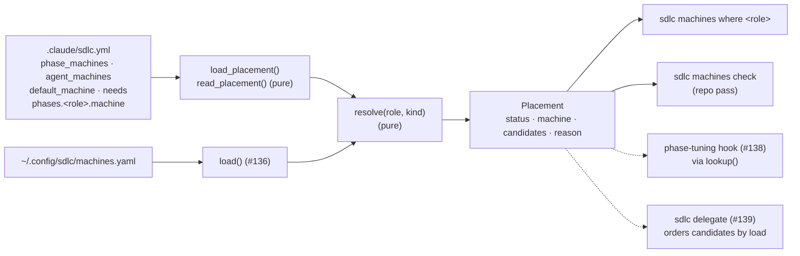
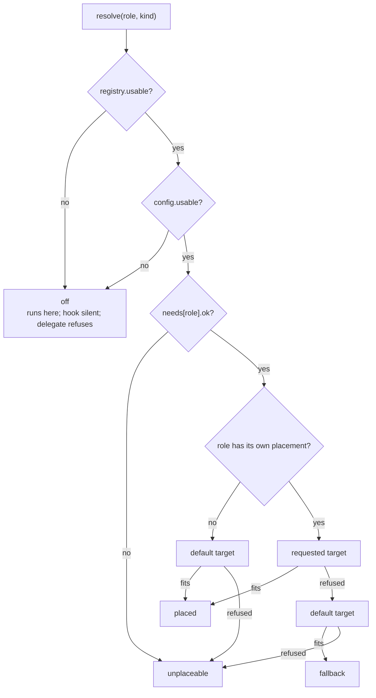

# Placement in sdlc.yml: phase_machines, agent_machines, default_machine, needs + resolver

## Goal

Let a repo say where each phase and agent runs, and answer "where does role R run?" from that
plus the person's registry (#136). This issue ships:
- four placement keys in `.claude/sdlc.yml` (`phase_machines`, `agent_machines`,
  `default_machine`, `needs`) plus the grouped `phases.<role>.machine`, documented as a commented
  block in `plugin/sdlc.example.yml`;
- a reader and a resolver in `plugin/lib/machines.py`: `resolve(role, kind) -> Placement`, and
  `lookup()`, the entry point the #138 hook imports;
- `sdlc machines where <role>`, and a repo pass in `sdlc machines check`;
- table-driven tests wired into CI, a CHANGELOG entry, README text, and version 0.2.41.

Nothing moves yet. The resolver only answers; the hint is #138 and starting work elsewhere is
#139. With no registry, or with no placement keys, every project behaves as before.

**Baseline.** This branch is rebased onto PR #140's head **e6b50dd**. That commit adds only Gate 2.5
review logs on top of ce12a0d; #140's fix cycle is still open and will change
`plugin/lib/machines.py`. **The implementer rebases onto #140's final head before starting.**

The spec relies only on #136's **contract**, not its internals.

What this spec relies on:
- `load()` never raises. Every problem is an `Issue(level, where, message)`.
- `Machine.ok` and `Machine.invalid` record problems per machine. A machine that isn't `ok` is
  never a placement target.
- `Registry.usable` requires the file to exist and parse, exactly one local machine, **and
  `local.ok`**. `Registry.local`, `Registry.get` and `Registry.machines` (file order) are as in
  #136's Interfaces.
- `secrets` levels are `SECRET_LEVELS = ("none", "dev", "prod")`, compared by index.
- `RESERVED_NAMES` contains `any`, `auto` and `local`, so no machine has those names.
- `parse_yaml(path)`, `RegistryError` and `YQ_TIMEOUT` work as #136 specifies, and `validate(doc)`
  is pure.

The fix-cycle changes that can reach this spec, and how it absorbs them:
- **Duplicate keys, blank trust keys, case-insensitive near-misses, and digit-only names become
  registry errors.** The resolver sees these only as `Machine.ok` false or a name missing from the
  registry, so nothing changes here.
- **Duplicate keys at the parse layer.** If `parse_yaml` starts rejecting duplicate keys, `sdlc.yml`
  inherits that through `load_placement`: a duplicate anywhere in the file makes the placement
  config `broken`, and every role resolves `off`. That is fail-closed, and it is accepted.
- **The `force_*` flags.** Removing them changes nothing: this spec never reads them.
- **`sdlc.yml` takes the same posture.** Blank (`null`) values inside `needs` are errors (see the
  reading table), and did-you-mean folds case and `-`/`_` as #140's near-miss rule does.

## Approach

### Where this sits



- **Everything new goes in `machines.py`, under #136's module rules:** no output, no `sys.exit`,
  no I/O at import time, `yaml` imported lazily (through `parse_yaml`), and nothing raises on bad
  input. Every problem becomes an `Issue`, or a `Placement` whose `reason` says what went wrong.
  That is what lets #138 import the reader inside its fail-open wrapper
  (`plugin/hooks/phase-tuning.py:205-211`).
- **`resolve()` is pure.** It takes a `Registry` and a `PlacementConfig` and does no I/O, so the
  table-driven tests build both from Python dicts and need no YAML backend.
- **`lookup()` does the I/O, in a fixed order:** registry first, `sdlc.yml` only when the registry
  is usable. With no registry, it costs one `stat` and never opens `sdlc.yml`.
- **`bin/sdlc` owns all output,** as in #136. `where` is a sibling of `list` and `check`. `check`
  gains a placement pass between the registry issues and the probe pass.

### The keys in `.claude/sdlc.yml`

ADR-009 §2 shape, plus the grouped form the issue asks for:

| Key | Shape | Meaning |
|---|---|---|
| `phase_machines` | map `<role>: <target>` | Where each phase runs. Same keys as `phase_models` (role names minus any `sdlc:` prefix). |
| `phases.<role>.machine` | `<target>` | Grouped form of the same thing. **Wins over `phase_machines.<role>`** when present and not null, as `model`/`effort` do in the hook (`phase-tuning.py:162-165`). |
| `agent_machines` | map `<agent>: <target>` | Where each non-phase agent runs (`browser-pilot`, `tour`, ...). |
| `default_machine` | `<target>` | Where a role with no placement runs, and where a refused placement falls back to. Unset means `local`. |
| `needs` | map `<role>: <list>` or `<role>: {caps, keeps, secrets}` | What a role requires. A bare list is shorthand for `caps`. It filters **every** target, and it is how `any` is resolved. |

**A `<target>` is one of three things:**
- a machine name from the person's registry;
- `local`, meaning the registry's `transport: local` machine. Repos can write
  `default_machine: local` without knowing what each person calls their own box. #136 already
  reserves the word, so no machine can be named `local`.
- `any`, meaning every machine that fits, with local first.

`auto` is reserved for #139's `--machine auto`. In `sdlc.yml` it is an error that suggests `any`.

**Reading rules (`read_placement`).** It is pure and takes the parsed document.

**Blanks:**
- A `null` block reads as `{}`.
- A `null` target means "no placement". The role goes to the default target, which is still
  filtered, so a blank target can't bypass trust. A `null` `phases.<role>.machine` lets
  `phase_machines.<role>` apply, as the hook does for its own knobs.
- **Inside `needs`, a blank is an error**: a `null` role value, or a `null` `caps`/`keeps`/`secrets`.
  Every `needs` value is a requirement, so a blank one would silently drop it. This is the same
  rule #140 applies to blank trust keys.

The other keys of `phases.<role>` (`model`, `effort`, ...) belong to the hook and are ignored
here, as is a `phases.<role>` that isn't a map. The hook ignores those too.

**Values quoted in messages** are bounded with `reprlib.repr`, so a pasted block can't become a
huge line.

| Problem | Level and where | Effect |
|---|---|---|
| explicit `--config` file missing; unreadable; unparseable; no YAML backend; yq timeout | error at `sdlc.yml` | `broken`: config not usable → every role resolves `off` |
| top level is not a map (an empty file reads as `{}`, not an error) | error at `sdlc.yml` | `broken` |
| `phase_machines`, `agent_machines`, `needs` or `phases` present but not a map | error at `sdlc.yml.<key>` | `broken` |
| a role key that is not a non-empty string | error at `sdlc.yml.<block>` | that entry is skipped |
| a target that is not a non-empty string, or is `auto` | error at its own path, e.g. `sdlc.yml.phases.validator.machine` | `Requested.error` is set; at resolution that target is refused, so the role falls back |
| `default_machine` that is not a non-empty string, or is `auto` | error at `sdlc.yml.default_machine` | treated as unset (`local`) |
| `needs.<role>` that is `null`, or neither a list nor a map; a list item or `caps`/`keeps` item that is not a non-empty string; a `null` `caps`/`keeps`/`secrets`; `secrets` not in `SECRET_LEVELS`; a key other than `caps`/`keeps`/`secrets` (did-you-mean folds case and `-`/`_`, so `Caps:` suggests `caps`) | error at `sdlc.yml.needs.<role>[.<key>]` | `Needs.invalid` gets the key (`entry` for the whole value). The role is **unplaceable** |
| `phases.<role>.machine` and `phase_machines.<role>` both set and different | warning at `sdlc.yml.phase_machines.<role>`: "overridden by phases.<role>.machine ('worker-1')" | grouped wins |
| a role in both the phase maps and `agent_machines`, with different targets | error at `sdlc.yml.agent_machines.<role>` | resolution with no `kind` uses the phase entry |

The value rules are the registry's:
- `caps` and `keeps` are lists of non-empty strings;
- `secrets` is one of `SECRET_LEVELS`.

Reuse #136's checkers for these if they survive the fix cycle; the behaviour is what's specified
here, not the helper names.

Unknown keys inside a `needs` map are errors, not #136-style warnings, because every `needs` key is a requirement: dropping a
misspelt `cap:` would quietly place a browser step on a box with no browser. This is the same
fail-closed reasoning as #136's near-miss rule.

**Unknown machine names are not judged by the reader,** which never sees the registry. They are
judged at resolution and reported by the repo pass.

### Where `sdlc.yml` is found (`sdlc_path`), first match wins

1. **`--config FILE`** on the CLI. Source is `flag`, and the file must exist (a missing file is an
   error and leaves the config `broken`).
2. **`project_dir=` argument**, which #138 passes, looked up as `<dir>/.claude/sdlc.yml`. Source is
   `project`.
3. **`$CLAUDE_PROJECT_DIR`**, if set and non-empty, looked up the same way. Source is `env`.
4. **Walk up from the current directory.** The first `<D>/.claude/sdlc.yml` that is a file wins.
   The walk stops after a directory that contains `.git` (a directory, or a worktree's `.git`
   file), or at `/`. Source is `search`.

If 2 or 3 names a directory with no `sdlc.yml`, the search stops there and does not walk up. That
matches the hook, which looks only at `$CLAUDE_PROJECT_DIR` or the event's `cwd`
(`phase-tuning.py:139-142`), so `where` explains what the hook will see. No file found means
source `none`, `path` `None`, nothing placed, and a **usable** config: every role goes to the
default target.

**Nothing here may raise.** #140's review found two ways `load()` breaks this, and #137 adds more
filesystem checks of the same kind, so each one is guarded:
- **Every `is_file()`/`exists()` call goes inside `try/except OSError`.** A path that is too long,
  or a directory that can't be searched, raises rather than returning `False`.
  - On an explicit `--config`, a `project_dir`, or `$CLAUDE_PROJECT_DIR`: an `OSError` other than
    "not found" is an error `Issue` at `sdlc.yml`, and the config is `broken`.
  - On the walk-up: it ends the walk as "none found".
- **An empty `--config ""` is an error**, not "not given". Test `explicit is not None`. The point
  is that a script passing an unset variable can't get a false pass.
- **A last `except Exception`** around the parse and read in `load_placement`, and around the
  whole of `lookup`, turns any future bug into a broken config (`off`), with the exception type in
  the message.

### Resolution: `resolve(role, kind=None, *, registry, config)`

The role's namespace is stripped first (`sdlc:validator` → `validator`), as the hook does
(`phase-tuning.py:134-135`).



1. **Off.** If `not registry.usable` (#136 rule 1: no file, a file broken as a whole, zero or
   several local machines, or a local machine that isn't `ok`), or `not config.usable`, the status
   is `off`. The reason is one of:
   - `machines are off: no machine registry at <path>`;
   - `machines are off: the registry has errors (<first error message>)`;
   - `machines are off: sdlc.yml has errors (<first error message>)`.
2. **Kind and the requested target.**
   - `kind="phase"` reads only `phases.<role>.machine`, then `phase_machines.<role>`.
   - `kind="agent"` reads only `agent_machines.<role>`.
   - `kind=None` reads the phase maps, then `agent_machines`. The kind is whichever map named the
     role, or `None` (shown as "unplaced") if neither did.
3. **Needs.** `config.needs.get(role, Needs())`. If it isn't `ok`, the status is `unplaceable`
   with the reason `needs.<role> has errors in: <keys, sorted>`, and no target is tried.
4. **The target chain** is the requested target (if any), then the **default target**:
   - The default target is `default_machine` if it is valid and usable as a default: `any`,
     `local`, or a registered machine that is `ok` and `assignable`.
   - Otherwise the default target is `local`. An unknown, invalid, unassignable or not-`ok`
     `default_machine` is reported once by the repo pass and then treated as unset.
   - If the default target is the same single machine as a refused requested target, it is not
     tried again.
   - There is no third link. A default target that doesn't fit the role's needs leaves the role
     `unplaceable`, and the resolver does not quietly fall through to some other box.
5. **Evaluating one target:**
   - `Requested.error` set → refused with that message.
   - a name → `registry.get(name)`. If it's missing, refused with
     `'<name>' is not in the registry`, plus `; did you mean '<x>'?` when
     `difflib.get_close_matches` finds a registered name. Otherwise run `unfit_reason`.
   - `local` → `registry.local`, then `unfit_reason`.
   - `any` → every registered machine that `unfit_reason` passes, with the **local machine first**
     and the rest in registry file order. An empty result is refused with
     `no machine fits: <machine>: <why>; ...`, one entry per registered machine.
     **Load ordering, busy flags and `limits` are not the resolver's job**; they belong to
     `delegate` (#139).
6. **Result.**
   - The first target that yields at least one machine wins. `machine` is its first candidate.
   - The status is `placed` when that target was the role's own (or the role had none and the
     default fit), and `fallback` when the role's own target was refused and the default fit.
   - If nothing fits, the status is `unplaceable`, `machine` is `None`, and the reason names every
     refusal.

**Hard filters, in order (`unfit_reason(machine, needs)`).** It returns `None` when the machine
fits, else the first failure. Within a filter, every missing item is listed, in `needs` order.

| # | Filter | Refusal text (tests match these substrings) |
|---|---|---|
| 1 | `machine.ok` (#136 rule 2) | `machine '<m>' has registry errors in: <invalid keys, sorted, ", ">` |
| 2 | `machine.assignable` | `machine '<m>' is not assignable` |
| 3 | `caps` ⊇ `needs.caps` | `machine '<m>' lacks caps: <missing>` |
| 4 | `keeps` ⊇ `needs.keeps` | `machine '<m>' lacks keeps: <missing>` |
| 5 | `SECRET_LEVELS.index(machine.secrets) >= SECRET_LEVELS.index(needs.secrets)` | `machine '<m>' holds secrets '<have>', needs '<need>'` |

Filter 1 comes before the issue's "assignable never" filter only so the reason is exact: an
invalid `assignable` already loads as `False` (#136 rule 3), so the order changes no outcome.
`needs.secrets` is a **floor**: a step that needs `dev` credentials may run where `dev` or `prod`
is held. A machine without a transport is always caught by filter 1 or 2, because #136 makes a
missing transport an error unless `assignable: false`.

**`Placement` fields and statuses:**

| Status | `machine` | `local` | Consumers |
|---|---|---|---|
| `off` | `None` | `True` | The hook adds no hint. `delegate` refuses with `reason`. `where` exits 0. |
| `placed` | first candidate | `machine == registry.local.name` | The hook hints only when `not local` (#138). `delegate` orders `candidates` by load. |
| `fallback` | first candidate of the default target | as above | As `placed`, but `reason` says what was refused. `check` reports an error, and `where` exits 1. |
| `unplaceable` | `None` | `False` | `delegate` refuses. #138 chooses its own text. `check` reports an error, and `where` exits 1. |

D4 calls the fallback "a warning". The issue makes it an error in `check`, and that is the one
followed here. At runtime the role still resolves, and `reason` is the warning text.

**Reason texts** (one line; tests match the bold parts):
- placed, own target: `**<at> places <role> on '<m>'**`; for `any`: `**<n> machines fit**` (1 → "1 machine fits")
- placed, default: `**<role> has no placement**; default_machine '<m>'` or `...; runs on this box ('<local>')`
- fallback: `**<at> '<value>' was refused** (<why>); **using** default_machine '<m>' | this box ('<local>')`
- unplaceable: `**<role> has nowhere to run**: <why for each target tried, "; ">`

### Consumer contract additions (module docstring rules 6-8)

These are appended to #136's rules 1-5 in the `machines.py` docstring:

6. **Placement never raises and prints nothing.** `resolve()` and `lookup()` return a `Placement`
   for any `str` role, even an empty one. `status` is one of `off`, `placed`, `fallback` or
   `unplaceable`, with the meanings in the table above. Only `placed` and `fallback` carry a
   `machine`.
7. **`lookup()` cost.** With no registry file it costs one `stat`. It reads `sdlc.yml` only when
   the registry is usable. Each file's parse is bounded by `YQ_TIMEOUT`, and `sdlc.yml` is opened
   only after the registry parsed, so a hung `yq` costs at most one timeout (2 s) inside the hook's
   5 s (`hooks.json:161`). The hook must still call it inside its try/except.
8. **The resolver judges trust and fit only.** Load (`limits`, the `herdr agent list` counts), busy
   flags and `gaming_sensitive` belong to `delegate` (#139). `candidates` is fit-ordered, never
   load-ordered.

`Issue.where` (rule 5) gains a third family: `sdlc.yml` (file-level) and
`sdlc.yml.<key>[.<role>[.<sub>]]` (one entry).

### CLI

**`sdlc machines where <role> [--kind phase|agent] [--registry PATH] [--config FILE]`** prints the
resolution. The first line is the answer, so `| head -1` works. Only ASCII is used.

```
validator: worker-1
  kind:        phase
  placement:   worker-1 (phases.validator.machine)
  needs:       caps full-suite, browser
  candidates:  worker-1
  reason:      phases.validator.machine places validator on 'worker-1'
  registry:    /home/me/.config/sdlc/machines.yaml
  sdlc.yml:    /repo/.claude/sdlc.yml
```

- **First line:**
  - `<role>: <machine>`, with ` (local)` added when the machine is local, and `, fallback`
    added for a fallback;
  - `<role>: nowhere` when unplaceable;
  - `<role>: this box (machines are off)` when off.
- **Detail lines:**
  - `kind` is `phase`, `agent` or `unplaced`.
  - `placement` is `<value> (<at>)`, or `none (default target)`.
  - `needs` is `caps ...; keeps ...; secrets <lvl>`, leaving out empty parts and `secrets none`;
    it reads `-` when there are none.
  - `candidates` appears only when `machine` is set. For `any` it also carries
    `   (local first; sdlc delegate picks by load)`.
  - Each `rejected` entry gets its own line, `  refused:     <target>: <why>`.
  - `reason`, `registry` and `sdlc.yml` (a path, or `none found`) always appear. When the status
    is `off`, only `reason`, `registry` and `sdlc.yml` follow the first line.
- **Exit codes:** 0 for `placed` or `off`; 1 for `fallback` or `unplaceable`; 2 for a usage error.
- **Same order as `lookup()`:** load the registry; read `sdlc.yml` only if the registry is usable;
  then `resolve`. `where` calls these three itself rather than `lookup()`, so that it can print
  both paths.

**`sdlc machines check [--config FILE]` gains the repo pass.** The pass list becomes:

1. the registry issues (unchanged);
2. **placement**, new;
3. the probe, when `--probe` is given.

What the placement pass prints depends on the registry:
- **The registry is inert:** output is byte-identical to 0.2.40, and `sdlc.yml` is not read. D4
  says existing projects see no change. The inert message already says everything runs on this
  box.
- **The registry exists but isn't usable:** after the summary, a plain line
  `Placement: not checked (the registry is not usable)`, and `sdlc.yml` is not read. The exit
  status is already 1 from the registry errors.
- **The registry is usable:** a plain line `Placement: <path>`, or
  `Placement: none (no .claude/sdlc.yml found)`. Then `placement_issues(registry, config)` adds:
  - every `config.issues` entry;
  - **default-target checks**, as one error at `sdlc.yml.default_machine`:
    - a `default_machine` that is unknown, not `ok`, or not assignable: `...; unplaced roles run
      on this box ('<local>') instead`;
    - no usable default and a local machine that is `assignable: false`: `no usable
      default_machine and the local machine '<m>' is not assignable, so unplaced roles have
      nowhere to run`;
  - **one line per role the file names** (`config.roles()`): phase roles in file order, then
    agent roles, then roles named only in `needs`. Each is reported at its requested path, or at
    `sdlc.yml.needs.<role>` for a needs-only role:
    - `placed` → `info`: `<role> -> <m>`. For `any`: `<role> -> any: <c1>, <c2>`. For the
      default: `<role> -> <m> (default)`.
    - `fallback` or `unplaceable` → `error` with the reason. **But if the role's own entry already
      has a value error** (`Requested.error`, or `needs` not `ok`), the line is `info`. One fault
      gives one error.
  - When the config is broken: just its file- or block-level error, and no role lines.

**Flags.** `--config FILE` is accepted on the `machines` group parser and on the `check` and
`where` leaves. On the leaves it uses `default=argparse.SUPPRESS`, the pattern #136 uses for the
leaf `--registry`, so a group flag survives and a leaf flag wins. `where` also takes
`--registry` the same way.

## File-level plan

### Create

- **`plugin/lib/placement.test.sh`** is the placement suite. It follows `machines.test.sh`'s
  conventions:
  - paths resolved from `$0`;
  - `ok`/`bad` counters, `TMP` with a `trap` cleanup;
  - `export HOME="$TMP/home"`, with `SDLC_MACHINES`, `XDG_CONFIG_HOME` and `CLAUDE_PROJECT_DIR`
    unset;
  - `PYTHONDONTWRITEBYTECODE=1`;
  - the same backend detection, the `noyaml` shadow package and fresh PATH directories;
  - a summary line `placement: N passed, M failed`, with the exit status taken from the fail
    count.

  It has two parts:
  - **Part A, the table.** One `python3 - <<'PY'` heredoc holds a list of rows. Each row is a
    name, a registry dict, an `sdlc.yml` dict, a role, a kind and the expected fields. It builds
    the registry from #136's public surface, the pure `validate(doc)` plus the `Registry`
    dataclass: `Registry(Path("<fixture>"), "flag", True, *machines.validate(reg))`. If #140's
    final head changes that constructor, build it the way #140 ends up doing. It builds the
    config with `machines.read_placement(cfg)`, calls `resolve`, and prints `ok: <name>` or
    `FAIL: <name>: <field> expected <x> got <y>` per row. Bash tallies the lines. It needs **no
    YAML backend**, so it always runs. The cases are listed under Tests.
  - **Part B, YAML and the CLI.** Cases marked [both] run once per available backend; with no
    backend, Part B prints one `skip:` line.

### Modify

- **`plugin/lib/machines.py`** adds the surface under Interfaces, after `load()`:
  - **Constants:** `SDLC_RELPATH`, `PROJECT_ENV`, `KINDS`, `PLACEMENT_KEYWORDS`, `NEEDS_KEYS`,
    `STATUSES`.
  - **Dataclasses:** `Needs`, `Requested`, `PlacementConfig`, `Placement`.
  - **Functions:** `sdlc_path`, `read_placement`, `load_placement`, `unfit_reason`, `resolve`,
    `placement_issues`, `lookup`.
  - **Docstring:** extend the module docstring with rules 6-8 and the `sdlc.yml` `where` family.
    Replace the `# #137 adds here` placeholder comment from the #136 Interfaces with the real
    code.
  - **Constraints:**
    - Python ≥ 3.8 and stdlib only, as in #136.
    - `load_placement` calls `parse_yaml` and turns `RegistryError` into an `Issue` at `sdlc.yml`.
      The class name is kept; the message already names the path.
    - Every filesystem check is guarded with `OSError`, and `load_placement` and `lookup` each
      end with a last `except Exception`. The details are in Approach, "Nothing here may raise".
    - Nothing new runs at import time.
    - **Depend only on the contract listed under Baseline.** Don't import #136's private helpers
      unless they still exist on #140's final head.
- **`plugin/bin/sdlc`:**
  - add `cmd_where` and a `_print_where(placement, reg, cfg)` formatter;
  - add `--config FILE` to the `machines` group, to `check` and to `where` (SUPPRESS on the
    leaves), and `--kind` with `choices=KINDS`;
  - **`cmd_check`:** after the summary line, run the placement pass described under Approach,
    then the probe. Error and warning counts include placement issues.
  - **Docstring:** add the `where` grammar, remove the "Reserved for later releases ...
    `sdlc machines where <role>`" sentence, keep `delegate` reserved, and update the subparser
    metavar to `{list,check,where}`.
- **`plugin/lib/machines.test.sh`:** next to its `unset SDLC_MACHINES XDG_CONFIG_HOME` line, add
  `export CLAUDE_PROJECT_DIR="$TMP/proj"` and `mkdir -p "$TMP/proj"`. This keeps the new repo pass
  deterministic: it finds no `sdlc.yml`, rather than walking up into whatever repo the suite runs
  in. Every #136 case keeps its exact `errors=`/`warnings=` counts.
- **`plugin/sdlc.example.yml`:** add a new section after the backward-compat note that ends the
  per-phase tuning section (`:156-158`) and before "Loop iteration caps" (`:160`). It ships
  commented: zero behaviour change.

  ```yaml
  # === Machines — where each phase and agent runs (optional) ===
  # Needs a machine registry (${XDG_CONFIG_HOME:-~/.config}/sdlc/machines.yaml; start from
  # ${CLAUDE_PLUGIN_DIR}/machines.example.yaml). Without one, or with these keys commented,
  # everything runs on this box exactly as before.
  #
  # A placement is a machine name from your registry, `local` (the box you run Claude Code
  # on), or `any` (every machine that fits the role's needs, local first; `sdlc delegate`
  # picks among them by load). Trust comes first: a machine that is `assignable: false`,
  # has registry errors, or lacks a cap, keep or secrets level in `needs` is refused, and
  # the role falls back to `default_machine`. `sdlc machines check` reports every refusal;
  # `sdlc machines where <role>` explains one.
  #
  # Machine names come from each person's registry, so `local` is the portable choice for
  # `default_machine`. `needs:` here is not the `needs:*` issue labels (those add /develop
  # teammates).
  #
  # phase_machines:                 # same keys as phase_models / phases
  #   validator: worker-1           # full suite + browser off the workstation
  #   implementer: local            # needs this box's checkout and services
  #   reviewer: any                 # read-only: wherever it fits
  # agent_machines:                 # agent names as in subagent_type, minus `sdlc:`
  #   browser-pilot: worker-1
  # default_machine: local          # where unplaced roles run (default: local)
  # needs:                          # filters every placement; resolves `any`
  #   validator: [full-suite, browser]                 # a list is shorthand for caps
  #   implementer: { keeps: [checkouts, services], secrets: dev }
  #
  # Grouped form: `phases.<role>.machine: worker-1` works too and wins over
  # `phase_machines.<role>`, as for the other knobs.
  ```

  Constraints the test relies on:
  - The example's YAML lines run from `# phase_machines:` to the next line that is exactly `#`.
    Each line starts with `# `, so stripping that prefix gives valid YAML.
  - The names match `plugin/machines.example.yaml` (`workstation` local, `worker-1`, `control`).
    Against that registry the block resolves with 0 errors and 0 warnings: validator → worker-1,
    implementer → workstation, reviewer → workstation and worker-1, browser-pilot → worker-1.
  - Don't add `machine:` to the commented `phases:` block above. That block promises that
    uncommenting it as-is is a no-op (`:124-126`).
- **`plugin/machines.example.yaml`:** comments only, so #136 case 1 (0 errors, 0 warnings) still
  holds. In the header line `:5-6`, replace "Placement (a later release) matches..." with
  "Placement (`phase_machines`, `agent_machines` and `needs` in a repo's `.claude/sdlc.yml`)
  matches...".
- **`plugin/sdlc.justfile`:** in the `machines` recipe comment (`:89`), mention `where <role>`.
  The recipe body is unchanged: `cd ..` lands at the project root, where the walk-up finds
  `.claude/sdlc.yml`.
- **`.github/workflows/verify.yml`:** add one step after "Machine registry tests" (`:71-72`):
  `- name: Placement resolver tests` / `run: bash plugin/lib/placement.test.sh`. Don't rename the
  job, because its `name:` is a required check.
- **`plugin/.claude-plugin/plugin.json`:** bump `version` from 0.2.40 to **0.2.41**.
- **`CHANGELOG.md`:** add a new top entry above `## [0.2.40]` (`:8`):
  `## [0.2.41] — 2026-10-25` / `### Added — placement: where each phase and agent runs`.
  - **Why:** the registry (0.2.40) says what each box can do and hold. A repo can now say which
    box each phase and agent belongs on, and the resolver checks that against the registry,
    trust first: a box that is unassignable, has registry errors, or lacks what the role needs is
    refused. Nothing moves yet; this release only answers "where".
  - **Bullets:**
    - the keys, including the grouped form, and the `local`/`any` targets;
    - the fallback to `default_machine`, never to an unassignable box;
    - `needs` as list or map, with `secrets` as a floor;
    - `sdlc machines where <role>`;
    - the `check` repo pass;
    - no registry → no change;
    - the tests in CI.
  - Generic names only.
- **`README.md`:** in `## Machines` (`:244-257`), replace the line "Placing phases on machines
  comes in a later release." with a short `### Placing phases and agents` subsection. It covers:
  - the keys, pointing at the commented block in `plugin/sdlc.example.yml`;
  - the targets (a name, `local`, `any`);
  - trust first, with refused placements falling back to `default_machine` and never going to an
    unassignable box;
  - `where` and `check`;
  - that names are per person, so prefer `default_machine: local`;
  - that nothing moves yet, and starting work on another box comes in a later release.

## Interfaces

```python
# ── plugin/lib/machines.py (additions) ───────────────────────────────────────
# Same module rules as #136: no stdout/stderr, no sys.exit, no import-time I/O,
# yaml only via parse_yaml, and nothing here raises on bad input.

SDLC_RELPATH = ".claude/sdlc.yml"
PROJECT_ENV = "CLAUDE_PROJECT_DIR"
KINDS = ("phase", "agent")
PLACEMENT_KEYWORDS = ("any", "local")          # `auto` is #139's --machine auto; refused in sdlc.yml
NEEDS_KEYS = ("caps", "keeps", "secrets")
STATUSES = ("off", "placed", "fallback", "unplaceable")

@dataclass(frozen=True)
class Needs:
    caps: Tuple[str, ...] = ()
    keeps: Tuple[str, ...] = ()
    secrets: str = "none"                       # a floor: the machine must hold at least this level
    invalid: FrozenSet[str] = frozenset()       # "entry" | "caps" | "keeps" | "secrets" | an unknown key as written

    @property
    def ok(self) -> bool: ...                   # not invalid; a role whose needs aren't ok is unplaceable

@dataclass(frozen=True)
class Requested:
    value: Optional[str]                        # the target as written; None when the value was rejected
    at: str                                     # "phases.<role>.machine" | "phase_machines.<role>" | "agent_machines.<role>" | "default_machine"
    error: Optional[str] = None                 # why it can't be used (not a string, empty, `auto`); None when well-formed

@dataclass
class PlacementConfig:
    path: Optional[Path]                        # the sdlc.yml read; None when none was found
    source: str                                 # "flag" | "project" | "env" | "search" | "none"
    exists: bool
    phases: Dict[str, Requested]                # grouped phases.<role>.machine over flat phase_machines.<role>; file order
    agents: Dict[str, Requested]                # agent_machines.<role>; file order
    default: Optional[Requested]                # default_machine; None when unset
    needs: Dict[str, Needs]                     # file order
    issues: List[Issue]                         # where: "sdlc.yml" | "sdlc.yml.<key>[.<role>[.<sub>]]"
    broken: bool = False                        # a file-level or block-level error (see Approach table)

    @property
    def usable(self) -> bool: ...               # not broken; a missing (non-explicit) file is usable and places nothing
    def roles(self) -> List[Tuple[str, Optional[str]]]: ...   # (role, kind): phase roles, agent roles, then needs-only roles (kind None)

@dataclass(frozen=True)
class Placement:
    role: str                                   # namespace stripped
    kind: Optional[str]                         # "phase" | "agent" | None (unplaced, no kind given)
    status: str                                 # one of STATUSES
    machine: Optional[str]                      # set only for "placed" and "fallback"
    candidates: Tuple[str, ...]                 # fitting machines of the winning target; `any`: local first, then file order
    local: bool                                 # runs on this box: status "off", or machine is registry.local
    requested: Optional[Requested]              # the role's own placement; None when it has none
    rejected: Tuple[Tuple[str, str], ...]       # (target as written, why), in the order tried
    reason: str                                 # one line, always set

def sdlc_path(explicit: Optional[str] = None, *, project_dir: Optional[str] = None,
              env: Optional[Mapping[str, str]] = None,
              cwd: Optional[str] = None) -> Tuple[Optional[Path], str]: ...
              # --config, then project_dir, then $CLAUDE_PROJECT_DIR, then walk up from cwd (stops after a dir with .git)

def read_placement(doc: object, path: Optional[Path] = None,
                   source: str = "flag") -> PlacementConfig: ...      # pure; validates a parsed sdlc.yml

def load_placement(explicit: Optional[str] = None, *, project_dir: Optional[str] = None,
                   env: Optional[Mapping[str, str]] = None,
                   cwd: Optional[str] = None) -> PlacementConfig: ... # locate + parse_yaml + read; never raises

def unfit_reason(machine: Machine, needs: Needs) -> Optional[str]: ...
    # None when it fits; else the first failing filter: ok, assignable, caps, keeps, secrets

def resolve(role: str, kind: Optional[str] = None, *,
            registry: Registry, config: PlacementConfig) -> Placement: ...  # pure

def placement_issues(registry: Registry, config: PlacementConfig) -> List[Issue]: ...
    # the check repo pass; call only when registry.usable

def lookup(role: str, kind: Optional[str] = None, *, project_dir: Optional[str] = None,
           registry_file: Optional[str] = None, config_file: Optional[str] = None,
           env: Optional[Mapping[str, str]] = None, cwd: Optional[str] = None) -> Placement: ...
    # the hook's entry point (#138): load(); if usable, load_placement(); resolve(). One stat with no registry.

# ── plugin/bin/sdlc (CLI grammar) ────────────────────────────────────────────
# sdlc machines [--registry PATH] [--config FILE] [list [--registry PATH]]
# sdlc machines [--registry PATH] [--config FILE] check [--registry PATH] [--config FILE] [--probe] [--timeout SECS]
# sdlc machines [--registry PATH] [--config FILE] where ROLE [--kind phase|agent] [--registry PATH] [--config FILE]
# reserved, not built here: sdlc delegate <role> ... (#139)
# exit: 0 ok/inert/placed/off · 1 error found (check), nothing to show (list), fallback/unplaceable (where) · 2 usage
```

## Tests

Everything lives in `plugin/lib/placement.test.sh`, and CI runs it. Run it locally with
`bash plugin/lib/placement.test.sh` (under `nice -n 19` if you like: none of its assertions is a
wall-clock bound).

**Part A fixtures.**
- **`REG`** has five machines:
  - `workstation`: local; caps `edit, test, browser`; keeps `checkouts, services`; secrets `dev`;
  - `worker-1`: herdr; caps `edit, test, browser, docker, full-suite`; no keeps; secrets `none`;
  - `vault`: herdr; caps `edit`; secrets `prod`;
  - `control`: `assignable: false`;
  - `broken`: herdr, with `limits: {cores: 0}`, so it is not `ok`.
- **`REG_WF`** is `REG` with `worker-1` listed before `workstation`.
- **`REG_LOCKED`** is `REG` with `workstation` set to `assignable: false`.

Every row asserts `status` and `machine`, plus whichever of `candidates`, `local`, `kind`, a
`requested.at`, or reason substrings it names. `cfg` is the `sdlc.yml` dict.

| # | Case (acceptance item) | cfg | call | Expect |
|---|---|---|---|---|
| A1 | **unassignable refused** | `phase_machines: {validator: control}` | `validator` | `fallback`, `workstation`, local; reason has `is not assignable` and `using` |
| A2 | not-`ok` refused | `{validator: broken}` | `validator` | `fallback`; reason has `has registry errors in: ` + `", ".join(sorted(broken.invalid))`, computed from the loaded machine rather than written as a literal |
| A3 | **caps mismatch** | `{validator: workstation}`, `needs: {validator: [full-suite]}`, `default_machine: worker-1` | `validator` | `fallback`, `worker-1`; `lacks caps: full-suite` |
| A4 | **keeps mismatch** | `{implementer: worker-1}`, `needs: {implementer: {keeps: [checkouts]}}` | `implementer` | `fallback`, `workstation`; `lacks keeps: checkouts` |
| A5 | **secrets mismatch** | `{implementer: worker-1}`, `needs: {implementer: {secrets: dev}}` | `implementer` | `fallback`, `workstation`; `holds secrets 'none', needs 'dev'` |
| A6 | secrets is a floor | `{implementer: vault}`, `needs: {implementer: {secrets: dev}}` | `implementer` | `placed`, `vault` |
| A7 | **`any`, no needs** | `{reviewer: any}` | `reviewer` | `placed`, `workstation`, local, candidates `(workstation, worker-1, vault)`; control and broken in `rejected` |
| A8 | **`any` with needs** | `{reviewer: any}`, `needs: {reviewer: [full-suite]}` | `reviewer` | `placed`, `worker-1`, not local, candidates `(worker-1,)` |
| A9 | `any` with `secrets: prod` | `needs: {reviewer: {secrets: prod}}` | `reviewer` | candidates `(vault,)` |
| A10 | `any`, nothing fits | `needs: {reviewer: [gpu]}` | `reviewer` | `unplaceable`, `None`; `no machine fits`, `has nowhere to run` |
| A11 | `any` is local first | `REG_WF`, `{reviewer: any}` | `reviewer` | candidates[0] `workstation` |
| A12 | **unknown machine** | `{validator: worker-9}` | `validator` | `fallback`, `workstation`; `'worker-9' is not in the registry`, `did you mean 'worker-1'` |
| A13 | **no registry → local** | inert `Registry(..., "default", False, {}, [])`, any cfg | `validator` | `off`, `None`, local; `no machine registry` |
| A14 | broken registry | two local machines | `validator` | `off`; `the registry has errors` |
| A15 | broken config | `phase_machines: [validator]` | `validator` | `off`; `sdlc.yml has errors` |
| A16 | **grouped beats flat** | `phases: {validator: {model: fable, machine: worker-1}}`, `phase_machines: {validator: workstation}` | `validator` | `placed`, `worker-1`, `requested.at == "phases.validator.machine"`; config has 1 warning |
| A17 | grouped null → flat | `phases: {validator: {machine: null}}`, `phase_machines: {validator: worker-1}` | `validator` | `worker-1`, `at == "phase_machines.validator"` |
| A18 | invalid grouped still wins | `phases: {validator: {machine: 3}}`, `phase_machines: {validator: worker-1}` | `validator` | `fallback`, `workstation` |
| A19 | default used | `default_machine: worker-1` | `tour` | `placed`, `worker-1`, not local, `requested is None`, kind `None` |
| A20 | no default | `{}` | `tour` | `placed`, `workstation`, local |
| A21 | unknown default → local | `default_machine: worker-9` | `tour` | `placed`, `workstation` |
| A22 | unassignable default → local | `default_machine: control` | `tour` | `placed`, `workstation` |
| A23 | needs invalid | `needs: {validator: {secrets: staging}}` | `validator` | `unplaceable`; `needs.validator has errors in: secrets` |
| A24 | needs unknown key | `needs: {validator: {cap: [browser]}}` | `validator` | `unplaceable`; `Needs.invalid` has `cap` |
| A25 | bare list = caps | `needs: {validator: [full-suite, browser]}` | read only | `needs["validator"].caps == ("full-suite", "browser")` |
| A26 | kind auto → agent | `agent_machines: {browser-pilot: worker-1}` | `browser-pilot` | kind `agent`, `worker-1` |
| A27 | explicit kind | `phase_machines: {validator: worker-1}` | `validator, "agent"` | `placed`, `workstation`, `requested is None` |
| A28 | namespace stripped | `{validator: worker-1}` | `sdlc:validator` | equals the `validator` result |
| A29 | `local` keyword | `{implementer: local}` | `implementer` | `placed`, `workstation`, local |
| A30 | `auto` refused | `{validator: auto}` | `validator` | `fallback`; reason has `any` |
| A31 | both targets unfit | `{validator: worker-1}`, `needs: {validator: {keeps: [game-data]}}` | `validator` | `unplaceable`; reason names `worker-1` and `workstation` |
| A32 | role in both maps | `phase_machines: {x: worker-1}`, `agent_machines: {x: workstation}` | `x` | kind `phase`, `worker-1` |
| A33 | local unassignable | `REG_LOCKED`, `{}` | `tour` | `unplaceable` |
| A34 | never raises | `{}` | `""`, `"a:b:c"`, `"sdlc:"` | each returns a `Placement` |
| A35 | `unfit_reason` order | `broken` with `assignable: "no"` | direct | the `has registry errors in:` text (keys from `Machine.invalid`, which include `assignable`), not `is not assignable` |
| A36 | blank needs | `needs: {validator: null}`; then `needs: {validator: {secrets: null}}` | `validator` | both `unplaceable`; `Needs.invalid` has `entry`, then `secrets` |
| A37 | case-folded did-you-mean | `needs: {validator: {Caps: [browser]}}` | read only | error at `sdlc.yml.needs.validator.Caps` suggesting `caps` |
| A38 | blank target ≠ bypass | `phase_machines: {validator: null}`, `needs: {validator: [full-suite]}` | `validator` | `unplaceable`: the default target (workstation) is still filtered and lacks `full-suite` |

**`placement_issues` rows (Part A).** Each single-fault cfg against `REG` yields **exactly one
error**, at the stated `where`:
- `phase_machines.validator`: `worker-9`, `control` or `broken`;
- `phase_machines.validator` with value `auto`, and `phases.validator.machine` with value `[a]`
  (the value error; the outcome line is `info`);
- `needs.validator.secrets` with `staging` (plus a placed `validator`, whose line is `info`);
- `needs.validator.cap`;
- `needs.validator` with the value `browser`, a string, and with the value `null`;
- `default_machine` with `worker-9`, `control` or `3`;
- `agent_machines.x` for case A32.

Two more rows:
- The grouped/flat difference (A16) yields exactly one warning and no error.
- `REG_LOCKED` with `{}` yields one error at `sdlc.yml.default_machine`.

**Part B, YAML and the CLI.**

| # | Case | Expect |
|---|---|---|
| B1 | **[both]** The commented example block in `plugin/sdlc.example.yml`, extracted with `sed -n '/^# phase_machines:/,/^#$/p'` and stripped of `# `, checked with `--config` against `plugin/machines.example.yaml` | `check` exits 0 with `check: ok (errors=0, warnings=0)`, and `info` lines for validator, implementer, reviewer and browser-pilot. `where validator` → first line `validator: worker-1`. `where reviewer` → `reviewer: workstation (local)` and a `candidates:  workstation, worker-1` line. `where browser-pilot` → `kind:        agent`. All exit 0. |
| B2 | **[both]** `plugin/sdlc.example.yml` as shipped | `check --config` exits 0 and nothing is placed: no role lines. `read_placement` gives empty maps. |
| B3 | **[both]** Grouped beats flat in YAML: block form, then inline flow `validator: { model: fable, machine: worker-1 }`, each beside `phase_machines: {validator: workstation}` | `where validator` → `validator: worker-1`, and `check` shows 1 warning. |
| B4 | Unknown machine (`validator: worker-9`) | `check` exits 1 with `check: failed (errors=1, warnings=0)` and `error    sdlc.yml.phase_machines.validator:`. `where` exits 1 with `validator: workstation (local), fallback` and a `refused:` line. |
| B5 | Unplaceable (A31 as YAML) | `where` exits 1 with `validator: nowhere`. |
| B6 | **No registry** (`HOME` empty), with B1's sdlc.yml | `where validator` exits 0 with `validator: this box (machines are off)`. `check --config <B1>` exits 0, and its output **equals** the 0.2.40 inert message (two lines, compared exactly). |
| B7 | Broken registry (two local machines), with B1's sdlc.yml | `check` exits 1 and prints `Placement: not checked (the registry is not usable)` with no `sdlc.yml.` lines. `where` exits 0 with `machines are off`. |
| B8 | **[both]** Unparseable sdlc.yml (`phase_machines: [`) | `check` exits 1 with `error    sdlc.yml: could not parse`. `where` exits 0 with `machines are off`. |
| B9 | `--config $TMP/nope.yml` | `check` exits 1 with `sdlc.yml not found`. |
| B10 | Discovery | `CLAUDE_PROJECT_DIR=$TMP/p1` beats a cwd inside `$TMP/p2`. From `$TMP/p2/a/b` with no env, the walk-up finds `$TMP/p2/.claude/sdlc.yml`. With `$TMP/p3/.claude/sdlc.yml` and `$TMP/p3/repo/.git/`, running from `$TMP/p3/repo/x` finds nothing (`Placement: none`). `CLAUDE_PROJECT_DIR` pointing at a directory with no `sdlc.yml` does not walk up. |
| B11 | `--config` on the group and on the leaf | `machines --config A where validator` uses A, and `machines --config A where validator --config B` uses B, as the `sdlc.yml:` line shows. |
| B12 | `lookup()` reads no YAML without a registry: PyYAML shadowed, and PATH holding `python3` plus a `yq` wrapper that touches `$TMP/yq-called` and then execs the real yq (needs yq) | With an inert registry, `lookup("validator", project_dir=...)` returns `off` and the marker is absent. With the example registry, the marker is present: the wrapper works. |
| B13 | `lookup()` is bounded on `sdlc.yml`: a `yq` wrapper that runs `exec sleep 5` when its last argument ends in `sdlc.yml`, and execs the real yq otherwise | Returns `off`, and the reason has `timed out`. The registry still parsed. Asserted on the message, not on time. |
| B14 | **[both]** `lookup()` is quiet and never raises, for each of: unparseable, top level a list, `phase_machines` a list, `needs: browser`, an empty file, binary bytes | The python3 process exits 0 with empty stderr, and its only stdout is the status the test prints itself. |
| B14b | Filesystem errors don't raise: `--config` with a 5000-character name; `CLAUDE_PROJECT_DIR` set to the same; `--config ""` | `check` exits 1 with an error at `sdlc.yml` and no `Traceback` in the output. `lookup(project_dir=<long>)` returns `off` quietly. An empty `--config` is an error, not a fallback to discovery. |
| B15 | The tuning hook ignores `machine` | Pipe an `Agent` event for `sdlc:validator` into `plugin/hooks/phase-tuning.sh`, with `phases: {validator: {model: fable, machine: worker-1}}`. `updatedInput.model == "fable"`, and there is no `machine` key in `updatedInput`. |

**Checks for the validator, outside the test file:**
- `bash plugin/lib/placement.test.sh`, `bash plugin/lib/machines.test.sh` and
  `bash plugin/hooks/phase-tuning.test.sh` each exit 0. The #136 suite must keep every count.
- From the repo root, with no registry: `just sdlc::machines where validator` exits 0 and prints
  `machines are off`.
- `just sdlc::machines check --registry plugin/machines.example.yaml` exits 0. This repo's own
  `.claude/sdlc.yml` places nothing.
- **Genericity grep**, which must print nothing:
  `grep -rniE 'maplelog|devbox|node2|10\.88\.' plugin/lib/machines.py plugin/bin/sdlc plugin/lib/placement.test.sh plugin/sdlc.example.yml plugin/machines.example.yaml`.
  Apply the same pattern to the `+` lines of `git diff origin/dugshub/136-machine-registry -- README.md CHANGELOG.md`.
- `bash plugin/scripts/verify-version-bump.sh` reports a bump to 0.2.41.
- `just sdlc::verify` exits 0, and `claude plugin validate ./plugin` passes apart from the
  pre-existing icon warning.
- The CI `verify` job is green, including the new step.

## Out of scope

- **The remote hint** in `phase-tuning.py`: #138. The hook is not modified here. B15 only proves
  the new knob doesn't disturb it.
- **Everything about `sdlc delegate`**: #139. That includes:
  - ordering `candidates` by load;
  - `limits`;
  - busy flags and `gaming_sensitive` (D5 applies "under `auto`", which is `delegate`);
  - `--machine <name>|auto` overrides (#139 composes `unfit_reason` and `config.needs` for those);
  - `workdir`;
  - first-start gates.
- **A `secrets` ceiling** ("never run this step where `prod` is held"). `needs.secrets` is a
  floor only.
- **Grouped `phases.<role>.needs`.** `needs` stays top level, keyed by role, and shared by phases
  and agents.
- **Placement keys under the inert registry.** `check` stays byte-identical, and `sdlc.yml` is not
  validated without a registry.
- **Validating role names** against the plugin's agents. Projects add their own.
- `--json` output, and editing `sdlc.yml` from the CLI.

## Open questions

All have defaults, and none blocks implementation.

- **`local` as a placement keyword.** This is my addition; the issue lists names and `any`. #136
  already reserves the word, and without it a shared `sdlc.yml` cannot name "each person's own
  box". Drop it if Gate 1.5 prefers a smaller surface: `default_machine` unset already means
  local.
- **An unusable `default_machine` is treated as unset (`local`),** not as making every unplaced
  role unplaceable. The reasoning: machine names are per person, so a teammate whose registry
  lacks `devbox` should get a `check` error and keep working here, the same as with no registry.
- **No third fallback.** If the default target doesn't fit a role's `needs`, that role is
  `unplaceable`. It does not quietly go to whichever box fits.
- **A fallback is an `error` in `check`** (per the issue), and D4's "warning" is the runtime
  `reason`. `where` exits 1 on a fallback so scripts can gate on it.
- **`needs` errors fail closed.** An invalid `needs` entry makes the role unplaceable, and unknown
  `needs` keys are errors, not warnings.
- **With no `kind`, the phase maps win** over `agent_machines` for a role named in both. A
  conflict between them is an error.
- **The repo pass runs only when the registry is usable.** A broken registry already fails `check`,
  and a second pass of placement errors computed against it would be noise.
- **Duplicate keys in `sdlc.yml` follow whatever #140 settles.** If `parse_yaml` rejects them, a
  duplicate anywhere in `sdlc.yml`, even an unrelated key, turns placement `off` for that repo,
  and `check` names it. That fails closed. If #140 only documents the behaviour (the last value
  wins), placement inherits that. The hook's own tuning scanner is unaffected either way.

---

<!--
The sections below this divider are the **phase execution log**. They are
written by phase agents (reviewer, specifier, implementer, validator) as the
issue progresses through gates. The static spec sections above are the
current implementation contract; the phase sections below are how we got
here. See `instructions.yaml.phases` for ownership and gate mapping.

When `instructions.yaml.implementer_view` is `clean`, sections below this
divider are stripped before the implementer reads the spec.
-->

## Spec Review
<!-- written by: reviewer · gate 1.5 · /sdlc:critique -->
_Awaiting spec critic._

## Design Addendum
<!-- written by: specifier · in response to REVISE verdict on Spec Review -->
_No addendum required._

## Implementation notes
<!-- written by: implementer · gate 2 · /sdlc:develop -->
_Awaiting implementation._

## Diff Review — Adherence
<!-- written by: reviewer · gate 2.5 · /sdlc:review (lens=adherence) -->
_Awaiting adherence review._

## Diff Review — Quality
<!-- written by: reviewer · gate 2.5 · /sdlc:review (lens=quality) -->
_Awaiting quality review._

## Live Validate
<!-- written by: validator · gate 3 -->
_Awaiting validation._
