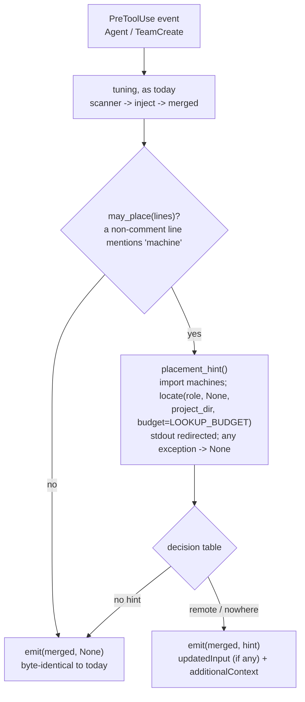

# phase-tuning hook: hint to start a remotely-placed phase as a herdr agent

## Goal

When a coordinator spawns a role (`Agent` or `TeamCreate`) that the repo places on another machine,
the phase-tuning hook adds a hint. The hint says that the subagent runs on this box, not there, and
shows how to start the role on its machine: `sdlc delegate <role> --issue <n>`, or the raw herdr
commands if `sdlc delegate` isn't available.

- **The spawn is allowed (D3).** The hook adds `hookSpecificOutput.additionalContext` and never
  sets `permissionDecision`. Nothing is denied.
- **Tuning and the hint share one payload.** `updatedInput` is built exactly as today. The hint is a
  sibling key.
- **Fail-open is unchanged.** If the import fails, a file can't be parsed, the lookup fails or it
  runs out of time, the hook adds no hint and the tuning output stays as it is.
- **Byte-identical where nothing is placed elsewhere.** This covers local roles, unplaced roles,
  repos that place nothing, and boxes with no registry. Two pre-existing scanner bugs are the only
  exception (next bullet). Their fixes change output only for configs that hit them today.
- **Scanner fixes.** #137 recorded two quirks in the tuning scanner for #138. This issue fixes them,
  and also a third defect in the same lines (see Approach, "Scanner fixes"):
  - a blank knob (a bare `machine:`) is read as a new role, so the role's later knobs are lost;
  - `null` is injected as the string `"null"`;
  - a prefixed role header (`sdlc:validator:`) leaks its knobs into the role above it.
- Tests go in `phase-tuning.test.sh`, which CI now runs under both YAML backends. The release also
  gets a CHANGELOG entry, README text, and **version 0.2.42**.

**Baseline.** This branch was cut from `dugshub/137-placement-resolver` at a6c7977, which holds
#137's spec only. The hook imports #137's code, so implementation starts once #137's implementation
is pushed to that branch.
- Before writing code, the implementer merges `origin/dugshub/137-placement-resolver` into
  `dugshub/138-remote-hint`.
- Merge, don't rebase: the branch is already pushed, and it must not be force-pushed. #137 did the
  same with #140.
- If #137's code isn't there yet (no `locate` in `plugin/lib/machines.py`), halt.

**What this spec relies on from #137** (its § Interfaces and consumer contract rules 6-9):
- **`lookup` and `locate`.** `locate(role, kind=None, *, project_dir=None, ..., budget=None)`
  returns `(Placement, Registry, Optional[PlacementConfig])`. `lookup(...)` is
  `locate(..., budget=LOOKUP_BUDGET)[0]`.
- **No raising, no printing, bounded time.** Neither function raises or prints. With `budget`, the
  file reads finish within `LOOKUP_BUDGET` (2.5 s), which is about 3 s of hook time including
  start-up (rule 7).
- **`Placement` fields:**
  - `status` is one of `off`, `placed`, `fallback`, `unplaceable`;
  - `off_cause` says why a placement is `off`;
  - `machine` is set only for `placed` and `fallback`;
  - `local` is true for `off`, and for a machine that is the registry's local one;
  - `requested` is `None` when the role has no placement of its own;
  - `candidates` comes in fit order, local first;
  - `reason` is one line and always set.
- **Reason texts.** A placement on the role's own target reads `<at> places <role> on '<m>'`. A
  fallback reads `<at> '<value>' was refused (<why>); using ...`. An unplaceable role reads
  `<role> has nowhere to run: ...`.
- **Opt-in.** Placement applies only once `sdlc.yml` sets a target (`phase_machines`,
  `agent_machines`, `default_machine`, or `phases.<role>.machine`). Otherwise every role is `off`.
- **`kind`.** #138 passes `kind=None`, because a hook can't tell a phase from an agent. The phase
  maps win over `agent_machines` for a role named in both.
- **The registry.** `Registry.local` and `Registry.get(name)` return a `Machine` with
  `transport.kind`, `transport.herdr` (the label for `herdr --machine`), `workdir` and
  `first_start`.

**Verified against Claude Code** (all line references are to the minified bundle):
- **2.1.310 (installed), live.** I ran `claude -p --model haiku` with a probe PreToolUse hook on
  `Bash` and `Agent`. The hook returned `updatedInput` and `additionalContext` together, with no
  `permissionDecision`. Results:
  - the command and the subagent's prompt were both rewritten;
  - the model quoted the context back as `PreToolUse:Agent hook additional context: "<text>"`;
  - the calls ran.
- **The source agrees.**
  - `updatedInput` is applied only when the hook sets no decision:
    `if (updatedInput && permissionBehavior === undefined) yield hookUpdatedInput`.
  - `additionalContexts` is yielded separately, as a `hook_additional_context` attachment
    (`hookName: "PreToolUse:<tool>"`).
  - `permissionDecisionReason` is used only together with a decision, as the permission message.
    With no decision it reaches neither the model nor the user.
- **2.1.226 (the CI pin), static only.** CI uses it only for `claude plugin validate`. I fetched
  `@anthropic-ai/claude-code-linux-x64@2.1.226` and read its bundle:
  - the PreToolUse schema is the same: `permissionDecision`, `permissionDecisionReason`,
    `updatedInput`, `additionalContext`;
  - the handling is the same: the same `updatedInput && permissionBehavior === void 0` guard, and
    the same `hook_additional_context` yield.

  I didn't run it, because an old binary could migrate `~/.claude` state.
- **Consequences:**
  - The hint goes in `additionalContext`.
  - The hook must not add `permissionDecision: "allow"`. That would also bypass the user's
    permission rules for the spawn, and it would move `updatedInput` onto a different code path.
  - `permissionDecisionReason` is useless here.
- **When the model reads it.** The attachment reaches the model together with the tool's result.
  For a foreground `Agent` call, that is after the subagent has finished. For a background one, it
  is right away. The hint text reads correctly either way.

## Approach

### Where it sits



- **The tuning path doesn't move.** Role resolution, the `sdlc.yml` check, and the `inject` and
  `merged` computation all stay where they are (`phase-tuning.py:126-190`). `inject` is computed
  first. Then `placement_hint()` runs, inside its own `try/except Exception` that returns `None`.
  Only after both does the hook print. So nothing in the placement path can lose the tuning.
- **Exits that stay ahead of placement.** A non-spawn tool, a spawn with no role, and a project
  with no `.claude/sdlc.yml` still exit before placement is considered (`:126-142`). Placement
  needs an opted-in `sdlc.yml` in the same project directory anyway: #137's `sdlc_path` is given
  `project_dir` and doesn't walk up past it.
- **`may_place(lines)` is a cheap gate.** Every opt-in key contains `machine`: `phase_machines`,
  `agent_machines`, `default_machine` and `phases.<role>.machine`. So a file in which no line
  outside a whole-line comment mentions `machine` can't opt in.
  - For such repos the hook never imports `machines.py` and never touches the registry. That makes
    "repos that place nothing → today's output" true by construction, at no cost.
  - A false positive (the word in a value or a trailing comment) only costs a lookup.
  - A false negative needs exotic YAML, such as an escaped key name. Its effect is no hint, the
    fail-open direction.
- **Calling #137.** `placement_hint()`:
  1. sets `sys.dont_write_bytecode = True`, as `machines.py`'s docstring requires of this hook;
  2. puts `<plugin>/lib` at `sys.path[0]`, resolved from `__file__` as `bin/sdlc` does;
  3. inside `contextlib.redirect_stdout(io.StringIO())`, imports `machines` and calls
     `machines.locate(role, None, project_dir=project_dir, budget=machines.LOOKUP_BUDGET)`.

  `project_dir` is the value the hook already computes (`$CLAUDE_PROJECT_DIR`, else the event's
  `cwd`, else `os.getcwd()`, `:139`). Passing it makes #137's lookup source `project` and the
  hook's own `sdlc.yml` the same file. The stdout redirect costs two lines. It guarantees that a
  stray `print` in a future `machines.py` can't corrupt the JSON, which would silently drop the
  tuning (#137 rule 6 already promises silence).
- **Why `locate(..., budget=LOOKUP_BUDGET)` and not `lookup()`.** The hint needs the target
  `Machine` (herdr label, `workdir`, `first_start`) and the local machine's name. `lookup()`
  returns only the `Placement`.
  - A second `load()` would parse the registry again. Under yq that is up to 2 s more, which
    breaks the hook's 5 s budget.
  - #137 defines `lookup` as exactly `locate(..., budget=LOOKUP_BUDGET)[0]`, so the never-raises,
    prints-nothing and time-bound guarantees (rules 6 and 7) are the same.
  - See Open questions.
- **`kind=None`,** per #137.

### Decision table

`p` is the `Placement`, `reg` the `Registry`.

| `p.status` | `p.requested` | `p.local` | Output |
|---|---|---|---|
| `off` (any `off_cause`: `no-registry`, `registry-errors`, `sdlc-errors`, `no-placement`, `time-budget`) | any | `True` | **no hint** |
| `placed` / `fallback` | `None` (the role has no placement; the default target was used) | any | **no hint**: an unplaced role, so byte-identical |
| `placed` / `fallback` | set | `True` | **no hint**: it runs where it is placed (or fell back to this box) |
| `placed` / `fallback` | set | `False` | **remote hint** |
| `unplaceable` | `None` | `False` | **no hint**: unplaced. `check` already reports the default-target problem |
| `unplaceable` | set | `False` | **nowhere hint** |

Consequences, stated so the reviewer can object:
- **A remote `default_machine` alone never triggers a hint.** The issue says unplaced roles stay
  byte-identical. A hint on every `general-purpose` or `Explore` spawn would be noise. The hook
  speaks only for roles the repo names in `phase_machines`, `agent_machines` or
  `phases.<role>.machine`, including when such a role falls back to a remote default.
- **A shared `sdlc.yml` naming a machine a teammate doesn't have** falls back to that teammate's
  local box. The hook stays silent, and `check` reports it (#137).
- **`any` whose candidates include the local machine** resolves local (local first), so no hint.

### The hint text

The text is plain ASCII, one fact per line, with no Markdown. Templates are below; `[...]` marks a
line or fragment that appears only when its condition holds.

| Name | Value |
|---|---|
| `{what}` | `Agent subagent` for `Agent`, `TeamCreate teammate` for `TeamCreate` |
| `{role}` | the role with its namespace stripped |
| `{raw}` | `subagent_type` or `agent_type` as spawned (e.g. `sdlc:validator`) |
| `{m}` | `p.machine` |
| `{local}` | `reg.local.name` |
| `{label}`, `{workdir}`, `{gates}` | from `reg.get(p.machine)`: `transport.herdr`, `workdir`, `", ".join(first_start)` |
| `{model}`, `{effort}` | from the merged spawn input, i.e. what this spawn runs with (an explicit argument, else the injected value) |

**Remote hint:**

```text
sdlc machines: {p.reason}.
This {what} runs on this box ('{local}'), not on '{m}': a subagent can't change machines. The hook let it start; it never blocks a spawn.
To run {role} on '{m}' instead, start it there as a herdr agent:
  sdlc delegate {role} --issue <n>
Without `sdlc delegate`, use herdr directly:
  herdr --machine {label} tab create --label {role}-<n> --no-focus[ --cwd {workdir}]
  herdr --machine {label} agent start {role}-<n> --kind claude --pane <.result.root_pane.pane_id from tab create> -- --permission-mode auto --agent {raw}[ --model {model}][ --effort {effort}]
  herdr --machine {label} agent prompt {role}-<n> '<the prompt of this call>'
['{m}' has no workdir in the registry: cd the new pane to a checkout before agent start.]
['{m}' shows first-start prompts ({gates}): while agent start reports agent_not_ready, send Down then Enter to the pane.]
[any: sdlc delegate picks the least loaded of {c1}, {c2}, ...]
Results come back through GitHub (a pushed branch or a PR comment), so ask for that in the brief. Explain: sdlc machines where {role}
```

**Nowhere hint** (`unplaceable` with its own placement):

```text
sdlc machines: {p.reason}.
This {what} runs on this box anyway: the hook never blocks a spawn, and sdlc delegate would refuse this role too. Fix the placement or needs.{role} in sdlc.yml; sdlc machines check lists every refusal.
```

Rules:
- **The herdr block is optional.** It (the "Without" line and the three commands, plus the workdir
  and first-start lines) appears only when `reg.get(m)` exists, its `transport.kind == "herdr"`,
  and `transport.herdr` is set. Otherwise the hint ends after the `sdlc delegate` line and the
  "Results ... Explain" line. #136 makes this unreachable for a placeable machine; the check is
  belt and braces.
- **The `any` line** appears when `len(p.candidates) > 1`. The commands name `p.machine` (the first
  candidate). Load is `delegate`'s job (#137 rule 8).
- **Quoting.** Every interpolated value in a command line goes through `shlex.quote`, `{role}-<n>`
  as `shlex.quote(role) + "-<n>"`. `<n>` and the `<...>` placeholders stay literal: the coordinator
  fills in the issue number.
- **Bounds.**
  - Each interpolated value, `p.reason` included, is cut to `VALUE_MAX` (200) characters, ending
    with `...` when cut.
  - If the assembled text is still over `HINT_MAX_CHARS` (2000), the herdr block is dropped.
  - Typical length is about 1.1 KB. Claude Code's own cap on `additionalContext` (8000 characters,
    200 lines) is never reached.
- **Raw herdr commands.** These were checked against `herdr` 0.9.5's help:
  - `tab create` takes `--cwd`, `--label` and `--no-focus`, and returns `.result.root_pane`;
  - `agent start <NAME> --kind claude --pane <ID> -- <args>`;
  - `agent prompt <TARGET> <TEXT>`.

  The flags passed to `claude`:
  - `--permission-mode auto` is from the plan's #139 entry;
  - `--agent sdlc:validator`: I checked live that `claude --agent sdlc:validator` with the plugin
    loaded runs as the validator;
  - `--model` and `--effort` take the same vocabulary as `phases`.

  `maxTurns` and `isolation` aren't carried over: `--max-turns` is print-mode only, and the remote
  box has its own `workdir`.
- **The hint doesn't check whether `sdlc delegate` exists.** #139 ships in parallel. The fallback
  line covers either merge order.

### Output

`emit(merged, hint)` prints at most one JSON object, with `json.dumps` defaults (separators
`", "` and `": "`; `ensure_ascii` true, so the bytes are ASCII).

| `inject` non-empty | hint | Printed |
|---|---|---|
| no | none | nothing (today) |
| yes | none | `{"hookSpecificOutput": {"hookEventName": "PreToolUse", "updatedInput": {...}}}`, exactly today's bytes |
| yes | text | `{"hookSpecificOutput": {"hookEventName": "PreToolUse", "updatedInput": {...}, "additionalContext": "..."}}` |
| no | text | `{"hookSpecificOutput": {"hookEventName": "PreToolUse", "additionalContext": "..."}}`. No `updatedInput` echo of the unchanged input |

The keys are always in the order `hookEventName`, `updatedInput`, `additionalContext`. The hook
never prints `permissionDecision`, `permissionDecisionReason`, `systemMessage`, `decision` or
`continue`.

### Time and fail-open

- **Repos that place nothing** pay no added time, because of the gate.
- **A repo that places, on a box with no registry,** pays the `machines` import (tens of
  milliseconds) and one `stat` (#137 rule 7).
- **The worst case** is #137's bound, about 3 s, inside the hook's 5 s (`hooks.json:161`). This
  happens when yq is slow or hangs and the budget runs out. The hook then emits the tuning with
  no hint. `hooks.json` is unchanged.
- **Past 5 s Claude Code kills the hook,** which would lose the tuning too. That is why the test
  that hangs yq fails above 5 s (Tests, T14).
- **Every failure gives `None` and today's output:**
  - no `lib/`, or `machines.py` failing to import;
  - no PyYAML and no yq (D2);
  - a broken registry, or a broken `sdlc.yml` placement block;
  - a `time-budget` result;
  - an exception anywhere in `placement_hint()` or `format_hint()`.

  The outer wrapper at `:205-211` stays as the last line of defence.

### Scanner fixes (pre-existing; in scope by decision)

I reproduced each one on a6c7977 by piping `Agent` events into `phase-tuning.sh`:

| # | Config | Today | After |
|---|---|---|---|
| Q1 | `phases:` / `validator:` / `machine:` (bare) / `model: fable` | prints nothing for `validator`: `machine:` became a role and took `model` | `model: fable` injected |
| Q2 | `phases.validator.model: null` (also `~`, `Null`, `NULL`) | `"model": "null"` (or `"~"`) injected; it even beats a flat `phase_models.validator: sonnet` | unset, so the flat value or frontmatter applies, as #137 reads null |
| Q3 | `phases:` / `implementer:` / `model: sonnet` / `sdlc:validator:` / `model: haiku` / `max_turns: 7` | **`implementer` gets `model: haiku, maxTurns: 7`**: the prefixed header was read as a knob, and its knobs leaked upward | `implementer` keeps `sonnet`. `sdlc:validator` still doesn't tune (unchanged; #137's `check` warns about the prefix) |

Why fix them here:
- Q1 and Q3 are one defect: the scanner decides role-vs-knob from the value instead of the indent.
  #138 is the release in which users write `machine` under `phases.<role>`, the form that hits Q1.
- Q2 makes the hook agree with #137, where null is unset.
- All three changes are small, and none touches the placement path.

**The rule for `read_nested_block`:**
- The **role indent** is the indent (spaces or tabs) of the first entry line in the block.
- A line indented **at or left of** the role indent is a role entry:
  - `name: {…}` is an inline role (parsed as today; a later entry for the same role replaces it,
    as today);
  - `name:` with a blank or null value opens role `name`;
  - `name: <scalar>` is not a role map, so no role is open until the next role entry. Its deeper
    lines are ignored.
- A line indented **right of** the role indent is a knob of the open role, if one is open:
  - a blank or null value means unset (skipped, never a header);
  - a `{`-value is skipped;
  - otherwise the knob gets the value as today.
- Top-level detection, comment and blank handling, and inline-flow parsing are unchanged.

**Null.** A new helper `scalar(raw)` replaces `strip_value` at every value read, in `read_block`,
knob lines and inline pairs:
- the comment is stripped as today, then whitespace;
- **unquoted** `null`, `Null`, `NULL`, `~` or an empty string returns `None`, meaning unset;
- otherwise surrounding quotes are stripped as today.

So a quoted `"null"` is still the string `null`, which is YAML's meaning.

**Checked.** I prototyped the rule and compared it with today's scanner on:
- the test file's fixture;
- the `phases:` block of `sdlc.example.yml`, uncommented;
- a tab-indented block;
- this repo's `.claude/sdlc.yml`.

The output was identical on all four. It differed only on Q1-Q3.

**Not fixed, recorded:**
- the scanner reads the first copy of a repeated top-level block;
- prefixed role keys are not normalised (`sdlc:validator:` never tunes; see Out of scope).

### Version and merge order

- **`plugin.json`:** 0.2.41 (#137) → **0.2.42**.
- **#138 and #139 run in parallel.** The second of them to merge rebases onto the first and takes
  **0.2.43**: its `CHANGELOG` entry goes above the other's, and `plugin.json` becomes 0.2.43. The
  two also touch the same README section, `CHANGELOG.md` and maybe `verify.yml`. Expect small text
  conflicts.

## File-level plan

### Create

None.

### Modify

- **`plugin/hooks/phase-tuning.py`.** All changes are under Interfaces:
  - **The scanner.**
    - `scalar()` replaces `strip_value()` at every value read. Keep `strip_value` only if something
      else uses it (nothing does today).
    - `read_nested_block()` decides role or knob by indent.
    - `read_block()` reads null as unset.
  - **`may_place(lines)`.**
  - **`placement_hint(...)`.** It does the import and `locate` call under
    `redirect_stdout`, inside `try/except Exception → None`, and sets
    `sys.dont_write_bytecode = True` before the import.
  - **`format_hint(...)`.** It is pure: it holds the decision table and the templates.
  - **`emit(merged, hint)`.** It replaces the print at `:192-202`.
  - **`main()`.** After `inject` (`:179-190`), `hint = placement_hint(...) if may_place(lines) else
    None`. Then:
    - if `not inject and not hint` → `fail_open()`;
    - else `emit(merged if inject else None, hint)`.
  - **Module docstring:**
    - the hook may now also add `additionalContext`;
    - it never sets a permission decision;
    - D3;
    - fail-open covers placement.
  - **Constraints:**
    - Python 3.8 and stdlib only (`contextlib`, `io`, `shlex` are new imports);
    - nothing new at import time beyond those imports;
    - `machines` is imported lazily, only when the gate passes.
- **`plugin/hooks/phase-tuning.sh`.** Header comment only (`:1-47`, `:59-60`):
  - describe the hint and the decision table in two lines;
  - "prints only on a real injection" becomes "prints only on an injection or a hint";
  - add placement to the FAILS OPEN list ("no registry, no placement, or any placement error → no
    hint");
  - note that the hook never decides permission, so the user's rules still apply to the spawn.

  No logic change.
- **`plugin/hooks/phase-tuning.test.sh`.** New cases (Tests). Harness changes at the top:
  - `export HOME="$TMP/home"`, with `unset SDLC_MACHINES XDG_CONFIG_HOME`, so the developer's real
    registry never leaks in. This matters on a box whose owner keeps a hand-written registry.
  - `export PYTHONDONTWRITEBYTECODE=1`.
  - Backend detection, the `noyaml` shadow package and `SDLC_REQUIRE_BOTH_BACKENDS`, mirroring
    `plugin/lib/machines.test.sh:20-55`. Two required-backend assertions when the variable is 1.
  - A `nobackend` PATH directory with symlinks for `python3`, `cat` and `dirname` (the wrapper
    needs the last two) and no `yq`.
  - Helpers next to `got()`/`empty()`:
    - `ctx()` reads `.hookSpecificOutput.additionalContext`;
    - `hkeys()` reads `.hookSpecificOutput | keys_unsorted | join(",")`;
    - `runp FIXTURE_DIR REGISTRY BACKEND tool_input [tool]`.
  - Existing cases are unchanged, and they run with no registry.
  - The summary line format is kept: `phase-tuning: N passed, M failed`.
- **`.github/workflows/verify.yml`.** Add one step after "Machine registry tests" and after #137's
  "Placement resolver tests", with the same env:

  ```yaml
  - name: Phase-tuning hook tests
    env:
      SDLC_REQUIRE_BOTH_BACKENDS: "1"
    run: bash plugin/hooks/phase-tuning.test.sh
  ```

  The suite isn't in CI today. Don't rename the job: its `name:` is a required check.
- **`plugin/sdlc.example.yml`.** Two edits, both in #137's commented Machines block (comments only;
  #137's B1 extraction from `# phase_machines:` to the next bare `#` is untouched):
  - In the last paragraph, replace "To unset it, delete the line or write `machine: null`; never
    leave a bare `machine:` (the tuning hook misreads it)." with "To unset it, delete the line or
    write `machine: null`."
  - Add two lines before the `# phase_machines:` example: "When a role placed on another machine is
    spawned as a subagent, the phase-tuning hook tells the coordinator to start it there instead
    (`sdlc delegate <role>`); the spawn itself still runs here."
- **`README.md`.** Inside `## Machines`, after #137's `### Placing phases and agents`, add
  `### The remote hint`. It covers:
  - when the hint appears: a role the repo places on another machine is spawned with
    `Agent`/`TeamCreate`;
  - that the spawn still runs here (a hint, not a block) and the hook never decides permission;
  - what the hint offers: `sdlc delegate` and the raw herdr commands;
  - no change for local roles, unplaced roles (even under a remote `default_machine`), repos that
    place nothing, or boxes with no registry;
  - that an unplaceable role gets a one-line warning;
  - time: none added unless the repo places something, and at most about 3 s on a slow registry
    read;
  - that the coordinator sees the hint with the Agent call's result.

  Generic names only.
- **`CHANGELOG.md`.** New top entry `## [0.2.42] — 2026-10-25`.
  - `### Added — the phase-tuning hook points remote-placed roles at their machine`.
    - **Why:** a subagent always runs on the coordinator's box. Until now, a role placed on a worker
      box quietly ran locally anyway.
    - **Bullets:** the hint and where it appears; the spawn still runs (no deny, no permission
      decision); `sdlc delegate` or raw herdr; byte-identical output for everything not placed
      elsewhere; fail-open on any registry or `sdlc.yml` problem; the CI step.
  - `### Fixed — phase-tuning reads blank and null knobs as unset`. Q1-Q3 in one bullet each, each
    with its user-visible effect.
- **`plugin/.claude-plugin/plugin.json`:** `version` 0.2.41 → 0.2.42. If #139 merges first, see
  "Version and merge order".

Unchanged:
- `plugin/hooks/hooks.json`: the matcher, `async:false` and the 5 s timeout stay.
- `plugin/lib/machines.py`, `plugin/bin/sdlc`, `plugin/lib/herdr.py`.

## Interfaces

```python
# ── plugin/hooks/phase-tuning.py (changes) ───────────────────────────────────
# Stdlib only, Python >= 3.8. Fails open: every new path returns None / prints nothing on error.
import contextlib, io, shlex                      # new imports
from typing import Any, Dict, List, Mapping, Optional

NULLS = ("null", "Null", "NULL", "~")             # unquoted YAML nulls read as unset
HINT_MAX_CHARS = 2000                             # over this, the herdr block is dropped
VALUE_MAX = 200                                   # each interpolated value is cut to this ("..." suffix)

def scalar(raw: str) -> Optional[str]: ...
    # comment-strip, whitespace-strip; None for "" or an unquoted NULLS spelling; then strip quotes

def read_block(lines: List[str], key: str) -> Dict[str, str]: ...
    # unchanged except values go through scalar(); None -> entry absent

def read_nested_block(lines: List[str], key: str) -> Dict[str, Dict[str, str]]: ...
    # role entry vs knob decided by indent against the block's first entry (see Approach)

def may_place(lines: List[str]) -> bool: ...
    # any(line that isn't a whole-line comment contains "machine")

def placement_hint(tool_name: str, raw_role: str, role: str, project_dir: str,
                   spawn: Mapping[str, Any]) -> Optional[str]: ...
    # sys.dont_write_bytecode = True; sys.path.insert(0, <plugin>/lib);
    # with redirect_stdout(StringIO()): import machines;
    #   p, reg, _ = machines.locate(role, None, project_dir=project_dir, budget=machines.LOOKUP_BUDGET)
    #   return format_hint(tool_name, raw_role, role, p, reg, spawn)
    # any Exception -> None. `spawn` is the merged input (explicit args + injected tuning).

def format_hint(tool_name: str, raw_role: str, role: str, placement: Any, registry: Any,
                spawn: Mapping[str, Any]) -> Optional[str]: ...
    # pure. Decision table -> None | remote hint | nowhere hint (templates in Approach)

def emit(merged: Optional[Dict[str, Any]], hint: Optional[str]) -> None: ...
    # print(json.dumps({"hookSpecificOutput": {"hookEventName": "PreToolUse",
    #        **({"updatedInput": merged} if merged else {}),
    #        **({"additionalContext": hint} if hint else {})}}))
    # never permissionDecision / permissionDecisionReason

# Uses from #137 (contract, not internals):
#   machines.locate(role, kind=None, *, project_dir=None, registry_file=None, config_file=None,
#                   env=None, cwd=None, budget=None) -> (Placement, Registry, Optional[PlacementConfig])
#   machines.LOOKUP_BUDGET; Placement.{status, off_cause, machine, candidates, local, requested, reason}
#   Registry.local, Registry.get(name) -> Machine.{name, transport.kind, transport.herdr, workdir, first_start}
```

## Tests

Everything goes in `plugin/hooks/phase-tuning.test.sh`. CI runs it with
`SDLC_REQUIRE_BOTH_BACKENDS=1`. Run it locally with `nice -n 19 bash plugin/hooks/phase-tuning.test.sh`.

**Fixtures.**
- **`REG`** (`$TMP/machines.yaml`):
  - `here`: local; caps `edit, test`; keeps `checkouts`; secrets `dev`.
  - `worker-1`: transport `{herdr: w1-label}`. The label differs from the name on purpose, to
    prove the hint uses the label. `workdir: /srv/work`; caps `edit, test, browser, full-suite`;
    `first_start: [trust-prompt, fullscreen-notice]`.
  - `worker-2`: transport `{herdr: worker-2}`; no `workdir`; caps `edit, test, browser`.
  - `control`: `assignable: false`.
- **`P`** (`.claude/sdlc.yml`, places roles):

  ```yaml
  phases:
    implementer:
      model: opus
    validator:
      model: sonnet
      machine: worker-1
  phase_machines:
    implementer: local
    reviewer: worker-2
    checker: any
    tester: worker-2
  agent_machines:
    browser-pilot: worker-1
  needs:
    validator: [full-suite]
    checker: [browser]
    tester: { keeps: [datasets] }
    lonely: [gpu]
  ```

- **`P2`** = `phase_machines: {reviewer: control}`, `default_machine: worker-2`.
- **`BASE`** = the existing fixture. It contains no `machine` text.
- **`REG_BAD`** = `REG` with `worker-1` also `transport: local` (two local machines, so not
  usable).
- **`P_BAD`** = `P` with `agent_machines: [x]` (a broken placement block).

**Golden strings.** These are today's exact bytes, captured on a6c7977:
- `G_IMPL_BASE` = `{"hookSpecificOutput": {"hookEventName": "PreToolUse", "updatedInput": {"subagent_type": "sdlc:implementer", "prompt": "x", "model": "sonnet", "maxTurns": 40, "isolation": "worktree"}}}`
- `G_SPEC_BASE` = `{"hookSpecificOutput": {"hookEventName": "PreToolUse", "updatedInput": {"subagent_type": "sdlc:specifier", "prompt": "x", "model": "claude-opus-4-8", "effort": "high"}}}`
- `G_IMPL_P` = `{"hookSpecificOutput": {"hookEventName": "PreToolUse", "updatedInput": {"subagent_type": "sdlc:implementer", "prompt": "x", "model": "opus"}}}`
- `G_VAL_P` = `{"hookSpecificOutput": {"hookEventName": "PreToolUse", "updatedInput": {"subagent_type": "sdlc:validator", "prompt": "x", "model": "sonnet"}}}`

Each case below sends `prompt: "x"` unless it says otherwise. "[both]" means the case runs once
per available backend: PyYAML, and yq with PyYAML shadowed.

| # | Case (acceptance item) | Setup | Expect |
|---|---|---|---|
| T0 | **No registry → today exactly** | `BASE` and `P`, `HOME` empty | `sdlc:implementer` on `BASE` == `G_IMPL_BASE` and `sdlc:specifier` == `G_SPEC_BASE` (byte-compare with `[ "$out" = "$G" ]`). On `P`: `sdlc:validator` == `G_VAL_P`, and `sdlc:reviewer` gives empty output. |
| T1 | **[both] Remote role → hint, with tuning** | `P`, `REG` | `sdlc:validator`: `updatedInput.model == sonnet`; no `machine` key in `updatedInput`; `hkeys == hookEventName,updatedInput,additionalContext`. The output starts with `{"hookSpecificOutput": {"hookEventName": "PreToolUse", "updatedInput": {` and its `updatedInput` equals `G_VAL_P`'s. The context contains `sdlc machines: phases.validator.machine places validator on 'worker-1'`, `runs on this box ('here')`, `sdlc delegate validator --issue <n>`, `herdr --machine w1-label tab create`, `--cwd /srv/work`, `--agent sdlc:validator`, `--model sonnet`, `trust-prompt, fullscreen-notice`, `sdlc machines where validator` and `GitHub`. It does not contain `worker-1 tab create`, which would mean the name was used instead of the label. The context is ASCII (`LC_ALL=C grep -q '[^ -~]'` finds nothing apart from newlines) and at most 2000 characters. |
| T2 | Remote role, nothing to tune | `P`, `REG` | `sdlc:reviewer`: `hkeys == hookEventName,additionalContext`, so no `updatedInput`. The context has `on 'worker-2'`, `herdr --machine worker-2`, no `--cwd`, the `no workdir in the registry` line, and no `first-start` line. |
| T3 | **Local role → no hint, byte-identical** | `P`, `REG` | `sdlc:implementer` (placed `local`) == `G_IMPL_P`. |
| T4 | **Unplaced roles → no output** | `P`, `REG`; then `P2`, `REG` | `general-purpose` and `lonely` (unplaceable but unplaced) give empty output on `P`. `tour` on `P2` (default `worker-2`, unplaced) gives empty output. |
| T5 | Fallback to a remote default | `P2`, `REG` | `sdlc:reviewer`: the context has `was refused` and `on 'worker-2'`. |
| T6 | `any` | `P`, `REG` | `checker`: the context has `least loaded of worker-1, worker-2` and `herdr --machine w1-label`. |
| T7 | **[both] Nowhere hint** | `P`, `REG` | `tester`: the context has `has nowhere to run` and `runs on this box anyway`. It has no `sdlc delegate` and no `herdr`. No `updatedInput`. |
| T8 | Agent placement, `kind=None` | `P`, `REG` | `sdlc:browser-pilot`: the context has `agent_machines.browser-pilot`, `--agent sdlc:browser-pilot`, and `'worker-1'`. |
| T9 | Explicit spawn args win and are carried over | `P`, `REG` | `{"subagent_type":"sdlc:validator","model":"haiku","effort":"low"}`: no `updatedInput` (nothing to inject), and the context has `--model haiku --effort low`. |
| T10 | **[both] Broken registry → no output change** | `P`, `REG_BAD` | `sdlc:validator` == `G_VAL_P`; `sdlc:reviewer` gives empty output. |
| T11 | Broken placement in `sdlc.yml` → tuning untouched | `P_BAD`, `REG` | `sdlc:validator` == `G_VAL_P`. |
| T12 | No YAML backend (D2) | `P`, `REG`; `PYTHONPATH=noyaml`, `PATH=nobackend` | `sdlc:validator` == `G_VAL_P`. |
| T13 | Import failure and stdout guard | Copy `phase-tuning.sh` and `.py` into `$TMP/fp/hooks/`. Variant (a): no `$TMP/fp/lib`. Variant (b): `$TMP/fp/lib/machines.py` is `print("garbage"); raise RuntimeError("boom")`. Variant (c): a `machines.py` with `LOOKUP_BUDGET = 1` and `def locate(*a, **k): print("garbage"); return (object(), None, None)`, so the print must be swallowed and `format_hint` hits an `AttributeError`. | Each gives `sdlc:validator` on `P` == `G_VAL_P`, and the output parses as JSON. |
| T14 | Hung yq stays inside the hook timeout | `P`, `REG`, yq only: PyYAML shadowed, PATH holds a `yq` that runs `exec sleep 5`, plus `python3`, `cat`, `dirname` | `sdlc:validator` == `G_VAL_P` (the registry read times out, so `off`). Prints the elapsed time. **Fails only above 5 s,** the real kill threshold, because past it Claude Code would drop the tuning. |
| T15 | The gate skips the import | `$TMP/fp` with `lib/machines.py` that touches `$TMP/imported` and then raises | `BASE` with `REG` present: the marker is absent and the output == `G_IMPL_BASE`. `P`: the marker is present (the probe works) and `sdlc:validator` == `G_VAL_P`. |
| T16 | TeamCreate | `P`, `REG`; tool `TeamCreate`, `{"agent_type":"sdlc:validator"}` | The context has `TeamCreate teammate`, and `updatedInput.model == sonnet`. |
| Q1 | Bare knob | `phases:` / `validator:` / `machine:` / `model: fable` (no registry) | `updatedInput.model == fable` |
| Q2 | Null knobs | (a) `phases.validator.model: null`. (b) `model: ~` beside flat `phase_models: {validator: sonnet}`. (c) `model: "null"` (quoted) | (a) empty output. (b) `model == sonnet`. (c) `model == "null"`, a YAML string. |
| Q3 | No upward leak | `phases:` / `implementer:` / `model: sonnet` / `sdlc:validator:` / `model: haiku` / `max_turns: 7`. Then the same with `validator: sonnet` (a scalar at role level) in place of the prefixed header | `sdlc:implementer`: `model == sonnet`, no `maxTurns`, in both variants. `sdlc:validator` with the prefixed header: empty output. |

**Checks for the validator, outside the test file:**
- These exit 0, each run at `nice -n 19`:
  - `SDLC_REQUIRE_BOTH_BACKENDS=1 bash plugin/hooks/phase-tuning.test.sh`;
  - `SDLC_REQUIRE_BOTH_BACKENDS=1 bash plugin/lib/placement.test.sh`. #137's B15 still passes: it
    asserts `updatedInput` only, and the hint is a sibling key;
  - `SDLC_REQUIRE_BOTH_BACKENDS=1 bash plugin/lib/machines.test.sh`.
- **Differential byte check.** Extract the pre-change hook into a temp dir:
  `git show <#137 impl head>:plugin/hooks/phase-tuning.{sh,py}`. Compare old and new over this
  matrix:
  - tool inputs: `implementer`, `specifier`, `reviewer`, `validator`, `understander`,
    `general-purpose`, no role, an explicit `model`, a `TeamCreate`, and a `Bash` event;
  - `sdlc.yml` files: the test's `BASE`, its flat and `worktree.enabled` fixtures, the `phases:`
    block of `plugin/sdlc.example.yml` uncommented, and this repo's `.claude/sdlc.yml`;
  - registries: none, and `plugin/machines.example.yaml`.

  The output must be byte-equal everywhere. Add `P` with only its local and unplaced roles
  (`implementer`, `general-purpose`, `lonely`) under `REG`.
- **Live check (issue acceptance).** It runs from a scratch directory with
  `.claude/sdlc.yml = "phase_machines:\n  validator: worker-1\n"` and
  `SDLC_MACHINES=<worktree>/plugin/machines.example.yaml`, so the real registry is never read:

  ```bash
  nice -n 19 claude -p --model haiku --setting-sources local --plugin-dir <worktree>/plugin \
    --allowedTools Agent --output-format json \
    "Call the Agent tool once: subagent_type sdlc:validator, description probe, prompt 'Reply with exactly OK. Use no tools.' Then quote verbatim any hook context you received about that call."
  ```

  The `result` quotes `places validator on 'worker-1'` and `sdlc delegate validator`, and the
  subagent ran. Repeat with `implementer: local` in place of `validator`, and with no
  `SDLC_MACHINES`: no hook context is quoted. `--setting-sources local` keeps the installed
  marketplace copy of the plugin from loading a second phase-tuning hook.
- **Genericity grep,** which must print nothing:
  `grep -rniE 'maplelog|devbox|node2|10\.88\.|game' plugin/hooks/phase-tuning.py plugin/hooks/phase-tuning.sh plugin/hooks/phase-tuning.test.sh`.
  Apply the same pattern to the `+` lines of the `README.md`, `CHANGELOG.md`, `sdlc.example.yml`
  and `verify.yml` diff.
- `bash plugin/scripts/verify-version-bump.sh` reports the bump. `just sdlc::verify` exits 0, and
  `claude plugin validate ./plugin` passes apart from the pre-existing icon warning.

## Out of scope

- **A `deny` mode** (D3's later knob, if hints get ignored). The issue's fallback, "switch to
  `permissionDecision: deny` with the same reason text", isn't taken, because Gate 0 kept D3.
- **`sdlc delegate` itself** (#139). The hook doesn't check whether it exists, and it doesn't probe
  herdr, read load or check busy flags. If #139 lands first with different start flags or
  first-start choreography, align the raw herdr lines to match. That is a text change.
- **Coordinator or command prose** that tells agents how to react to the hint (`/develop`,
  `/orchestrate`, coordinator.md). This issue only adds the hint.
- **Hints for unplaced roles under a remote `default_machine`** (see the decision table).
- **Guessing the issue number** from the spawn prompt. The hint keeps the `<n>` placeholder.
- **Scanner items not fixed:**
  - prefixed role keys (`sdlc:validator:`) still never tune. Only their upward leak (Q3) is fixed,
    and #137's `check` warns about the prefix;
  - the first copy of a repeated top-level block still wins.
- **Raising the hook's 5 s timeout.**
- **Restricted "personal hook" sessions.** In 2.1.310, a session can let the user's own hooks block
  a call or ask about it, but not change it. There, an input-changing `updatedInput` is refused,
  and the call doesn't run. That is today's behaviour for tuning, and #138 doesn't change it. A
  hint-only output carries no `updatedInput`, so it isn't affected.

## Open questions

All have defaults, and none blocks implementation.

- **`locate(..., budget=LOOKUP_BUDGET)` instead of `lookup()`.** The default is `locate`. The hint
  needs the target machine's herdr label, `workdir`, `first_start`, and the local machine's name,
  and only the `Registry` that `locate` returns has them. A second `load()` would double the worst
  case past the 5 s timeout. #137 defines `lookup` as this exact call's first element, so the
  guarantees are the same. Alternative if the lead wants `lookup()` strictly: the raw herdr block
  uses `<herdr label>` and `<workdir>` placeholders and points at `sdlc machines list`.
- **A remote `default_machine` alone doesn't hint unplaced roles.** The default is to follow the
  issue's "unplaced → byte-identical". The hook speaks only for roles the repo names, including
  their fallbacks.
- **An unplaceable role with its own placement gets a two-line "nowhere" hint.** #137 left this text
  to #138. An unplaceable role without a placement stays silent, per the #137 reviewer's note.
- **The scanner fixes are in scope:**
  - Q1 and Q2, the quirks #137 recorded;
  - Q3, a cross-role leak I found in the same lines: worse than recorded, because a prefixed role
    header retunes the role above it.

  Prefix normalisation is deferred. It would change which roles tune, while the three fixes only
  stop knobs from being lost or corrupted.
- **What the raw herdr block passes.** It carries `--agent <subagent_type>`, `--permission-mode
  auto`, and `--model`/`--effort` from the merged spawn input, but not `maxTurns` or `isolation`.
  `#139` owns the real choreography.
- **The hint is read with the tool's result.** For a foreground Agent call, that is after the
  subagent finishes. The text is worded for both cases. If coordinators ignore it, D3's `deny` knob
  is the escalation.
- **Version 0.2.42**, assuming #137 ships 0.2.41. Whichever of #138 and #139 merges second rebases
  onto the other and takes 0.2.43.
- **CI gains a "Phase-tuning hook tests" step.** The suite has never run in CI.

---

<!--
The sections below this divider are the **phase execution log**. They are
written by phase agents (reviewer, specifier, implementer, validator) as the
issue progresses through gates. The static spec sections above are the
current implementation contract; the phase sections below are how we got
here. See `instructions.yaml.phases` for ownership and gate mapping.

When `instructions.yaml.implementer_view` is `clean`, sections below this
divider are stripped before the implementer reads the spec.
-->

## Spec Review
<!-- written by: reviewer · gate 1.5 · /sdlc:critique · lens=mixed -->

**Target:** `.ai-docs/stacks/machines/specs/138.md` @ `8b6cc75`
**Against:** issue #138 · `plan.yaml` D2-D3 (D3 binding) · ADR-009 §3 · cited code (`plugin/hooks/phase-tuning.{py,sh,test.sh}`, `hooks.json`) · #137's implementation at PR #141 head `e3d0a46` (`plugin/lib/machines.py`, `placement.test.sh`, `sdlc.example.yml`, `verify.yml`) · Claude Code 2.1.310 (installed binary) and 2.1.226 (npm cache, static)
**Verdict:** REVISE

**What was verified, and holds:**
- **`locate` exists as assumed.** At `e3d0a46`, `locate(role, kind=None, *, project_dir, registry_file, config_file, env, cwd, budget=None) -> (Placement, Registry, Optional[PlacementConfig])` matches § Interfaces exactly. `lookup` is `locate(..., budget=LOOKUP_BUDGET)[0]`, with `LOOKUP_BUDGET = 2.5`, `SDLC_SKIP_AFTER = 1.0` and `YQ_TIMEOUT = 2.0`. Every field the spec reads exists: `Placement.{status, off_cause, machine, candidates, local, requested, reason}`, `Registry.local` and `Registry.get`, `Machine.{name, workdir, first_start}`, `Transport.{kind, herdr}`. Open question 1 (use `locate`, not `lookup`) is right.
- **The worst case fits the 5 s timeout.** I timed `locate` from `e3d0a46` at `nice -n 19` with PyYAML hidden:
  - yq hangs on every call: the registry read times out after 2.06 s → `off` / `registry-errors`;
  - yq answers the registry and hangs on `sdlc.yml`: 2.06 s → `off` / `sdlc-errors`.

  The ceiling is 2.5 s of file reads, reached when the registry read takes 0.5-0.99 s. With start-up that is about 3 s, inside 5 s.
- **The decision table matches #137.** I ran the real `locate()` on the spec's `REG`, `P`, `P2`, `REG_BAD` and `P_BAD`:
  - remote: `validator` (placed, `worker-1`), `reviewer` (placed, `worker-2`), `checker` (placed by `any` on `worker-1`; candidates `worker-1,worker-2`) and `browser-pilot` (placed, `worker-1`, from `agent_machines`);
  - local: `implementer` (placed, `here`);
  - `requested=None`: `general-purpose` (placed, `here`), `lonely` (unplaceable) and, on `P2`, `tour` (placed on the remote default `worker-2`);
  - `tester` (unplaceable, with its own placement);
  - on `P2`, `reviewer` (falls back to `worker-2`);
  - `REG_BAD` → `off` / `registry-errors`; `P_BAD` → `off` / `sdlc-errors`.

  The expectations of T1-T11 hold.
- **The goldens are today's bytes.** `G_IMPL_BASE`, `G_SPEC_BASE`, `G_IMPL_P` and `G_VAL_P` are byte-equal to the output of today's hook. `BASE` contains no `machine` text. #137 doesn't touch `plugin/hooks/` (diff `a6c7977..e3d0a46`), so `a6c7977` is a valid pre-change ref.
- **The gate has no practical false negatives.** `_opts_in` (`machines.py`) opts in only through `phase_machines`, `agent_machines`, `default_machine` and `phases.*.machine`, and all four contain the literal `machine`. Namespaced keys still put the literal on a non-comment line: `#137` normalises `sdlc:validator` under both `phase_machines` and `phases`. So does `phases.<role>.machine` in block or flow form. A case-sensitive match is correct, because #137 is case-sensitive too. Only YAML escapes in quoted keys (`"phase_\x6dachines"`) slip through, and they fail open.
- **The Claude Code claims hold.**
  - 2.1.310: `if(je&&Me.permissionBehavior===void 0)yield{type:"hookUpdatedInput"...}`, then the `hook_additional_context` yield with `hookName:\`PreToolUse:${n.name}\``. The caps are `additionalContext:8000` and 200 lines. The consumer is `case"additionalContext":if(!As(s.agentContext))mt.push(...)`, where `As` is true only for a subagent with `delegatedObservation`. Ordinary coordinators and teammates receive the context. Non-progress messages are buffered in `mt` and returned together with the tool result.
  - 2.1.226 (`claude-code-linux-x64` from the npm cache, not run): the same PreToolUse schema, the same guard, the same yield, and an unconditional `push`.
- **The surrounding pieces check out.**
  - `herdr` 0.9.5's help matches `tab create --cwd/--label/--no-focus`, `agent start <NAME> --kind --pane -- ...` and `agent prompt <TARGET> <TEXT>`.
  - The README at `e3d0a46` confirms that Claude Code puts a plugin's `bin/` on the Bash tool's PATH, so a bare `sdlc delegate` resolves for an in-session coordinator.
  - #137's B15 still passes, because it asserts `updatedInput` only and runs with an empty `HOME`.
  - The `sdlc.example.yml` edits fall outside #137's B1 extraction window (`# phase_machines:` to the next bare `#`).
  - `machines.example.yaml` has `worker-1` with `full-suite`, so the live check resolves.
  - There is no new hard dependency, and the suite runs at `nice -n 19`.
  - The line references for `phase-tuning.py`, `.sh` and `hooks.json:155-163` (timeout at `:161`) are correct.
- **The scanner quirks are real.** All three reproduce on `a6c7977` exactly as the table says: Q1 prints nothing; Q2 injects `"model": "~"`; Q3 gives `implementer` `model: haiku, maxTurns: 7`. The scalar-at-role-level variant of Q3 leaks the same way. I also prototyped the indent rule. It matches today's output on the test fixture, the uncommented example block, a tab-indented block and this repo's `sdlc.yml`, which confirms the spec's claim. For the exceptions, see N2.

**Blockers (1):**
- [`§ Goal` "When the model reads it" (`:104-106`) · `§ The hint text`, the Remote hint template (`:197-212`) · `§ Open questions`, bullet 6 (`:658-660`)] **The hint's wording doesn't fit when it arrives, and it invites running a role twice.**
  - **The timing.** The spec is right that the context reaches the model together with the tool result (verified above). The placed spawns that matter are foreground: `coordinator.md:95-125` spawns `sdlc:implementer` and `sdlc:validator` with `Agent(...)` and says "Wait for completion". So the coordinator reads "This Agent subagent runs on this box ... The hook let it start" and "To run validator on 'worker-1' instead, start it there" after the local validator has already finished.
  - **The risk.** Taken literally, that tells the coordinator to delegate the same work again. Each role has side effects: the validator commits a Live Validate phase log and posts a tracker comment; the implementer commits, pushes and opens a PR.
  - **Background and `TeamCreate`.** The hint arrives while the local copy is still running, so the same text invites a second copy running at the same time.
  - **The claim.** "The hint text reads correctly either way" is not true.

  _Fix:_
  - Choose the wording from what the hook already knows: the tool name, and `tool_input.run_in_background`.
    - **Foreground `Agent`:** "This {what} already ran on this box ('{local}'), not on '{m}'. Its result above stands; don't run this call again. Start the next {role} on '{m}': ...".
    - **Background `Agent` or `TeamCreate`:** "This {what} is running on this box now. Let it finish, or stop it, before you start {role} on '{m}': ...".
  - Assert each wording in the tests: T1 (foreground), T16 (`TeamCreate`), and a new `run_in_background: true` case.
  - Say the same in README § The remote hint, the `sdlc.example.yml` lines and the CHANGELOG. Today the `sdlc.example.yml` lines say "start it there instead". The point to make: under D3, the first spawn of a placed role still runs here, and the hint redirects the next one.

**Notes (7):**
- [`§ The hint text` "no Markdown" (`:184`) vs `§ Goal` "Reason texts" (`:66-68`)] **#137's reasons are bold, so the hint carries Markdown.** `resolve()` writes `**<at> '<v>' was refused** (...); **using** ...` and `**<role> has nowhere to run**: ...`. This is intentional: `137.md:362` says "tests match the bold parts". On the spec's fixtures, the T5 `reviewer` and T7 `tester` reasons both contain `**`.
  - `{p.reason}` goes in verbatim, so the fallback and nowhere hints will contain `**`.
  - The template adds backticks of its own ("Without \`sdlc delegate\`").
  - Either strip `**` in `format_hint` and drop the backticks, or drop the "no Markdown" rule. Add an assertion that the T5 and T7 contexts contain no `**`.
- [`§ Scanner fixes`, "The rule for `read_nested_block`" (`:305-317`)] **The indent rule has two gaps that change valid configs.**
  - **(a) Nested maps leak.** A line right of the role indent is treated as a knob at any depth. So in `validator:` / `model: sonnet` / `extra:` / `model: haiku` (block form), `validator` now gets `haiku`; today it keeps `sonnet`. This is valid YAML. Refine the rule: the knob indent is the indent of the role's first knob line, and deeper lines are ignored.
  - **(b) Inline maps.** The rule doesn't say whether an inline `name: {...}` leaves a role open. If it does, a multi-line flow map (`specifier: {` / `model: opus,` / `effort: high }`) injects `model: "opus,"`; today nothing is injected. State that an inline role leaves no role open, as today's `role = None` does.
  - Add both cases to the tests.
- [`§ Tests`, "Checks for the validator", "Differential byte check" (`:580-590`)] **The byte-identical guarantee for well-formed configs isn't kept after merge.**
  - Only a one-off validator run proves it. Once the old hook is gone, nothing in `phase-tuning.test.sh` or CI holds the line, and T0 has goldens for `BASE` and `P` only.
  - Capture the matrix's outputs on `a6c7977` as golden literals in the test file. At least cover: the uncommented `sdlc.example.yml` `phases:` block, a tab-indented block, the flat + grouped fixture, and the two cases from N2.
  - Separately, `git show <sha>:plugin/hooks/phase-tuning.{sh,py}` expands to two arguments whose contents land on one stdout. Use two commands.
- [`§ Tests` T14 (`:567`)] **T14 never reaches the bounded `sdlc.yml` read.** Its yq hangs on every call, so the registry read times out and `sdlc.yml` is never opened.
  - The path that sets the 2.5 s ceiling, `min(YQ_TIMEOUT, LOOKUP_BUDGET - elapsed)`, is untested.
  - Add T14b: a `yq` wrapper that runs the real yq unless the path ends in `sdlc.yml`, and sleeps for that one. Expect `G_VAL_P`, in under 5 s.
- [`§ Approach` "Calling #137" (`:139-149`) · `§ Interfaces` `placement_hint` (`:475-481`)] **`except Exception` doesn't catch `SystemExit`.**
  - A `sys.exit()` in a future `machines.py`, or in anything it imports, would pass through `main()`'s `except SystemExit: raise`. The tuning would be dropped, which is the failure this section says can't happen.
  - In `placement_hint`, catch `(Exception, SystemExit)`.
  - Add T13 variant (d): a `machines.py` that does `raise SystemExit(3)` at import, expecting `G_VAL_P`.
- [ADR-009 §3 · plan D3 · `§ Out of scope` "Coordinator or command prose" (`:619-620`)] **For the human: under D3, the hint can't stop the first local run.**
  - ADR §3 says the hook speaks when a coordinator "is about to spawn". With PreToolUse `additionalContext` on 2.1.310, a foreground spawn's hint arrives after the run. So the hint can never prevent the first local run of a placed role; it can only redirect later spawns, such as impl⇄val iterations and the next issue.
  - This is a property of the platform, not a defect in this spec.
  - The proactive fix is coordinator and command prose: run `sdlc machines where <role>` before spawning. That is rightly out of scope here. File it as a follow-up issue now, instead of waiting until "hints get ignored" (D3's trigger for `deny`), and say it in the README.
- [`§ The hint text`, the raw herdr block (`:204-210`, `:238-251`) · `§ Out of scope` (`:616-618`)] **The raw herdr block will drift from #139.**
  - The issue asks for the raw herdr commands "until issue 4 lands". The spec keeps the block permanently, and spells out #139's first-start choreography: Down then Enter while `agent_not_ready`.
  - #138 and #139 land in the same window, so this is a second copy of #139's start sequence.
  - Keep it, since it is in scope per the issue. Name an owner: either #139's PR aligns or trims the block, or a follow-up drops it once `sdlc delegate` ships.

**Nits (6):**
- [front matter, `:12`] At `e3d0a46`, `machines.py`'s rules docstring runs `:1-69`, not `:1-50`. The bytecode rule is at `:10-11`, and rule 7 is at `:45-51`.
- [`§ Version and merge order` (`:342-345`) vs `§ Goal` "Baseline" (`:45-48`)] "The second ... rebases onto the first" contradicts "Merge, don't rebase ... must not be force-pushed". Change it to "merges the first in".
- [`§ File-level plan`, the test harness (`:394-395`) · T12 · T14] With `PATH=$TMP/nobackend`, a bare `bash "$HOOK"` isn't found, and neither is `env PATH=... nice ...` (verified). Call `"$BASH" "$HOOK"`, and put `nice` and `env` before the PATH change. As written, these cases would fail loudly rather than pass falsely.
- [`§ The hint text` "Bounds" (`:232-235`)] Cutting `{label}`, `{workdir}` or `{raw}` to 200 characters with `...` inside a command line produces a wrong command. When a command value is over `VALUE_MAX`, drop the herdr block instead. Keep the cut for `p.reason`.
- [`§ File-level plan`, CHANGELOG (`:442`)] The title "Fixed — phase-tuning reads blank and null knobs as unset" doesn't cover Q3: a prefixed or scalar role entry that leaks its knobs into the role above. Retitle it.
- [`§ Tests`, Live check (`:602-603`)] The "with no `SDLC_MACHINES`" variant reads `~/.config/sdlc/machines.yaml` on a box that has one, as the ADR's devbox does. That contradicts "the real registry is never read". For that variant, point `XDG_CONFIG_HOME` at an empty directory. Don't change `HOME`, which carries Claude's auth. This box has no registry, so a run here is clean.

**Open questions 1-8:**
1. `locate`: agree; the signature is verified.
2. No hint for an unplaced role under a remote default: agree.
3. Nowhere hint: agree; strip the bold (N1).
4. Scanner fixes in scope: agree, given N2 and N3.
5. Contents of the raw herdr block: agree; see N7.
6. Hint read with the result: **disagree**; see the blocker.
7. Version 0.2.42: agree (`plugin.json` is 0.2.41 at `e3d0a46`); see the nit on merge wording.
8. CI step: agree.

**Reviewed by:** reviewer agent · 2026-10-25T19:47:23Z

## Design Addendum
<!-- written by: specifier · in response to REVISE verdict on Spec Review -->
_No addendum required._

## Implementation notes
<!-- written by: implementer · gate 2 · /sdlc:develop -->
_Awaiting implementation._

## Diff Review — Adherence
<!-- written by: reviewer · gate 2.5 · /sdlc:review (lens=adherence) -->
_Awaiting adherence review._

## Diff Review — Quality
<!-- written by: reviewer · gate 2.5 · /sdlc:review (lens=quality) -->
_Awaiting quality review._

## Live Validate
<!-- written by: validator · gate 3 -->
_Awaiting validation._
