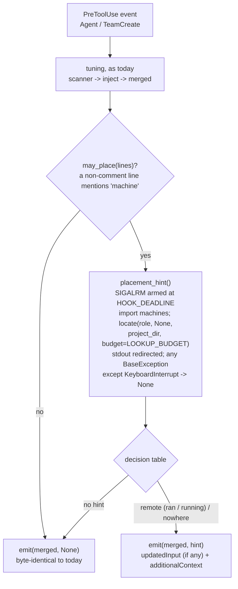

# phase-tuning hook: hint to start a remotely-placed phase as a herdr agent

## Goal

When a coordinator spawns a role (`Agent` or `TeamCreate`) that the repo places on another machine,
the phase-tuning hook adds a hint. The hint says that this run is on this box, not there, that its
result stands, and that the **next** run of the role should start on its machine with
`sdlc delegate <role> --issue <n>`. A minimal raw-herdr fallback follows for when `sdlc delegate`
isn't available.

- **The spawn is allowed (D3).** The hook adds `hookSpecificOutput.additionalContext` and never
  sets `permissionDecision`. Nothing is denied.
- **The hint redirects later spawns; it can't move this one.** The coordinator reads the hint
  together with the tool's result. For a foreground `Agent` call, that is after the subagent has
  finished. So the wording depends on the spawn:
  - **Foreground `Agent`:** the role **already ran** here, and its result stands;
  - **Background `Agent` or `TeamCreate`:** the role **is running** here now. Let it finish, or
    stop it and start this job on the placed machine instead; never both.

  No wording invites a second run of the same job.
- **Tuning and the hint share one payload.** `updatedInput` is built exactly as today. The hint is a
  sibling key.
- **Fail-open is unchanged, and now bounded in time.** In each of these cases the hook adds no hint,
  and the tuning output stays as it is:
  - the import fails, or a file can't be parsed;
  - the lookup fails, raises, or even calls `sys.exit`;
  - the lookup runs past the hook's own deadline (`HOOK_DEADLINE`, 3.5 s from the start of the
    `.py`).

  The deadline is enforced with `SIGALRM`, because #137's budget can't interrupt a PyYAML parse
  that is under way.
- **Byte-identical where nothing is placed elsewhere.** This covers local roles, unplaced roles,
  repos that place nothing, and boxes with no registry. Golden strings in the test file hold that
  line after merge, including the shipped example's `phases:` block and this repo's
  `.claude/sdlc.yml`. The scanner fixes are the only exception (next bullet). They change output
  only for configs that hit them today.
- **Scanner fixes.** #137 recorded two quirks in the tuning scanner for #138. This issue fixes them,
  plus a defect in the same lines and one shape it now refuses (see Approach, "Scanner fixes"):
  - a blank knob (a bare `machine:`) is read as a new role, so the role's later knobs are lost;
  - `null` is injected as the string `"null"`;
  - a prefixed or scalar role entry leaks its knobs into the role above it;
  - a multi-line flow map now fails closed for that role.
- Tests go in `phase-tuning.test.sh`, which CI now runs under both YAML backends. The release also
  gets a CHANGELOG entry, README text, and **version 0.2.42**.

**Baseline.** This branch was cut from `dugshub/137-placement-resolver` at a6c7977, which holds
#137's spec only. #137's implementation is now on that branch (PR #141, 0.2.41; head 007bc1e at the
time of this revision).
- Before writing code, the implementer merges the base branch in:
  `git merge origin/dugshub/137-placement-resolver`.
- Merge, never rebase: this branch is pushed, and it is never force-pushed.
- If `locate` is missing from `plugin/lib/machines.py` after the merge, halt.
- `a6c7977` is the pre-change reference for the hook. #137 doesn't touch `plugin/hooks/`.

**What this spec relies on from #137** (its § Interfaces and consumer contract rules 6-9, as
implemented in PR #141):
- **`lookup` and `locate`.** `locate(role, kind=None, *, project_dir=None, ..., budget=None)`
  returns `(Placement, Registry, Optional[PlacementConfig])`. `lookup(...)` is
  `locate(..., budget=LOOKUP_BUDGET)[0]`.
- **No raising, no printing, and time bounded only under yq.** Neither function raises or prints.
  - With `budget`, the yq reads finish within `LOOKUP_BUDGET` (2.5 s), about 3 s of hook time
    including start-up (rule 7). The `sdlc.yml` timeout is `min(YQ_TIMEOUT, budget - elapsed)`,
    clamped to `YQ_MIN_TIMEOUT` (0.1 s).
  - **PyYAML parses in-process and ignores the budget** (rule 7). Gate 1.5 measured an opted-in
    `sdlc.yml` with 40k extra keys at 11.8 s under PyYAML (`nice -n 19`, at 571d7ff). 007bc1e made
    the parser linear, which lowers that curve but doesn't bound it. The budget can only skip
    the `sdlc.yml` read after a slow registry read; it can't stop a parse that is under way. So
    the hook enforces its own deadline (§ Approach, "The deadline").
- **`Placement` fields:**
  - `status` is one of `off`, `placed`, `fallback`, `unplaceable`;
  - `off_cause` says why a placement is `off`;
  - `machine` is set only for `placed` and `fallback`;
  - `local` is true for `off`, and for a machine that is the registry's local one;
  - `requested` is `None` when the role has no placement of its own;
  - `candidates` comes in fit order, local first;
  - `reason` is one line and always set.
- **Reason texts.**
  - A placement on the role's own target reads `<at> places <role> on '<m>'`; for `any`,
    `... on any: <n> machines fit`.
  - A fallback reads `<at> '<value>' was refused (<why>); using ...`.
  - An unplaceable role reads `<role> has nowhere to run: ...`.

  The `**` bold was removed in PR #141 (`d4afbfe`), and reasons are capped at `MESSAGE_CAP` (300
  characters). A reason can still contain backticks. For `auto`, #137's refusal reads "'auto' is
  reserved for \`sdlc delegate --machine auto\`". So `format_hint` strips both `**` and backticks,
  and the hint carries no Markdown.
- **Opt-in.** Placement applies only once `sdlc.yml` sets a target (`phase_machines`,
  `agent_machines`, `default_machine`, or `phases.<role>.machine`). Otherwise every role is `off`.
- **`kind`.** #138 passes `kind=None`, because a hook can't tell a phase from an agent. The phase
  maps win over `agent_machines` for a role named in both.
- **The registry.** `Registry.local` and `Registry.get(name)` return a `Machine` with
  `transport.kind`, `transport.herdr` (the label for `herdr --machine`) and `workdir`.

**Verified against Claude Code** (all line references are to the minified bundle):
- **2.1.310 (installed), live.** I ran `claude -p --model haiku` with a probe PreToolUse hook on
  `Bash` and `Agent`. The hook returned `updatedInput` and `additionalContext` together, with no
  `permissionDecision`. Results:
  - the command and the subagent's prompt were both rewritten;
  - the model quoted the context back as `PreToolUse:Agent hook additional context: "<text>"`;
  - the calls ran.
- **The source agrees.**
  - `updatedInput` is applied only when the hook sets no decision:
    `if (updatedInput && permissionBehavior === undefined) yield hookUpdatedInput`.
  - `additionalContexts` is yielded separately, as a `hook_additional_context` attachment
    (`hookName: "PreToolUse:<tool>"`). It is buffered and returned together with the tool's
    result.
  - `permissionDecisionReason` is used only together with a decision, as the permission message.
    With no decision it reaches neither the model nor the user.
- **2.1.226 (the CI pin), static only.** CI uses it only for `claude plugin validate`. I fetched
  `@anthropic-ai/claude-code-linux-x64@2.1.226` and read its bundle:
  - the PreToolUse schema is the same: `permissionDecision`, `permissionDecisionReason`,
    `updatedInput`, `additionalContext`;
  - the handling is the same: the same `updatedInput && permissionBehavior === void 0` guard, and
    the same `hook_additional_context` yield.

  I didn't run it, because an old binary could migrate `~/.claude` state.
- **When an `Agent` call runs in the background.** I read this in both bundles (2.1.310 `bo()`,
  2.1.226 the same expression).
  - `run_in_background: true` runs in the background.
  - `run_in_background: false` runs in the foreground, except in coordinator and fork modes.
  - **Unset is the ambiguous case.** On the main thread both versions start the subagent in the
    background. 2.1.310 doesn't even offer the parameter in a terminal, the desktop app or VS Code
    ("subagents forced into the background"). Inside a non-interactive subagent, the same call runs
    in the foreground.
  - The hook event carries `agent_id` and `agent_type` only inside a subagent (verified live on
    2.1.310). But whether a nested spawn is async also depends on whether the session is
    interactive, which the event doesn't carry.
  - **Two exceptions in `bo()`, both versions:**
    - An agent definition with `background: true` runs async even when `run_in_background` is
      false or unset. The hook would then say `ran` while the job runs, which is the safe
      direction. No `plugin/agents/*.md` sets it.
    - `run_in_background: true` runs in the foreground when background tasks are disabled. That
      is the unsafe direction for `running`, but both versions drop the parameter from the schema
      then, so it can't arrive in practice.
  - So the hook can be sure of the timing only for `TeamCreate` and for an explicit
    `run_in_background` (see "Timing" under Approach).
- **Consequences:**
  - The hint goes in `additionalContext`.
  - The hook must not add `permissionDecision: "allow"`. That would also bypass the user's
    permission rules for the spawn, and it would move `updatedInput` onto a different code path.
  - `permissionDecisionReason` is useless here.

## Approach

### Where it sits



- **The tuning path doesn't move.** Role resolution, the `sdlc.yml` check, and the `inject` and
  `merged` computation all stay where they are (`phase-tuning.py:126-190`). `inject` is computed
  first. Then `placement_hint()` runs, inside its own guard: `except KeyboardInterrupt: raise`,
  then `except BaseException: return None`. A `sys.exit()` in `machines.py`, or in anything it
  imports, therefore can't reach `main()`'s `except SystemExit: raise` and drop the tuning. The
  same guard turns the deadline's `_Deadline` into `None` (see "The deadline"). Only after both
  does the hook print.
- **Exits that stay ahead of placement.** A non-spawn tool, a spawn with no role, and a project
  with no `.claude/sdlc.yml` still exit before placement is considered (`:126-142`). Placement
  needs an opted-in `sdlc.yml` in the same project directory anyway: #137's `sdlc_path` is given
  `project_dir` and doesn't walk up past it.
- **`may_place(lines)` is a cheap gate.** Every opt-in key contains `machine`: `phase_machines`,
  `agent_machines`, `default_machine` and `phases.<role>.machine`. So a file in which no line
  outside a whole-line comment mentions `machine` can't opt in.
  - For such repos the hook never imports `machines.py` and never touches the registry. That makes
    "repos that place nothing → today's output" true by construction, at no cost.
  - A false positive (the word in a value or a trailing comment) only costs a lookup.
  - A false negative needs exotic YAML, such as an escaped key name. Its effect is no hint, the
    fail-open direction. The reviewer confirmed the match is case-sensitive, as #137's is.
- **Calling #137.** `placement_hint()`:
  1. sets `sys.dont_write_bytecode = True`, as `machines.py`'s docstring requires of this hook
     (`:10-11`);
  2. puts `<plugin>/lib` at `sys.path[0]`, resolved from `__file__` as `bin/sdlc` does;
  3. inside `contextlib.redirect_stdout(io.StringIO())`, imports `machines` and calls
     `machines.locate(role, None, project_dir=project_dir, budget=machines.LOOKUP_BUDGET)`.

  `project_dir` is the value the hook already computes (`$CLAUDE_PROJECT_DIR`, else the event's
  `cwd`, else `os.getcwd()`, `:139`). Passing it makes #137's lookup source `project` and the
  hook's own `sdlc.yml` the same file. The stdout redirect costs two lines. It guarantees that a
  stray `print` in a future `machines.py` can't corrupt the JSON, which would silently drop the
  tuning (#137 rule 6 already promises silence).
- **Why `locate(..., budget=LOOKUP_BUDGET)` and not `lookup()`.** The hint needs the target
  `Machine` (herdr label, `workdir`) and the local machine's name. `lookup()` returns only the
  `Placement`.
  - A second `load()` would parse the registry again. Under yq that is up to 2 s more, which
    breaks the hook's 5 s budget.
  - #137 defines `lookup` as exactly `locate(..., budget=LOOKUP_BUDGET)[0]`, so the never-raises,
    prints-nothing and time-bound guarantees (rules 6 and 7) are the same. Gate 1.5 checked the
    signature on PR #141.
- **`kind=None`,** per #137.
- **The role is stripped by the hook itself** (`:134-135`), before and without the import. It is
  the same expression as #141's now-public `machines.strip_role()`.

### The deadline

#137's `LOOKUP_BUDGET` bounds the yq path only. A PyYAML parse runs in-process and can't be
interrupted by a budget: Gate 1.5 measured 11.8 s for an opted-in `sdlc.yml` with 40k extra keys. At
5 s Claude Code would kill the hook, and the tuning would be lost with it. So the hook bounds
placement itself.

- **`HOOK_DEADLINE = 3.5` seconds**, measured from `_T0 = time.monotonic()`, taken as the first
  statement of `phase-tuning.py` (before the other imports). Why 3.5 s:
  - **Above** `LOOKUP_BUDGET` plus the import (about 2.6 s), so it never cuts the bounded yq path;
  - **below** 5 s, with room for interpreter start-up, the wrapper and `emit`.
- **The mechanism: `SIGALRM` through `signal.setitimer`.**
  - `class _Deadline(BaseException)`. It derives from `BaseException`, so no `except Exception`
    inside `machines.py` or PyYAML can absorb it and carry on.
  - `_on_alarm(signum, frame)` raises `_Deadline()`.
  - The timer is armed only around the placement work:
    `signal.setitimer(signal.ITIMER_REAL, max(0.05, HOOK_DEADLINE - (time.monotonic() - _T0)))`,
    after `signal.signal(signal.SIGALRM, _on_alarm)` saves the old handler. It is armed just before
    the `machines` import.
- **Two layers, so an alarm can't escape.**
  - The inner `_armed_hint(...)` does the arming, the import, `locate` and `format_hint`. In
    `finally` it **disarms first** (`setitimer(ITIMER_REAL, 0)`), **then** restores the old
    handler. Both happen before `placement_hint` returns, so before `emit`.
  - The outer `placement_hint(...)` holds the guard: `except KeyboardInterrupt: raise`,
    `except BaseException: return None`.
  - An alarm that fires inside the inner `finally`, between the last statement and the disarm, is
    still caught by the outer guard. Once the old handler (the default for `SIGALRM`) is back, a
    flag still pending at the C level runs no Python handler. No timer is armed by then, so no new
    signal can come.
- **It is skipped when it can't work:** when `signal` has no `setitimer` (e.g. Windows), or when
  the code isn't on the main thread (`threading.current_thread() is not
  threading.main_thread()`). There the yq path is still bounded by `LOOKUP_BUDGET`, and only a
  huge `sdlc.yml` under PyYAML stays unbounded (§ Out of scope).
- **On expiry:**
  - the tuning is kept, and there is no hint;
  - a `subprocess.run` in progress (yq) is interrupted, and `run` kills the child on the way out.
    Gate 1.5 prototyped this: a 1.0 s timer cut a hung yq at 1.00 s and left no child behind;
  - a PyYAML parse is interrupted between bytecodes. A 1.5 s timer cut the 40k-key parse at
    1.50 s in Gate 1.5's prototype.
  - **Accepted: the fork-to-exec orphan window.** If the alarm lands in `Popen`'s fork-to-exec
    window, where `machines.py`'s `preexec_fn` applies `RLIMIT_AS`, `Popen()` raises before `run()`
    holds the process, and that one yq child is orphaned (reparented to PID 1). The window is a
    `setrlimit` plus `exec`, well under a millisecond. The orphan has `DEVNULL` stdin, a closed
    stdout pipe and the 1 GiB limit. T18's no-orphan check covers only the `communicate` phase. The
    same note is a comment in `_armed_hint`.
- **`sys.stdout` is restored.** `placement_hint` saves `sys.stdout` before calling `_armed_hint` and
  restores it in a `finally`. An alarm inside `redirect_stdout`'s `__enter__` or `__exit__` would
  otherwise leave it on the `StringIO`, and `emit` would print into nothing. T20 tests it
  deterministically.
- **An `armed` flag.** `_armed_hint` disarms the timer and restores the old handler only when it
  actually armed them (it has `setitimer` and is on the main thread), so a skipped path can't make
  the `finally` raise.
- **Scope.** The tuning scanner runs before the timer is armed. It is linear and pure Python, so
  it needs no deadline.

### Decision table

`p` is the `Placement`, `reg` the `Registry`.

| `p.status` | `p.requested` | `p.local` | Output |
|---|---|---|---|
| `off` (any `off_cause`: `no-registry`, `registry-errors`, `sdlc-errors`, `no-placement`, `time-budget`) | any | `True` | **no hint** |
| `placed` / `fallback` | `None` (the role has no placement; the default target was used) | any | **no hint**: an unplaced role, so byte-identical |
| `placed` / `fallback` | set | `True` | **no hint**: it runs where it is placed (or fell back to this box) |
| `placed` / `fallback` | set | `False` | **remote hint**, worded per "Timing" |
| `unplaceable` | `None` | `False` | **no hint**: unplaced. `check` already reports the default-target problem |
| `unplaceable` | set | `False` | **nowhere hint** |

Consequences, stated so the reviewer can object:
- **A remote `default_machine` alone never triggers a hint.** The issue says unplaced roles stay
  byte-identical. A hint on every `general-purpose` or `Explore` spawn would be noise. The hook
  speaks only for roles the repo names in `phase_machines`, `agent_machines` or
  `phases.<role>.machine`, including when such a role falls back to a remote default.
- **A shared `sdlc.yml` naming a machine a teammate doesn't have** falls back to that teammate's
  local box. The hook stays silent, and `check` reports it (#137).
- **`any` whose candidates include the local machine** resolves local (local first), so no hint.

### Timing: which wording

`timing(tool_name, tool_input)` returns one of two words:
- **`running`** for `TeamCreate` (a teammate persists), and for an `Agent` call whose
  `tool_input.run_in_background is True`;
- **`ran`** for every other `Agent` call: `run_in_background` false, absent, or not a boolean.

The unset case is the uncertain one (see "When an `Agent` call runs in the background" under Goal).
Both versions start an unset main-thread spawn in the background, so the call may still be running
when the coordinator reads "already ran". That is acceptable, because the `ran` wording is the safe
one when it is wrong:
- it says the result stands and the call must not run again;
- it asks only that the **next** run go to the placed machine;
- it never suggests moving or repeating this job.

The `running` wording, shown after a run that had in fact finished, could be read as "start it on
`<m>`". So `running` is used only when the hook is sure. The tests pin both wordings.

### The hint text

The text is plain ASCII, one fact per line, with no Markdown: the templates use no backticks, and
`**` and backticks are stripped from `p.reason`. Templates are below; `[...]` marks a line or fragment that appears only when its
condition holds.

| Name | Value |
|---|---|
| `{what}` | `Agent subagent` for `Agent`, `TeamCreate teammate` for `TeamCreate` |
| `{as_what}` | `as an Agent subagent` for `Agent`, `as a TeamCreate teammate` for `TeamCreate` (by tool, not by timing) |
| `{role}` | the role with its namespace stripped |
| `{raw}` | `subagent_type` or `agent_type` as spawned (e.g. `sdlc:validator`) |
| `{m}` | `p.machine` |
| `{local}` | `reg.local.name` |
| `{label}`, `{workdir}` | from `reg.get(p.machine)`: `transport.herdr`, `workdir` |
| `{reason}` | `p.reason` with every `**` and every backtick removed, cut to `VALUE_MAX` |

**Remote hint, `ran`** (foreground `Agent`):

```text
sdlc machines: {reason}.
{role} already ran here, on this box ('{local}'), {as_what}: a subagent can't change machines. Its result stands; don't run this call again.
sdlc.yml places {role} on '{m}': start the next {role} there, as a herdr agent, with:
  sdlc delegate {role} --issue <n>
[any: sdlc delegate picks the least loaded of {c1}, {c2}, {c3}[ and {k} more]]
[Without sdlc delegate: herdr --machine {label} tab create --no-focus[ --cwd {workdir}], then herdr --machine {label} agent start {role}-<n> --kind claude --pane <pane id from tab create> -- --agent {raw}, then herdr --machine {label} agent prompt {role}-<n> '<brief>'.]
Results come back through GitHub (a pushed branch or a PR comment), so ask for that in the brief. Explain: sdlc machines where {role}
```

**Remote hint, `running`** (background `Agent`, or `TeamCreate`):

```text
sdlc machines: {reason}.
{role} is running here now, on this box ('{local}'), {as_what}: a subagent can't change machines.
Either let it finish and use its result, then start the next {role} on '{m}'; or stop it and start this job on '{m}' instead. Never both.
To start {role} on '{m}' as a herdr agent:
  sdlc delegate {role} --issue <n>
[any line, as above]
[Without sdlc delegate line, as above]
Results come back through GitHub (a pushed branch or a PR comment), so ask for that in the brief. Explain: sdlc machines where {role}
```

**Nowhere hint** (`unplaceable` with its own placement; the same text for either timing):

```text
sdlc machines: {reason}.
This {what} runs on this box anyway: the hook never blocks a spawn, and sdlc delegate would refuse this role too. Fix the placement or needs.{role} in sdlc.yml; sdlc machines check lists every refusal.
```

Rules:
- **`sdlc delegate` leads; the raw herdr line is minimal.** It is one line of three commands: open
  a tab in `workdir`, start Claude Code as the role's agent in that pane, and send the brief. It
  carries no permission mode, model, effort or first-start handling. Those belong to #139's start
  sequence, which `sdlc delegate` runs.
- **When the herdr line appears.** It appears only when all of these hold:
  - `reg.get(m)` exists;
  - `transport.kind == "herdr"` and `transport.herdr` is set;
  - none of `{label}`, `{workdir}` or `{raw}` is longer than `VALUE_MAX`.

  An over-long command value drops the line rather than being cut, because a cut value would make
  a wrong command. Without `workdir`, `--cwd` is simply left out.
- **Alignment with #139.** #138 and #139 land in the same window. Whichever merges second aligns
  this line with #139's actual start sequence, or trims it.
- **The `any` line** appears when `len(p.candidates) > 1`. It names at most `ANY_SHOWN` (3)
  candidates, then ` and <k> more`. The commands name `p.machine` (the first candidate). Load is
  `delegate`'s job (#137 rule 8).
- **Quoting.** Every interpolated value in a command goes through `shlex.quote`, `{role}-<n>` as
  `shlex.quote(role) + "-<n>"`. `<n>`, `<pane id from tab create>` and `<brief>` stay literal: the
  coordinator fills them in.
- **Bounds.**
  - `{reason}` is cut to `VALUE_MAX` (200) characters, ending with `...` when cut.
  - If `{role}` or `{raw}` is longer than `VALUE_MAX`, there is no hint at all: the delegate command
    would be wrong, and silence is the fail-open direction.
  - If the assembled text is over `HINT_MAX_CHARS` (2000), the herdr line is dropped.
  - If it is **still** over 2000, there is **no hint**. It can get there only with names near
    `VALUE_MAX`: `{role}` appears five times, and `{m}`, `{local}` and the `any` names add up.
    Truncating isn't safe: cutting to the first line plus the delegate command would drop the
    timing sentence ("its result stands; don't run this call again", or "never both"), and that
    sentence is what keeps the hint from inviting a second run. Silence is the fail-open direction.
  - Typical length is about 0.8 KB. Claude Code's own cap on `additionalContext` (8000 characters,
    200 lines) is never reached.
- **Checked against herdr 0.9.5's help:** `tab create` takes `--cwd` and `--no-focus` and returns
  `.result.root_pane`; `agent start <NAME> --kind claude --pane <ID> -- <args>`;
  `agent prompt <TARGET> <TEXT>`. `claude --agent sdlc:validator` with the plugin loaded runs as
  the validator (checked live).
- **The hint doesn't check whether `sdlc delegate` exists.** #139 ships in parallel. The herdr line
  covers either merge order.

### Output

`emit(merged, hint)` prints at most one JSON object, with `json.dumps` defaults (separators
`", "` and `": "`; `ensure_ascii` true, so the bytes are ASCII).

| `inject` non-empty | hint | Printed |
|---|---|---|
| no | none | nothing (today) |
| yes | none | `{"hookSpecificOutput": {"hookEventName": "PreToolUse", "updatedInput": {...}}}`, exactly today's bytes |
| yes | text | `{"hookSpecificOutput": {"hookEventName": "PreToolUse", "updatedInput": {...}, "additionalContext": "..."}}` |
| no | text | `{"hookSpecificOutput": {"hookEventName": "PreToolUse", "additionalContext": "..."}}`. No `updatedInput` echo of the unchanged input |

The keys are always in the order `hookEventName`, `updatedInput`, `additionalContext`. The hook
never prints `permissionDecision`, `permissionDecisionReason`, `systemMessage`, `decision` or
`continue`.

### Time and fail-open

- **Repos that place nothing** pay no added time, because of the gate.
- **A repo that places, on a box with no registry,** pays the `machines` import (tens of
  milliseconds) and one `stat` (#137 rule 7).
- **The worst case, by backend.** The hook's 5 s timeout is at `hooks.json:161`.
  - **yq:** #137's bound. File reads take at most `LOOKUP_BUDGET` (2.5 s), and the hook about 3 s
    in all. Gate 1.5 timed `locate` from PR #141 at `nice -n 19` with yq hanging: 2.06 s when it
    hangs on every call (`registry-errors`), and 2.06 s when it hangs only on `sdlc.yml`
    (`sdlc-errors`). The 2.5 s ceiling is reached when the registry read takes 0.5-0.99 s.
  - **PyYAML:** not bounded by #137, so it is capped by `HOOK_DEADLINE`. Placement work ends by
    3.5 s after the `.py` started, plus the time to unwind and `emit` (milliseconds).
  - **Either way,** the hook finishes in about 3.6 s plus interpreter and wrapper start-up, well
    inside 5 s. When placement is cut short, the hook emits the tuning with no hint. `hooks.json` is
    unchanged.
- **Past 5 s Claude Code kills the hook,** which would lose the tuning too. That is why T14, T14b
  and T18 fail above 5 s.
- **Every failure gives `None` and today's output:**
  - no `lib/`, or `machines.py` failing to import, raising `SystemExit` included;
  - no PyYAML and no yq (D2);
  - a broken registry, or a broken `sdlc.yml` placement block;
  - a `time-budget` result;
  - `HOOK_DEADLINE` reached (`_Deadline`);
  - any `BaseException` other than `KeyboardInterrupt` in `placement_hint()` or `format_hint()`.

  The outer wrapper at `:205-211` stays as the last line of defence.

### Scanner fixes (pre-existing; in scope by decision)

I reproduced Q1-Q3 on a6c7977 by piping `Agent` events into `phase-tuning.sh`, and Gate 1.5
reproduced them too:

| # | Config | Today | After |
|---|---|---|---|
| Q1 | `phases:` / `validator:` / `machine:` (bare) / `model: fable` | prints nothing for `validator`: `machine:` became a role and took `model` | `model: fable` injected |
| Q2 | `phases.validator.model: null` (also `~`, `Null`, `NULL`) | `"model": "null"` (or `"~"`) injected; it even beats a flat `phase_models.validator: sonnet` | unset, so the flat value or frontmatter applies, as #137 reads null |
| Q3 | `phases:` / `implementer:` / `model: sonnet` / `sdlc:validator:` / `model: haiku` / `max_turns: 7`. The same with a scalar role entry such as `validator: sonnet` | **`implementer` gets `model: haiku, maxTurns: 7`**: the entry was read as a knob, and its knobs leaked upward | `implementer` keeps `sonnet`. `sdlc:validator` still doesn't tune (unchanged; #137's `check` warns about the prefix) |
| Q4 | a flow map that doesn't close on its line: `specifier: { model: opus,` / `effort: high }` | `model: opus` injected from the first line; the rest is ignored | fails closed: no tuning from that entry for `specifier`. Its flat keys still apply |

Why fix them here:
- Q1 and Q3 are one defect: the scanner decides role-vs-knob from the value instead of the indent.
  #138 is the release in which users write `machine` under `phases.<role>`, the form that hits Q1.
- Q2 makes the hook agree with #137, where null is unset.
- Q4 follows from the lead's decision: multi-line flow maps are out of scope for the scanner, and
  out of scope means no injection from a half-read value.
- All four are small, and none touches the placement path.

**The rule for `read_nested_block`:**
- The **role indent** is the indent (spaces or tabs) of the first entry line in the block.
- A line indented **at or left of** the role indent is a role entry. It always closes the role
  before it.
  - `name: {…}` that closes with `}` on the same line, after the comment is stripped, is an inline
    role. It is parsed as today, and a later entry for the same role replaces it, as today. **It
    leaves no role open,** so deeper lines after it are ignored.
  - `name: {` without the closing `}` is a multi-line flow map. It is ignored (Q4) and leaves no
    role open, so its continuation lines are ignored too.
  - `name:` with a blank or null value opens role `name`.
  - `name: <scalar>` is not a role map. No role is open until the next role entry.
- **Knob lines.** Within an open role, the **knob indent** is the indent of the role's first line
  deeper than the role indent.
  - A line at exactly the knob indent is a knob:
    - a blank or null value means unset (skipped, never a header);
    - a `{`-value is skipped;
    - otherwise the knob gets the value as today.
  - A line deeper than the knob indent belongs to a nested map under some knob. It is ignored, so
    `validator:` / `model: sonnet` / `extra:` / `model: haiku` keeps `sonnet`.
  - A line between the role indent and the knob indent is malformed YAML, and it is ignored.
- Top-level detection, comment and blank handling, and inline-flow pair parsing are unchanged.

**Null.** A new helper `scalar(raw)` replaces `strip_value` at every value read, in `read_block`,
knob lines and inline pairs:
- the comment is stripped as today, then whitespace;
- **unquoted** `null`, `Null`, `NULL`, `~` or an empty string returns `None`, meaning unset;
- otherwise surrounding quotes are stripped as today.

So a quoted `"null"` is still the string `null`, which is YAML's meaning.

**Checked.** I prototyped the rule and compared it with today's scanner on:
- the test file's fixture;
- the `phases:` block of `sdlc.example.yml`, uncommented;
- a tab-indented block;
- this repo's `.claude/sdlc.yml`.

The output was identical on all four, and differed only on Q1-Q3. The golden matrix (Tests, T0b)
pins the well-formed shapes, the nested-map case and the inline-then-deeper case. Their bytes were
captured on a6c7977.

**Not fixed, recorded:**
- the scanner reads the first copy of a repeated top-level block;
- prefixed role keys are not normalised (`sdlc:validator:` never tunes; see Out of scope).

### Version and merge order

- **`plugin.json`:** 0.2.41 (#137) → **0.2.42**.
- **#138 and #139 run in parallel.** Whichever of them merges second merges the first in and takes
  **0.2.43**: its `CHANGELOG` entry goes above the other's, and `plugin.json` becomes 0.2.43. That
  same PR aligns the hint's raw herdr line with #139's start sequence, or trims it. The two also
  touch the same README section, `CHANGELOG.md` and maybe `verify.yml`. Expect small text
  conflicts.

## File-level plan

### Create

None.

### Modify

- **`plugin/hooks/phase-tuning.py`.** All changes are under Interfaces:
  - **The scanner.**
    - `scalar()` replaces `strip_value()` at every value read. Keep `strip_value` only if something
      else uses it (nothing does today).
    - `read_nested_block()` follows the role-indent and knob-indent rule.
    - `read_block()` reads null as unset.
  - **`may_place(lines)`.**
  - **`timing(tool_name, tool_input)`.**
  - **`_T0 = time.monotonic()`** as the module's first statement, and `HOOK_DEADLINE`,
    `_Deadline` and `_on_alarm` (§ Approach, "The deadline").
  - **`_armed_hint(...)`.** It arms `SIGALRM` (when `setitimer` exists and the code is on the main
    thread), sets `sys.dont_write_bytecode = True`, then does the import and `locate` call under
    `redirect_stdout`, and calls `format_hint`. In `finally` it disarms the timer, then restores
    the old handler.
  - **`placement_hint(...)`.** The outer guard around `_armed_hint`: `except KeyboardInterrupt:
    raise`, `except BaseException: return None`.
  - **`format_hint(...)`.** It is pure: it holds the decision table, the `**` and backtick strip,
    the bounds (`ANY_SHOWN`, the no-hint fallback over 2000) and the three templates.
  - **`emit(merged, hint)`.** It replaces the print at `:192-202`.
  - **`main()`.** After `inject` (`:179-190`), `hint = placement_hint(...) if may_place(lines) else
    None`. Then:
    - if `not inject and not hint` → `fail_open()`;
    - else `emit(merged if inject else None, hint)`.
  - **Module docstring:**
    - the hook may now also add `additionalContext`;
    - it never sets a permission decision;
    - D3, and that the hint redirects the next spawn;
    - fail-open covers placement.
  - **Constraints:**
    - Python 3.8 and stdlib only. The new imports are `contextlib`, `io`, `shlex`, `signal`,
      `threading` and `time`;
    - nothing new at import time beyond those imports and `_T0`;
    - the timer is never armed outside `_armed_hint`, and it is always disarmed before `emit`;
    - `machines` is imported lazily, only when the gate passes.
- **`plugin/hooks/phase-tuning.sh`.** Header comment only (`:1-47`, `:59-60`):
  - describe the hint in two lines;
  - "prints only on a real injection" becomes "prints only on an injection or a hint";
  - add placement to the FAILS OPEN list ("no registry, no placement, or any placement error → no
    hint");
  - note that the hook never decides permission, so the user's rules still apply to the spawn.

  No logic change.
- **`plugin/hooks/phase-tuning.test.sh`.** New cases (Tests). Harness changes at the top:
  - `export HOME="$TMP/home"`, with `unset SDLC_MACHINES XDG_CONFIG_HOME`, so the developer's real
    registry never leaks in. This matters on a box whose owner keeps a hand-written registry.
  - `export PYTHONDONTWRITEBYTECODE=1`.
  - Backend detection, the `noyaml` shadow package and `SDLC_REQUIRE_BOTH_BACKENDS`, mirroring
    `plugin/lib/machines.test.sh:20-55`. Two required-backend assertions when the variable is 1.
  - **Restricted-PATH runs** (T12, T14, T14b) build a directory with symlinks for `python3`, `cat`
    and `dirname` (the wrapper needs the last two), plus the case's own `yq` or none.
    - Invoke the hook as `"$BASH" "$HOOK"`: a bare `bash` isn't found under that PATH.
    - Put `env` and `nice` **before** the PATH change, e.g.
      `env PATH="$DIR" PYTHONPATH="$TMP/noyaml" "$BASH" "$HOOK"`, never `env PATH=... nice ...`
      (verified to fail).
  - Helpers next to `got()`/`empty()`:
    - `ctx()` reads `.hookSpecificOutput.additionalContext`;
    - `hkeys()` reads `.hookSpecificOutput | keys_unsorted | join(",")`;
    - `runp FIXTURE_DIR REGISTRY BACKEND tool_input [tool]`.
  - The golden matrix (T0b) as `fixture|role|tool|expected` rows, with the fixtures as heredocs.
  - Existing cases are unchanged, and they run with no registry.
  - The summary line format is kept: `phase-tuning: N passed, M failed`.
- **`.github/workflows/verify.yml`.** Add one step after "Machine registry tests" and after #137's
  "Placement resolver tests", with the same env:

  ```yaml
  - name: Phase-tuning hook tests
    env:
      SDLC_REQUIRE_BOTH_BACKENDS: "1"
    run: bash plugin/hooks/phase-tuning.test.sh
  ```

  The suite isn't in CI today. Don't rename the job: its `name:` is a required check.
- **`plugin/sdlc.example.yml`.** Two edits, both in #137's commented Machines block (comments only;
  #137's B1 extraction from `# phase_machines:` to the next bare `#` is untouched):
  - In the last paragraph, replace "To unset it, delete the line or write `machine: null`; never
    leave a bare `machine:` (the tuning hook misreads it)." with "To unset it, delete the line or
    write `machine: null`."
  - Add two lines before the `# phase_machines:` example: "A subagent always runs on this box. When
    a role placed elsewhere is spawned as one, it still runs here, and the phase-tuning hook tells
    the coordinator to start the next run on the placed machine (`sdlc delegate <role>`)."
- **`README.md`.** Inside `## Machines`, after #137's `### Placing phases and agents`, add
  `### The remote hint`. It covers:
  - when the hint appears: a role the repo places on another machine is spawned with
    `Agent`/`TeamCreate`;
  - that under D3 the spawn still runs here, the first run of a placed role included. The hint
    can't move a run, only redirect the next one. A foreground run has already finished when the
    hint is read; a background run or teammate is still going, and the hint says to let it finish
    or stop it, never both;
  - that to place the first run too, check `sdlc machines where <role>` before spawning, or start
    it with `sdlc delegate` directly;
  - what the hint offers: `sdlc delegate`, then a one-line raw herdr fallback;
  - that the hook never decides permission;
  - no change for local roles, unplaced roles (even under a remote `default_machine`), repos that
    place nothing, or boxes with no registry;
  - that an unplaceable role gets a one-line warning;
  - time: none added unless the repo places something. A slow registry or `sdlc.yml` read is cut
    off by the hook's own 3.5 s deadline (`HOOK_DEADLINE`), and the spawn then gets its tuning with
    no hint.

  Generic names only.
- **`CHANGELOG.md`.** New top entry `## [0.2.42] — 2026-10-25`.
  - `### Added — the phase-tuning hook points remote-placed roles at their machine`.
    - **Why:** a subagent always runs on the coordinator's box. Until now, a role placed on a worker
      box quietly ran locally, every time.
    - **Bullets:**
      - the hint and where it appears;
      - the spawn still runs (no deny, no permission decision), and the hint redirects the next
        run;
      - the two wordings: a foreground run already ran and its result stands; a background run or
        teammate is let finish or stopped, never both;
      - `sdlc delegate`, or a one-line herdr fallback;
      - byte-identical output for everything not placed elsewhere, with golden tests;
      - fail-open on any registry or `sdlc.yml` problem, and a 3.5 s deadline on the lookup, so a
        huge `sdlc.yml` under PyYAML can't push the hook past its 5 s timeout;
      - the CI step.
  - `### Fixed — phase-tuning no longer loses, corrupts or leaks knobs`. Q1-Q4 in one bullet
    each, each with its user-visible effect:
    - blank knobs;
    - null values;
    - prefixed or scalar role entries leaking upward;
    - multi-line flow maps now fail closed.
- **`plugin/.claude-plugin/plugin.json`:** `version` 0.2.41 → 0.2.42. If #139 merges first, see
  "Version and merge order".

Unchanged:
- `plugin/hooks/hooks.json`: the matcher, `async:false` and the 5 s timeout stay.
- `plugin/lib/machines.py`, `plugin/bin/sdlc`, `plugin/lib/herdr.py`.

## Interfaces

```python
# ── plugin/hooks/phase-tuning.py (changes) ───────────────────────────────────
# Stdlib only, Python >= 3.8. Fails open: every new path returns None / prints nothing on error.
import time; _T0 = time.monotonic()               # first statement: the deadline's clock
import contextlib, io, shlex, signal, threading   # new imports
from typing import Any, Dict, List, Mapping, Optional

NULLS = ("null", "Null", "NULL", "~")             # unquoted YAML nulls read as unset
HINT_MAX_CHARS = 2000                             # over this, the herdr line is dropped; still over -> no hint
VALUE_MAX = 200                                   # reason cut here ("..."); a longer command value drops the herdr line
ANY_SHOWN = 3                                     # `any` candidates named before " and <k> more"
HOOK_DEADLINE = 3.5                               # seconds from _T0; > LOOKUP_BUDGET + import, < 5 s hook timeout

class _Deadline(BaseException): ...               # BaseException: no `except Exception` downstream can absorb it

def _on_alarm(signum: int, frame: Any) -> None: ...   # raise _Deadline()

def scalar(raw: str) -> Optional[str]: ...
    # comment-strip, whitespace-strip; None for "" or an unquoted NULLS spelling; then strip quotes

def read_block(lines: List[str], key: str) -> Dict[str, str]: ...
    # unchanged except values go through scalar(); None -> entry absent

def read_nested_block(lines: List[str], key: str) -> Dict[str, Dict[str, str]]: ...
    # role entry at/left of the role indent; knob only at the role's knob indent; deeper ignored;
    # an inline {..} role leaves no role open; an unclosed "{" entry is ignored (fails closed)

def may_place(lines: List[str]) -> bool: ...
    # any(line that isn't a whole-line comment contains "machine")

def timing(tool_name: str, tool_input: Mapping[str, Any]) -> str: ...
    # "running" for TeamCreate, or Agent with run_in_background is True; else "ran"

def _armed_hint(tool_name: str, raw_role: str, role: str, project_dir: str,
                spawn: Mapping[str, Any]) -> Optional[str]: ...
    # if hasattr(signal, "setitimer") and threading.current_thread() is threading.main_thread():
    #     old = signal.signal(signal.SIGALRM, _on_alarm)
    #     signal.setitimer(signal.ITIMER_REAL, max(0.05, HOOK_DEADLINE - (time.monotonic() - _T0)))
    # try:
    #     sys.dont_write_bytecode = True; sys.path.insert(0, <plugin>/lib)
    #     with redirect_stdout(StringIO()): import machines
    #         p, reg, _ = machines.locate(role, None, project_dir=project_dir,
    #                                     budget=machines.LOOKUP_BUDGET)
    #         return format_hint(tool_name, raw_role, role, p, reg, timing(tool_name, spawn))
    # finally: disarm (setitimer(ITIMER_REAL, 0)) FIRST, then signal.signal(SIGALRM, old)

def placement_hint(tool_name: str, raw_role: str, role: str, project_dir: str,
                   spawn: Mapping[str, Any]) -> Optional[str]: ...
    # try: return _armed_hint(...)
    # except KeyboardInterrupt: raise
    # except BaseException: return None    # _Deadline, SystemExit, anything; also an alarm in the inner finally
    # `spawn` is the tool input as issued (run_in_background is never injected).

def format_hint(tool_name: str, raw_role: str, role: str, placement: Any, registry: Any,
                when: str) -> Optional[str]: ...
    # pure. Decision table -> None | remote hint ("ran" / "running") | nowhere hint
    # (templates in Approach); strips "**" and backticks from placement.reason;
    # caps the `any` list at ANY_SHOWN; None when still over HINT_MAX_CHARS without the herdr line

def emit(merged: Optional[Dict[str, Any]], hint: Optional[str]) -> None: ...
    # print(json.dumps({"hookSpecificOutput": {"hookEventName": "PreToolUse",
    #        **({"updatedInput": merged} if merged else {}),
    #        **({"additionalContext": hint} if hint else {})}}))
    # never permissionDecision / permissionDecisionReason

# Uses from #137 (contract, not internals; checked on PR #141):
#   machines.locate(role, kind=None, *, project_dir=None, registry_file=None, config_file=None,
#                   env=None, cwd=None, budget=None) -> (Placement, Registry, Optional[PlacementConfig])
#   machines.LOOKUP_BUDGET; Placement.{status, off_cause, machine, candidates, local, requested, reason}
#   Registry.local, Registry.get(name) -> Machine.{name, transport.kind, transport.herdr, workdir}
```

## Tests

Everything goes in `plugin/hooks/phase-tuning.test.sh`. CI runs it with
`SDLC_REQUIRE_BOTH_BACKENDS=1`. Run it locally with `nice -n 19 bash plugin/hooks/phase-tuning.test.sh`.

**Fixtures.**
- **`REG`** (`$TMP/machines.yaml`):
  - `here`: local; caps `edit, test`; keeps `checkouts`; secrets `dev`.
  - `worker-1`: transport `{herdr: w1-label}`. The label differs from the name on purpose, to
    prove the hint uses the label. `workdir: /srv/work`; caps `edit, test, browser, full-suite`;
    `first_start: [trust-prompt, fullscreen-notice]`.
  - `worker-2`: transport `{herdr: worker-2}`; no `workdir`; caps `edit, test, browser`.
  - `control`: `assignable: false`.
- **`REG_LONG`** = `REG` with `worker-1`'s `workdir` set to `/srv/` followed by 300 `a`s.
- **`P`** (`.claude/sdlc.yml`, places roles):

  ```yaml
  phases:
    implementer:
      model: opus
    validator:
      model: sonnet
      machine: worker-1
  phase_machines:
    implementer: local
    reviewer: worker-2
    checker: any
    tester: worker-2
  agent_machines:
    browser-pilot: worker-1
  needs:
    validator: [full-suite]
    checker: [browser]
    tester: { keeps: [datasets] }
    lonely: [gpu]
  ```

- **`P2`** = `phase_machines: {reviewer: control}`, `default_machine: worker-2`.
- **`BASE`** = the existing fixture. It contains no `machine` text.
- **`REG_BAD`** = `REG` with `worker-1` also `transport: local` (two local machines, so not
  usable).
- **`P_BAD`** = `P` with `agent_machines: [x]` (a broken placement block).
- **`P3`** = `phase_machines: {reviewer: auto}`, `default_machine: worker-2`. #137 refuses `auto`
  with a reason that contains backticks, and the role falls back to `worker-2`.
- **`REG_MANY`** = `REG` plus `worker-3`, `worker-4` and `worker-5`, each with transport
  `{herdr: <name>}` and caps `edit, test, browser`. With them, `checker` (`any`, needs `browser`)
  has five candidates.
- **`REG_HUGE` / `P_HUGE`.** A registry whose local machine and three herdr machines have names of
  190 characters each (`NAME_PATTERN` allows it). The matching `sdlc.yml` places a 190-character
  role on `any`, with needs the local machine lacks. The assembled hint is over 2000 characters even
  without the herdr line.

**Golden strings.** These are today's exact bytes, captured on a6c7977:
- `G_IMPL_BASE` = `{"hookSpecificOutput": {"hookEventName": "PreToolUse", "updatedInput": {"subagent_type": "sdlc:implementer", "prompt": "x", "model": "sonnet", "maxTurns": 40, "isolation": "worktree"}}}`
- `G_SPEC_BASE` = `{"hookSpecificOutput": {"hookEventName": "PreToolUse", "updatedInput": {"subagent_type": "sdlc:specifier", "prompt": "x", "model": "claude-opus-4-8", "effort": "high"}}}`
- `G_IMPL_P` = `{"hookSpecificOutput": {"hookEventName": "PreToolUse", "updatedInput": {"subagent_type": "sdlc:implementer", "prompt": "x", "model": "opus"}}}`
- `G_VAL_P` = `{"hookSpecificOutput": {"hookEventName": "PreToolUse", "updatedInput": {"subagent_type": "sdlc:validator", "prompt": "x", "model": "sonnet"}}}`

**T0b, the golden matrix (N3).** Every row sends `{"<key>": "<role>", "prompt": "x"}`, where
`<key>` is `subagent_type` for `Agent` and `agent_type` for `TeamCreate`. It runs with no registry,
and again with `REG` present. Expected output is
`{"hookSpecificOutput": {"hookEventName": "PreToolUse", "updatedInput": <U>}}` byte for byte, or
empty where `<U>` is `-`. Each fixture goes into the test as a heredoc. All were captured on
a6c7977's hook.

- **`EX`:** the `phases:` block of `plugin/sdlc.example.yml`, uncommented (lines from `# phases:`
  to the line before the first bare `#`, with `# ` stripped). It is frozen in the test as a copy.
- **`TAB`:** `phases:` / `\timplementer:` / `\t\tmodel: sonnet` / `\t\tmax_turns: 40` /
  `\treviewer: { model: opus, effort: high }`.
- **`FLAT`:**
  - `phase_models: {implementer: haiku, validator: sonnet}` and `phase_effort: {implementer: low}`;
  - `phase_max_turns: {validator: 30}` and `phase_worktree: {reviewer: true}`;
  - all four in block form, then `phases:` / `implementer:` / `model: sonnet   # grouped wins`.
- **`REPO`:** a frozen copy of this repo's `.claude/sdlc.yml`.
- **`NEST`:** `phases:` / `validator:` / `model: sonnet` / `extra:` / `model: haiku` (N2a, block
  form).
- **`INL`:** `phases:` / `planner: { model: fable }` / `effort: high` (deeper than `planner`) /
  `validator:` / `model: sonnet` (N2b).
- **`MLF`:** `phases:` / `specifier: {` / `model: opus,` / `effort: high }` / `reviewer:` /
  `model: fable` (Q4, the form that is a no-op today).

| Fixture | Role (tool) | `<U>` |
|---|---|---|
| EX | `sdlc:understander` | `{"subagent_type": "sdlc:understander", "prompt": "x", "model": "opus", "effort": "xhigh"}` |
| EX | `sdlc:planner` | `{"subagent_type": "sdlc:planner", "prompt": "x", "model": "fable", "effort": "xhigh"}` |
| EX | `sdlc:specifier` | `{"subagent_type": "sdlc:specifier", "prompt": "x", "model": "fable", "effort": "xhigh"}` |
| EX | `sdlc:reviewer` | `{"subagent_type": "sdlc:reviewer", "prompt": "x", "model": "fable", "effort": "xhigh"}` |
| EX | `sdlc:implementer` | `{"subagent_type": "sdlc:implementer", "prompt": "x", "model": "opus", "effort": "low", "maxTurns": 60, "isolation": "worktree"}` |
| EX | `sdlc:implementer` (TeamCreate) | `{"agent_type": "sdlc:implementer", "prompt": "x", "model": "opus", "effort": "low", "maxTurns": 60, "isolation": "worktree"}` |
| EX | `sdlc:validator` | `{"subagent_type": "sdlc:validator", "prompt": "x", "model": "fable", "effort": "medium", "maxTurns": 40}` |
| EX | `sdlc:coordinator` | `{"subagent_type": "sdlc:coordinator", "prompt": "x", "model": "opus", "effort": "high"}` |
| EX | `general-purpose` | `-` |
| TAB | `sdlc:implementer` | `{"subagent_type": "sdlc:implementer", "prompt": "x", "model": "sonnet", "maxTurns": 40}` |
| TAB | `reviewer` | `{"subagent_type": "reviewer", "prompt": "x", "model": "opus", "effort": "high"}` |
| FLAT | `sdlc:implementer` | `{"subagent_type": "sdlc:implementer", "prompt": "x", "model": "sonnet", "effort": "low"}` |
| FLAT | `sdlc:validator` | `{"subagent_type": "sdlc:validator", "prompt": "x", "model": "sonnet", "maxTurns": 30}` |
| FLAT | `sdlc:reviewer` | `{"subagent_type": "sdlc:reviewer", "prompt": "x", "isolation": "worktree"}` |
| REPO | `sdlc:implementer` | `{"subagent_type": "sdlc:implementer", "prompt": "x", "isolation": "worktree"}` |
| REPO | `sdlc:validator` | `-` |
| NEST | `sdlc:validator` | `{"subagent_type": "sdlc:validator", "prompt": "x", "model": "sonnet"}` |
| INL | `sdlc:planner` | `{"subagent_type": "sdlc:planner", "prompt": "x", "model": "fable"}` |
| INL | `sdlc:validator` | `{"subagent_type": "sdlc:validator", "prompt": "x", "model": "sonnet"}` |
| MLF | `sdlc:specifier` | `-` |
| MLF | `sdlc:reviewer` | `{"subagent_type": "sdlc:reviewer", "prompt": "x", "model": "fable"}` |

**Cases.** Each sends `prompt: "x"` unless it says otherwise. "[both]" means the case runs once per
available backend: PyYAML, and yq with PyYAML shadowed. **Every context in every case** is also
checked to be ASCII (`LC_ALL=C grep -q '[^ -~]'` finds nothing apart from newlines), to be at most
2000 characters, and to contain no `**` and no backtick.

| # | Case (acceptance item) | Setup | Expect |
|---|---|---|---|
| T0 | **No registry → today exactly** | `BASE` and `P`, `HOME` empty | `sdlc:implementer` on `BASE` == `G_IMPL_BASE` and `sdlc:specifier` == `G_SPEC_BASE` (byte-compare with `[ "$out" = "$G" ]`). On `P`: `sdlc:validator` == `G_VAL_P`, and `sdlc:reviewer` gives empty output. |
| T0b | **Golden matrix** (above) | no registry, then `REG` | every row byte-equal |
| T1 | **[both] Remote role, foreground → `ran` hint, with tuning** | `P`, `REG` | `sdlc:validator` (no `run_in_background`): `updatedInput.model == sonnet`; no `machine` key in `updatedInput`; `hkeys == hookEventName,updatedInput,additionalContext`. The output starts with `{"hookSpecificOutput": {"hookEventName": "PreToolUse", "updatedInput": {` and its `updatedInput` equals `G_VAL_P`'s. **The context contains** `sdlc machines: phases.validator.machine places validator on 'worker-1'`, `already ran here, on this box ('here')`, `Its result stands; don't run this call again`, `start the next validator there`, `sdlc delegate validator --issue <n>`, `herdr --machine w1-label tab create`, `--cwd /srv/work`, `-- --agent sdlc:validator`, `sdlc machines where validator` and `GitHub`. **It does not contain** `is running here now`, `stop it`, `worker-1 tab create` (that would mean the name was used instead of the label), `--permission-mode`, `--model` or `agent_not_ready` (the start sequence is #139's). The same assertions hold with `"run_in_background": false`. |
| T1b | **Remote role, background → `running` hint** | `P`, `REG` | `{"subagent_type":"sdlc:validator","prompt":"x","run_in_background":true}`: `updatedInput.model == sonnet` and `updatedInput.run_in_background == true`. The context contains `is running here now, on this box ('here')`, `let it finish and use its result`, `stop it and start this job on 'worker-1' instead`, `Never both` and `sdlc delegate validator --issue <n>`. It doesn't contain `already ran` or `don't run this call again`. |
| T2 | Remote role, nothing to tune | `P`, `REG` | `sdlc:reviewer`: `hkeys == hookEventName,additionalContext`, so no `updatedInput`. The context has `on 'worker-2'`, `herdr --machine worker-2 tab create --no-focus,` (no `--cwd`) and `already ran`. |
| T3 | **Local role → no hint, byte-identical** | `P`, `REG` | `sdlc:implementer` (placed `local`) == `G_IMPL_P`. |
| T4 | **Unplaced roles → no output** | `P`, `REG`; then `P2`, `REG` | `general-purpose` and `lonely` (unplaceable but unplaced) give empty output on `P`. `tour` on `P2` (default `worker-2`, unplaced) gives empty output. |
| T5 | Fallback to a remote default | `P2`, `REG` | `sdlc:reviewer`: the context has `was refused` and `on 'worker-2'`, and no `**`. |
| T5b | A reason with backticks (`auto`) | `P3`, `REG` | `sdlc:reviewer`: the context has `reserved for sdlc delegate --machine auto` and `on 'worker-2'`, and no backtick. |
| T6 | `any` | `P`, `REG` | `checker`: the context has `least loaded of worker-1, worker-2` and `herdr --machine w1-label`. |
| T6b | The `any` list is capped | `P`, `REG_MANY` | `checker`: the context has `least loaded of worker-1, worker-2, worker-3 and 2 more`, and no `worker-4` or `worker-5`. |
| T7 | **[both] Nowhere hint** | `P`, `REG` | `tester`: the context has `has nowhere to run` and `runs on this box anyway`. It has no `**`, no `sdlc delegate` and no `herdr`. No `updatedInput`. |
| T8 | Agent placement, `kind=None` | `P`, `REG` | `sdlc:browser-pilot`: the context has `agent_machines.browser-pilot`, `--agent sdlc:browser-pilot`, and `'worker-1'`. |
| T9 | Explicit spawn args win | `P`, `REG` | `{"subagent_type":"sdlc:validator","model":"haiku","effort":"low"}`: no `updatedInput` (nothing to inject), and the context is present with the `ran` wording. |
| T10 | **[both] Broken registry → no output change** | `P`, `REG_BAD` | `sdlc:validator` == `G_VAL_P`; `sdlc:reviewer` gives empty output. |
| T11 | Broken placement in `sdlc.yml` → tuning untouched | `P_BAD`, `REG` | `sdlc:validator` == `G_VAL_P`. |
| T12 | No YAML backend (D2) | `P`, `REG`; `PYTHONPATH=noyaml`, a PATH with no `yq` | `sdlc:validator` == `G_VAL_P`. |
| T13 | Import failure, exit and stdout guard | Copy `phase-tuning.sh` and `.py` into `$TMP/fp/hooks/`. Variant (a): no `$TMP/fp/lib`. Variant (b): `$TMP/fp/lib/machines.py` is `print("garbage"); raise RuntimeError("boom")`. Variant (c): a `machines.py` with `LOOKUP_BUDGET = 1` and `def locate(*a, **k): print("garbage"); return (object(), None, None)`, so the print must be swallowed and `format_hint` hits an `AttributeError`. Variant (d): a `machines.py` that is `raise SystemExit(3)`. | Each gives `sdlc:validator` on `P` == `G_VAL_P`, exit status 0, and output that parses as JSON. |
| T14 | yq hangs on every call | `P`, `REG`, yq only: PyYAML shadowed, PATH holds a `yq` that runs `exec sleep 5` | `sdlc:validator` == `G_VAL_P` (the registry read times out, so `off`). Prints the elapsed time. **Fails only above 5 s,** the real kill threshold, because past it Claude Code would drop the tuning. |
| T14b | **yq hangs only on `sdlc.yml`** (N4) | As T14, but the `yq` wrapper execs the real yq unless its last argument ends in `sdlc.yml`, and runs `exec sleep 5` for that one | `sdlc:validator` == `G_VAL_P` (the bounded `sdlc.yml` read times out, so `off` / `sdlc-errors`). Prints the elapsed time; fails only above 5 s. |
| T15 | The gate skips the import | `$TMP/fp` with `lib/machines.py` that touches `$TMP/imported` and then raises | `BASE` with `REG` present: the marker is absent and the output == `G_IMPL_BASE`. `P`: the marker is present (the probe works) and `sdlc:validator` == `G_VAL_P`. |
| T16 | **TeamCreate → `running` hint** | `P`, `REG`; tool `TeamCreate`, `{"agent_type":"sdlc:validator"}` | The context has `as a TeamCreate teammate`, `is running here now` and `Never both`, and no `already ran`. `updatedInput.model == sonnet`. |
| T17 | An over-long command value drops the herdr line | `P`, `REG_LONG` | `sdlc:validator`: the context has `sdlc delegate validator --issue <n>` and no `herdr`. |
| T18 | **The hook's own deadline** (blocker) | `$TMP/fp` with `lib/machines.py` defining `LOOKUP_BUDGET = 2.5` and a `locate` that (a) runs `time.sleep(30)`, or (b) busy-loops (`while True: pass`) | For each variant, `sdlc:validator` on `P` == `G_VAL_P`, with exit status 0, and elapsed under 5 s. Elapsed is about 3.5 s; it is printed but asserted only against 5 s. No process is left behind: the stub runs a child with a marker argument, e.g. `sleep 31.77`, and an exact match (`ps -eo pid,args | awk '$2=="sleep" && $3=="31.77"'`) finds nothing. Don't use `pgrep -f`: it matches the test's own shell. |
| T18b (implemented as part of T18) | Each T18 variant runs under `timeout 10`, and a timeout counts as a failure. Variant (c) is `subprocess.run(["sleep", "31.77"], capture_output=True)` with bare `sleep`; the exact `ps` match then finds no child. | See T18. |
| T20 | **Deadline inside `redirect_stdout`; arming is conditional** | Load the hook with `importlib`. Swap `contextlib.redirect_stdout` for a class whose `__enter__` redirects `sys.stdout` and then raises `_Deadline`. | `placement_hint` returns `None`, `sys.stdout is sys.__stdout__`, and `main()` still prints the tuning JSON (== `G_VAL_P`). A second run checks that the timer is disarmed and the old handler is back after a call on the main thread, and that a call off the main thread touches neither. |
| T19 | Still over 2000 without the herdr line → no hint | `P_HUGE`, `REG_HUGE` | The 190-character role gives no `additionalContext`. Its tuning, if any, is unaffected. |
| Q1 | Bare knob | `phases:` / `validator:` / `machine:` / `model: fable` (no registry) | `updatedInput.model == fable` |
| Q2 | Null knobs | (a) `phases.validator.model: null`. (b) `model: ~` beside flat `phase_models: {validator: sonnet}`. (c) `model: "null"` (quoted) | (a) empty output. (b) `model == sonnet`. (c) `model == "null"`, a YAML string. |
| Q3 | No upward leak | `phases:` / `implementer:` / `model: sonnet` / `sdlc:validator:` / `model: haiku` / `max_turns: 7`. Then the same with `validator: sonnet` (a scalar at role level) in place of the prefixed header | `sdlc:implementer`: `model == sonnet`, no `maxTurns`, in both variants. `sdlc:validator` with the prefixed header: empty output. |
| Q4 | A multi-line flow map fails closed | (a) `phases:` / `specifier: { model: opus,` / `effort: high }`. (b) The same with flat `phase_models: {specifier: sonnet}` | (a) empty output: neither `model` nor `"high }"` is injected. (b) `model == sonnet` and no `effort`. |
| Q5 | A blank knob followed by a nested map, then a real knob | `phases:` / `validator:` / `model: sonnet` / `extra:` / `model: haiku` / `effort: low` | `model == sonnet`, `effort == low` (today: `effort` is lost, Q1). |

**Checks for the validator, outside the test file:**
- These exit 0, each run at `nice -n 19`:
  - `SDLC_REQUIRE_BOTH_BACKENDS=1 bash plugin/hooks/phase-tuning.test.sh`;
  - `SDLC_REQUIRE_BOTH_BACKENDS=1 bash plugin/lib/placement.test.sh`. #137's B15 still passes: it
    asserts `updatedInput` only, and the hint is a sibling key;
  - `SDLC_REQUIRE_BOTH_BACKENDS=1 bash plugin/lib/machines.test.sh`.
- **Differential byte check** (T0b holds the line after merge; this widens it once). Extract the
  pre-change hook with two commands:
  - `git show a6c7977:plugin/hooks/phase-tuning.sh > "$OLD/hooks/phase-tuning.sh"`;
  - `git show a6c7977:plugin/hooks/phase-tuning.py > "$OLD/hooks/phase-tuning.py"`.

  Compare old and new over this matrix:
  - tool inputs: `implementer`, `specifier`, `reviewer`, `validator`, `understander`,
    `general-purpose`, no role, an explicit `model`, `run_in_background: true`, a `TeamCreate`,
    and a `Bash` event;
  - `sdlc.yml` files: T0b's fixtures, plus the live `plugin/sdlc.example.yml` with its `phases:`
    block uncommented;
  - registries: none, and a temporary copy of `plugin/machines.example.yaml`.

  The output must be byte-equal everywhere. Add `P` with only its local and unplaced roles
  (`implementer`, `general-purpose`, `lonely`) under `REG`.
- **Live check (issue acceptance).** It runs from a scratch directory, and the real
  `~/.config/sdlc/machines.yaml` is never read:
  - copy `plugin/machines.example.yaml` to `$T/reg/machines.yaml`, a temporary registry;
  - export `XDG_CONFIG_HOME=$T/xdg` (empty) in every variant, and leave `HOME` alone, because it
    carries Claude's auth;
  - write `.claude/sdlc.yml` as `"phase_machines:\n  validator: worker-1\n"`.

  ```bash
  env XDG_CONFIG_HOME="$T/xdg" SDLC_MACHINES="$T/reg/machines.yaml" \
    nice -n 19 claude -p --model haiku --setting-sources local --plugin-dir <worktree>/plugin \
    --allowedTools Agent --output-format json \
    "Call the Agent tool once: subagent_type sdlc:validator, description probe, run_in_background false, prompt 'Reply with exactly OK. Use no tools.' Then quote verbatim any hook context you received about that call."
  ```

  The `result` quotes `places validator on 'worker-1'`, `already ran here` and
  `sdlc delegate validator`, and the subagent ran. Two more variants show no hook context:
  - `implementer: local` in place of `validator`;
  - no `SDLC_MACHINES`, with `XDG_CONFIG_HOME` still the empty directory.

  `--setting-sources local` keeps the installed marketplace copy of the plugin from loading a
  second phase-tuning hook.
- **Genericity grep,** which must print nothing:
  `grep -rniE 'maplelog|devbox|node2|10\.88\.|game' plugin/hooks/phase-tuning.py plugin/hooks/phase-tuning.sh plugin/hooks/phase-tuning.test.sh`.
  Apply the same pattern to the `+` lines of the `README.md`, `CHANGELOG.md`, `sdlc.example.yml`
  and `verify.yml` diff.
- `bash plugin/scripts/verify-version-bump.sh` reports the bump. `just sdlc::verify` exits 0, and
  `claude plugin validate ./plugin` passes apart from the pre-existing icon warning.

## Out of scope

- **A `deny` mode** (D3's later knob, if hints get ignored). The issue's fallback, "switch to
  `permissionDecision: deny` with the same reason text", isn't taken, because Gate 0 kept D3.
- **Placing the first run.** Under D3 the hint can't stop the first local run of a placed role; it
  redirects later spawns. The proactive fix is coordinator and command prose: check
  `sdlc machines where <role>` before spawning. The lead records it as a follow-up for HQ. Here,
  the README only states the habit.
- **`sdlc delegate` itself** (#139). That includes its start sequence: permission mode, model,
  effort and first-start prompts. The hook doesn't check whether `sdlc delegate` exists, and it
  doesn't probe herdr, read load or check busy flags. The second of #138 and #139 to merge aligns
  the raw herdr line.
- **Hints for unplaced roles under a remote `default_machine`** (see the decision table).
- **Guessing the issue number** from the spawn prompt. The hint keeps the `<n>` placeholder.
- **Guessing timing beyond the tool name and `run_in_background`.** `agent_id`, the session's
  surface and fork or coordinator modes are not read (see "Timing").
- **Scanner items not fixed:**
  - prefixed role keys (`sdlc:validator:`) still never tune. Only their upward leak (Q3) is fixed,
    and #137's `check` warns about the prefix;
  - the first copy of a repeated top-level block still wins;
  - multi-line flow maps are not parsed; they fail closed (Q4).
- **Raising the hook's 5 s timeout.**
- **A deadline where `SIGALRM` is unavailable** (no `signal.setitimer`, e.g. Windows) or off the
  main thread. There, yq is still bounded by `LOOKUP_BUDGET`, and only a huge `sdlc.yml` under
  PyYAML stays unbounded.
- **Restricted "personal hook" sessions.** In 2.1.310, a session can let the user's own hooks block
  a call or ask about it, but not change it. There, an input-changing `updatedInput` is refused,
  and the call doesn't run. That is today's behaviour for tuning, and #138 doesn't change it. A
  hint-only output carries no `updatedInput`, so it isn't affected.

## Open questions

All have defaults, and none blocks implementation. Gate 1.5 agreed with 1-5, 7 and 8, and
question 6 is now settled by the lead's decision.

- **`locate(..., budget=LOOKUP_BUDGET)` instead of `lookup()`.** The hint needs the target
  machine's herdr label and `workdir`, and the local machine's name. Only the `Registry` that
  `locate` returns has them. A second `load()` would double the worst case past the 5 s timeout.
  #137 defines `lookup` as this exact call's first element.
- **A remote `default_machine` alone doesn't hint unplaced roles.** This follows the issue's
  "unplaced → byte-identical". The hook speaks only for roles the repo names, including their
  fallbacks.
- **An unplaceable role with its own placement gets a two-line "nowhere" hint**, with `**`
  stripped. An unplaceable role without a placement stays silent.
- **The scanner fixes are in scope:**
  - Q1 and Q2, the quirks #137 recorded;
  - Q3, a cross-role leak in the same lines;
  - Q4, multi-line flow maps failing closed, per the lead.

  Prefix normalisation is deferred.
- **The raw herdr line is minimal.** `sdlc delegate` leads. The second of #138 and #139 to merge
  aligns the line with #139.
- **Timing (settled).** There are two wordings, `ran` and `running`, chosen from the tool name and
  `run_in_background`. Unset maps to `ran`, the wording that is safe when wrong.
- **Version 0.2.42**, with #137 at 0.2.41 in PR #141. Whichever of #138 and #139 merges second
  merges the other in and takes 0.2.43.
- **CI gains a "Phase-tuning hook tests" step.** The suite has never run in CI.
- **`HOOK_DEADLINE = 3.5` s** (adopted from Gate 1.5's re-run). It sits above the bounded yq path
  (about 2.6 s with the import) and below the 5 s kill. If the import or start-up on a loaded box
  ever pushes the yq path past 3.5 s, the cost is a lost hint, never lost tuning.

---

<!--
The sections below this divider are the **phase execution log**. They are
written by phase agents (reviewer, specifier, implementer, validator) as the
issue progresses through gates. The static spec sections above are the
current implementation contract; the phase sections below are how we got
here. See `instructions.yaml.phases` for ownership and gate mapping.

When `instructions.yaml.implementer_view` is `clean`, sections below this
divider are stripped before the implementer reads the spec.
-->

## Spec Review
<!-- written by: reviewer · gate 1.5 · /sdlc:critique · lens=mixed -->

**Target:** `.ai-docs/stacks/machines/specs/138.md` @ `8b6cc75`
**Against:** issue #138 · `plan.yaml` D2-D3 (D3 binding) · ADR-009 §3 · cited code (`plugin/hooks/phase-tuning.{py,sh,test.sh}`, `hooks.json`) · #137's implementation at PR #141 head `e3d0a46` (`plugin/lib/machines.py`, `placement.test.sh`, `sdlc.example.yml`, `verify.yml`) · Claude Code 2.1.310 (installed binary) and 2.1.226 (npm cache, static)
**Verdict:** REVISE

**What was verified, and holds:**
- **`locate` exists as assumed.** At `e3d0a46`, `locate(role, kind=None, *, project_dir, registry_file, config_file, env, cwd, budget=None) -> (Placement, Registry, Optional[PlacementConfig])` matches § Interfaces exactly. `lookup` is `locate(..., budget=LOOKUP_BUDGET)[0]`, with `LOOKUP_BUDGET = 2.5`, `SDLC_SKIP_AFTER = 1.0` and `YQ_TIMEOUT = 2.0`. Every field the spec reads exists: `Placement.{status, off_cause, machine, candidates, local, requested, reason}`, `Registry.local` and `Registry.get`, `Machine.{name, workdir, first_start}`, `Transport.{kind, herdr}`. Open question 1 (use `locate`, not `lookup`) is right.
- **The worst case fits the 5 s timeout.** I timed `locate` from `e3d0a46` at `nice -n 19` with PyYAML hidden:
  - yq hangs on every call: the registry read times out after 2.06 s → `off` / `registry-errors`;
  - yq answers the registry and hangs on `sdlc.yml`: 2.06 s → `off` / `sdlc-errors`.

  The ceiling is 2.5 s of file reads, reached when the registry read takes 0.5-0.99 s. With start-up that is about 3 s, inside 5 s.
- **The decision table matches #137.** I ran the real `locate()` on the spec's `REG`, `P`, `P2`, `REG_BAD` and `P_BAD`:
  - remote: `validator` (placed, `worker-1`), `reviewer` (placed, `worker-2`), `checker` (placed by `any` on `worker-1`; candidates `worker-1,worker-2`) and `browser-pilot` (placed, `worker-1`, from `agent_machines`);
  - local: `implementer` (placed, `here`);
  - `requested=None`: `general-purpose` (placed, `here`), `lonely` (unplaceable) and, on `P2`, `tour` (placed on the remote default `worker-2`);
  - `tester` (unplaceable, with its own placement);
  - on `P2`, `reviewer` (falls back to `worker-2`);
  - `REG_BAD` → `off` / `registry-errors`; `P_BAD` → `off` / `sdlc-errors`.

  The expectations of T1-T11 hold.
- **The goldens are today's bytes.** `G_IMPL_BASE`, `G_SPEC_BASE`, `G_IMPL_P` and `G_VAL_P` are byte-equal to the output of today's hook. `BASE` contains no `machine` text. #137 doesn't touch `plugin/hooks/` (diff `a6c7977..e3d0a46`), so `a6c7977` is a valid pre-change ref.
- **The gate has no practical false negatives.** `_opts_in` (`machines.py`) opts in only through `phase_machines`, `agent_machines`, `default_machine` and `phases.*.machine`, and all four contain the literal `machine`. Namespaced keys still put the literal on a non-comment line: `#137` normalises `sdlc:validator` under both `phase_machines` and `phases`. So does `phases.<role>.machine` in block or flow form. A case-sensitive match is correct, because #137 is case-sensitive too. Only YAML escapes in quoted keys (`"phase_\x6dachines"`) slip through, and they fail open.
- **The Claude Code claims hold.**
  - 2.1.310: `if(je&&Me.permissionBehavior===void 0)yield{type:"hookUpdatedInput"...}`, then the `hook_additional_context` yield with `hookName:\`PreToolUse:${n.name}\``. The caps are `additionalContext:8000` and 200 lines. The consumer is `case"additionalContext":if(!As(s.agentContext))mt.push(...)`, where `As` is true only for a subagent with `delegatedObservation`. Ordinary coordinators and teammates receive the context. Non-progress messages are buffered in `mt` and returned together with the tool result.
  - 2.1.226 (`claude-code-linux-x64` from the npm cache, not run): the same PreToolUse schema, the same guard, the same yield, and an unconditional `push`.
- **The surrounding pieces check out.**
  - `herdr` 0.9.5's help matches `tab create --cwd/--label/--no-focus`, `agent start <NAME> --kind --pane -- ...` and `agent prompt <TARGET> <TEXT>`.
  - The README at `e3d0a46` confirms that Claude Code puts a plugin's `bin/` on the Bash tool's PATH, so a bare `sdlc delegate` resolves for an in-session coordinator.
  - #137's B15 still passes, because it asserts `updatedInput` only and runs with an empty `HOME`.
  - The `sdlc.example.yml` edits fall outside #137's B1 extraction window (`# phase_machines:` to the next bare `#`).
  - `machines.example.yaml` has `worker-1` with `full-suite`, so the live check resolves.
  - There is no new hard dependency, and the suite runs at `nice -n 19`.
  - The line references for `phase-tuning.py`, `.sh` and `hooks.json:155-163` (timeout at `:161`) are correct.
- **The scanner quirks are real.** All three reproduce on `a6c7977` exactly as the table says: Q1 prints nothing; Q2 injects `"model": "~"`; Q3 gives `implementer` `model: haiku, maxTurns: 7`. The scalar-at-role-level variant of Q3 leaks the same way. I also prototyped the indent rule. It matches today's output on the test fixture, the uncommented example block, a tab-indented block and this repo's `sdlc.yml`, which confirms the spec's claim. For the exceptions, see N2.

**Blockers (1):**
- [`§ Goal` "When the model reads it" (`:104-106`) · `§ The hint text`, the Remote hint template (`:197-212`) · `§ Open questions`, bullet 6 (`:658-660`)] **The hint's wording doesn't fit when it arrives, and it invites running a role twice.**
  - **The timing.** The spec is right that the context reaches the model together with the tool result (verified above). The placed spawns that matter are foreground: `coordinator.md:95-125` spawns `sdlc:implementer` and `sdlc:validator` with `Agent(...)` and says "Wait for completion". So the coordinator reads "This Agent subagent runs on this box ... The hook let it start" and "To run validator on 'worker-1' instead, start it there" after the local validator has already finished.
  - **The risk.** Taken literally, that tells the coordinator to delegate the same work again. Each role has side effects: the validator commits a Live Validate phase log and posts a tracker comment; the implementer commits, pushes and opens a PR.
  - **Background and `TeamCreate`.** The hint arrives while the local copy is still running, so the same text invites a second copy running at the same time.
  - **The claim.** "The hint text reads correctly either way" is not true.

  _Fix:_
  - Choose the wording from what the hook already knows: the tool name, and `tool_input.run_in_background`.
    - **Foreground `Agent`:** "This {what} already ran on this box ('{local}'), not on '{m}'. Its result above stands; don't run this call again. Start the next {role} on '{m}': ...".
    - **Background `Agent` or `TeamCreate`:** "This {what} is running on this box now. Let it finish, or stop it, before you start {role} on '{m}': ...".
  - Assert each wording in the tests: T1 (foreground), T16 (`TeamCreate`), and a new `run_in_background: true` case.
  - Say the same in README § The remote hint, the `sdlc.example.yml` lines and the CHANGELOG. Today the `sdlc.example.yml` lines say "start it there instead". The point to make: under D3, the first spawn of a placed role still runs here, and the hint redirects the next one.

**Notes (7):**
- [`§ The hint text` "no Markdown" (`:184`) vs `§ Goal` "Reason texts" (`:66-68`)] **#137's reasons are bold, so the hint carries Markdown.** `resolve()` writes `**<at> '<v>' was refused** (...); **using** ...` and `**<role> has nowhere to run**: ...`. This is intentional: `137.md:362` says "tests match the bold parts". On the spec's fixtures, the T5 `reviewer` and T7 `tester` reasons both contain `**`.
  - `{p.reason}` goes in verbatim, so the fallback and nowhere hints will contain `**`.
  - The template adds backticks of its own ("Without \`sdlc delegate\`").
  - Either strip `**` in `format_hint` and drop the backticks, or drop the "no Markdown" rule. Add an assertion that the T5 and T7 contexts contain no `**`.
- [`§ Scanner fixes`, "The rule for `read_nested_block`" (`:305-317`)] **The indent rule has two gaps that change valid configs.**
  - **(a) Nested maps leak.** A line right of the role indent is treated as a knob at any depth. So in `validator:` / `model: sonnet` / `extra:` / `model: haiku` (block form), `validator` now gets `haiku`; today it keeps `sonnet`. This is valid YAML. Refine the rule: the knob indent is the indent of the role's first knob line, and deeper lines are ignored.
  - **(b) Inline maps.** The rule doesn't say whether an inline `name: {...}` leaves a role open. If it does, a multi-line flow map (`specifier: {` / `model: opus,` / `effort: high }`) injects `model: "opus,"`; today nothing is injected. State that an inline role leaves no role open, as today's `role = None` does.
  - Add both cases to the tests.
- [`§ Tests`, "Checks for the validator", "Differential byte check" (`:580-590`)] **The byte-identical guarantee for well-formed configs isn't kept after merge.**
  - Only a one-off validator run proves it. Once the old hook is gone, nothing in `phase-tuning.test.sh` or CI holds the line, and T0 has goldens for `BASE` and `P` only.
  - Capture the matrix's outputs on `a6c7977` as golden literals in the test file. At least cover: the uncommented `sdlc.example.yml` `phases:` block, a tab-indented block, the flat + grouped fixture, and the two cases from N2.
  - Separately, `git show <sha>:plugin/hooks/phase-tuning.{sh,py}` expands to two arguments whose contents land on one stdout. Use two commands.
- [`§ Tests` T14 (`:567`)] **T14 never reaches the bounded `sdlc.yml` read.** Its yq hangs on every call, so the registry read times out and `sdlc.yml` is never opened.
  - The path that sets the 2.5 s ceiling, `min(YQ_TIMEOUT, LOOKUP_BUDGET - elapsed)`, is untested.
  - Add T14b: a `yq` wrapper that runs the real yq unless the path ends in `sdlc.yml`, and sleeps for that one. Expect `G_VAL_P`, in under 5 s.
- [`§ Approach` "Calling #137" (`:139-149`) · `§ Interfaces` `placement_hint` (`:475-481`)] **`except Exception` doesn't catch `SystemExit`.**
  - A `sys.exit()` in a future `machines.py`, or in anything it imports, would pass through `main()`'s `except SystemExit: raise`. The tuning would be dropped, which is the failure this section says can't happen.
  - In `placement_hint`, catch `(Exception, SystemExit)`.
  - Add T13 variant (d): a `machines.py` that does `raise SystemExit(3)` at import, expecting `G_VAL_P`.
- [ADR-009 §3 · plan D3 · `§ Out of scope` "Coordinator or command prose" (`:619-620`)] **For the human: under D3, the hint can't stop the first local run.**
  - ADR §3 says the hook speaks when a coordinator "is about to spawn". With PreToolUse `additionalContext` on 2.1.310, a foreground spawn's hint arrives after the run. So the hint can never prevent the first local run of a placed role; it can only redirect later spawns, such as impl⇄val iterations and the next issue.
  - This is a property of the platform, not a defect in this spec.
  - The proactive fix is coordinator and command prose: run `sdlc machines where <role>` before spawning. That is rightly out of scope here. File it as a follow-up issue now, instead of waiting until "hints get ignored" (D3's trigger for `deny`), and say it in the README.
- [`§ The hint text`, the raw herdr block (`:204-210`, `:238-251`) · `§ Out of scope` (`:616-618`)] **The raw herdr block will drift from #139.**
  - The issue asks for the raw herdr commands "until issue 4 lands". The spec keeps the block permanently, and spells out #139's first-start choreography: Down then Enter while `agent_not_ready`.
  - #138 and #139 land in the same window, so this is a second copy of #139's start sequence.
  - Keep it, since it is in scope per the issue. Name an owner: either #139's PR aligns or trims the block, or a follow-up drops it once `sdlc delegate` ships.

**Nits (6):**
- [front matter, `:12`] At `e3d0a46`, `machines.py`'s rules docstring runs `:1-69`, not `:1-50`. The bytecode rule is at `:10-11`, and rule 7 is at `:45-51`.
- [`§ Version and merge order` (`:342-345`) vs `§ Goal` "Baseline" (`:45-48`)] "The second ... rebases onto the first" contradicts "Merge, don't rebase ... must not be force-pushed". Change it to "merges the first in".
- [`§ File-level plan`, the test harness (`:394-395`) · T12 · T14] With `PATH=$TMP/nobackend`, a bare `bash "$HOOK"` isn't found, and neither is `env PATH=... nice ...` (verified). Call `"$BASH" "$HOOK"`, and put `nice` and `env` before the PATH change. As written, these cases would fail loudly rather than pass falsely.
- [`§ The hint text` "Bounds" (`:232-235`)] Cutting `{label}`, `{workdir}` or `{raw}` to 200 characters with `...` inside a command line produces a wrong command. When a command value is over `VALUE_MAX`, drop the herdr block instead. Keep the cut for `p.reason`.
- [`§ File-level plan`, CHANGELOG (`:442`)] The title "Fixed — phase-tuning reads blank and null knobs as unset" doesn't cover Q3: a prefixed or scalar role entry that leaks its knobs into the role above. Retitle it.
- [`§ Tests`, Live check (`:602-603`)] The "with no `SDLC_MACHINES`" variant reads `~/.config/sdlc/machines.yaml` on a box that has one, as the ADR's devbox does. That contradicts "the real registry is never read". For that variant, point `XDG_CONFIG_HOME` at an empty directory. Don't change `HOME`, which carries Claude's auth. This box has no registry, so a run here is clean.

**Open questions 1-8:**
1. `locate`: agree; the signature is verified.
2. No hint for an unplaced role under a remote default: agree.
3. Nowhere hint: agree; strip the bold (N1).
4. Scanner fixes in scope: agree, given N2 and N3.
5. Contents of the raw herdr block: agree; see N7.
6. Hint read with the result: **disagree**; see the blocker.
7. Version 0.2.42: agree (`plugin.json` is 0.2.41 at `e3d0a46`); see the nit on merge wording.
8. CI step: agree.

**Reviewed by:** reviewer agent · 2026-10-25T19:47:23Z

### Re-run 1 (supersedes the REVISE above)
<!-- written by: reviewer · gate 1.5 · /sdlc:critique · lens=mixed · rerun: true -->

**Target:** `.ai-docs/stacks/machines/specs/138.md` @ `ce51ebc` (static sections rewritten, plus the Design Addendum)
**Against:** the first run's findings · the lead's decisions (two wordings by timing, unset → `ran`; N1-N5 and the nits adopted; N6 to the lane report; N7 a minimal herdr line) · #137 at PR #141's current head `571d7ff` · #137's quality-review inputs (the reason cap; PyYAML parse time) · Claude Code 2.1.310 (installed) and 2.1.226 (npm cache, static)
**Verdict:** REVISE

**The earlier findings are resolved in the main sections:**
- **The blocker (wording vs. timing).** It is resolved in § Goal, § Approach "Timing: which wording", the `ran` and `running` templates, T1, T1b and T16, the README, the `sdlc.example.yml` lines and the CHANGELOG.
  - Neither wording invites a second run of the same job.
  - Mapping unset to `ran` is the right call. When it is wrong (the job is still running), `ran` only says that the result stands and that the next run goes elsewhere.
- **N1-N5.** N1: `**` is stripped, and the templates have no backticks. N2: the knob-indent rule. N3: the T0b matrix. N4: T14b. N5: `except KeyboardInterrupt: raise; except BaseException`, plus T13 (d). Each is in the main sections.
- **N6 and N7.** N6 is in § Out of scope. N7 is the minimal herdr line, with T1 asserting that `--permission-mode`, `--model` and `agent_not_ready` are absent.
- **All six earlier nits** are applied.

**Checked again, and holds:**
- **The timing claims (check 2).** I read `bo()` in the 2.1.310 binary:
  - `S = isCoordinator&&!inProcessTeammate || forceAsync || !(inProcessTeammate||headlessSubagent) && run_in_background!==false`;
  - `shouldRunAsync = remote || (run_in_background===true || agent.background===true || S) && !backgroundTasksDisabled`.

  2.1.226 has the same expression: `Q=W||(o===!0||V.background===!0||K||j||!A&&o!==!1)&&!U`. So unset on the main thread is background, and unset from an in-process teammate or a headless subagent is foreground.
  - 2.1.310's own telemetry text says the parameter "is not offered" when background tasks are disabled or subagents are "forced into the background: in a terminal, the desktop app or the VS Code extension". 2.1.226's schema drops `run_in_background` under the same conditions.
  - The `hook_additional_context` path and the 8000-character cap are as verified in the first run. The specifier's claims hold; see n2 for two details.
- **The golden matrix (check 3).** I built EX, TAB, FLAT, REPO, NEST, INL and MLF as described, and piped every T0b row through today's hook (`a6c7977`). All 21 rows are byte-equal to the spec's `<U>`. None of these fixtures mentions `machine`, so the pass with `REG` present exercises the gate.
- **The N2 rule (check 3).** I implemented § Scanner fixes exactly as written:
  - it reproduces all 21 T0b goldens, `BASE` (four roles) and `P`;
  - it gives the spec's "after" column for Q1, Q2 (a-c), Q3 (both variants), Q4 (a, b) and Q5.
- **Q4's one output change.** On today's hook, `specifier: { model: opus,` / `effort: high }` injects `model: opus`. With a flat `phase_models.specifier: sonnet`, the half-read `opus` wins. After the fix the first gives nothing, and the second gives `sonnet`, which is what the spec and CHANGELOG say.
  - Failing closed is justified. A half-read can inject a wrong value: on today's hook, `specifier: { model: "claude-opus,` / `-4-8" }` injects `"model": "\"claude-opus"`.
- **#137 at `571d7ff`.** I ran the real `locate()` on `REG`, `P`, `P2`, `REG_BAD` and `P_BAD`.
  - Every status, machine, `local` and `requested` value is unchanged from `e3d0a46`, so the decision table holds.
  - The bold is gone (since `d4afbfe`), and the T1, T5 and T7 substrings still match.
  - `locate`'s signature is unchanged. Its `sdlc.yml` timeout is now `min(YQ_TIMEOUT, budget - elapsed)`, clamped in `parse_yaml` to `YQ_MIN_TIMEOUT = 0.1`.
  - The new 300-character cap applies to `Issue` messages. The spec's own `VALUE_MAX` cut of `{reason}` still bounds the hint.
  - An alias-bomb `sdlc.yml` (9^9 nodes) resolves in 0.04 s under PyYAML.
- **No new contradictions (check 4), apart from n1 and n3.**

**Blockers (1):**
- [`§ Time and fail-open` "The worst case" (`:336-344`) · `§ Goal` "Fail-open is unchanged ... runs out of time" (`:39-41`) · `§ Interfaces` `placement_hint` (`:582-589`)] **PyYAML parse time isn't bounded, so the "about 3 s" worst case and "the tuning output stays" don't hold.**
  - **The budget can't interrupt PyYAML.** #137 rule 7 says PyYAML "parses in-process and ignores the timeout". `LOOKUP_BUDGET` can only skip the `sdlc.yml` read after a slow registry read; it can't interrupt a parse that is under way. That applies to the registry and to `sdlc.yml`, under the backend CI requires.
  - **Measured at `571d7ff`** (`nice -n 19`, PyYAML), on an opted-in `sdlc.yml` with N extra keys: 5k keys took 0.31 s, 20k took 2.91 s, and 40k took 11.84 s. At 40k Claude Code kills the hook at 5 s, and the tuning is lost: the failure the spec says nothing in the placement path can cause.
  - **#137's quadratic fix only lowers the curve.** The parse stays unbounded, and before #138 the hook had no such failure mode at all.

  _Fix:_ The hook enforces its own deadline around `placement_hint`.
  - **The deadline.** Add `HOOK_DEADLINE`, for example 3.5 s, measured from the `.py`'s first line. It must be above `LOOKUP_BUDGET` plus the import (about 2.6 s), so it never cuts the bounded yq path. It must also leave time under 5 s for the wrapper's start-up and `emit`.
  - **The mechanism.**
    - Raise `class _Deadline(BaseException)` from a `SIGALRM` handler.
    - Arm it with `signal.setitimer(signal.ITIMER_REAL, max(0.05, HOOK_DEADLINE - elapsed))` just before the import.
    - In `finally`, disarm it and restore the old handler, before `emit`.
    - It derives from `BaseException`, so no `except Exception` inside `machines.py` can absorb it and carry on.
    - `placement_hint`'s existing `except BaseException` turns it into `None`.
    - Arm it only when `hasattr(signal, "setitimer")` and on the main thread. Otherwise `LOOKUP_BUDGET` still bounds yq.
  - **Prototyped on `571d7ff`.**
    - A 1.5 s timer cut the 40k-key PyYAML parse at 1.50 s.
    - A 1.0 s timer cut a hung yq at 1.00 s. `subprocess.run` killed the child on the exception, and no `sleep 5` was left behind.
  - **Tests.** Add T18: a `$TMP/fp/lib/machines.py` whose `locate` sleeps 30 s, plus a busy-loop variant. Each must give `sdlc:validator` on `P` == `G_VAL_P`, exit 0, in under 5 s, with the elapsed time printed.
  - **Text.** Rewrite § Time "The worst case" to cover both backends (yq about 3 s; PyYAML capped by `HOOK_DEADLINE`). Add `signal` to § Constraints. Name the deadline in the README's time bullet.
  - **Re-run scope.** The re-run after this fix only needs to check the deadline delta.

**Notes (0).**

**Nits (4):**
- [`§ The hint text` "no backticks" (`:235`) · `{reason}` (`:248`)] **A reason can still carry backticks.** #137's `_target` refusal reads "'auto' is reserved for \`sdlc delegate --machine auto\`". With `phase_machines: {validator: auto}` and `default_machine: worker-2`, `571d7ff` gives a remote fallback whose reason contains it, so the hint would contain backticks. Strip backticks from `{reason}` as well as `**`, and add a T5 variant using `auto`.
- [`§ Goal` "When an `Agent` call runs in the background" (`:119-131`)] **Record two exceptions in `bo()`** (both versions), so that "`running` only when sure" is exact:
  - an agent definition with `background: true` runs async even with `run_in_background` false or unset. That is the safe direction, and no `plugin/agents/*.md` sets it;
  - `run_in_background: true` runs in the foreground when background tasks are disabled. That is the unsafe direction for `running`, but both versions leave the parameter out of the schema then, so it can't arrive in practice.
- [`§ The hint text` "Bounds" (`:301-307`)] **Dropping the herdr line may not get the text under 2000 characters.** `{role}`, at up to 200 characters, appears five times in the `ran` template, and the `any` line lists every candidate, unbounded. Say what happens then (no hint, the fail-open direction), and cap the candidate list, e.g. three names and "and K more".
- [front matter `:7` · `§ Goal` "Baseline" (`:57-58`) · "Reason texts" (`:87-88`)] **Stale references.** PR #141's head is now `571d7ff`, not `f599b24`. The `**` removal has landed (`d4afbfe`), so "is being removed there" is out of date. #141 also dropped the `OFF_CAUSES` constant; the decision table's list is still the valid set of values.

**Reviewed by:** reviewer agent · 2026-10-25T22:41:05Z

### Re-run 2 (supersedes Re-run 1; checks only the deadline change)
<!-- written by: reviewer · gate 1.5 · /sdlc:critique · lens=mixed · rerun: true -->

**Target:** `.ai-docs/stacks/machines/specs/138.md` @ `9bb42d2` (§ Approach "The deadline", § Time, § Interfaces, T5b/T6b/T18/T19, Design Addendum "Re-run 1 response")
**Against:** Re-run 1's blocker and nits n1-n4 · #137 at PR #141's head `007bc1e` · CPython 3.12.3 at `nice -n 19`
**Verdict:** PASS_WITH_NOTES

**Re-run 1's blocker is resolved.**
- `HOOK_DEADLINE = 3.5` s, `SIGALRM` through `setitimer`, `_Deadline(BaseException)`, and the two layers (`_armed_hint` arms and disarms; `placement_hint` catches) are in § Approach, § Time, § File-level plan and § Interfaces, with T18 as the test.
- I prototyped the exact two-layer structure with a 1.0 s deadline at `nice -n 19`. Each of these variants returned no hint, printed the tuning JSON, and exited 0 at 1.00-1.01 s:
  - `while True: pass` at the module level of `machines.py` (an alarm during the import);
  - `time.sleep(30)` in `locate`;
  - a busy loop in `locate`;
  - `subprocess.run(["sleep", "31.77"])` in `locate`. No child was left behind (exact-match `ps`).
- **The guard's edge cases.**
  - **During the import:** caught. The import machinery drops the half-initialised module, and nothing `emit` needs is imported late.
  - **Between disarm and restore:** sound. The timer is one-shot, so at most one alarm ever fires. A signal that expired just before `setitimer(0)` is delivered as that syscall returns, and the eval loop runs the Python handler right after that `CALL`, before `signal.signal(old)`. The resulting `_Deadline` skips the restore, and the outer guard turns it into `None`. The handler left installed is harmless, because no timer is armed.
  - **During `redirect_stdout`:** see N1. This is the one gap.
- **Time claims are now consistent.** § Goal, "What this spec relies on", § Approach "The deadline", § Time "by backend", § Interfaces, the README and CHANGELOG bullets, and the open question all say the same thing: about 3 s under yq, and a 3.5 s cap under PyYAML. "Lowers but doesn't bound" is still true at `007bc1e`: under PyYAML, 20k keys took 0.52 s, 40k took 1.02 s and 160k took 4.19 s.
- **n1-n4 are resolved.**
  - n1: backticks are stripped, and T5b covers it. At `007bc1e`, `P3` gives a remote fallback whose reason contains `` `sdlc delegate --machine auto` ``.
  - n2: the two exceptions in `bo()` are recorded.
  - n3: `ANY_SHOWN` with T6b, and the no-hint fallback with T19. At `007bc1e`, `REG_MANY` gives `checker` 5 candidates, and `REG_HUGE`/`P_HUGE` gives a remote placement with 3 candidates of 190 characters, so it is over 2000 without the herdr line.
  - n4: the `007bc1e` facts are accurate: `MESSAGE_CAP = 300` (the reason is cut at 300), public `strip_role`, `RLIMIT_AS` through `preexec_fn`, and the linear parser.

**Blockers (0).**

**Notes (2):**
- [`§ Approach` "The deadline", "Two layers" · `§ Interfaces` `_armed_hint` / `placement_hint`] **An alarm inside `redirect_stdout`'s `__enter__` or `__exit__` leaves `sys.stdout` pointing at the `StringIO`. `emit`'s `print` then goes nowhere, and the tuning is lost.**
  - `contextlib`'s `__enter__` sets `sys.stdout` before it returns, and its `__exit__` pops the saved stream before setting it back. A `_Deadline` raised in either window means the `with` never restores it.
  - It is not theoretical. I armed random 1-12 µs timers around a trivial `with redirect_stdout(...)` 200,000 times at `nice -n 19`: of the 43 alarms that landed, 5 left `sys.stdout` redirected.
  - In the hook the window is microseconds at the start or end of a block that lasts seconds, and the deadline itself fires only on pathological input. So the risk is tiny, but it is exactly the failure the design says can't happen.
  - _Fix:_ in `placement_hint`, save `real = sys.stdout` before calling `_armed_hint`, and set `sys.stdout = real` in a `finally`. No second alarm can come: the timer is one-shot, and it has fired or been disarmed by then. (Having `emit` write to a saved stream works too.) My prototype used this, and all five variants printed the JSON.
  - A deterministic test: load `phase-tuning.py` with `importlib`, swap its `contextlib.redirect_stdout` for a class whose `__enter__` redirects and then raises `_Deadline`, call `placement_hint`, and assert `None` and `sys.stdout is sys.__stdout__`.
- [`§ Tests` T18] **Make T18 fail rather than hang, and make the child check explicit.**
  - Without a working deadline (a regression, or a platform without `setitimer`), variant (b) busy-loops forever, and the suite hangs the CI job. Run each variant under `timeout 10` and count a timeout as a failure.
  - T18 lists (a) sleep and (b) busy loop, then says "the stub runs a child". Make that an explicit variant (c): `subprocess.run(["sleep", "31.77"], capture_output=True)`.
  - Call `sleep` by its bare name. With an absolute path, `$2=="sleep"` never matches, and the no-orphan check passes falsely.
  - **Flake risk is low.** My deadline overshot by under 10 ms at `nice -n 19`. Expect about 3.5 s plus bash and interpreter start-up against the 5 s bound.

**Nits (2):**
- [`§ Interfaces` `_armed_hint` `finally`] The pseudo-code disarms and restores unconditionally. On a path that skipped arming (no `setitimer`, or off the main thread), `old` is unbound or `setitimer` is missing. The `finally` would then raise, and the outer guard would drop the hint every time. Guard both calls with an `armed` flag.
- [`§ Approach` "The deadline", "On expiry"] "`run` kills the child on the way out" has one exception. If the alarm lands in `Popen`'s fork-to-exec window, `Popen()` raises before `run()` holds the process, and the child is orphaned. `007bc1e` now passes `preexec_fn` (`RLIMIT_AS`), and that function runs in this window. I reproduced it with a slow `preexec_fn`: the child was reparented to PID 1.
  - For yq the window is a `setrlimit` plus `exec`, well under a millisecond. The orphan has `DEVNULL` stdin and a closed stdout pipe, and it runs under the 1 GiB limit.
  - Record it as accepted. T18's no-orphan check covers only the `communicate` phase.

**Reviewed by:** reviewer agent · 2026-10-25T22:54:43Z

## Design Addendum
<!-- written by: specifier · in response to REVISE verdict on Spec Review -->
<!-- specifier · 2026-10-25 · responds to Spec Review REVISE @ f8cd4fd; lead's decisions applied -->

**Revision:** I rewrote the static sections above in place, so they stand on their own as the
current contract. This log records what changed and why. The blocker, all seven notes and all six
nits are adopted or settled, each per the lead's decision.

**Base.** #137's implementation is now on the base branch (PR #141, 0.2.41, head f599b24). § Goal
"Baseline" now says to **merge the base branch in** before coding, and never to rebase. `a6c7977`
stays the pre-change reference for `plugin/hooks/`: #137 doesn't touch it.

**Blocker: the wording didn't fit when the hint arrives. Adopted.**
- There are now two remote wordings, chosen by `timing(tool_name, tool_input)` (§ Approach
  "Timing"):
  - **`ran`:** foreground `Agent`. "<role> already ran here, on this box; its result stands; don't
    run this call again. sdlc.yml places <role> on '<m>': start the next <role> there".
  - **`running`:** background `Agent` (`run_in_background: true`) or `TeamCreate`. "<role> is
    running here now. Either let it finish and use its result, then start the next one on '<m>';
    or stop it and start this job on '<m>' instead. Never both."
- I tightened the lead's background text ("Let it finish, or stop it, before starting it on '<m>'")
  with "never both". As written, "let it finish, then start it on '<m>'" would invite a second run
  of the same job.
- **A finding that shaped the mapping.** I read the background decision in both bundles (2.1.310
  `bo()`; 2.1.226 the same expression). An `Agent` call with `run_in_background` **unset** on the
  main thread starts in the **background** on both versions. 2.1.310 doesn't even offer the
  parameter in a terminal, the desktop app or VS Code. Inside a non-interactive subagent, the same
  call runs in the foreground.
  - The event's `agent_id` (present only inside a subagent; verified live) doesn't settle it,
    because interactivity also matters.
  - So unset maps to `ran`, the wording that is safe when wrong: it never suggests moving or
    repeating this job. `running` is used only when the hook is sure.
- **Tests:** T1 (foreground, both unset and `false`), T1b (`run_in_background: true`), T16
  (`TeamCreate`). Each asserts its own phrases and the absence of the other wording's.
- **The same point is carried into** the README, the `sdlc.example.yml` lines ("it still runs here
  ... start the next run on the placed machine") and the CHANGELOG bullets.
- § Goal's "reads correctly either way" claim is removed.

**N1: `**` in #137's reasons. Adopted.**
- `format_hint` strips every `**` from `p.reason`. That holds whether or not #141 lands its removal
  first.
- The templates lose their backticks.
- Every context in every case is checked for no `**` and no backtick; T5 and T7 also assert it
  explicitly.

**N2: the indent rule's gaps. Adopted.**
- **The knob indent** is the role's first line deeper than the role indent. Only lines at exactly
  that indent are knobs, and deeper lines are ignored. So a nested map under a role no longer
  leaks.
- **An inline `{...}` role leaves no role open.**
- **A flow map that doesn't close on its line is ignored for that role (Q4), and fails closed:**
  no tuning from it, and no half-read value. That changes one output today: `specifier: { model:
  opus,` injected `model: opus` from its first line. It is in the fixes table and the CHANGELOG.
- **Tests:** NEST, INL and MLF in the golden matrix (unchanged output), plus Q4 and Q5 by value.

**N3: byte-identity after merge. Adopted.**
- T0b is a golden matrix in the test file. Its fixtures are heredocs, its rows are role and tool,
  and its expected bytes were captured on a6c7977's hook. The fixtures are:
  - the shipped example's `phases:` block (a frozen copy);
  - a tab-indented block;
  - the flat + grouped fixture;
  - a frozen copy of this repo's `.claude/sdlc.yml`;
  - the three N2 shapes.

  It runs with no registry and again with `REG` present.
- The differential check now extracts the old hook with two `git show` commands.

**N4: T14b. Adopted.** The new case is a `yq` wrapper that hangs only on `sdlc.yml`. It expects
`G_VAL_P` and fails only above 5 s. Gate 1.5 timed this path at 2.06 s.

**N5: `SystemExit` passing through. Adopted.**
- `placement_hint` is guarded by `except KeyboardInterrupt: raise`, then
  `except BaseException: return None`.
- T13 gains variant (d), `raise SystemExit(3)` at import.

**N6: the hint can't stop the first local run. Settled by the lead.**
- The coordinator-prose follow-up ("check `sdlc machines where` before spawning") goes in the
  lead's lane report for HQ. It is not #138 scope.
- § Out of scope says so, and the README only states the habit.

**N7: the raw herdr line drifting from #139. Adopted.**
- The raw herdr block is now one minimal line: `tab create`, then `agent start ... -- --agent
  <raw>`, then `agent prompt`. `sdlc delegate` leads.
- The first-start choreography, `--permission-mode`, `--model` and `--effort` are gone. T1 asserts
  they're absent.
- § Approach and § Version say the second of #138 and #139 to merge aligns or trims that line.

**Nits: all adopted.**
- The front-matter citation is now `machines.py` docstring `:10-11` (the bytecode rule) and
  `:45-51` (rule 7).
- The merge wording is "merges the first in" and "merge the base branch in", never "rebase".
- Restricted-PATH runs use `"$BASH" "$HOOK"` and put `env` and `nice` before the PATH change (§
  File-level plan, the test harness).
- An over-long command value now drops the herdr line instead of being cut (T17). An over-long role
  gives no hint. `p.reason` is still cut.
- The CHANGELOG Fixed title is now "phase-tuning no longer loses, corrupts or leaks knobs". It
  covers Q1-Q4.
- The live check uses a temporary copy of the example registry and an empty `XDG_CONFIG_HOME` in
  every variant, leaving `HOME` alone for auth. The real `~/.config/sdlc/machines.yaml` is never
  read.

**Unchanged:** the decision table, the gate, `locate` over `lookup`, the output shape and key order,
no permission decision, the fail-open contract, the CI step, the file list, and version 0.2.42 /
0.2.43.

### Re-run 1 response
<!-- specifier · 2026-10-25 · responds to Spec Review Re-run 1 REVISE @ bec3a95; lead's decisions applied -->

**Blocker: PyYAML parse time isn't bounded. Adopted as the reviewer designed it.**
- **The deadline.** `HOOK_DEADLINE = 3.5` s, measured from `_T0 = time.monotonic()`, the first
  statement of `phase-tuning.py`. It is enforced with `SIGALRM` through `signal.setitimer`.
- **The exception.** The handler raises `_Deadline(BaseException)`, so no `except Exception` in
  `machines.py` or PyYAML can absorb it. `placement_hint`'s guard turns it into `None`.
- **Arming and disarming.**
  - It is armed only around the placement work, just before the `machines` import.
  - It is disarmed in `finally`, timer first, then the old handler restored, all before `emit`.
  - It is skipped without `setitimer`, or off the main thread.
  - On expiry the tuning is kept, and there is no hint.
- **One refinement: two layers.** The inner `_armed_hint` arms and disarms. The outer
  `placement_hint` holds the guard. So an alarm that fires inside the inner `finally`, after the
  last statement but before the disarm, is still caught rather than escaping into `main()`.
- **Checked in a prototype** (scratch, `nice -n 19`). With a 1.0 s deadline, all four of these
  returned `None` at 1.00 s, and the yq-style child was killed (an exact-match `ps` check found
  none left):
  - `time.sleep(30)`;
  - a busy loop;
  - a loop that swallows `Exception` and sleeps again;
  - `subprocess.run(["sleep", ...])`.
- **Where it is:** § Approach "The deadline" (new), the flowchart, § Time "The worst case"
  (rewritten by backend: yq about 3 s; PyYAML capped at 3.5 s; about 3.6 s plus start-up either
  way), § Goal (the fail-open bullet, and #137's time bound corrected to "yq only"), § File-level
  plan (the new functions and the `signal`, `threading` and `time` imports under Constraints; the
  deadline named in the README and CHANGELOG), and § Interfaces.
- **Test T18.** A stub `locate` that (a) sleeps 30 s, or (b) busy-loops. Each gives `G_VAL_P` and
  exits 0 in under 5 s, with the elapsed time printed. T18 notes that `pgrep -f` matches the test's
  own shell, so it uses an exact `ps` match.

**Nits: all adopted.**
- **n1.** `{reason}` loses backticks as well as `**`. T5b (`P3`: `reviewer: auto` with a remote
  default) asserts that #137's "reserved for ... sdlc delegate --machine auto" text arrives with no
  backtick.
- **n2.** § Goal records the two exceptions in `bo()`:
  - `background: true` in an agent definition is the safe direction, and no plugin agent sets it;
  - `run_in_background: true` with background tasks disabled is the unsafe direction, but it can't
    arrive, because the parameter is dropped from the schema then.
- **n3.**
  - The `any` line names at most `ANY_SHOWN` (3) candidates, then "and <k> more" (T6b).
  - A hint still over 2000 characters after the herdr line is dropped becomes **no hint** (T19).
    Truncating to the first line plus the delegate command was rejected: it would cut the timing
    sentence, which is what keeps the hint from inviting a second run.
- **n4.** The refs are refreshed to PR #141 at 007bc1e:
  - the `**` bold is gone (`d4afbfe`);
  - reasons are capped at `MESSAGE_CAP` (300), and the hook still cuts `{reason}` to 200;
  - `strip_role()` is public, and the hook's own strip is the same expression, kept because it
    runs without the import;
  - yq runs under a 1 GiB `RLIMIT_AS`;
  - the parser is linear;
  - `OFF_CAUSES` is dropped as a constant, and its values are unchanged.

**Unchanged:** the two wordings and their mapping, the decision table, the gate, `locate`, the
output shape, the scanner rules, the golden matrix, the CI step and the versions.

## Implementation notes
<!-- written by: implementer · gate 2 · /sdlc:develop -->

Merged `origin/dugshub/137-placement-resolver` (merge only) before coding; `locate` is present. Built to the main
sections and both Design Addendum entries, with the four binding changes from Gate 1.5 re-run 2.

**What changed**
- `plugin/hooks/phase-tuning.py`: the new scanner (`scalar`, indent-based `read_nested_block`), `may_place`,
  `timing`, the `SIGALRM` deadline (`_Deadline`, `_on_alarm`, `_armed_hint`), `placement_hint`, `format_hint`, `emit`.
  `strip_value` is gone (nothing else used it).
- `phase-tuning.sh`: header comment only. `phase-tuning.test.sh`: harness changes, T0, T0b (21 rows, each with and
  without a registry), T1-T20, Q1-Q5. `verify.yml`: the new CI step. `sdlc.example.yml`, README, CHANGELOG, `plugin.json`
  (0.2.42).

**Re-run 2 bindings**
1. `placement_hint` saves `sys.stdout` and restores it in a `finally`. T20 loads the hook with `importlib` and uses a
   `redirect_stdout` that raises inside `__enter__`; the tuning JSON still prints. Removing the `finally` makes T20
   fail (checked).
2. Every T18 variant runs under `timeout 10`, and exit 124 is a failure. Variant (c) is `subprocess.run(["sleep",
   "31.77"])` with bare `sleep`, followed by an exact `ps` match. With `HOOK_DEADLINE` set to 300, all three variants
   fail (checked). Each normal run took 3.51 s.
3. `_armed_hint` has an `armed` flag. T20 also checks the main-thread restore and that a worker thread touches nothing.
4. The fork-to-exec orphan window is recorded as accepted, in § Approach "On expiry" and in a comment in `_armed_hint`.

**Rebased onto #141's final head** (merge, not rebase): merged `67fe1c5` (yq merge-key duplicate query, shared yq
deadline, `run_yq` with `RLIMIT_AS` capped at the hard limit, capped reasons). The merge was clean. Suites afterwards:
placement 392, machines 334, phase-tuning 157, all passing; T14 2.06 s, T14b 2.07 s, T18 3.52 s; the differential check
is still 363 runs with 0 differing; the live check still quotes the hint.

**Deviations and judgment calls** (the T7 and T17 readings were accepted by the lead)
- T7 says the nowhere hint has "no `sdlc delegate`", but the spec's own template says "sdlc delegate would refuse this
  role too". The test asserts the absence of the command (`sdlc delegate tester`, `--issue`) and of `herdr`.
- T17 says the hint has "no `herdr`". The text always says "as a herdr agent", so the test asserts the herdr line is
  gone (`herdr --machine`, `Without sdlc delegate`).
- `_armed_hint` arms the timer inside its `try` (after saving the handler), so an alarm can never fire before the
  `finally` covers it. When the old handler is `None` it restores `SIG_DFL`.
- The test's alarm hook is only reachable because the hook calls `contextlib.redirect_stdout` by attribute at run time.

**Results** (all at `nice -n 19`; exit codes are in the PR body)
- `phase-tuning.test.sh` with `SDLC_REQUIRE_BOTH_BACKENDS=1`: all cases pass, both backends. T14 took 2.06 s and T14b
  2.07 s.
- Differential check against `a6c7977`'s hook: 363 runs (10 fixtures, three registries including
  `machines.example.yaml`, 12 tool inputs, plus `P`'s local and unplaced roles), 0 differ.
- Live check (Claude Code 2.1.310, `haiku`, temporary registry, empty `XDG_CONFIG_HOME`, `--setting-sources local`): the
  model quoted `places validator on 'worker-1'`, `already ran here` and `sdlc delegate validator`, and the subagent ran.
  With `implementer: local`, and with no `SDLC_MACHINES`, it received no hook context.

## Diff Review — Adherence
<!-- written by: reviewer · gate 2.5 · /sdlc:review · lens=adherence -->

**Target:** `git diff origin/dugshub/137-placement-resolver...HEAD` (base `67fe1c5`, head `0560c9a`, PR #142)
**Against:** this spec (main sections, both Design Addendum entries, all three Spec Review runs with re-run 2's notes binding, Implementation notes, the T7 and T17 readings as accepted) · issue #138 · plan D3 (a hint only; the spawn is allowed; fail-open; no deny)
**Verdict:** PASS_WITH_NOTES

**What was verified, and holds:**
- **Suites** (all at `nice -n 19`, `SDLC_REQUIRE_BOTH_BACKENDS=1`):
  - `phase-tuning.test.sh`: 157 passed, 0 failed. T14 took 2.05 s, T14b 2.06 s, and each T18 variant 3.52 s;
  - `placement.test.sh`: 392 passed;
  - `machines.test.sh`: 334 passed;
  - `verify-version-bump.sh`: 0.2.39 → 0.2.42.
- **Byte-identical output.**
  - I re-ran the spec's differential matrix against `a6c7977`'s hook myself: 270 runs, 0 differ. It covered 8 fixtures (the live `sdlc.example.yml` with `phases:` uncommented, this repo's `sdlc.yml`, TAB, FLAT, NEST, INL, MLF and EX), three registries (none, `machines.example.yaml`, `REG`) and 11 tool inputs, plus `P`'s `implementer`, `general-purpose` and `lonely` under two registries.
  - I also fuzzed randomly generated well-formed configs: 2000 runs (1200 under PyYAML, 800 under yq), 0 differ. The configs mixed block and inline roles, 2-space, 4-space and tab indents, trailing and whole-line comments, quoted values, flat blocks and `worktree.enabled`. 30% of them also placed something, with every spawned role local or unplaced.
  - The frozen EX and REPO fixtures are identical to the live files.
- **The two wordings.** I rendered every template from `P`, `P2`, `P3` and `REG`, and each matches § The hint text line for line.
  - `ran` says the result stands and not to run the call again, and points only at the next run.
  - `running` says "let it finish ... or stop it ... Never both".
  - The nowhere hint carries no command.
  - None of the three invites a second run of the same job.
  - T1, T1b and T16 pin each wording and the absence of the other. Mutating either branch of `timing()` fails them.
- **The decision table** is `format_hint` (`phase-tuning.py:263-273`). Mutations that drop the `requested is None` check or the `local` check fail T4 and T3.
- **The text gate.** `may_place` (`:180-188`) matches the spec. If it always returns true, T15 fails.
- **The deadline.**
  - `_T0` is the first statement.
  - `_armed_hint` arms inside its `try`. That is the recorded deviation, and it is the safer order.
  - The `armed` flag guards the disarm, the disarm runs before the handler restore, and `SIG_DFL` stands in when the old handler is `None`.
  - The outer guard re-raises `KeyboardInterrupt`, maps every other `BaseException` to `None`, and restores `sys.stdout` in `finally`.
  - Each of these mutations fails T18 or T20: removing the stdout restore, removing the `armed` flag, not restoring the handler, `HOOK_DEADLINE = 300`, not arming, and `except Exception` in place of `except BaseException`.
  - Extra probes, each giving `G_VAL_P` with exit 0: a `machines.py` that busy-loops at import time (3.52 s), and one that writes to stdout, replaces `sys.stdout` and raises `SystemExit`.
- **Scanner fixes.** Q1-Q5 and the NEST, INL and MLF goldens pass. Each fails when its guard is reverted: the knob indent, `NULLS`, and the unclosed-`{` check.
- **The 2000-character rule.** T19 pins the still-over case: if the final cap is removed, T19 and the global check fail. T17 pins the `VALUE_MAX` drop of the herdr line. For the first stage, see N3.
- **Stripping.** The backtick strip is pinned: removing it fails T5b. For the `**` strip, see n2.
- **Scope and D3.**
  - Nine files changed, matching § File-level plan. `hooks.json`, `machines.py`, `bin/sdlc` and `herdr.py` are untouched.
  - The hook writes no `permissionDecision`, `systemMessage`, `decision` or `continue` anywhere.
  - The genericity grep finds nothing in the hook files or in the added doc lines.
  - The issue's acceptance cases are covered: T1 (a remote role gets the hint, alongside its tuning), T3 (a local role is unchanged), T10 (a broken registry changes nothing) and T0 (no registry gives today's bytes).
  - The live check belongs to Gate 3. I did not re-run it.
- **Docs.**
  - README § The remote hint covers all eight points in the plan.
  - The CHANGELOG 0.2.42 Added and Fixed entries are as specified.
  - `sdlc.example.yml` has both edits.
  - The CI step comes after "Placement resolver tests", with the same env.
- **Mutation tally.** 26 mutants: 18 killed and 8 survived. One survivor is equivalent: the nowhere hint can't reach 2000 characters under the `VALUE_MAX` bounds. The others are N2, N3, n2 and n3.

**Blockers (0).**

**Notes (4):**
- [`plugin/hooks/phase-tuning.py:170-176` · § Scanner fixes, "Knob lines"] **A multi-line flow map nested under a role doesn't fail closed when its continuation line sits at the knob indent.**
  - The case: `phases:` / `validator:` / `extra: { a: 1,` / `effort: high }`. This is valid YAML: PyYAML and yq both read `effort` as a key inside `extra`.
  - On `a6c7977` the hook prints nothing. On this PR's hook it injects `"effort": "high }"`. With `model: opus }` it would inject `"model": "opus }"`.
  - That is the half-read injection Q4 exists to prevent. It also breaks § Goal's promise that the scanner fixes change output only for configs that hit them today.
  - The code follows the knob rule to the letter, so the gap is in the rule. The shape is rare: no `phases` knob takes a map today.
  - _Fix:_ treat a knob value that opens `{` without closing it on the same line as Q4 does at role level: close the role, or skip lines until the brace closes. Add a Q4c case.
- [`phase-tuning.test.sh` T18 · `phase-tuning.py:202`] **`_Deadline(BaseException)` matters, but no test pins it.**
  - Changing it to `Exception` still passes all 157 tests.
  - Under that mutation, a `locate` that loops `try: time.sleep(30)` / `except Exception: pass` runs into `timeout 10` (exit 124, the tuning is lost). The real hook returns `G_VAL_P` at 3.51 s.
  - Re-run 1's prototype already used this variant.
  - _Fix:_ add it as T18 (d).
- [`phase-tuning.py:334-337` · § The hint text, "Bounds"] **The first stage of the 2000-character rule is untested.** That stage drops the herdr line and keeps the hint.
  - Removing the `build(False)` retry still passes all tests. T19 covers only the still-over case, and T17 is the `VALUE_MAX` drop.
  - I checked by hand that the stage works. With a 120-character role, a 150-character machine name, and a 190-character label and `workdir`, the hint is 2677 characters with the herdr line and 1338 without. The hook kept the hint and the delegate command.
  - _Fix:_ add a test with values like these.
- [`phase-tuning.test.sh:601-602` T18 (c)] **The no-orphan check is system-wide.**
  - It matches any `sleep 31.77` on the box, and its cleanup runs `pkill -x -f 'sleep 31.77'`.
  - So two runs of the suite at the same time give a false failure in one run and kill the other run's child. Parallel worktrees and agents, as this lane uses, make that likely.
  - I hit it while running mutation batches in parallel: five unrelated mutants failed only on `T18 (c) orphan`, with a PID from the other run. Run alone, each of them passed.
  - _Fix:_ use a per-run marker (e.g. `sleep 31.$$`), or match only descendants of the hook's process.

**Nits (6):**
- [`plugin/sdlc.example.yml:182`] **Two spaces lost before a comment.** The `# phase_machines:` line's trailing comment is now at column 33, while its siblings are at 35. That line opens #137's B1 extraction window, which the spec says stays untouched. B1 still passes, since only whitespace inside a comment changed. Restore the two spaces.
- [`phase-tuning.py:278`] **The `**` strip is unpinned.** Removing it passes every test. #137 no longer emits bold (`d4afbfe`), so the "no `**`" checks in T5 and the global check can't fail. A T13-style stub `locate` that returns a remote `Placement` with `**` in its `reason` would pin it.
- [`phase-tuning.py:274-275`, `:197`, `:288`, `:166`] **Four more guards survive mutation**, each with a cheap test if wanted:
  - an over-`VALUE_MAX` role or raw value gives no hint;
  - `timing()`'s `is True`: a string `"true"` must map to `ran`;
  - `shlex.quote` on command values;
  - a scalar role entry opens no role. Q3b asserts only the `implementer` side.
- [`phase-tuning.py:290-291`] **The role is unquoted in `Explain: sdlc machines where %s`.** The delegate and herdr commands in the same hint quote it, and § The hint text says every interpolated command value goes through `shlex.quote`. #137 accepts any non-empty role key, so a role with a space gives a command that doesn't match the others. Use `q_role`.
- [`phase-tuning.py:227`] **The path resolution differs from `bin/sdlc`.** `lib` is found with `os.path.abspath(__file__)`. § Calling #137 says "as `bin/sdlc` does", and `bin/sdlc` uses `Path(__file__).resolve()`, which follows symlinks. It matters only when `hooks/` is reached through a symlink, and then the hook fails open (no hint).
- [`README.md` § The remote hint · this spec · PR body] **Small text slips.**
  - The README says "An unplaceable role ... gets a one-line warning". Only an unplaceable role that the repo places gets one: T4's `lonely` is silent. The CHANGELOG has it right ("a role that is named").
  - The implementer added the deadline bullets and the T18b and T20 rows to the main sections in `3fa3349`, which the canvas assigns to the specifier. The content is accurate.
  - The Implementation notes heading says "Rebased onto #141's final head (merge, not rebase)"; "Merged" would match the text.
  - The PR body's test table gives placement 354 and machines 320, the counts before `67fe1c5`. They are now 392 and 334.

**Reviewed by:** reviewer agent · 2026-10-25T23:27:46Z

## Diff Review — Quality
<!-- written by: reviewer · gate 2.5 · /sdlc:review (lens=quality) -->
_Awaiting quality review._

## Live Validate
<!-- written by: validator · gate 3 -->
_Awaiting validation._
