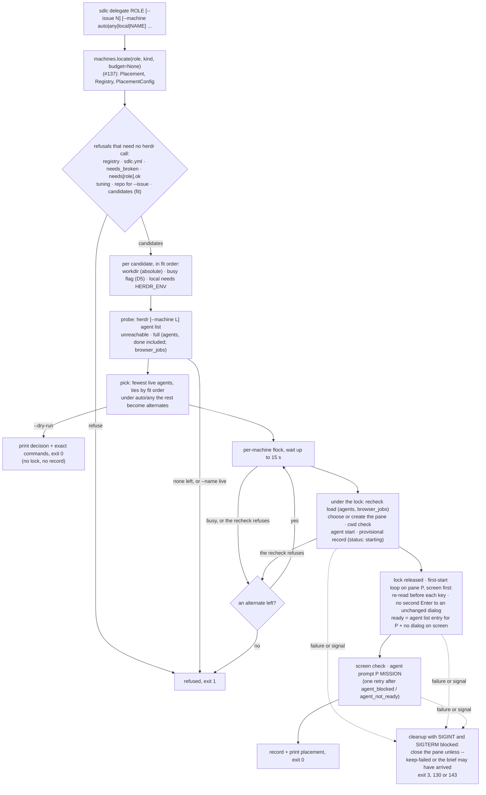

# `sdlc delegate <phase|agent>`: place, start in workdir, clear first-start gates

## Goal

Start a phase or agent on the machine its placement picks, and say where it went. This issue ships:
- `sdlc delegate <role>`, which:
  - picks a machine by fit, then by load;
  - starts a Claude Code agent through herdr in the machine's `workdir`;
  - clears the first-start dialogs the registry declares;
  - briefs the agent with a mission whose only return path is GitHub;
  - prints the placement and records it;
- `--dry-run`, which prints the decision and the exact commands without changing anything;
- the herdr calls it needs (`plugin/lib/herdr.py`), and a new `plugin/lib/delegate.py`;
- a fake herdr on PATH with a test suite in CI, `just sdlc::delegate`, a CHANGELOG entry, README
  text, and version **0.2.42**;
- a live check: real read-only jobs on devbox-n2, and `--machine compute` refused.

Nothing about the resolver changes. #137 says where a role may run, and this issue picks among
those machines and starts the agent.

**Baseline.** #137's code is on this branch: its head 67fe1c5 was merged in at 2ddd95f, after 007bc1e
at 80f0567 (merge, not rebase, no force-push). The implementation is PR #143. **Since revision 4,
these sections describe the code at 60186f8;** Gate 3 validates against them. This spec relies on
#137's **contract**:
- **Rule 1 (#136):** when `Registry.usable` is false, `delegate` refuses. The reason is the first
  registry error, or "no registry" when the registry is inert.
- **Rule 2 (#136) and `unfit_reason`:** a machine that isn't `ok` is never a target.
  `unfit_reason(machine, needs)` (`machines.py:1265`) returns `None` when the machine fits, and
  otherwise the first failure: not `ok`, not `assignable`, caps, keeps, secrets.
- **Rule 6:** `locate()` never raises. Its first element is a `Placement` whose `status` is `off`,
  `placed`, `fallback` or `unplaceable`, with `off_cause` set when the status is `off`.
  `Placement.target` (`:925`) is the winning target as written.
- **Rule 8:** `Placement.candidates` is fit-ordered (local first for `any`), never load-ordered.
  Load, busy flags and `limits` belong to this issue.
- **Rule 9** (`:55-62`): "A consumer that reads `config.needs` outside `resolve()` (#139's
  `--machine`) MUST refuse when `not config.usable`, when `config.needs_broken` is set, or when
  `not needs.ok` for the role." `Needs.invalid` and `needs_broken` are recorded whether or not the
  file opted in. **Only the `Issue`s are withheld** before opt-in (`:1223-1230`), so `delegate`'s
  refusals state the problem themselves.
- **The opt-in rule:** a repo that sets no target resolves every role `off` (`no-placement`).
- **#139 adds two thin public wrappers to `machines.py`,** and changes nothing else there. PR #141
  is in final review and is not touched. `delegate` uses only these public names, never the private
  ones (#137 has already renamed one private helper once: `_strip_role` became `strip_role` at
  007bc1e).
  - **`evaluate(target, registry, needs)`** returns `_evaluate(target, registry, needs)` (`:1335`),
    without its internal `skip`. It judges an explicit `any`, `local` or machine name with #137's
    own refusal texts.
  - **`short_repr(value)`** returns `_r(value)` (`:237`). It bounds every user value quoted in a
    message.
  - **Both are listed in the module's consumer contract** as rule 10, next to rule 9. Part A pins
    them (A12, A13), so a rename fails CI instead of a live run.
  - `delegate` also uses #137's public `cap_text` (`MESSAGE_CAP`, `:552-558`) for every line it prints
    from a pane or a refusal.

## Approach

### Where this sits



- **`plugin/lib/delegate.py` holds the logic.** It follows `machines.py`'s rules: no output, no
  `sys.exit`, no I/O at import time. It raises `Refused` (nothing was started) or `StartFailed`
  (a machine was chosen), and returns plain dataclasses.
  - `bin/sdlc` owns all output and exit codes, as in #136 and #137.
  - `bin/sdlc` installs the SIGTERM handler, which raises `delegate.Terminated`, a
    `KeyboardInterrupt` subclass, so that SIGTERM takes the same cleanup path as Ctrl-C.
  - A `StartFailed` carries the signal mask that the cleanup set. `bin/sdlc` restores it only after
    printing the failure (see "Failure and cleanup").
- **`plugin/lib/herdr.py` grows the calls `delegate` makes,** one function per herdr verb. Each one
  reads its verb's output the way the 0.9.5 CLI prints it: JSON, plain text, or the exit code alone
  (see the table under "`herdr.py`: the adapter grows"). Each raises `HerdrError`, which now carries
  herdr's error `code`. Every herdr call `delegate` makes goes through this file, so tests swap in a
  fake herdr on PATH.
- **`machines.py` gains only the two public wrappers** (`evaluate`, `short_repr`) and a rule 10 in
  its docstring. Everything placement-shaped comes through #137's public surface, which keeps this
  branch clear of #137's internals and of #138's code.

### CLI grammar

```
sdlc delegate ROLE [--issue N] [--machine auto|any|local|NAME] [--prompt TEXT|@FILE]
                   [--name NAME] [--kind phase|agent] [--dry-run] [--keep-failed]
                   [--start-timeout SECS] [--registry PATH] [--config FILE]
```

| Flag | Meaning |
|---|---|
| `ROLE` | A phase or agent name, as in `phase_machines` / `agent_machines`. It is parsed with `bin/sdlc`'s `_role_arg` (`:64`), as `where` does, so an `sdlc:` prefix is stripped and a blank role is exit 2. |
| `--issue N` | The tracker issue the job is for (a positive integer, else exit 2). It goes into the mission and the default agent name. |
| `--machine` | `auto` (default) follows the repo's placement. `any` takes every machine that fits the role's `needs`, local first. `local` is the registry's local machine. `NAME` is one registered machine. These are #137's target words, plus `auto`, which #136 reserved for this flag. An empty value is exit 2. |
| `--prompt TEXT\|@FILE` | The task. `@FILE` reads a UTF-8 file; an unreadable file is exit 2. An empty or blank prompt is exit 2 ("give the task, or leave --prompt out"). A prompt over `MISSION_MAX − 4096` bytes (61440) is exit 2. Without `--prompt`, the mission uses the default task (see "The mission"). **Giving neither `--issue` nor `--prompt` is a usage error** (exit 2), because there would be nothing to do. |
| `--name NAME` | The herdr agent name. It must match herdr's `[a-z][a-z0-9_-]{0,31}`, else exit 2. Default: `<role>-<issue>`, or `<role>` when there is no issue. |
| `--kind` | `phase` or `agent`, passed to the resolver as `where --kind` does. |
| `--dry-run` | Decide, which reads herdr (`agent list`, `workspace list`, `tab list`, `pane list`, `pane process-info`), then print the decision and every command that would change something. It takes no lock, changes nothing and writes no record. |
| `--keep-failed` | On a start failure, leave the pane for inspection instead of closing it. Once `agent start` has been called, it also writes a `status: failed` record for a failure whose brief certainly didn't arrive (see "Failure and cleanup"). |
| `--start-timeout SECS` | How long the agent may take to become ready, first-start dialogs included. Default 90 (compute's `--timeout 90000`). It must be more than 3 and at most 300, which are herdr's bounds: the API schema's `AgentStartParams.timeout_ms` says "Values must be greater than 3000 and at most 300000" (`herdr api schema --json`), and `agent start --help` gives the 300000 maximum. It is also the age past which a provisional record counts as stale (see "The machine lock"). |
| `--registry`, `--config` | As on `sdlc machines`: `_path_arg` / `_config_arg` (`bin/sdlc:60-61`), so an empty value is exit 2. |

**Exit codes:**

| Exit | When |
|---|---|
| 0 | `agent prompt` succeeded: the mission was submitted, and herdr saw the agent take it. The printed `status` is the state herdr reported (`working`, `blocked`, ..., or `unknown` when its reply isn't JSON). With `--dry-run`: a machine was chosen and its pane plan was read. |
| 1 | **Refused.** Nothing was started and no pane was touched. **Most refusals are decided before any herdr call;** the exceptions are listed after this table. Causes: the registry is off or broken; `sdlc.yml` is broken or can't be re-read; the role's needs are broken; a tuning value is invalid; `--issue` has no resolvable repo; the mission would be over `MISSION_MAX` bytes; the placement is `off` or `unplaceable`; an explicit machine is unknown or unfit (compute, or any `assignable: false` box); every candidate is full, busy, unreachable, or has no usable workdir. |
| 2 | Usage error. |
| 3 | **Start failed after a machine was chosen,** or **any unexpected error** anywhere in `sdlc delegate` (an exception that isn't a refusal), even before a machine was chosen. Start failures include: a herdr error while choosing or creating the pane, starting the agent or briefing it; a new pane that didn't open in the workdir; a dialog that couldn't be cleared, whose selection couldn't be read, or that didn't respond to Enter; a timeout. Under `--dry-run`, a failed read-only pane lookup is exit 3 too. The output says what was left behind. |
| 130 | Ctrl-C (SIGINT), after the cleanup. Also any other non-`Exception` `BaseException` that stops the start. |
| 143 | SIGTERM, after the cleanup. |

**The refusals that come after a herdr call:**
- full, or unreachable, from the probes;
- an explicit `--name` that is already live;
- all nine default-name suffixes live;
- the machine lock: busy after `LOCK_WAIT` (15 s), or no writable place for the lock file;
- the recheck under the lock: the machine is now full (agents or browser jobs), or now unreachable.

Under `auto` or `any`, the lock and recheck refusals move on to the next fitting machine first; the
run is refused only when none is left.

**If a second signal arrives during the cleanup,** the run ends with **that** signal's code once the
failure has been printed. So SIGTERM then Ctrl-C exits 130, and Ctrl-C then SIGTERM exits 143 (D59).
A Ctrl-C or SIGTERM before any machine was chosen (during `decide()`) exits 130 or 143, with nothing
started.

Exit 3 is separate from exit 1 so that a script can tell "nothing happened" from "something may be
left on that box". An unexpected error is exit 3 even when nothing was started, because the run
cannot vouch for what it did.

### Choosing the machine

**1. Every refusal that needs no herdr call, in this order.** They come before the candidates are
probed, so they make no herdr call at all (tests D6-D11, D22, D25 assert that `calls` is empty).
- **`locate`:** `placement, registry, config = machines.locate(role, kind, registry_file=..., config_file=..., budget=None)`.
- **The registry isn't usable:** refuse with `placement.reason` when `off_cause` is `no-registry` or
  `registry-errors`. For `no-registry`, add `; sdlc delegate needs a registry (see: sdlc machines)`.
- **`sdlc.yml` is broken** (`off_cause` `sdlc-errors`): refuse with `placement.reason`. A file that
  can't be read can't show the role's needs, so this holds for an explicit `--machine` too.
- **Re-read `sdlc.yml` once.** When `config.path` is set, run `doc = machines.parse_yaml(config.path)`.
  It serves the needs texts, the tuning and `repo:`. A `RegistryError` refuses with `could not
  re-read <path>: <detail>`.
- **The needs.** Take `needs = config.needs.get(role, machines.Needs())`. Each of the checks below
  applies to every `--machine` value (rule 9). Each states the problem itself, because
  `sdlc machines check` withholds needs issues until the file opts in. The hint `; see: sdlc
  machines check` is added only when `config.opted_in`.
  - **`config.needs_broken`:** refuse with `the top-level needs in <path> <problem>, so <role>'s
    needs can't be trusted`, where `<problem>` comes from the re-read `doc`:
    - `is written more than once` when `"needs"` is in `getattr(doc, "dups", ())`;
    - `is not a map (got <type name>)` when `doc["needs"]` is present and not a map;
    - otherwise `is repeated or malformed`. This generic wording covers a file that changed between
      `locate()` and the re-read, which would otherwise yield "not a map (got dict)".
  - **`not needs.ok`:** refuse with `needs.<role> has errors in: <sorted keys>` (#137's text).
- **Tuning:** `tuning_for(doc, role)`. A bad value refuses (see "`agent start`").
- **The repo:** with `--issue` and no resolvable repo, refuse (see "The mission").
- **The candidate list**, by `--machine`:

  | `--machine` | Candidates | Refused when |
  |---|---|---|
  | `auto` | `placement.candidates` when the status is `placed` or `fallback`. A `fallback` also prints `warning: <placement.reason>` on stderr and goes ahead (D4: the runtime keeps working). | `unplaceable`: refuse with `placement.reason`. `off` / `no-placement`: refuse with `sdlc.yml places nothing, so --machine auto has nowhere to send <role>; place it (phase_machines, agent_machines, default_machine) or name a machine with --machine`. |
  | `any`, `local`, `NAME` | `machines.evaluate(value, registry, needs)`, the public wrapper this issue adds. It returns the fitting machines (for `any`: local first, then registry file order), the refusals, and the text to use when none fit. | No machine fits: refuse with `_evaluate`'s text. For a name that isn't registered: `'<NAME>' is not in the registry; did you mean '<x>'?`. For an unfit one: the `unfit_reason` text, e.g. `machine 'compute' is not assignable`. |

  - An explicit `--machine` works in a repo that hasn't opted in. The opt-in rule governs the
    repo's map, while an explicit machine is the person choosing. Rule 9's refusals and the trust
    filters still apply in full.
  - When the repo did place the role somewhere else, the output adds
    `overrides <placement.requested.at> ('<value>')`.
- **`unfit_reason` runs again on every `auto` candidate.** This costs nothing, and it means
  `delegate` never sends work to a machine that isn't `ok` or `assignable`, even if the resolver had
  a bug.

**2. Delegate-only filters, per candidate in fit order.** These make no herdr call, and the busy
flag costs one `stat`. A candidate that fails is passed over with the reason shown:

| Order | Filter | Reason text (tests match these substrings) |
|---|---|---|
| a | **workdir.** The machine has a `workdir`. This applies to the local machine too: `delegate` only starts agents where the registry says it may. A remote machine's `workdir` must be an absolute path, because `start()` compares it with the path herdr reports for the new pane (and it must be canonical; see "Comparing paths"). A local `workdir` must be absolute after `~` expansion: a relative one is refused here, before any herdr call (D55). | `no workdir in the registry (sdlc delegate starts agents there)`; `workdir '<w>' must be an absolute path on a remote machine`; `workdir '<w>' must be an absolute path (or start with ~/)` |
| b | **Busy flag (D5).** The role is *heavy*: `needs.caps` includes `full-suite`, `browser` or `docker` (`HEAVY_CAPS`). The machine is `gaming_sensitive` with a `busy_flag`, and the flag says busy (rules below). | `busy: <flag> exists and <role> needs <the heavy caps>; remove the file when the box is free, or delegate to another machine`. The variants for a flag that can't be checked are below. |
| c | **The herdr session.** For the local machine, `HERDR_ENV` must be `1`. herdr's own rule is never to inspect or control a session from outside it (`herdr --skill`; compute's `_guard`). Remote machines are reached through `--machine` profiles and don't need it, but need a herdr label in the registry. | `this shell is not inside herdr (HERDR_ENV is not 1), so the local herdr server is not used`; `no herdr transport in the registry` |

**The busy flag.**
- **Where it is read.** D5 says "when the file exists". It is read **on the box `delegate` runs
  on**, the coordinating box where the registry lives. This is exact for ADR-009's only
  gaming-sensitive box, which is the local one. A remote gaming-sensitive box needs its flag mirrored
  to the coordinating box; see Open questions.
- **How it is resolved.** A leading `~` is expanded against this box's `HOME`, as `registry_path`
  does. A path that is still not absolute after that is treated as **busy**: `busy: busy_flag
  '<x>' is not an absolute path, so it can't be checked; write it as ~/... or /...`. The just
  recipe's `cd ..` would otherwise change what a relative path means.
- **`os.stat` decides:**
  - success → busy;
  - `FileNotFoundError` (ENOENT) or `NotADirectoryError` (ENOTDIR) → not busy;
  - any other `OSError` → busy (fail closed), as `busy: could not check busy_flag <x> (<error>);
    ...`.
- **A machine that is `gaming_sensitive` with no `busy_flag`** has nothing to test, so it is not
  busy; #136 already warns about that registry. An invalid `busy_flag` makes the machine not `ok`,
  so step 1 has already refused it (#136 rule 3).
- **The flag also refuses an explicit `--machine`.** That is stricter than D5's "under `auto`", but
  D5 grants no override, and ADR-009 §5 and the house rule say the flag blocks heavy work. The
  refusal says how to proceed. The README and CHANGELOG say so.

**3. Load: probe each remaining candidate.** Run `herdr [--machine <label>] agent list` (the local
machine has no `--machine`), with `herdr.DEFAULT_TIMEOUT` per machine, sequentially:

| Result | Verdict |
|---|---|
| `HerdrError` (unknown label, timeout, herdr missing, bad output) | passed over: `unreachable: <detail>` |
| `limits.agents` is set and `len(agents) >= limits.agents` | passed over: `full: <n> agents, limit <L>`. Every live agent counts, whatever its status. **A finished (`done`) agent keeps its slot until someone stops it** with the printed `stop:` command; the README says so. This matches `sdlc machines check --probe` (`bin/sdlc:163-168`). |
| The role is a **browser job** (`browser` in `needs.caps`), `limits.browser_jobs` is set, and the live browser jobs `>= limits.browser_jobs` | passed over: `full: <b> browser jobs, limit <B>` |
| otherwise | eligible: `<n> agents, limit <L or ->`, plus `, <b> browser jobs, limit <B>` for a browser job |

**Counting browser jobs.** herdr doesn't know which agents drive a browser, but `delegate` does,
because it records every placement (see "The record"). The live browser jobs on machine M are the
records under `delegates/<M>/` with `browser_job: true` whose `name` **and** `pane_id` match a live
agent in M's `agent list`. A provisional record (`status: starting`) counts too, unless it is stale
(see "The machine lock"). Agents started some other way are not counted. That limit is documented.

**4. Pick and name.** Among the eligible candidates, the one with the **fewest live agents** wins.
Ties go to fit order, which puts local first for `any`. If nothing is eligible, refuse with
`no machine can take <role> now: <m>: <why>; <m>: <why>` (exit 1).
- **Load never widens the candidate set.** A single named placement that is full refuses; it does
  not fall back to `default_machine`. To let load choose, place the role on `any`.
- A raw count, not a ratio, because a machine with no `limits.agents` has no ratio. The coordinator's
  own pane counts on the local server, which nudges work off the box you are typing on.
- **Concurrent runs are serialised per machine** by the machine lock and its recheck (see "The
  machine lock"). Two runs can't both take the last slot.
- **The name** is fixed now, from the winner's `agent list`. See "The name" below. An explicit
  `--name` that is live there refuses (exit 1), and so do nine live default-name suffixes.
- **The alternates.** Under `--machine auto` or `any`, the other eligible candidates, in the same
  ranked order, become `Decision.alternates`. Each gets its own name and mission. An alternate on
  which an explicit `--name` is live is dropped. They are tried only if the lock or the recheck
  refuses (see "The machine lock").

### Starting the agent

All calls on the chosen machine use the same `--machine <label>` prefix, or none for local. **IDs come
from herdr's JSON, never from guesses** (herdr skill; compute's justfile). **After `agent start`,
the agent is addressed by its pane id `P`, never by its name.** herdr's agent commands accept "the
pane ID currently hosting that agent" (herdr skill), and the name binding can lag during startup.
Compute saw `agent get <name>` answer `agent_not_found` for an agent that was still starting.

`start(decision)` (`delegate.py:1277`) tries the decision, then each of its `alternates` (see "The
machine lock"). Each try is one `_Run.go` (`:1136`) in two stages:
- **under the lock:** recheck, pane, `agent start`, provisional record;
- **without the lock:** first start, brief, final record.

**0. The machine lock** (`machine_lock`, `:658`). One `delegate` at a time may be starting an agent on
a given machine.
- **The lock** is an exclusive `fcntl.flock` on `${XDG_STATE_HOME:-~/.local/state}/sdlc/delegates/<machine>/.lock`.
  - **The wait:** a run polls every `LOCK_POLL` (0.2 s) for up to `LOCK_WAIT` (15 s), then refuses
    with `<machine> is busy: another sdlc delegate is starting an agent there; try again shortly`.
  - **Release:** the lock is released by closing the file. A holder killed with SIGKILL frees it at
    once, and a stale lock file is harmless.
- **When the records directory can't be created or written** (`_lock_file`, `:631`):
  - the lock goes to `$XDG_RUNTIME_DIR/sdlc-delegate/<machine>.lock`, or else to
    `/tmp/sdlc-delegate-<uid>/<machine>.lock`; those directories are made with mode 0700, and used only if `lstat`
    shows a real directory (not a symlink) owned by the current uid and not group- or other-writable;
    otherwise the start fails with exit 3 (`the lock directory <d> is not safe to use ...`), because an
    unlocked start could overrun the limits;
  - the start is **not** refused for the unwritable directory itself;
  - no record can be written. The success output warns `the state directory is not writable, so no
    record will be written (lock: <path>)`, and the failed record write adds `warning: could not
    write the record: <why>`.
  - If neither place is writable, the run refuses with `cannot take the lock for <machine>: ... so
    concurrent starts can't be ruled out`.
- **What it covers.** It is held from the load recheck through `agent start` and the provisional
  record, and **released before the first-start loop and the brief**, which can take minutes. So:
  - two delegates can't pick the same free pane, or both take the last slot;
  - a second delegate to the same machine waits only for another run's pane setup and `agent start`.
- **The recheck under the lock** (`recheck`, `:718`) reads the chosen machine's `agent list` again,
  because another delegate may have started an agent since the pick. It refuses with:
  - `<machine> is unreachable: <detail>`;
  - `<machine> is now full: <n> agents, limit <L>`;
  - for a browser job, `<machine> is now full: <b> browser jobs, limit <B>`, counted from the records
    as in "Counting browser jobs", provisional ones included;
  - for an explicit `--name` that has gone live, `agent name '<n>' is already live on <machine>`.

  A default name that has gone live is replaced by the next free suffix, and the mission is
  re-rendered with it.
- **The provisional record.** Right after `agent start`, still under the lock, the record is written
  with `status: starting`, `pid` (this process) and `started_at`. The next delegate's recheck then
  counts this job, its browser job included, before herdr's `agent list` or the final record would
  show it.
  - **Stale provisional records** don't count (`_stale`, `:696`): a `status: starting` record is
    stale when its `pid` is dead (`os.kill(pid, 0)`), or when it is older than `--start-timeout`.
- **Alternates.** Under `--machine auto` or `any`, `decide()` keeps the other eligible candidates as
  `Decision.alternates`, in the same ranked order (fewest live agents, then fit order).
  - An alternate on which an explicit `--name` is already live is dropped.
  - When the lock wait or the recheck refuses a machine, `start()` tries the next alternate.
  - A machine that was passed over is reported after a successful start, as
    `warning: tried <machine>: <why>`.
  - When every candidate refuses, the run is refused with `no machine can take <role> now: <machine>:
    <why>; ...` (exit 1).
  - With a single candidate (a named machine, `local`, or one fitting machine), its refusal is final.
  - The alternates never widen the candidate set: they are the same fitting machines the pick
    ranked.

**1. The pane: `choose_pane`, read-only, shared by `start` and `--dry-run`.**
- **Never split.** One job gets one tab, so there are no narrow panes. Compute's "reuse a free pane
  before splitting" lesson becomes "reuse a free pane before making a tab".
- **When it runs.** For a real start, `choose_pane` runs under the lock. For `--dry-run` it runs with
  no lock.
- **What it does.** It makes only the lookups below and returns a `PanePlan`. `start` carries the
  plan out, and `--dry-run` prints it. A herdr error is a `StartFailed` with no pane (exit 3).
- **Workspace.** Use the first workspace labelled `sdlc-delegate` (`WORKSPACE_LABEL`) from
  `workspace list`. If there is none, the plan is `workspace create --label sdlc-delegate --cwd
  <workdir> --no-focus`, using its `root_pane` and renaming its tab (`tab rename <tab>
  sdlc:<name>`). A workspace labelled `sdlc` is not used.
- **Free pane.** Otherwise, from `pane list --workspace W` and `tab list --workspace W`, take the
  first pane that meets all of these:
  - its tab's label starts with `sdlc:` (`TAB_PREFIX`; tabs this tool made) and holds one pane;
  - no live agent sits on it (its `pane_id` isn't in `agent list`);
  - its `foreground_cwd` is the workdir (compared as below);
  - `pane process-info --pane P` shows only a shell in the foreground (`bash`, `zsh`, `sh`, `fish`,
    `dash`).

  Its tab is renamed to `sdlc:<name>`. These are panes an earlier delegated agent left when it
  exited. herdr requires `agent start` to find the pane at its shell prompt, which the last two
  checks confirm.
- **Otherwise**, `tab create --workspace W --label sdlc:<name> --cwd <workdir> --no-focus`, using its
  `root_pane`.
- **Comparing paths** (`_same_dir`, `:750`). herdr reports the process's cwd, which the kernel has
  resolved.
  - **On the local machine,** both sides go through `os.path.realpath`, so a workdir reached through a
    symlink still matches (D55).
  - **On a remote machine,** both sides go through `os.path.normpath` only. So a remote `workdir` must
    already be its **canonical** absolute path, with no symlinks; filter a requires it to be
    absolute.
  - The local workdir is `~`-expanded first. A local workdir that is still relative after that is
    refused in filter a.
- **The new pane must open in the workdir** (`_wait_cwd`, `:988`).
  - **Why:** herdr's behaviour for a `--cwd` that doesn't exist hasn't been checked. An agent started
    elsewhere would make its working copy in the wrong place, and its `git clone` into
    `<workdir>/<name>` could even create the workdir.
  - **The check:** after `workspace create` or `tab create`, poll `pane list --workspace W` every
    `POLL`, for up to `CWD_WAIT` (5 s), until the new pane's `foreground_cwd` matches the workdir.
  - **If it never does,** the start fails **before any `agent start`** with exit 3: `workdir <w>
    doesn't exist on <machine> (the new pane opened in <cwd>); a remote workdir must be its
    canonical path, with no symlinks`. The cleanup closes the pane, unless `--keep-failed`.
  - A reused free pane has already passed the same comparison in `choose_pane`.
- **An interrupt during a create call** (D62). While `workspace create` or `tab create` is in flight,
  the run remembers the plan (`_Run.creating`). If a signal or error stops it there, the server may
  have made the pane already, so the cleanup looks it up (`_find_created`):
  - after `workspace create`: every pane of a workspace labelled `sdlc-delegate`;
  - after `tab create`: every pane in a tab labelled `sdlc:<name>` in that workspace.

  The first one found becomes the pane to clean up, and any others are closed. This is safe because
  the lock is held, so no other delegate is creating on that machine.

**2. `agent start`.**

```
herdr [--machine L] agent start <name> --kind claude --pane <P> --timeout <start_timeout*1000> \
  -- --permission-mode auto [--model <model>] [--effort <effort>]
```

- **`--permission-mode auto` is always passed.**
- **`model` and `effort`** come from `sdlc.yml` exactly as the phase-tuning hook reads them
  (`phase-tuning.py:153-172`): `phases.<role>.model` wins over `phase_models.<role>`, and
  `phases.<role>.effort` wins over `phase_effort.<role>`. They apply to any role, agents included,
  like the hook.
  - A knob that is unset, `null` or blank is left out, and the worker's Claude Code default applies.
    Unlike the hook, `null` is unset rather than the string `"null"` (the quirk #137 recorded).
  - **A bad value refuses** in step 1, before any herdr call (exit 1): a non-string `model`
    (`phases.<role>.model <v> is not a string`), or an `effort` outside `EFFORTS = (low, medium,
    high, xhigh, max)` (`phases.<role>.effort 'huge' is not one of: low, medium, high, xhigh, max`,
    or `phase_effort.<role>`). Values are quoted with `machines.short_repr`.
  - `max_turns` and `worktree` don't apply to an interactive session, so they are ignored.
- **The session is a plain Claude Code session** briefed with the role. It does not get
  `--agent sdlc:<role>`, because the sdlc plugin may not be installed on the worker. The default
  task points the worker at `sdlc:<role>` when the plugin is there (see "The mission"). Shipping the
  role with `--agents <json>` (2.1.310 has it) is a follow-up; see Out of scope.
- **The name:**
  - **Default:** `<role>-<issue>` (or `<role>`), sanitised. If all nine suffixes are live, refuse
    (exit 1); that is one of the refusals that come after a herdr call. The rules:
    - lower-case it, and turn each run of characters outside `[a-z0-9_-]` into one `-`;
    - strip `-` from both ends, and prefix `agent-` if it doesn't start with a letter;
    - cut it to 32 characters (to `32 - len(suffix)` when a suffix is added).

    If that name is live on the chosen machine, the next free suffix is used: `-2`, `-3`, ... up to
    `-9`.
  - **`agent_name_taken` anyway.** `agent start` can answer this even when the name isn't in
    `agent list` or `agent get`, because an agent that is still starting holds the name (compute's
    lesson). Then a default name moves to the next suffix on the same pane, at most twice. An
    explicit `--name` is a start failure (exit 3).
- **Success is exit 0.** The body is not relied on:
  - the schema's `agent_started` shape (`agent`, `argv`) hasn't been checked on the CLI;
  - a start that meets a dialog returns only an error.

  `agent_not_ready` means a startup dialog is up (herdr skill), and the loop below takes over.
  The loop runs either way, so a dialog is caught even when herdr already reports the agent idle.
- **Right after `agent start`** the provisional record is written, and the lock is released (step 0).

**3. First start: clearing the dialogs** (`_Startup.first_start`, `:930`). This is a bounded loop on
pane `P`, run without the lock.
- **Each round reads the screen first.** A declared dialog is then answered even when herdr says the
  agent is idle (the herdr skill warns that `idle`/`done` doesn't guarantee an unfamiliar dialog was
  recognised), and an undeclared one still fails.
- **The same `_Startup` object serves every run of the loop** for one start: the first-start run, the
  run after the screen check before the brief, and the run after a rejected brief. So `answers` (the
  Enters per gate) and the remembered Enter are **kept across the brief retry** (D67).

```
deadline = clock() + start_timeout; unreadable = None; unresponsive = None
loop:
  if clock() > deadline:                                  # FIRST, in every round
      fail "could not read the selection on <unreadable>"          if unreadable
        or "<unresponsive> did not respond to Enter: the screen has not changed since it was sent, so no second key was sent"  if unresponsive
        or "agent was not ready within <s>s"
  screen = pane_read(P)                                   # text; see "herdr.py"
  if never_answer(screen): fail "<dialog> is showing; it is never answered automatically: answer it once by hand on <machine>"
  gate = match_gate(screen)                               # a GATES name, or None
  if gate:
      if gate not in machine.first_start: fail "the screen shows <gate>, which <machine> doesn't declare; add it to first_start in the registry"
      if after_enter[gate] == dialog_lines(screen, gate): # unchanged since our last Enter: the redraw is late
          unresponsive = gate; sleep(POLL); continue      # send nothing until it changes
      unresponsive = None; forget after_enter[gate]
      if answers[gate] >= MAX_ANSWERS_PER_GATE (2): fail "<gate> still showing after 2 answers"
      result = answer(gate)                               # "entered" | "no-selection" | "skipped"
      if result == "entered": answers[gate] += 1; unreadable = None
      else: unreadable = gate if result == "no-selection" else None; sleep(POLL)
      continue                                            # back to the top: deadline, NEVER_ANSWER, re-match
  unreadable = unresponsive = None; forget every after_enter   # no dialog on screen
  entry = the agent list entry with pane_id == P
  if entry and entry.get("agent") == "claude" and entry.get("agent_status") in ("idle", "done")
         and entry.get("interactive_ready") is not False:  # missing or null is accepted
      return entry                                        # ready: no dialog on screen, agent settled
  sleep(POLL)
```

**No second Enter to an unchanged dialog** (D47, D60).
- **What is remembered.** When `answer()` sends Enter, it remembers that dialog's own lines at that
  moment (`_dialog_sig`, `:822`): each normalised line that matches one of the gate's patterns, or
  that is one of its option lines with the marker. A status line, a spinner or a ticking timer
  elsewhere on the screen is not part of it.
- **While the same gate shows the same dialog lines,** the loop sends nothing and waits. At the
  deadline it fails with `did not respond to Enter`, having sent exactly one Enter.
- **When the dialog lines differ** (the dialog remounted, or its selection moved), the memory is
  dropped, and the round counts toward the cap as usual.
- **When no dialog is on screen,** every remembered Enter is forgotten. So a dialog that later comes
  back looking the same is answered again, rather than waited out (D60 c).

**`answer(gate)`** (`_Startup.answer`, `:885`) sends at most one Down and one Enter. It returns
`entered`, `no-selection` or `skipped`.
- **A fresh read before each key.** Immediately before each key it reads the screen again and
  re-checks, so the gap between the last read and a key is one herdr call.
- **A pre-key check** means all of:
  - the same `gate` still matches;
  - `never_answer(screen)` is `None`;
  - the selection is the one the step needs.
- **A failed check sends nothing:** `answer()` returns to the top of the loop. Because the loop
  checks the deadline first in every round, even an `answer()` that returns early every time ends at
  the deadline (D42).

The steps:
1. **Wait out the input guard.** Sleep `GATE_KEY_PAUSE` (0.5 s). Claude Code dialogs refuse keys for
   150 ms after they open (`refuseInput`), and the auto-mode nudge for 500 ms.
2. **Read and re-check.** Read the screen.
   - If the gate no longer matches, or `never_answer(screen)` isn't `None`, return `skipped`.
   - If `selected_option(screen, gate)` is `None`, return `no-selection`. At the deadline the loop
     then fails with `could not read the selection on <gate>` and the screen.
3. **Down, only if needed.** If the selection is already `target_label` (a dialog that remounts with
   focus on the target, as 2.1.310's fullscreen notice does after a refused dismiss), skip to step 4.
   Otherwise:
   - read again, and require the pre-key check, with the same selection as step 2, then send
     `pane send-keys P down`;
   - re-read every `POLL` for up to `KEY_SETTLE` (2 s, never past the deadline), until the gate no
     longer matches, `never_answer` matches, or the selection changes to a readable option;
   - if the gate no longer matches, or `never_answer` matches, return `skipped`;
   - **a half-drawn frame:** if the selection still can't be read when `KEY_SETTLE` runs out, return
     `no-selection`. The next round reads again. The marker has usually moved by then, so step 3
     isn't repeated, and Down is not sent twice (D54);
   - if the selection is readable but not `target_label`, **send nothing more** and fail with `after
     Down the selection is '<option>', not '<target_label>'; nothing more was sent`;
   - otherwise sleep `GATE_KEY_PAUSE`.
4. **Enter, after a pre-key check.** Read the screen. The pre-key check must pass with the selection
   on `target_label`. If it doesn't, return `skipped`. Otherwise remember the dialog's lines (above)
   and send `pane send-keys P enter`.
5. **Wait for that dialog to be handled.** Re-read every `POLL`, for up to `CLEAR_WAIT` (5 s, never
   past the deadline), until that gate no longer matches, `never_answer` matches, or its selected
   option changes (a remount). Then return `entered`. If the dialog is still up and unchanged, the
   next round waits on it (see above) instead of answering it again.

**`selected_option(screen, gate)`** reads only the gate's own option lines, and matches labels
**exactly**:
1. **Normalise** each screen line: NBSP (U+00A0) becomes a space, whitespace runs collapse, the ends
   are stripped, and the text is case-folded. The labels in `gate.options` are normalised the same
   way.
2. **Strip the marker.** A line is *marked* when it starts with `❯` (`MARKER`), or with the ASCII
   fallback `>` (`ASCII_MARKER`). 2.1.310's figures table uses `pointer: ">"` where Unicode isn't
   available. The marker is stripped.
3. **Strip an optional index:** `1.`, `2.` ... (regex `^\d+\.\s*`).
4. **Compare.** The line is an *option line* only if what is left **equals** one of `gate.options`.
   - `❯ Not now please` (a past prompt) and `> hello` (the REPL input line) are never option lines.
   - So `>` counts as a marker only on an option line.
5. **Count.** The result is the option on the **single** marked option line. Zero marked option
   lines, or more than one, give `None`, and then nothing is sent. More than one happens, for
   example, when a past prompt reads exactly `❯ Not now` above the dialog. The deadline bounds the
   wait.

These gates' options carry no `· description` suffix in 2.1.310, so exact equality is safe.

**The gates** (`GATES`, `delegate.py:123`; Claude Code 2.1.310's dialog definitions, checked in the binary):

| Gate | Recogniser (case-insensitive, whitespace-collapsed) | `options` | `target_label` | Why that option |
|---|---|---|---|---|
| `trust-prompt` | `yes, i trust this folder`, or `is this a project you created or one you trust` | `No, exit` · `Yes, I trust this folder` | `Yes, I trust this folder` | Built with `cancelFirst: true`, `focus: "cancel"`, `hideIndexes: true`. It shows `❯ No, exit` first and focused, then the trust option, unnumbered. Only this **plain** trust dialog is answered. |
| `fullscreen-notice` | `try the new fullscreen renderer` | `Yes, try it` · `Not now` | `Not now` | `❯ 1. Yes, try it` comes first and focused, then `2. Not now`. Declining keeps the classic renderer, which suits a herdr pane: alternate-screen rows never reach the scrollback that `pane read --source recent` reads. It shows while `fullscreenUpsellSeenCount < 3`, so it can come back on a box's first three starts. The loop answers it on every start where it shows. |

**`NEVER_ANSWER`** (`delegate.py:135`): seeing one of these fails the start at once (exit 3, the
screen shown), with no key sent.

| Name | Recogniser | Why it is never answered |
|---|---|---|
| `auto-mode-teach` | `teach auto mode about your environment?`, **with the `?`** | 2.1.310 shows "Teach auto mode about your environment?" (Yes / Not now / Don't show again) in auto mode, after 5 or more starts and 5 or more auto-mode denials. A well-used worker can reach that, possibly during the brief. The `?` keeps release notes and the `/auto-mode-setup` command description ("Teach auto mode about your environment, plus ...") from matching (A8e). |
| `trust-elevated` | `no, continue without these permissions` | The trust dialog's **stronger** variant. It is shown when the folder pre-approves permissions, adds directories, configures MCP servers or runs a `headersHelper`; its cancel option reads "No, continue without these permissions". A settings file planted in a worker's `workdir` must never be accepted automatically. The trust gate's `options` therefore don't include that label, and the variant fails the start. The README says to trust such a folder once by hand (A14, D51). |

- **The README's troubleshooting line** covers both: an exit 3 showing such a dialog means answering
  it once by hand on that box, then running `delegate` again.
- **`#136`'s `FIRST_START_GATES` is unchanged**, because neither is a first-start gate.
- **The selection check guards against a reordered dialog.** If a future Claude Code moves the
  options, Down lands on the wrong label and the run fails before Enter. If the live check finds
  different recognisers, options or labels on devbox-n2's version, the implementer updates `GATES`,
  and records the version and the screen text in the implementation notes.
- **What the loop covers:**
  - **0 dialogs:** `agent start` succeeds, the screen shows none, and no keys are sent.
  - **1 or 2 dialogs:** one round each.
  - **A dialog while herdr says idle:** answered (screen first).
  - **An unnamed agent with null readiness:** accepted, then renamed.
  - **A dialog replaced between the decision and the key:** no key is sent to the replacement (the
    pre-key checks).
  - **A dialog that remounts on Enter:** answered again, up to the cap.
  - **A dialog that redraws late after Enter:** no second Enter. The loop waits, then fails with
    `did not respond to Enter` if it never changes.
  - **A half-drawn frame after Down:** retried as `no-selection`.
  - **A wrong selection:** fails before Enter.
  - **No readable selection** (no marker, or two marked option lines): no key; fails at the deadline.
  - **The ASCII `>` marker:** treated like `❯`, but only on option lines.
  - **A never-answered dialog, alone or next to a gate:** no key; fails at once.
  - **An unknown dialog:** fails at the deadline, with the screen.
- **Every round is recorded** in the record's `startup` (at most `MAX_STARTUP_ROUNDS_RECORDED`, 30).
  Each entry has:
  - `t` (seconds since the start);
  - `dialog`, and its `selected` option;
  - `action`: `read`, `down,enter`, `enter`, `no-selection`, `skipped`, `waiting`, `capped`,
    `undeclared` or `never-answered`;
  - the `agent list` entry's `name`, `agent_status`, `interactive_ready` and `launch_pending`.

  This shows what herdr really reports between `agent_not_ready` and ready.

**4. After ready, then the brief.**
- **Rename.** If the ready entry's name isn't `<name>` (for example `null`, when the start binding
  didn't survive `agent_not_ready`), run `agent rename P <name>` once. Success is exit 0.
- **The command line actually run.** Read `pane process-info --pane P` (JSON) and take the `argv` of
  the foreground process named `claude`. On 0.9.5 it carries the full command line, for example
  `claude --permission-mode auto --model sonnet --effort low` (the live check). If that is missing,
  or the call fails, fall back to the intended `claude` plus `claude_args`. `argv_source` says which
  was used (`process-info` or `intended`).
- **The ready record.** The name is final now; if it changed, the mission is re-rendered with it. The
  record is rewritten: `status: unknown`, `briefed: false`.
- **A screen check right before the brief** (D53). Read the screen once more. If a known gate or a
  `NEVER_ANSWER` dialog is up, a dialog was drawn after ready. Run the loop again (same `_Startup`,
  fresh `start_timeout` budget). It either answers a declared dialog, or fails. This keeps the
  mission from being typed into a dialog herdr didn't classify as blocked.
- **The brief:**

  ```
  herdr [--machine L] agent prompt <P> <mission> --wait --until working --until blocked --timeout 60000
  ```

  - It returns as soon as herdr sees the agent take the prompt. `delegate` never waits for the job
    itself.
  - **The status** is read from the JSON body: `.result.agent.agent_status`, else
    `.result.agent_status` (compute's justfile reads it the same way), else `unknown`. Success itself
    is exit 0.
  - **A dialog appeared after start:** `agent_blocked` (refused before any input is sent, so a retry
    can't submit twice) or `agent_not_ready`. Run the loop once more, with the same counts and a
    fresh `start_timeout` budget, then retry the prompt once. **That is the issue's "while
    start/prompt returns `agent_not_ready`".**
  - **Any other error** is a start failure (exit 3), and is not retried.
  - **A final status of `blocked`** is still exit 0, with `warning: <name> is blocked on a dialog;
    read it with: <read command>`.
- **The final record** is written with `briefed: true` and the status.

**5. Failure and cleanup** (`_Run._failed`, `:1232`). Every way out of a start after a machine was
chosen ends here: a herdr error, a `_Fail` from the loop or the cwd check, a refusal raised once a
pane exists, Ctrl-C, SIGTERM, or any unexpected exception. A `BaseException` is caught, not just an
`Exception` (D48, D49).
- **Signals are blocked first.** SIGINT and SIGTERM are blocked with `signal.pthread_sigmask` for the
  whole cleanup. The herdr child processes inherit the mask, so a terminal's group-wide Ctrl-C can't
  kill the `pane close` either.
  - The mask stays in place until `bin/sdlc` has printed the failure. Then `restore_signals()`
    unblocks, and a signal that arrived meanwhile is delivered there and ends the run with its own
    code: 130 or 143 (D59).
  - So pressing Ctrl-C twice, or SIGTERM during a slow cleanup, can't leave a pane behind.
- **The delivery rule.** Whether the pane may be closed depends on whether the mission may have
  reached the agent. **The brief certainly did not arrive if, and only if:**
  - `agent prompt` was never invoked; or
  - its last invocation was rejected with `agent_blocked`, `agent_not_ready` or `agent_not_found`
    (`NOT_DELIVERED`).

  Once `agent prompt` has been invoked and not rejected that way, the brief **may** have arrived.
  That covers a stall, a timeout, any other error, and Ctrl-C or SIGTERM during `--wait`. The flag is
  set immediately before each `agent prompt` call, and cleared only by a `NOT_DELIVERED` rejection
  (D61).

| Case | Pane | Output read | Record |
|---|---|---|---|
| **Certainly not delivered**, no `--keep-failed` | closed (`pane close P`) | the last `OUTPUT_LINES` (40) lines (`pane read P --source recent-unwrapped --lines 40 --format text`), **except after an interrupt**, when the pane is closed without reading it | removed (the provisional or ready record is deleted) once the close succeeded |
| **Certainly not delivered**, `--keep-failed` | left | as above | a `status: failed` record (`briefed: false`) is written, **once `agent start` has been called**; before that there is no record |
| **May have been delivered** (with or without `--keep-failed`) | left: the agent may be working on the mission | not read | the existing record stays (the ready record: `status: unknown`, `briefed: false`) |
| **No pane yet** (a failure before any pane, or a create call whose pane can't be found) | none | none | none |

- **Exit codes.** After an interrupt the exit code is 130 (Ctrl-C) or 143 (SIGTERM). After anything
  else it is 3. A pending signal delivered by `restore_signals()` overrides that, as above.
- **The output names what was left:**
  - `left behind: nothing (pane <P> closed)`;
  - `left behind: nothing` when there was no pane;
  - or `left behind: pane <P>`, followed by the `record:` line when a record exists, then `read:` and
    `stop:`.
- **A failed `pane close`** is reported as `could not close pane <P> (<why>); close it with: <stop
  command>`. The pane then counts as left behind, and its record is not removed.
- **An ignored SIGINT stays ignored** (D63). `bin/sdlc` installs a handler for SIGTERM only, and
  leaves SIGINT as Python found it. So `sdlc delegate ... &` from a shell without job control, which
  starts with SIGINT ignored, isn't stopped by a Ctrl-C meant for the foreground job.

### The mission

`mission_text()` composes the mission, which is at most `MISSION_MAX` **bytes** of UTF-8 (64 KiB,
inside Linux's 128 KiB limit for one argument string, which is counted in bytes; A15).
- `--prompt` itself is limited to `MISSION_MAX − 4096` bytes, and is a usage error (exit 2) above
  that.
- A mission that still comes out over the limit, from a very long workdir or name, is refused
  (exit 1).
- The mission is rendered again whenever the name changes: when the recheck finds a default name
  live, or after `agent_name_taken`.

The template (bracketed parts appear only when they apply):

```
You were started by `sdlc delegate` as <name> on <machine>, to do the <role> work[ for issue #<n> in <owner/repo>].

Results come back through GitHub only: push a branch, or comment on the issue or pull request. Nothing
is read back from this box afterwards, not files and not this terminal. If your task needs a comment
or a pull request, first run `gh auth status`; if it fails, print exactly this line and stop:
sdlc-delegate: gh is not logged in on <machine>
A task that only pushes a branch skips that check. If you later cannot push or comment, say why in
one final message and stop.

You are in <workdir> on <machine>.[ This box is disposable: anything you don't push is lost.] Make a new
working copy for this job at <workdir>/<name>: clone the repository there, or add a git worktree from
an existing clone. If <workdir>/<name> already exists, it belongs to an earlier job: don't reuse,
change or delete it; use <workdir>/<name>-2, -3, ... (the first that doesn't exist). Leave everything
else in <workdir> alone. When everything you made is pushed or posted, delete your working copy.
[
Issue: gh issue view <n> --repo <owner/repo>]

Task:
<--prompt text, or the default task>
```

- **The default task** (no `--prompt`): `If the sdlc plugin is installed here (the sdlc:<role> agent
  and /sdlc: commands exist), follow the sdlc:<role> agent's instructions for issue #<n>. Otherwise
  do the <role> work for issue #<n>: read the issue and what it links to, then report back as above.`
  This gives a plain session the phase contract whenever it can get it.
- **"This box is disposable"** appears when the machine's `persistence` is `disposable`.
- **A stale clone is never reused or deleted.** Suffixes only avoid *live* agent names, so
  `<workdir>/<name>` can be left over from an earlier job of the same name. The agent takes the next
  free directory instead. On a durable box, that leaves the earlier job's unpushed work intact.
- **The gh line** is fixed text, so a person can grep the pane for it (`read:` command) without
  waiting on GitHub.
- **Which jobs need `gh` on the worker.** A job that comments or opens a pull request needs `gh`
  logged in there. A push-only job needs only `git push` access and skips the `gh` check. The README
  says so.
- **`<owner/repo>`** is `sdlc.yml`'s `repo:` when that is a string `owner/name`. Otherwise it comes
  from `git -C <project root> remote get-url origin`, parsed as a GitHub URL (ssh or https, with or
  without `.git`), with a 5-second timeout.
  - The project root is the directory holding `.claude/` when `config.path` is
    `<root>/.claude/sdlc.yml`. Otherwise it is the current directory (for example, when `--config`
    names some other file).
  - With `--issue` and no repo, refuse in step 1 (exit 1, no herdr call): `can't tell which GitHub
    repository issue #<n> is in; set repo: <owner>/<name> in .claude/sdlc.yml`.
  - Without `--issue`, the repo is optional.
- **GitHub is the only return path** (ADR-009 §3, plan out-of-scope). `transport.ssh` is never used
  and nothing is fetched back.

### The printed placement and the record

**On success** (stdout, ASCII; the first line is the answer, so `| head -1` works):

```
reviewer-139: worker-2
  role:        reviewer (phase), issue #139 in owner/repo
  placement:   any (phase_machines.reviewer)
  considered:  workstation: no workdir in the registry (sdlc delegate starts agents there)
               worker-1: full: 4 agents, limit 4
               worker-2: 1 agent, limit 4   <- picked
               control: machine 'control' is not assignable
  workdir:     /home/agent/work
  where:       herdr:worker-2, workspace w3 (sdlc-delegate), tab w3:t4 (sdlc:reviewer-139), pane w3:p4
  claude:      claude --permission-mode auto --model fable --effort xhigh
  first start: trust-prompt, fullscreen-notice answered
  status:      working
  results:     GitHub only (a pushed branch, or a comment on issue #139)
  record:      /home/me/.local/state/sdlc/delegates/worker-2/reviewer-139.json
  check:       herdr --machine worker-2 agent get w3:p4
  read:        herdr --machine worker-2 pane read w3:p4 --source recent-unwrapped --lines 120
  stop:        herdr --machine worker-2 pane close w3:p4
```

- **`placement`**:
  - With `auto`, it is `<placement.target> (<requested.at>)`, or `<m> (default target)`. A `fallback`
    adds `, fallback`.
  - With an explicit machine, it is `--machine <value>`. When the repo's own placement names a
    **different** valid target, it adds `; overrides <at> ('<v>')` (D58).
- **`considered`** has one line per machine that was judged, in this order:
  - the candidates in fit order, with their verdicts;
  - then the resolver's `rejected` entries, or `evaluate`'s refusals (`<key>: <why>`).

  `<- picked` marks the decision's own machine. If an alternate was used, that alternate's machine is
  marked instead.
- **`claude`** shows the command line from `pane process-info`, or the intended one when that is
  missing (`argv_source`). Under `--dry-run` it shows the intended arguments.
- **`first start`** is `none shown`, or the dialogs that were answered.
- **`check`** addresses the agent by pane id, like every call after start. On the local machine the
  commands have no `--machine`, and `where:` says `local`.
- **`record:`** is printed only when a record was written.
- **Commands are `shlex.quote`d, and every printed line is capped** with `machines.cap_text` (300
  characters).
- **Warnings go to stderr as `warning: <text>` lines.**
  - **Before the start:** a `fallback` placement's reason.
  - **After a successful start:**
    - `tried <machine>: <why>` for each machine the lock or recheck passed over;
    - `the state directory is not writable, so no record will be written (lock: <path>)`;
    - `<name> is blocked on a dialog; read it with: <read command>`;
    - `could not write the record: <why>`.

**`--dry-run`** prints the same decision lines with ` (dry run: nothing started)` on the first line,
then `claude:` with the intended arguments. In place of `where`, `status` and `record` it prints:
- `would run:`, then each mutating command in order, with placeholders `<new-pane>` / `<new-tab>`
  where herdr would assign an ID;
- the dialog step, as `then, for each dialog on pane <pane> that is declared (<gates>): pane
  send-keys <pane> down (unless the selection is already on the target), then enter`;
- the prompt command with `"$MISSION"`;
- `mission:`, followed by the full mission text indented with `    | `.

It takes no lock, makes no mutating call, and writes no record. If the read-only pane lookups fail,
it prints `sdlc delegate: dry run: herdr failed on <machine>: <detail>` and exits 3.

**On refusal** (stderr, exit 1): `sdlc delegate: refused: <reason>`, followed by the `considered`
lines that exist so far.

**On a start failure** (stderr; exit 3, 130 or 143):
- `sdlc delegate: start failed on <machine>: <why>`. The reason for an interrupt is
  `interrupted (Ctrl-C)` or `interrupted (SIGTERM)`, and for an unexpected exception `unexpected
  error: <type>: <message>`;
- `  pane <P> output (last 40 lines):`, each line indented `    | ` and capped with
  `machines.cap_text`. This appears only when the output was read (see "Failure and cleanup");
- `  left behind: ...` as described there;
- when a pane remains: `could not close pane ...` if the close failed, `record:` if one exists, then
  `read:` and `stop:`.

**An unexpected error outside `start()`,** in `decide()` for example, prints `sdlc delegate:
unexpected error: <type>: <message>` and exits 3.

**The record** (`write_record`, `delegate.py:423`).
- **Where:** `${XDG_STATE_HOME:-$HOME/.local/state}/sdlc/delegates/<machine>/<name>.json`. Keying by
  machine as well as name matters, because herdr names are unique only per server, so two machines
  can each have `reviewer-139`.
- **How:** atomically, by writing `<name>.json.tmp` and then `os.replace`.
- **Why it exists:**
  - later commands, and a person, find the worker without environment variables (compute's
    `results/.machine/<name>`);
  - it is how browser jobs are counted;
  - its provisional form is how a concurrent delegate sees a start in progress.
- **Its lifecycle in one start:**

  | When | `status` | `briefed` |
  |---|---|---|
  | right after `agent start`, under the lock (provisional) | `starting` | `false` |
  | when the agent is ready, before the brief | `unknown` | `false` |
  | after a successful brief | herdr's status (`working`, `blocked`, ...) | `true` |
  | a failure under `--keep-failed` whose brief certainly didn't arrive | `failed` | `false` |

  A failure whose brief certainly didn't arrive, without `--keep-failed`, deletes the record once the
  pane is closed. When the brief may have arrived, the ready record stays.
- **Fields:**
  - `name`, `role`, `kind`, `issue`, `repo`;
  - `machine`, and `herdr` (the label, or `null` for local);
  - `workspace_id`, `tab_id`, `pane_id`, `workdir`;
  - `browser_job`;
  - `claude_args` (intended), plus `argv` and `argv_source`;
  - `first_start` (the dialogs answered), and `startup` (the loop's rounds, at most 30; fields as in
    "First start");
  - `briefed`, `status`;
  - `started_at` (UTC, `%Y-%m-%dT%H:%M:%SZ`, fixed when the run began);
  - `pid` (the `delegate` process; used for staleness).
- **A failed write** (`OSError`) never changes the exit code. After a success it prints `warning:
  could not write the record: <why>`, since the printed placement already carries every field.
- **`read_records` is tolerant:** unreadable or malformed files are skipped.

### `herdr.py`: the adapter grows

- **`HerdrError(detail, returncode=None, code=None)`.** `code` is herdr's error code when stderr is
  herdr's JSON error (`{"error": {"code", "message"}, "id"}`, exit 1, as checked against 0.9.5).
  Then `detail` is `<code>: <message>`. Text errors (exit 2, for example
  `error: unknown machine 'x'; use \`herdr machine list\``) keep today's first-line detail.
- **The existing messages are kept,** so #136's probe tests (`machines.test.sh:403-436`) pass
  unchanged:
  - `herdr not found on PATH`;
  - `timed out after <t>s`;
  - the first stderr line;
  - `unexpected output`.
- **One private runner, `_run(machine, args, timeout)`,** builds `["herdr", "--machine", label,
  *args]` (no `--machine` when `machine is None`). It runs the command with `stdin=DEVNULL` and
  captured output. A non-zero exit raises `HerdrError`, with herdr's JSON error code when stderr
  carries one. On exit 0 it returns stdout **as text**.
  - **`_call(...)`** is `_run` plus `json.loads(stdout)["result"]`, with `unexpected output` when that
    fails. Only the verbs whose JSON output is known use it.
  - `agent_list` is reimplemented on `_call`, with the same behaviour.
  - `argv(machine, *args)` returns the same argument list for `--dry-run` printing.
- **The CLI's output is not the socket API's.** `herdr api schema --json` describes the socket API,
  and the CLI's output differs from it for some verbs. Each verb is therefore handled by what the
  0.9.5 CLI actually prints:

  | Output | Verbs | Evidence | How `herdr.py` reads it |
  |---|---|---|---|
  | **JSON** `{"id", "result"}` | `agent list`, `agent get`, `workspace list`, `tab list`, `pane list`, `pane process-info` | read on devbox and devbox-n2, 2026-10-25 | `_call`: `result.agents`, `result.workspaces`, `result.tabs`, `result.panes`, `result.process_info.foreground_processes[]` (`name`, `argv`) |
  | **JSON**, as compute's justfile parses it | `workspace create`, `tab create`, `agent prompt --wait` | `.result.workspace.workspace_id`, `.result.tab.tab_id`, `.result.root_pane.pane_id`, `.result.agent.agent_status // .result.agent_status` | `_call` for the two creates. `agent_prompt` returns `{}` when the body isn't JSON, and `delegate` then reports status `unknown`. |
  | **Plain text** | `pane read` | `herdr pane read <P> --source visible --format text` printed the viewport as text, exit 0 (checked on this box). `--raw`/`--format ansi` print ANSI, and no flag gives JSON. | `_run` with `--format text`, returning stdout unchanged. Never parsed. |
  | **Not relied on** | `pane send-keys`, `pane close`, `tab rename`, `agent rename`, `agent start` | not checked on the CLI. The schema has an `ok` result type and `agent_started.{agent, argv}`, but that is the socket API. | `_run`: success is exit 0, and stdout is ignored. `agent start`'s command line comes from `pane process-info` afterwards. |
  | **JSON error** on stderr, exit 1 | every verb | `{"error": {"code", "message"}, "id"}` (checked: `agent_not_found`) | `HerdrError.code`; `detail` is `<code>: <message>`. `_error_from` takes the **last** stderr line that starts with `{`, because a warning line may come first (A16). |
  | **Text error** on stderr, exit 2 | an unknown `--machine`, bad syntax | ``error: unknown machine '<x>'; use `herdr machine list` `` | `HerdrError`; `detail` is the first stderr line (#136's behaviour) |

- **The functions:**
  - `workspace_list`, `workspace_create`;
  - `tab_list`, `tab_create`, `tab_rename`;
  - `pane_list`, `pane_processes` (with `pane_foreground` as its names), `pane_read`,
    `pane_send_keys`, `pane_close`;
  - `agent_start`, `agent_prompt`, `agent_rename`.

  Signatures are under Interfaces.
- **`agent_start`'s subprocess timeout** is `start_timeout + DEFAULT_TIMEOUT`, so herdr's own
  `--timeout` fires first.

## File-level plan

### Create

- **`plugin/lib/delegate.py`** holds the logic under "Approach". It follows #136's module rules:
  - no stdout/stderr, no `sys.exit`, no import-time I/O, Python >= 3.8, stdlib only. It needs POSIX
    for `fcntl.flock` and `signal.pthread_sigmask`, as the plugin's other tools already do;
  - YAML only through `machines.parse_yaml`.

  It imports `machines` and `herdr`.
  - **Pure parts, unit-tested directly:**
    - `tuning_for(doc, role)`;
    - `is_heavy(needs)`, `is_browser_job(needs)`;
    - `default_name(role, issue, taken)`;
    - `repo_from_remote(url)`;
    - `mission_text(...)`, which raises `Refused` over `MISSION_MAX` bytes;
    - `match_gate(screen)`, `never_answer(screen)`, `selected_option(screen, gate)`;
    - `follow_up(label, pane_id)`, which gives the `check`/`read`/`stop` commands.
  - **I/O parts:**
    - `busy_reason(machine, role, needs, env)` (one `stat`);
    - `decide(...)`: step 1 with no herdr call, then the filters, the per-candidate probes, the pick,
      and the alternates;
    - `machine_lock(machine, env, wait)`, `recheck(decision, env)`, `browser_jobs(machine, agents,
      env, stale_after)`;
    - `choose_pane(decision)` (read-only), then `plan_commands(...)` for `--dry-run`, or
      `start(decision, ...)` for a real run;
    - `restore_signals(mask)`, which `bin/sdlc` calls after printing a failure;
    - `read_records(machine, env)`, `write_record(...)`.
  - **A herdr error inside `choose_pane`** is a `StartFailed` with no pane, so exit 3. Under
    `--dry-run`, `bin/sdlc` prints it as `dry run: <reason>`.
  - **`start` takes `sleep`, `clock` and `lock_wait`,** so that Python-level tests can drive the loop
    and the lock without waiting.
  - **A test asserts** `set(GATES) == set(machines.FIRST_START_GATES)`, so that a new registry gate
    name can't ship without a recogniser and a target label.
- **`plugin/lib/fake-herdr.py`** is the fake `herdr` for the tests. It is a stateful, executable
  Python script that the suite links onto PATH as `herdr`.
  - **Files in `$FAKE_HERDR_DIR`:**
    - `scenario.json`: what to simulate, keyed by machine label (`""` for the local server);
    - `state.json`: workspaces, tabs, panes, agents and screens;
    - `calls.jsonl`: every call;
    - `keys.jsonl`: every key, with the dialog and marked option on screen when it arrived;
    - `prompts.jsonl`: every prompt it accepted, with `into_dialog`, the dialog it was typed into, if
      any.
  - **Scenario keys per machine:**

    | Key | Effect |
    |---|---|
    | `agents` | N pre-existing `working` agents, `busy1`... on panes `w9:p1`... |
    | `done_agents` | N pre-existing `done` agents, `done1`... on panes `w8:p1`... (D57) |
    | `unreachable` / `hang` | herdr 0.9.5's unknown-machine text with exit 2 / sleep 30 s |
    | `workspaces` | existing workspaces, each with tabs whose panes have a `cwd`, a foreground process (`fg`) and an optional live `agent` |
    | `gates` | the dialogs a new agent shows, in order: `trust-prompt`, `fullscreen-notice`, `trust-elevated`, `auto-mode-teach`, `unknown` |
    | `idle_with_gate` | `agent start` succeeds and `agent list` says `idle` while the first dialog is still up |
    | `unnamed_after_gate` | after the last dialog the entry has `name: null`, `interactive_ready: null` until `agent rename` |
    | `focus_target` | the fullscreen notice opens with the marker on `Not now` (its target) |
    | `marker_stuck` | `down` doesn't move the marker |
    | `stuck` | `enter` remounts the dialog with its default focus |
    | `redraw_lag: N` | the next N visible reads after a key return the old screen |
    | `lag_enter_only` | with `redraw_lag`, only `enter` lags (D47, D60) |
    | `ticker` | a status line (`esc to interrupt  Ns`) that changes on every visible read (D60) |
    | `torn_reads: N` | the next N visible reads after a key show the dialog without its marker, a half-drawn frame (D54) |
    | `swap_before_enter: {to, after_target_reads: K}` | the read after the K-th read that showed the marker on the target shows `to` instead (D40) |
    | `swap_at_read: {n, to}` | the n-th visible read replaces the dialog with `to` (D52 b) |
    | `augment_at_read: {n, text}` | from the n-th visible read on, the dialog `text` is drawn beside the current one (D52 a) |
    | `late_dialog` | the first `pane process-info` after ready draws this dialog, with the status still `idle` (D53) |
    | `marker_glyph` | `"❯"` (default), `">"`, or `none` |
    | `missing_cwd` | a created pane reports `foreground_cwd: "/"` |
    | `resolve_cwd` | a created pane reports the `realpath` of its `--cwd` (D55) |
    | `no_process_argv` | `pane process-info` omits `argv` |
    | `raw_screen` | every read returns this text (D39) |
    | `start_error`, `prompt_error` | a herdr error code for every `agent start` / `agent prompt` |
    | `prompt_error_once` (+ `prompt_gate`) | the first `agent prompt` fails with this code, after drawing the `prompt_gate` dialog and setting the status `blocked` |
    | `prompt_hang: S` | `agent prompt` accepts the text, then sleeps S seconds before replying (D61 b) |
    | `name_taken_once` | the first `agent start` answers `agent_name_taken` |
    | `slow_create: S` | `workspace create` / `tab create` makes the pane, then sleeps S seconds before replying (D62) |
    | `slow_close: S` | `pane close` sleeps S seconds first (D59) |
    | `slow_recent: S` | a `recent-unwrapped` read sleeps S seconds (the cleanup read) |
    | `fail_visible_read_n: N` (+ `fail_code`) | the N-th visible read fails with that herdr code, `internal_error` by default (D61 a) |
  - **Output** follows the table under "`herdr.py`: the adapter grows":
    - JSON `{"id": "cli:<group>:<verb>", "result": {...}}` for the JSON verbs;
    - **plain text** for `pane read`: the screen exactly, never JSON;
    - **nothing** on stdout for `pane send-keys`, `pane close`, `tab rename`, `agent rename` and
      `agent start`, all with exit 0. This proves `herdr.py` doesn't depend on a success body;
    - server errors print `{"error": {"code", "message"}, "id"}` to stderr, exit 1;
    - an unknown verb prints `fake herdr: unsupported: ...`, exit 2.
  - **Like herdr:**
    - `agent start` refuses a pane whose foreground isn't a shell, or that already hosts an agent
      (`pane_not_at_shell`);
    - closing a tab's last pane removes the tab, and an empty workspace goes with it;
    - `agent prompt` answers `agent_blocked` when the status is `blocked`, and otherwise types into
      whatever is on screen;
    - commands accept a live name or the hosting pane id;
    - `pane process-info` on an agent's pane reports the foreground process `claude` with `argv`
      `["claude", *the args after --]`.
  - **Dialogs** use 2.1.310's strings and layout:
    - **trust:** unnumbered (`hideIndexes`);
    - **fullscreen:** numbered;
    - **the elevated trust variant:** its "No, continue without these permissions" option;
    - **auto-mode-teach:** its three options.
  - **Keys.** `down` moves the marker, and `enter` picks the marked option. Enter on the trust
    dialog's `No, exit` ends the agent.
- **`plugin/lib/delegate.test.sh`** is the suite. It follows the conventions of `machines.test.sh`
  and `placement.test.sh`:
  - paths from `$0`;
  - `ok`/`bad` counters, `TMP` with a `trap`;
  - `export HOME="$TMP/home"`, with `SDLC_MACHINES`, `XDG_CONFIG_HOME`, `XDG_STATE_HOME` and
    `CLAUDE_PROJECT_DIR` unset;
  - `PYTHONDONTWRITEBYTECODE=1`;
  - the same backend detection and `noyaml` shadow;
  - `SDLC_REQUIRE_BOTH_BACKENDS` honoured;
  - a summary line `delegate: N passed, M failed`, with the exit status taken from the fail count.

  Its parts:
  - **Part A** is one Python heredoc for the pure functions. It prints `rows: N` first, and bash
    checks the exit status and the `ok:` count, as #137 does.
  - **Part B** runs the CLI against the fake herdr, **from `$TMP/cwd`**, a directory with no `.git`
    and no `.claude`.
    - Every row passes `--registry` and `--config` explicitly unless it says otherwise. So no row
      depends on the checkout the suite runs in.
    - Rows marked [both] run once per backend.
    - Every row gets a fresh `$FAKE_HERDR_DIR` and `$TMP/home`, and runs with `HERDR_ENV=1` unless
      the row says otherwise.
    - **The signal rows** (D48, D59, D61 b, D62) run the delegate in the background under `set -m`,
      wait for a given herdr call in `calls.jsonl`, then send the signals. D63 runs a plain `cmd &`
      without job control, so that SIGINT starts ignored.
    - **The concurrency rows** (D56, D64, D65) hold the lock from a helper, or run two delegates at
      once.
  - **Timeouts.**
    - `--start-timeout 4` where the row tests the deadline (D19 b, D42), and 12-60 s where the row
      ends early or needs a lagging redraw.
    - Every command and heredoc runs under `timeout 120`, so a hang fails the suite.
    - The suite takes about 2.5 minutes under `nice -n 19` with both backends; that is accepted.
  - **Not here:** the #136 suite (`machines.test.sh`). CI runs it as its own step with the same env,
    so the nested run (the old D32) was dropped.

### Modify

- **`plugin/lib/machines.py`**: additions only; no behaviour changes.
  - Add `evaluate(target, registry, needs)`, right after `_evaluate` (`:1335`; `evaluate` is at `:1374`). It returns
    `_evaluate(target, registry, needs)`, so it has no `skip` parameter.
  - Add `short_repr(value)`, right after `_r` (`:237`; `short_repr` is at `:242`). It returns `_r(value)`.
  - In the docstring, append **rule 10** after rule 9 (`:55-62`): "Consumers outside `resolve()`
    (#139's `sdlc delegate`) judge an explicit target with `evaluate(target, registry, needs)`, which
    applies the same fit filters and texts as `resolve()`. They quote user values with
    `short_repr(value)`. They use these public names, never the private helpers behind them."
  - Every #136/#137 suite keeps its counts. Part A rows A12 and A13 pin both wrappers.
- **`plugin/lib/herdr.py`**: as under "`herdr.py`: the adapter grows". In the docstring, replace "#139
  extends this file" with the list of verbs and the `HerdrError.code` field.
- **`plugin/bin/sdlc`**:
  - **Add the `delegate` top-level subparser** with the grammar above. Reuse `_role_arg`,
    `_path_arg`, `_config_arg` and `_timeout_arg`'s parsing. Add:
    - `_issue_arg` (a positive integer);
    - `_name_arg` (herdr's pattern; a usage error otherwise);
    - `_machine_arg` (non-empty);
    - `_start_timeout_arg` (more than 3 and at most 300);
    - `_prompt_arg`, which reads `@FILE` as UTF-8 and gives exit 2 for an unreadable file, an empty
      or blank prompt, or more than `MISSION_MAX − 4096` bytes;
    - in `main`, the check that `--issue` or `--prompt` is given (exit 2).
  - **`cmd_delegate`** (`:462`):
    - installs a SIGTERM handler that raises `delegate.Terminated`, and leaves SIGINT as Python found
      it;
    - calls `_delegate`: `delegate.decide()`, the `warning:` lines, then either the dry run (via
      `choose_pane`) or `delegate.start()`;
    - maps `Refused` → 1 and success → 0;
    - maps `StartFailed` → 143 (`Terminated`), 130 (another interrupt) or 3, after `_print_failure`
      and then `delegate.restore_signals(exc.sigmask)`. A signal delivered there returns 143 or 130;
    - outside `start()`, maps `Terminated` → 143, `KeyboardInterrupt` → 130, and any other
      `Exception` → 3, with `sdlc delegate: unexpected error: ...`.

    It prints in the formats under "The printed placement".
  - **The docstring** gets the `delegate` grammar and exit codes (0, 1, 2, 3, 130, 143). The
    "Reserved for a later release, not built here: `sdlc delegate`" line goes.
  - **The top-level subparser metavar stays `COMMAND`** (`:480`). It is unchanged.

- **`plugin/sdlc.justfile`**: add a recipe after `machines` (`:89-94`), in the same group, with the
  same `[positional-arguments]` and `cd ..`:

  ```just
  # start a phase or agent on the machine its placement picks; --dry-run shows the decision first.
  [group('machines')]
  [positional-arguments]
  delegate *args:
      @cd .. && python3 "${CLAUDE_PLUGIN_DIR:-$(dirname "$(realpath .claude/sdlc.justfile)")}/bin/sdlc" delegate "$@"
  ```

  `cd ..` lands at the project root, so `locate()` finds `.claude/sdlc.yml` and `git remote` finds
  the repo.
- **`.github/workflows/verify.yml`**: add a step after "Placement resolver tests" (`:76-79`), with the
  same env. Don't rename the job, because its `name:` is a required check.

  ```yaml
  - name: Delegate tests
    env:
      SDLC_REQUIRE_BOTH_BACKENDS: "1"
    run: bash plugin/lib/delegate.test.sh
  ```

- **`plugin/machines.example.yaml`**: comments only, so #136 case 1 (0 errors, 0 warnings) still
  holds.
  - On `busy_flag` (`:19`): add "(an absolute or ~ path on this box, the one you coordinate from)".
  - On `workdir` (`:26`): "where `sdlc delegate` starts agents (it needs one on every machine it
    uses)".
  - On `worker-1`'s `limits` (`:28`): "`agents` and `browser_jobs` cap what `sdlc delegate` sends here".
  - On `first_start` (`:34`): "dialogs `sdlc delegate` may answer on a fresh box or directory".
  - Under `workstation`: `# workdir: ...   # set it to let sdlc delegate start agents here too`,
    commented out.
- **`plugin/.claude-plugin/plugin.json`**: `version` 0.2.41 → **0.2.42**. 0.2.41 is #137's, now on
  this branch. #138 runs in parallel. **Whichever of #138 and #139 merges second rebases onto the
  other** (or merges it in) and takes **0.2.43**, moving its CHANGELOG heading to match.
- **`CHANGELOG.md`**: add a new top entry above `## [0.2.41]`: `## [0.2.42] — <date>` /
  `### Added — sdlc delegate: start a phase or agent on another machine`.
  - **Why:** the registry (0.2.40) and placement (0.2.41) say where work may run, but starting it
    there was still done by hand, including the dialogs a fresh Claude Code shows. `delegate` picks
    the machine (trust first, then load), starts the agent in the machine's `workdir`, answers the
    first-start dialogs the registry declares, and briefs it. Results come back through GitHub only.
  - **Bullets:**
    - the grammar and the `--machine` words;
    - picking: fit, then fewest live agents, with `limits.agents` and `limits.browser_jobs` as caps,
      full or unreachable machines skipped, and finished agents counting until stopped;
    - the busy flag for heavy roles, **an explicit `--machine` included**;
    - the refusals (unassignable, unfit or not-`ok` machines, broken needs), exit 1, decided before
      any herdr call;
    - cleanup: Ctrl-C (130), SIGTERM (143), and any failure before `agent prompt` was invoked, or a
      `NOT_DELIVERED` rejection, close the pane and remove the record unless `--keep-failed`. Once
      `agent prompt` was invoked, the pane and record stay. Signals are blocked during the cleanup,
      an interrupted create is cleaned up, an unexpected error is exit 3, and an ignored SIGINT stays
      ignored;
    - one start at a time per machine: the lock from the recheck through `agent start` and a
      provisional record, the alternates under `auto`/`any`, and the fallback lock location;
    - only the plain trust dialog is answered; the elevated variant fails the start;
    - `--permission-mode auto`, plus `model`/`effort` from `phases`;
    - the first-start loop: it never answers an undeclared dialog, re-checks the screen right before
      every key, checks the selection before Enter, and never answers the auto-mode prompt;
    - comment and PR jobs need `gh` on the worker, while push-only jobs don't;
    - the new public `machines.evaluate` and `machines.short_repr`;
    - `--dry-run`;
    - the record, and exit 3;
    - the tests in CI.

  Generic names only.
- **`README.md`**: in `## Machines`, replace the sentence "Starting work on another box comes in a
  later release." (`:269`) with a subsection, `### Starting work on another box: sdlc delegate`. It
  covers:
  - one example, `sdlc delegate validator --issue 42`, with `--dry-run` first;
  - how a machine is chosen (trust and fit, then load);
  - that `workdir` is needed, and that the local machine is used only from inside herdr;
  - **the busy flag:** read on this box, it blocks heavy roles even with an explicit `--machine`;
    remove the file when the box is free, or name another machine;
  - **load:** finished agents count until you stop them with the printed `stop:` command;
  - **starting is serialised per machine:** a second run waits up to 15 s, then tries the next fitting
    machine under `auto` or `any`. Ctrl-C twice is safe. An unwritable state directory moves the lock
    elsewhere and loses only the record;
  - **the elevated trust dialog** ("No, continue without these permissions") is never answered: trust
    such a folder once by hand;
  - `first_start`, and that the fullscreen notice can come back on a box's first three starts;
  - GitHub as the only return path. A job that comments or opens a PR needs `gh` logged in on the
    worker, and prints a fixed line to grep for when it isn't. A push-only job needs only git push
    access;
  - the record path;
  - how to check on the agent or stop it (the printed `check`/`read`/`stop` lines);
  - the exit codes, 130 and 143 included;
  - **troubleshooting:** an exit 3 showing a dialog `delegate` doesn't know (such as "Teach auto mode
    about your environment?") means answering it once by hand on that box.

## Interfaces

```python
# ── plugin/lib/machines.py (additions only) ──────────────────────────────────
def evaluate(target: str, registry: Registry, needs: Needs) -> Tuple[List[str], List[Tuple[str, str]], str]: ...
    # _evaluate(target, registry, needs) without `skip`: (fitting machine names, [(key, why)], text when none fit)
def short_repr(value: Any) -> str: ...          # _r(value): the bounded repr placement uses in messages
# docstring rule 10, after rule 9: consumers outside resolve() use evaluate() and short_repr(), never the private names

# ── plugin/lib/herdr.py (after) ──────────────────────────────────────────────
DEFAULT_TIMEOUT = 15.0
# Output per verb: see "herdr.py: the adapter grows". For send-keys, pane close, tab rename,
# agent rename and agent start, success is exit 0 and stdout is ignored. pane read is text.

class HerdrError(Exception):
    def __init__(self, detail: str, returncode: Optional[int] = None, code: Optional[str] = None): ...
    # code: herdr's JSON error code ("agent_not_ready", "agent_name_taken", "agent_not_found",
    #       "agent_blocked", "agent_prompt_stalled", "timeout", ...), else None

def available() -> bool: ...                                                   # unchanged
def argv(machine: Optional[str], *args: str) -> List[str]: ...                # ["herdr", ("--machine", m)?, *args]
def agent_list(machine: Optional[str] = None, *, timeout: float = DEFAULT_TIMEOUT) -> List[dict]: ...  # unchanged behaviour
def workspace_list(machine: Optional[str], *, timeout: float = DEFAULT_TIMEOUT) -> List[dict]: ...
def workspace_create(machine: Optional[str], label: str, cwd: str, *, timeout: float = DEFAULT_TIMEOUT) -> dict: ...  # {workspace, tab, root_pane}; --no-focus
def tab_list(machine: Optional[str], workspace_id: str, *, timeout: float = DEFAULT_TIMEOUT) -> List[dict]: ...
def tab_create(machine: Optional[str], workspace_id: str, label: str, cwd: str, *, timeout: float = DEFAULT_TIMEOUT) -> dict: ...  # {tab, root_pane}; --no-focus
def tab_rename(machine: Optional[str], tab_id: str, label: str, *, timeout: float = DEFAULT_TIMEOUT) -> None: ...
def pane_list(machine: Optional[str], workspace_id: str, *, timeout: float = DEFAULT_TIMEOUT) -> List[dict]: ...
def pane_processes(machine: Optional[str], pane_id: str, *, timeout: float = DEFAULT_TIMEOUT) -> List[dict]: ...  # process_info.foreground_processes ({name, argv, ...})
def pane_foreground(machine: Optional[str], pane_id: str, *, timeout: float = DEFAULT_TIMEOUT) -> List[str]: ...  # their names
def pane_read(machine: Optional[str], pane_id: str, *, source: str = "visible", lines: Optional[int] = None,
              timeout: float = DEFAULT_TIMEOUT) -> str: ...                    # `pane read ... --format text`: stdout as text, never parsed
def pane_send_keys(machine: Optional[str], pane_id: str, keys: Sequence[str], *, timeout: float = DEFAULT_TIMEOUT) -> None: ...
def pane_close(machine: Optional[str], pane_id: str, *, timeout: float = DEFAULT_TIMEOUT) -> None: ...
def agent_start(machine: Optional[str], name: str, pane_id: str, *, kind: str = "claude",
                args: Sequence[str] = (), start_timeout: float = 90.0) -> None: ...   # exit 0 = started; --timeout start_timeout*1000
def agent_prompt(machine: Optional[str], target: str, text: str, *,
                 until: Sequence[str] = ("working", "blocked"), timeout: float = 60.0) -> dict: ...  # result.agent, or {} when the body isn't JSON; target = pane id
def agent_rename(machine: Optional[str], target: str, name: str, *, timeout: float = DEFAULT_TIMEOUT) -> None: ...

# ── plugin/lib/delegate.py (at 60186f8) ──────────────────────────────────────
# Module rules as machines.py: no output, no sys.exit, no import-time I/O, stdlib only (POSIX: fcntl, pthread_sigmask).
HEAVY_CAPS = ("full-suite", "browser", "docker")  # D5
BROWSER_CAP = "browser"
EFFORTS = ("low", "medium", "high", "xhigh", "max")
AGENT_NAME = r"[a-z][a-z0-9_-]{0,31}"           # herdr's rule for live agent names (fullmatch)
WORKSPACE_LABEL = "sdlc-delegate"
TAB_PREFIX = "sdlc:"
SHELLS = ("bash", "zsh", "sh", "fish", "dash")
MARKER = "❯"                                    # Claude Code's selection marker
ASCII_MARKER = ">"                              # 2.1.310's figures fallback; a marker only on an option line
START_TIMEOUT = 90.0                            # --start-timeout default; also the age at which a provisional record is stale
PROMPT_TIMEOUT = 60.0
POLL = 0.5
GATE_KEY_PAUSE = 0.5                            # after a dialog is first seen, and between Down and Enter
CWD_WAIT = 5.0                                  # wait for a new pane's foreground_cwd to equal the workdir
KEY_SETTLE = 2.0                                # wait for the marker to move after Down
CLEAR_WAIT = 5.0                                # wait for the dialog to go (or remount) after Enter
MAX_ANSWERS_PER_GATE = 2                        # Enters per gate per start, kept across the brief retry
MAX_STARTUP_ROUNDS_RECORDED = 30
MISSION_MAX = 64 * 1024                         # bytes (UTF-8); --prompt is limited to MISSION_MAX - 4096
STATE_RELPATH = "sdlc/delegates"                # under ${XDG_STATE_HOME:-~/.local/state}
GH_NOT_LOGGED_IN = "sdlc-delegate: gh is not logged in on {machine}"
OUTPUT_LINES = 40                               # pane lines shown after a failed start
LOCK_WAIT = 15.0                                # seconds a run waits for another delegate on the same machine
LOCK_POLL = 0.2
NOT_DELIVERED = ("agent_blocked", "agent_not_ready", "agent_not_found")   # agent prompt rejections: the brief certainly did not arrive

@dataclass(frozen=True)
class Gate:
    name: str                                   # a machines.FIRST_START_GATES name
    patterns: Tuple[str, ...]                   # lower-case substrings of the whitespace-collapsed visible screen
    options: Tuple[str, ...]                    # the dialog's own option labels; only these lines can carry a marker
    target_label: str                           # one of options

GATES: Dict[str, Gate]                          # trust-prompt: options ("No, exit", "Yes, I trust this folder"); fullscreen-notice: ("Yes, try it", "Not now")
NEVER_ANSWER: Dict[str, Tuple[str, ...]]        # auto-mode-teach: ("teach auto mode about your environment?",); trust-elevated: ("no, continue without these permissions",)

class Refused(Exception):                       # exit 1; nothing started, no pane touched
    reason: str
    considered: Tuple["Verdict", ...]

class StartFailed(Exception):                   # exit 3 (130 / 143 when `interrupt` is set); a machine was chosen
    reason: str
    machine: str
    pane_id: Optional[str]
    output: str                                 # the pane's last 40 lines; "" when not read (after an interrupt, or when the brief may have arrived)
    pane_closed: bool
    record_path: Optional[Path]
    close_error: Optional[str]                  # why `pane close` failed, if it did
    interrupt: Optional[BaseException]          # the KeyboardInterrupt / Terminated (or other non-Exception) that stopped the start
    label: Optional[str]                        # the herdr --machine label, for the printed commands
    sigmask: Optional[Any]                      # SIGINT/SIGTERM stay blocked until restore_signals(sigmask)

class Terminated(KeyboardInterrupt): ...        # raised by bin/sdlc's SIGTERM handler, so SIGTERM takes Ctrl-C's cleanup path

@dataclass(frozen=True)
class Tuning:
    model: Optional[str]
    effort: Optional[str]

@dataclass(frozen=True)
class Verdict:
    machine: str
    eligible: bool
    why: str                                    # "1 agent, limit 4" | "full: 4 agents, limit 4" | "busy: ..." | unfit_reason text
    agents: Optional[int] = None
    live_names: FrozenSet[str] = frozenset()

@dataclass(frozen=True)
class Decision:
    role: str
    kind: Optional[str]
    name: str
    machine: machines.Machine
    label: Optional[str]                        # herdr --machine label; None = the local server
    workdir: str                                # as passed to herdr (local: ~-expanded)
    placement: machines.Placement
    via: str                                    # "any (phase_machines.reviewer)" | "worker-1 (default target)" | "--machine NAME"
    overrides: Optional[str]                    # "<at> ('<value>')" when --machine differs from the repo's own valid placement
    considered: Tuple[Verdict, ...]             # this decision's machine marked "   <- picked"
    tuning: Tuning
    claude_args: Tuple[str, ...]                # ("--permission-mode", "auto", ["--model", m], ["--effort", e])
    browser_job: bool
    issue: Optional[int]
    repo: Optional[str]                         # "owner/name"
    mission: str
    name_explicit: bool = False
    prompt: Optional[str] = None
    warnings: Tuple[str, ...] = ()              # a fallback placement's reason
    alternates: Tuple["Decision", ...] = ()     # auto/any: the other eligible machines, by load then fit order

@dataclass(frozen=True)
class PanePlan:
    action: str                                 # "create-workspace" | "reuse-pane" | "create-tab"
    workspace_id: Optional[str]                 # None when action == "create-workspace"
    tab_id: Optional[str]                       # the free pane's tab (reuse-pane), else None
    pane_id: Optional[str]                      # the free pane (reuse-pane), else None

@dataclass(frozen=True)
class Started:
    decision: Decision                          # the machine actually used (an alternate, if one was)
    workspace_id: str
    tab_id: str
    pane_id: str                                # every call after agent start targets this
    argv: Tuple[str, ...]                       # from pane process-info (the claude process), else the intended command line
    argv_source: str                            # "process-info" | "intended"
    gates_answered: Tuple[str, ...]
    startup: Tuple[dict, ...]                   # the loop's rounds: t, dialog, selected, action, name, agent_status, interactive_ready, launch_pending
    status: str                                 # agent_status after the brief
    record_path: Optional[Path]
    record_error: Optional[str]
    name: str = ""                              # the name the agent finally has
    briefed: bool = False
    warnings: Tuple[str, ...] = ()              # "tried <m>: <why>", the lock-fallback note, the blocked note

@dataclass(frozen=True)
class LockInfo:
    path: Path
    fallback: bool                              # the records directory isn't writable: the lock lives elsewhere, no record is written

def tuning_for(doc: object, role: str) -> Tuning: ...            # pure; grouped beats flat; raises Refused on a bad value
def is_heavy(needs: machines.Needs) -> bool: ...                 # needs.caps ∩ HEAVY_CAPS
def is_browser_job(needs: machines.Needs) -> bool: ...
def busy_reason(machine: machines.Machine, role: str, needs: machines.Needs,
                env: Optional[Mapping[str, str]] = None) -> Optional[str]: ...
    # one os.stat on this box: ENOENT/ENOTDIR -> None; success or other OSError -> busy; relative path -> busy
def default_name(role: str, issue: Optional[int], taken: Iterable[str]) -> str: ...  # sanitised, suffix -2..-9; Refused when all are taken
def repo_from_remote(url: str) -> Optional[str]: ...             # pure; github ssh/https -> "owner/name"
def match_gate(screen: str) -> Optional[str]: ...                # the GATES name whose patterns match, else None
def never_answer(screen: str) -> Optional[str]: ...              # the NEVER_ANSWER name whose patterns match, else None
def selected_option(screen: str, gate: Gate) -> Optional[str]: ...
    # the option on the single marked option line: strip MARKER/ASCII_MARKER, then an optional "N.";
    # the rest must EQUAL a gate.options label (NBSP = space, whitespace collapsed, case-folded);
    # zero or several marked option lines -> None
def mission_text(*, role: str, kind: Optional[str], machine: machines.Machine, workdir: str, name: str,
                 issue: Optional[int], repo: Optional[str], prompt: Optional[str]) -> str: ...  # pure; Refused over MISSION_MAX bytes
def follow_up(label: Optional[str], pane_id: str) -> Dict[str, str]: ...   # {"check": agent get P, "read": pane read P ..., "stop": pane close P}
def read_records(machine: str, env: Optional[Mapping[str, str]] = None) -> List[dict]: ...    # tolerant: skips unreadable files
def write_record(started: Started, env: Optional[Mapping[str, str]] = None,
                 started_at: Optional[str] = None) -> Path: ...  # atomic (tmp + os.replace); raises OSError
def decide(role: str, *, kind: Optional[str] = None, machine_arg: str = "auto",
           issue: Optional[int] = None, prompt: Optional[str] = None, name: Optional[str] = None,
           registry_file: Optional[str] = None, config_file: Optional[str] = None,
           env: Optional[Mapping[str, str]] = None, cwd: Optional[str] = None,
           probe_timeout: float = herdr.DEFAULT_TIMEOUT, start_timeout: float = START_TIMEOUT) -> Decision: ...
           # step 1 (no herdr call), filters, probes (agent list only), pick, name, alternates; raises Refused
def machine_lock(machine: str, env: Optional[Mapping[str, str]] = None, wait: float = LOCK_WAIT,
                 sleep: Callable[[float], None] = time.sleep,
                 clock: Callable[[], float] = time.monotonic) -> ContextManager[LockInfo]: ...
           # flock on <state>/<machine>/.lock (or the fallback); Refused when busy after `wait`, or when no place is writable
def browser_jobs(machine: str, agents: List[dict], env: Optional[Mapping[str, str]] = None,
                 stale_after: float = START_TIMEOUT) -> int: ...
           # records with browser_job true whose name and pane_id match a live agent; stale provisional records excluded
def recheck(decision: Decision, env: Optional[Mapping[str, str]] = None, *,
            probe_timeout: float = herdr.DEFAULT_TIMEOUT, stale_after: float = START_TIMEOUT) -> Decision: ...
           # under the lock: agents and browser jobs again; Refused when now full, unreachable, or an explicit name went live
def choose_pane(decision: Decision, *, timeout: float = herdr.DEFAULT_TIMEOUT) -> PanePlan: ...
           # read-only: workspace list, tab list, pane list, agent list, pane process-info; raises StartFailed on a herdr error
def plan_commands(decision: Decision, plan: PanePlan, *, start_timeout: float = START_TIMEOUT) -> List[str]: ...
           # --dry-run: each mutating command start() would run, shlex-quoted, <new-pane>/<new-tab> placeholders
def start(decision: Decision, plan: Optional[PanePlan] = None, *, start_timeout: float = START_TIMEOUT,
          keep_failed: bool = False, env: Optional[Mapping[str, str]] = None,
          sleep: Callable[[float], None] = time.sleep, clock: Callable[[], float] = time.monotonic,
          lock_wait: float = LOCK_WAIT) -> Started: ...
           # the decision, then its alternates; raises Refused (nothing touched) or StartFailed (sigmask set: call restore_signals)
def restore_signals(mask: Optional[Any]) -> None: ...            # unblock SIGINT/SIGTERM; a pending one is delivered here

# ── plugin/bin/sdlc (grammar added) ──────────────────────────────────────────
# sdlc delegate ROLE [--issue N] [--machine auto|any|local|NAME] [--prompt TEXT|@FILE] [--name NAME]
#                    [--kind phase|agent] [--dry-run] [--keep-failed] [--start-timeout SECS]
#                    [--registry PATH] [--config FILE]
# exit: 0 started (dry run: decided) · 1 refused, nothing started · 2 usage · 3 start failed after choosing a machine,
#       or any unexpected error · 130 Ctrl-C · 143 SIGTERM (a signal during the cleanup sets the code)
```

## Tests

Everything is in `plugin/lib/delegate.test.sh`, which CI runs with `SDLC_REQUIRE_BOTH_BACKENDS=1`.
Run it locally with `nice -n 19 bash plugin/lib/delegate.test.sh`. It never reaches the network or a
real herdr: PATH holds `python3`, the fake `herdr` and, for [yq] rows, `yq`.

**Fixtures.**
- **`REG`** has five machines:
  - `workstation`: local; `workdir: $TMP/ws`; caps `edit, test, browser`; secrets `dev`;
    `busy_flag: $TMP/busy`;
  - `worker-1`: herdr `worker-1`; workdir `/w1`; caps `edit, test, browser, docker, full-suite`;
    `limits: {agents: 4, browser_jobs: 2}`; `first_start: [trust-prompt, fullscreen-notice]`;
    `persistence: disposable`;
  - `worker-2`: as `worker-1`, but herdr `worker-2` and workdir `/w2`;
  - `control`: `role: control-plane`, `assignable: false`;
  - `broken`: herdr `broken`, `limits: {cores: 0}`, so it is not `ok`.
- **`CFG_ANY`** = `repo: owner/repo`, `phase_machines: {reviewer: any}`,
  `phases: {reviewer: {model: fable, effort: xhigh}}`.
- **`CFG_W1`** = `repo: owner/repo`, `phase_machines: {reviewer: worker-1}`. Rows D15-D21 and
  D33-D38 use it with `delegate reviewer --issue 139`.
- **The fake herdr scenario's default:** `""` (local) with 2 agents, `worker-1` with 3, `worker-2`
  with 1, and no dialogs.
- **`calls`** is `calls.jsonl`, parsed. **"Mutating"** means any verb other than `agent list`,
  `workspace list`, `tab list`, `pane list`, `pane read` or `pane process-info`. **"In order"** means
  as a subsequence of `calls`, because `agent list` and `pane read` calls come in between.

**Part A, the pure functions (one heredoc, no herdr, no YAML backend):**

| # | Case | Expect |
|---|---|---|
| A1 | `tuning_for`: grouped `phases.r.model` beside flat `phase_models.r` | grouped wins; `source["model"] == "phases.r.model"` |
| A2 | flat only; then neither | `phase_effort.r` is used; then `Tuning(None, None, {})` |
| A3 | `null` and blank values | unset (not `"null"`) |
| A4 | `effort: huge`; `model: 3` | `Refused`, with `is not one of: low, medium, high, xhigh, max` / `phases.r.model` |
| A5 | `is_heavy`: caps `[browser]`, `[docker]`, `[full-suite]`, `[edit]`, `()` | True ×3, False ×2. `is_browser_job` is true only for `browser` |
| A6 | `default_name("reviewer", 139, set())`; with `{"reviewer-139"}` taken; `("Browser Pilot!", None, ...)`; `("9lives", None, ...)`; a 40-character role with a suffix needed; all 9 taken | `reviewer-139`; `reviewer-139-2`; `browser-pilot`; `agent-9lives`; matches `AGENT_NAME` and is ≤ 32 characters, suffix included; `Refused` |
| A7 | `repo_from_remote` on `git@github.com:o/r.git`, `https://github.com/o/r`, `https://github.com/o/r.git`, `ssh://git@github.com/o/r`, a gitlab URL | `o/r` ×4; `None` |
| A8 | `match_gate` and `never_answer` on the fake's trust, fullscreen and auto-mode screens (mixed case, extra spaces), and on a plain prompt `❯ ` | `match_gate`: `trust-prompt`, `fullscreen-notice`, `None`, `None`. `never_answer`: `None`, `None`, `auto-mode-teach`, `None`. |
| A8b | `selected_option` on the trust screen, and on the fullscreen screen after a `down` | `No, exit`; `Not now` |
| A8c | `selected_option` on a fullscreen screen with the marker on `Yes, try it` that also shows (a) the REPL line `❯ hello` and a past prompt `❯ Not now please`; (b) NBSP between `❯` and the label, and upper case; (c) a past prompt that reads exactly `❯ Not now`; (d) no marker on any option line | (a) and (b): `Yes, try it` (non-option lines are ignored; NBSP and case don't matter). (c) `None` (two marked option lines). (d) `None`. |
| A8d | `selected_option` with the ASCII marker: `> 2. Not now` under the fullscreen title; then `> hello` with no marked option line | `Not now`; `None` |
| A8e | `never_answer` on "Teach auto mode about your environment?"; on release-notes text that contains "teach auto mode about your environment" with no `?`; on the `/auto-mode-setup` description "Teach auto mode about your environment." | `auto-mode-teach`; `None`; `None` (the recogniser needs the title's `?`) |
| A9 | `mission_text` with issue, repo, a disposable machine and a prompt | Contains `as reviewer-139 on`, `GitHub only`, `gh auth status`, the exact `GH_NOT_LOGGED_IN` line, `push a branch, or comment`, `<workdir>/<name>`, `don't reuse, change or delete it`, `delete your working copy`, `gh issue view 139 --repo o/r`, `disposable`, and the prompt. Length ≤ `MISSION_MAX`. |
| A10 | `mission_text` with no prompt; with a durable machine | the default task names `sdlc:reviewer` and issue 139; no `disposable` |
| A11 | `set(GATES) == set(machines.FIRST_START_GATES)`; `NEVER_ANSWER` is disjoint from `GATES`; each gate's `target_label` is one of its `options` | true |
| A12 | **`machines.evaluate`**, pinned on a fixture registry like #137's `REG` (local `workstation`, `worker-1`, unassignable `control`) | `inspect.signature` has exactly `(target, registry, needs)`. `evaluate("any", ...)` lists `workstation` first. `evaluate("worker-9", ...)` gives `'worker-9' is not in the registry; did you mean 'worker-1'?`. `evaluate("control", ...)` gives `machine 'control' is not assignable`. `evaluate("local", ...)` gives `["workstation"]`. |
| A13 | **`machines.short_repr`** on a 5000-character string, and on a map nested 6 deep with 10 keys per level and 200-character string values | Each result equals `machines._r` of the same value and is at most 2000 characters. `_r` bounds each element (3 levels, 4 entries), not the total; this fixture prints about 1100. |
| A14 | the elevated trust dialog: the trust title with `❯ No, continue without these permissions` / `Yes, I trust this folder` | `never_answer` gives `trust-elevated`; "No, continue without these permissions" is not in `GATES["trust-prompt"].options`; the plain trust screen gives `None` |
| A15 | the mission is counted in bytes: `mission_text(..., prompt="é" * 40000)` (40000 characters, 80000 bytes) | `Refused`, with `bytes` in the reason |
| A16 | `herdr._error_from` on a warning line followed by `{"error": {"code": "agent_not_ready", ...}}`; on herdr's text error `error: unknown machine 'x'` | `.code == "agent_not_ready"`; `.code is None` |

**Part B, the CLI against the fake herdr.** All rows run from `$TMP/cwd`, with `REG`, unless they say
otherwise.

| # | Case (acceptance item) | Run | Expect |
|---|---|---|---|
| D1 | **[both] fit + load picking** | `CFG_ANY`; `delegate reviewer --issue 139` | Exit 0. First line `reviewer-139: worker-2`. `considered` has `workstation: 2 agents`, `worker-1: 3 agents, limit 4`, `worker-2: 1 agent, limit 4   <- picked`, `control: machine 'control' is not assignable`, and `broken: machine 'broken' has registry errors in:`. Every call after the probes carries `--machine worker-2`. |
| D2 | tie → fit order | `CFG_ANY`; local, `worker-1` and `worker-2` all at 1 agent | `workstation` is picked (local first). Its calls have no `--machine`. |
| D3 | **full machine skipped** | `CFG_ANY`; `worker-2` at 4 agents, local at 9 | `worker-1` is picked; `worker-2: full: 4 agents, limit 4` |
| D4 | **unreachable skipped** | `CFG_ANY`; (a) `worker-2` `unreachable`, through the CLI; (b) `worker-2` `hang`, through `decide(..., probe_timeout=3)` | (a) exit 0 on `worker-1`, with `worker-2: unreachable: error: unknown machine 'worker-2'`; (b) the decision is `worker-1`, with `worker-2: unreachable: timed out after 3s`. See the note under the table. |
| D5 | everything full or unreachable | `CFG_ANY`; local `HERDR_ENV` unset, `worker-1` at 4, `worker-2` unreachable | Exit 1. Stderr has `refused: no machine can take reviewer now` and all three reasons. `calls` has no mutating verb. |
| D6 | **compute refused** | `CFG_ANY`; `--machine control` | Exit 1; stderr has `machine 'control' is not assignable`; **`calls` is empty** |
| D6b | **any unassignable machine refused**, also in a repo that places nothing | as D6, with `--config` of `{repo: owner/repo}` | Exit 1 with the same reason; `calls` empty |
| D7 | unknown and not-`ok` machines | `CFG_ANY`; `--machine worker-9`; `--machine broken` | Exit 1: `'worker-9' is not in the registry; did you mean 'worker-2'?` (`difflib`'s pick among this fixture's five names; A12 pins `'worker-1'` on three); `has registry errors in:`. `calls` empty. |
| D8 | needs refuse an explicit machine | `{repo: owner/repo, needs: {reviewer: {keeps: [datasets]}}}`; `--machine worker-1` | Exit 1, `lacks keeps: datasets`. The file isn't opted in, so this also shows that needs apply without opt-in. `calls` empty. |
| D9 | **broken needs refuse, opted in or not** | (a) `{repo: owner/repo, needs: {reviewer: {secrets: staging}}}`, `--machine worker-1`; (b) top-level `needs:` written twice, no target, `--machine worker-1`; (c) `needs: browser`, no target, `--machine worker-1`; (d) as (a) plus `CFG_ANY`'s placement | (a) exit 1 with `needs.reviewer has errors in: secrets`, and **no** `sdlc machines check` hint; (b) `the top-level needs in` and `is written more than once`; (c) `is not a map (got str)`; (d) the (a) text plus `; see: sdlc machines check`. `calls` is empty in each. |
| D10 | **off causes** | no registry (`HOME` empty, no `--registry`); registry with two local machines; unparseable `sdlc.yml` (`phase_machines: [`) | Each exits 1, with `no machine registry` + `sdlc delegate needs a registry`; `the registry has errors`; `sdlc.yml has errors`. `calls` empty. |
| D11 | not opted in: auto refuses, an explicit machine works | `{repo: owner/repo}` (which doesn't opt in); `delegate reviewer --issue 1`; then `--machine worker-2` | First: exit 1, `sdlc.yml places nothing`, `calls` empty. Second: exit 0 on `worker-2`. |
| D12 | **busy flag** | `{repo: owner/repo, phase_machines: {validator: any}, needs: {validator: [browser]}}`; worker-1 and worker-2 at 4 agents; `touch $TMP/busy` | Exit 1, with `workstation: busy: $TMP/busy exists and validator needs browser; remove the file when the box is free, or delegate to another machine`. With the flag removed: exit 0 on `workstation`. A non-heavy role (`reviewer: any`) with the flag present: `workstation` is still eligible. `--machine workstation` for `validator` with the flag present: exit 1, busy, and `calls` has no herdr call for the local server. |
| D12b | flag paths | (a) `busy_flag: rel/flag`; (b) `busy_flag: $TMP/afile/flag`, where `$TMP/afile` is a file (ENOTDIR); (c) a 5000-character flag path (ENAMETOOLONG) | (a) busy, `is not an absolute path`; (b) not busy; (c) busy, `could not check busy_flag` |
| D13 | browser jobs | `needs: {validator: [browser]}`; two records under `delegates/worker-1/` with `browser_job: true` whose name and pane match the scenario's `busy1`/`w9:p1` and `busy2`/`w9:p2`; a third record whose pane doesn't match; `--machine worker-1` | Exit 1, `full: 2 browser jobs, limit 2`. A non-browser role on `--machine worker-1` gives exit 0. |
| D14 | no workdir; local outside herdr | `REG` with `workstation` lacking `workdir`, `CFG_ANY`; then `HERDR_ENV` unset, with the workdir back | `workstation: no workdir in the registry`; then `workstation: this shell is not inside herdr`. In both, `calls` has no local-server call. |
| D15 | **first start, 0 dialogs** | `CFG_W1`, no dialogs | Exit 0, `first start: none shown`, no `send-keys` call |
| D16 | **first start, 1 dialog** | `CFG_W1`, `gates: [trust-prompt]` | Exit 0. In order: `agent start`, `pane read <P> --source visible --format text`, `pane send-keys <P> down`, `pane read <P> ...` (the pre-Enter check), `pane send-keys <P> enter`, `agent prompt <P>`. `first start: trust-prompt answered`. |
| D17 | **first start, 2 dialogs** | `CFG_W1`, `gates: [trust-prompt, fullscreen-notice]` | Exit 0; two down/enter pairs; `trust-prompt, fullscreen-notice answered` |
| D18 | **answer cap** | `CFG_W1`, `gates: [trust-prompt]`, `stuck: true` (Enter remounts the dialog with focus back on `No, exit`), `--start-timeout 20` | Exit 3. Stderr has `trust-prompt still showing after 2 answers`, the pane output (`Yes, I trust this folder`) and `left behind: nothing (pane <P> closed)`. A `pane close <P>` call was made, and there are exactly 2 `down` and 2 `enter` calls. |
| D19 | undeclared or unknown dialog | (a) `worker-1` with `first_start: []` and `gates: [trust-prompt]`, `--start-timeout 20`; (b) `gates: [unknown]`, `--start-timeout 4` | (a) exit 3 with `doesn't declare`; (b) exit 3 with `was not ready within 4s`. **Neither sends any key.** |
| D20 | `--keep-failed` | D18 with `--keep-failed` (`--start-timeout 20`) | Exit 3; no `pane close`; `left behind: pane <P>`, with the `stop:` command; K |
| D21 | **agent arguments** | `CFG_ANY` → `worker-2`; then variants | The `agent start` argv ends with `-- --permission-mode auto --model fable --effort xhigh`, and it has `--kind claude --pane <P> --timeout 90000`. With `CFG_W1` (no tuning), it ends `-- --permission-mode auto`. With `phase_models: {reviewer: opus}` and a grouped `model: fable`, `fable` is used. |
| D22 | bad tuning refuses before any herdr call | `CFG_W1` + `phases: {reviewer: {effort: huge}}` | Exit 1; **`calls` is empty** |
| D23 | **mission** | `CFG_ANY`, `--prompt @$TMP/task.md` | The fake's recorded prompt targets `<P>`, and contains `GitHub only`, `gh auth status`, `/w2/reviewer-139`, `issue #139 in owner/repo` and the file's text. The prompt call has `--wait --until working --until blocked`. |
| D24 | usage | no `--issue` and no `--prompt`; `--prompt @/nope`; `--name Bad!`; `--start-timeout 3`; `--issue 0`; role `sdlc:` | Each exits 2 |
| D25 | issue without repo | `{phase_machines: {reviewer: worker-1}}` with no `repo:`, from `$TMP/cwd` (no git) | Exit 1, `can't tell which GitHub repository`; **`calls` is empty**. With `repo:` set, exit 0. |
| D26 | **dry run** | `CFG_ANY`, `--dry-run` | Exit 0. The first line ends `(dry run: nothing started)`. Output has `would run:`, `workspace create --label sdlc-delegate`, `agent start reviewer-139 --kind claude`, `--permission-mode auto`, `then, for each dialog`, and `mission:` followed by `GitHub only`. **`calls` has only read-only verbs**, and no record file exists. |
| D27 | **record** | D1 | `delegates/worker-2/reviewer-139.json` exists under `$TMP/home/.local/state/sdlc/`, with `machine`, `herdr`, `pane_id`, `argv` (from the fake's `pane process-info`: `claude --permission-mode auto --model fable --effort xhigh`), `argv_source: process-info`, `browser_job`, `startup` (a list), `briefed: true` and `status: working`. The output's `record:` line gives that path, and the `check:`/`read:`/`stop:` lines have `--machine worker-2` and the pane id. With `XDG_STATE_HOME=$TMP/st`, the record goes there. |
| D28 | workspace and pane reuse | (a) no `sdlc-delegate` workspace; (b) an `sdlc-delegate` workspace with a free pane (in an `sdlc:` tab, no agent, `cwd` /w2, foreground `bash`); (c) the same pane with foreground `node`; (d) the same pane with a live agent; (e) a workspace labelled `sdlc` only | (a) `workspace create --label sdlc-delegate --cwd /w2 --no-focus` plus `tab rename`; (b) no `tab create`, and a `tab rename <tab> sdlc:reviewer-139`; (c), (d) and (e) `tab create` or `workspace create` as appropriate, and the `sdlc` workspace is not used |
| D29 | names | (a) `reviewer-139` live on worker-2; (b) the same with `--name reviewer-139`; (c) `name_taken_once` | (a) `reviewer-139-2`; (b) exit 1, `already live`; (c) a second `agent start` with `reviewer-139-2` on the same pane, exit 0 |
| D30 | brief failures | (a) `prompt_error: agent_prompt_stalled`; (b) `prompt_error_once: agent_blocked`, with a declared dialog put on screen at that moment | (a) exit 3; no `pane close`; the record has `briefed: false`; `left behind: pane`. (b) one more dialog round, then a second `agent prompt <P>`; exit 0 |
| D31 | herdr missing | PATH without `herdr`, `CFG_ANY` | Exit 1; every candidate has `unreachable: herdr not found on PATH` |
| D33 | **unnamed agent, null readiness** (the blocker) | `CFG_W1`, `gates: [trust-prompt]`, `unnamed_after_gate: true` | Exit 0. Ready is accepted with `interactive_ready: null`. `agent rename <P> reviewer-139` is called exactly once, and `agent prompt <P>` follows it. The record's `startup` shows `name: null`. |
| D34 | **selection check** | `CFG_W1`, `gates: [trust-prompt]`, `marker_stuck: true`, `--start-timeout 20` | Exit 3, `after Down the selection is`; exactly one `down` and **zero** `enter`; K |
| D35 | selection already on target | `CFG_W1`, `gates: [fullscreen-notice]`, `focus_target: true` | Exit 0; one `enter`, **no** `down` |
| D36 | **stale screen** | `CFG_W1`, `gates: [trust-prompt]`, `redraw_lag: 2` | Exit 0; exactly one `down`/`enter` pair (no second answer) |
| D37 | **auto-mode prompt never answered** | `CFG_W1`, `gates: [auto-mode-teach]`, `--start-timeout 20` | Exit 3 with `is never answered automatically`; no keys; the pane output names the dialog |
| D38 | **dialog while herdr says idle** | `CFG_W1`, `gates: [trust-prompt]`, `idle_with_gate: true` | Exit 0. `agent start` succeeded, yet the dialog is answered (one `down`/`enter`) before `agent prompt`. |
| D39 | **`pane read` is text** (blocker 1) | A Python heredoc with the fake on PATH: `herdr.pane_read("worker-1", P)` on (a) the trust screen, and (b) a screen whose text is itself valid JSON (`{"result": {"read": {"text": "x"}}}`) | Both return the fake's screen text **unchanged**, as `str`. An adapter that parsed JSON would raise `unexpected output` on (a) and return the wrong value on (b). The call has `--format text`. |
| D40 | **dialog replaced before Enter** | `CFG_W1`, `--start-timeout 20`: (a) `gates: [trust-prompt]`, `swap_before_enter: {to: auto-mode-teach, after_target_reads: 1}` (the Down path); (b) the same with `to: fullscreen-notice`, and `first_start` declaring both; (c) `gates: [fullscreen-notice]`, `focus_target: true`, `swap_before_enter: {to: auto-mode-teach, after_target_reads: 2}` (the path that skips Down) | (a) Exit 3, `is never answered automatically`. `keys.jsonl` has one `down` on `trust-prompt` and **no `enter`**. (b) Exit 0. The only `enter` arrives with `dialog: fullscreen-notice, selected: Not now`; none arrives while `Yes, try it` is selected, and none on the trust dialog. (c) Exit 3, `is never answered automatically`; **no keys at all**. An implementation without step 4's pre-Enter read fails (a) and (c). |
| D41 | argv fallback | `CFG_W1`, `no_process_argv: true` | Exit 0. The record has `argv_source: intended`, and its `argv` is `claude --permission-mode auto`. The `claude:` line shows the same. |
| D42 | **no readable selection never hangs** (re-run 2 blocker) | `CFG_W1`, `gates: [trust-prompt]`, `marker_glyph: none`, `--start-timeout 4` | Exit 3 with `could not read the selection on trust-prompt` and the screen; **zero keys**. The run ends well inside the row's `timeout 120` guard. |
| D43 | the ASCII marker | `CFG_W1`, `gates: [trust-prompt, fullscreen-notice]`, `marker_glyph: ">"` | Exit 0; one `down`/`enter` pair per dialog; invariant K holds |
| D44 | **workdir missing on the worker** | `CFG_W1`, `missing_cwd: true`: (a) no `sdlc-delegate` workspace (so `workspace create`); (b) an existing workspace with no free pane (so `tab create`) | Exit 3 with `workdir /w1 doesn't exist on worker-1 (the new pane opened in /)`. A `pane close <P>` call; **no `agent start` call**; no record. |
| D45 | remote workdir must be absolute | `REG` with `worker-1`'s `workdir: work`, `--machine worker-1` | Exit 1, `workdir 'work' must be an absolute path on a remote machine`; `calls` is empty |
| D46 | the executables | `test -x plugin/bin/sdlc`, `test -x plugin/lib/fake-herdr.py` | both true |
| D47 | **no second Enter to a late redraw** | `CFG_W1`, `lag_enter_only: true`: (a) `gates: [fullscreen-notice, trust-prompt]`, `focus_target`, `redraw_lag: 12`, `--start-timeout 60`; (b) `gates: [trust-prompt, fullscreen-notice]`, `redraw_lag: 12`; (c) `gates: [trust-prompt]`, `redraw_lag: 60`, `--start-timeout 12` | (a), (b): exit 0, exactly one `enter` per dialog, K. (c): exit 3, `did not respond to Enter`, exactly one `enter`, K. |
| D48 | **Ctrl-C and SIGTERM leave no pane** | `CFG_W1`, `gates: [unknown]`, `--start-timeout 60`, run in the background; one signal after `agent start` | SIGINT: exit 130, no pane or agent left, `left behind: nothing (pane ... closed)`. SIGTERM: exit 143, same. SIGINT with `--keep-failed`: exit 130, `left behind: pane` with `stop:`, and the record has `status: failed`. |
| D49 | **an unexpected exception is exit 3** | in-process `bin/sdlc` `main()`, `CFG_W1`: (a) `herdr.pane_processes` raises `RuntimeError` (after ready, before the brief); (b) `delegate.decide` raises it | Both exit 3 (never 1); no pane or agent left; stderr has `unexpected error: RuntimeError: injected` |
| D50 | **a brief that certainly didn't arrive** | `CFG_W1`, `prompt_error: agent_blocked` (every attempt); then the same with `--keep-failed` | Exit 3; one `pane close`; `left behind: nothing (pane`; no record file. With `--keep-failed`: exit 3, the pane stays, and a record file exists. |
| D51 | **the elevated trust dialog** | `CFG_W1`, `gates: [trust-elevated]`, `--start-timeout 20` | Exit 3, `is never answered automatically`; no key; the screen (with "No, continue without these permissions") is shown |
| D52 | **a never-answered dialog beside a gate, or swapped in before Down** | `CFG_W1`, `gates: [trust-prompt]`, `--start-timeout 20`: (a) `augment_at_read: {n: 2, text: auto-mode-teach}`; (b) `swap_at_read: {n: 3, to: auto-mode-teach}` | Both exit 3, `is never answered automatically`, **zero keys** |
| D53 | **a dialog after ready is never typed into** | `CFG_W1`: (a) `late_dialog: fullscreen-notice`; (b) `late_dialog: auto-mode-teach`, `--start-timeout 20` | (a) exit 0; one prompt, with `into_dialog: null`; an `enter` comes before `agent prompt`; K. (b) exit 3, `is never answered automatically`; no prompt and no key. |
| D54 | **a half-drawn frame after Down** | `CFG_W1`, `gates: [trust-prompt]`, `torn_reads: 2`, `--start-timeout 30` | Exit 0; exactly one `down` and one `enter`; K |
| D55 | **workdir paths** | (a) the local workdir given through a symlink (`$TMP/ws-link`), `resolve_cwd`, `--machine workstation`; (b) a relative local workdir `rel/ws`; (c) `CFG_W1`, `missing_cwd`; (d) (c) with `--keep-failed` | (a) started on `workstation` (realpath comparison). (b) exit 1, `workdir 'rel/ws' must be an absolute path`, no herdr call. (c) the failure says `must be its canonical path`. (d) exit 3, no `pane close`. |
| D56 | **one delegate at a time per machine** | (a) a helper holds `worker-1`'s lock; `machine_lock("worker-1", wait=0.5)`; (b) a helper holds the lock for 3 s while `delegate --machine worker-1` runs; (c) `worker-1` at 3 of 4 agents, two delegates (issues 139 and 138) at once | (a) `refused: worker-1 is busy: another sdlc delegate`. (b) the run waits at least 2 s, then exits 0. (c) exit codes `0` and `1`; the loser's text has `full`; exactly one `agent start`; no `pane close`. |
| D57 | **finished agents count** | `CFG_W1`, `worker-1` with `agents: 0`, `done_agents: 4`; then `done_agents: 3` | Exit 1 with `decide()`'s own text, `no machine can take reviewer now: worker-1: full: 4 agents, limit 4`, and **not** the recheck's `is now full`. With 3: started on `worker-1`. |
| D58 | usage and the override line | `--prompt ""`; `--machine worker-1` (the repo's own placement); `--machine worker-2` | Exit 2; no `overrides`; `overrides phase_machines.reviewer ('worker-1')` |
| D59 | **a second signal during the cleanup** | `CFG_W1`, `gates: [unknown]`, `slow_close: 3`; two signals 1 s apart, after `agent start`: INT+INT, TERM+TERM, TERM+INT, INT+TERM | Exit 130, 143, 130 and 143: the second signal's code. Each leaves no pane or agent, and prints `left behind: nothing (pane ... closed)`. |
| D60 | **a ticking status line isn't a changed dialog** | `CFG_W1`, `lag_enter_only`, `redraw_lag: 20`, `ticker`: (a) `gates: [fullscreen-notice, trust-prompt]`, `focus_target`; (b) `gates: [trust-prompt, fullscreen-notice]`; (c) `gates: [fullscreen-notice]`, `focus_target`, `prompt_error_once: agent_blocked`, `prompt_gate: fullscreen-notice` | (a), (b): exit 0; exactly two `enter`s, each with its dialog's target selected, in dialog order; K. (c): exit 0 with two `enter`s. The remembered Enter was forgotten once the dialog was gone, so the same dialog coming back was answered. |
| D61 | **which brief failures leave the pane** | `CFG_W1`: (a) `fail_visible_read_n: 2` (the screen read just before the brief fails); (b) `prompt_hang: 20`, Ctrl-C during `agent prompt --wait` | (a) exit 3; no `agent prompt` call; one `pane close`; no record file. (b) exit 130; the pane is still there, with no `pane close`; `left behind: pane` with `stop:`; the record file stays. |
| D62 | **an interrupt during a create call** | `slow_create: 4`, Ctrl-C while the call is in flight: (a) `workspace create`; (b) `tab create` in an existing `sdlc-delegate` workspace whose one pane is elsewhere | (a) exit 130; no pane, agent or workspace left; `left behind: nothing (pane ... closed)`. (b) exit 130; only the pre-existing pane is left. |
| D63 | **an ignored SIGINT stays ignored** | `gates: [unknown]`, `--start-timeout 20`, started as a plain `cmd &` (no job control); SIGINT, then SIGTERM | After the SIGINT it is still running. After the SIGTERM, exit 143. |
| D64 | **the lock falls back to another machine** | `CFG_ANY` (best `worker-2`); a helper holds `worker-2`'s lock; `start(..., lock_wait=0.5)`; then every candidate's lock is held | `fell back: worker-2 -> workstation`, with the warning `tried worker-2: worker-2 is busy`. With every lock held: `refused: no machine can take reviewer now: worker-2: worker-2 is busy...` |
| D65 | **browser jobs under concurrency and staleness** | a `validator` browser job: (a) `browser_jobs: 1`, two delegates at once; (b) `worker-1` at 3 agents with two browser-job records, one `working` (live pid) and one `starting` with a dead pid; (c) the same with both pids live | (a) exit codes `0` and `1`; the loser says `browser job`; one `agent start`. (b) the stale provisional record isn't counted: started on `worker-1`. (c) exit 1, `full: 2 browser jobs, limit 2`. |
| D66 | **an unwritable state directory** | `CFG_W1`, `XDG_STATE_HOME` pointing at a file, `XDG_RUNTIME_DIR=$TMP/run` | Exit 0 (not refused); `no record will be written`; the lock file is `$TMP/run/sdlc-delegate/worker-1.lock` |
| D67 | **answer counts kept across the brief retry** | `CFG_W1`, `gates: [fullscreen-notice, fullscreen-notice]`, `prompt_error_once: agent_blocked`, `prompt_gate: fullscreen-notice`, `--start-timeout 30` | Exit 3, `fullscreen-notice still showing after 2 answers`; exactly two `enter`s |

**D32 is gone.** It ran `machines.test.sh` inside this suite; CI already runs that suite as its own
step with the same env, so the nested run only doubled CI time. Its numbers are not reused.

**No row may hang.** Every Part B command runs under `timeout 120`. A kill (exit 124) counts as a
failure, so a loop that never reaches its deadline fails the suite instead of stalling CI.

**Invariant K, checked after every Part B row that shows a dialog.** In `keys.jsonl`:
- no key arrives while the screen shows a dialog the machine doesn't declare, a `NEVER_ANSWER`
  dialog, or no dialog;
- every `enter` arrives with `selected` equal to that dialog's `target_label`.

This is the rule the pre-key checks exist for. A row that breaks it fails even if its own
assertions pass.

**About D4 (b).** A `hang` fake sleeps 30 s, while `herdr.DEFAULT_TIMEOUT` is 15 s. Don't add an
environment knob or a CLI flag just for tests. Call `delegate.decide(..., probe_timeout=3)` from a
small Python heredoc in Part B, with the fake herdr on PATH.

**Checks for the validator, outside the test file:**
- These each exit 0:
  - `SDLC_REQUIRE_BOTH_BACKENDS=1 bash plugin/lib/delegate.test.sh`;
  - the same for `placement.test.sh` and `machines.test.sh`;
  - `bash plugin/hooks/phase-tuning.test.sh`.
- **Genericity grep**, which must print nothing:
  `grep -rniE 'maplelog|devbox|node2|10\.88\.|game' plugin/lib/delegate.py plugin/lib/herdr.py plugin/lib/fake-herdr.py plugin/lib/delegate.test.sh plugin/bin/sdlc plugin/machines.example.yaml`.
  Apply the same pattern to the `+` lines of the README, CHANGELOG and `verify.yml` diff.
- `bash plugin/scripts/verify-version-bump.sh` reports a bump to 0.2.42 (or 0.2.43; see the version
  note).
- `just sdlc::verify` exits 0, and `claude plugin validate ./plugin` passes apart from the
  pre-existing icon warning.
- `just sdlc::delegate reviewer --issue 1 --dry-run` from the repo root exits 1 with `no machine
  registry`, when run with no registry: `SDLC_MACHINES` unset and `XDG_CONFIG_HOME` pointed at an
  empty directory. That matters on a box that has a real `~/.config/sdlc/machines.yaml`.
- `git ls-files -s plugin/bin/sdlc` still shows mode 100755.

**Live check (acceptance). The implementer runs it on devbox, everything at `nice -n 19`, from
inside herdr (`HERDR_ENV=1`).** Don't create `~/.config/sdlc/machines.yaml`; it is Doug's to write.
Only read-only jobs go to devbox-n2. The guard is installed there now (HQ → compute, after §3), but a
job that writes is out of scope for this check.

- **Step 0: setup.**
  - Open the #139 **draft** PR (base `dugshub/137-placement-resolver`) before anything else. The jobs
    comment on that PR (`<PR>`), so their missions include the `gh auth status` check.
  - HQ confirms separately that `gh` is logged in on devbox-n2.
  - **Run F's directory is the fixed `/root/work/sdlc-live`, which HQ creates. There is no ssh.**
    - `delegate` can't create directories, and nothing in this check may.
    - Run F runs only after HQ confirms that `/root/work/sdlc-live` exists and is empty.
    - Otherwise run F is **skipped**, and the notes record that. The same applies if run F exits 3
      with `workdir /root/work/sdlc-live doesn't exist`: the cwd check in `start()` caught it before
      `agent start`.
    - `/tmp` is not used, so it doesn't become trusted on devbox-n2.
  - Make the temporary files:

    ```bash
    LIVE=$(mktemp -d)
    OLD_XDG_STATE_HOME="${XDG_STATE_HOME:-$HOME/.local/state}"   # capture it BEFORE the export below
    export XDG_STATE_HOME="$LIVE/state"                          # the records (and the lock) land inside $LIVE
    mkdir -p "$LIVE/state"; ln -s "$OLD_XDG_STATE_HOME/herdr" "$LIVE/state/herdr"
    # herdr keeps its machine profiles under $XDG_STATE_HOME/herdr; without the link, --machine <label> answers "unknown machine"
    cat > "$LIVE/machines.yaml" <<'YML'
    machines:
      devbox: {transport: local, caps: [edit, test, browser], keeps: [checkouts, services], secrets: dev}
      devbox-n2:
        transport: {herdr: devbox-n2}
        workdir: /root/work
        limits: {cores: 12, mem_gb: 16, browser_jobs: 3, agents: 30}
        caps: [edit, test, browser, docker, full-suite]
        secrets: none
        persistence: disposable
        first_start: [trust-prompt, fullscreen-notice]
      compute: {role: control-plane, assignable: false}
    YML
    sed "s#workdir: /root/work#workdir: /root/work/sdlc-live#" "$LIVE/machines.yaml" > "$LIVE/machines-fresh.yaml"
    printf 'repo: pattern-stack/claudecode-patterns\nphase_machines: {reviewer: any}\nphases: {reviewer: {model: sonnet, effort: low}}\n' > "$LIVE/sdlc.yml"
    ```

  - **Room for the jobs.** Read the live count first with `herdr --machine devbox-n2 agent list`,
    and set the temporary registry's `limits.agents` above it. Finished agents keep their slots
    until stopped: devbox-n2 held 13 idle or done agents at the first live check, which is why the
    file says `agents: 30`. Only the temporary file changes; the real registry's `agents: 10` is
    Doug's to raise.
  - **`$LIVE/task.md`** asks the agent to:
    - read branch `dugshub/139-sdlc-delegate` of the public repo, with a shallow clone in its own
      working copy;
    - post **exactly one** comment on `<PR>`. The comment starts `delegate live check: <your agent
      name> on $(hostname)` (the mission states the agent name) and gives three bullets on what the
      branch changes;
    - push nothing, edit nothing, run no tests, post nothing else.

    The mission's own last step deletes the clone.
- **Step 1: dry run.** Snapshot devbox-n2 first, as sets rather than statuses, because the `done`
  agents' fields can change:
  - `workspace list` as `(workspace_id, label, tab_count, pane_count)`;
  - `agent list` as `(name, pane_id)`.

  Then run:

  `nice -n 19 python3 plugin/bin/sdlc delegate reviewer --issue 139 --registry "$LIVE/machines.yaml" --config "$LIVE/sdlc.yml" --prompt @"$LIVE/task.md" --dry-run`

  It must exit 0, with first line `reviewer-139: devbox-n2 (dry run: nothing started)`.
  - `considered` must show `devbox: no workdir` and `compute: machine 'compute' is not assignable`.
  - `would run:` must start with `workspace create --label sdlc-delegate`, because no such workspace
    exists today.
  - Both snapshots must be identical afterwards.
- **Step 2: run F, the fresh directory. It comes first, and only if HQ has confirmed the directory
  (step 0).** Trust covers a directory's children (2.1.310 walks up from the cwd to the first trusted
  path). So if run W left `/root/work` trusted, `/root/work/sdlc-live` would inherit the trust and
  show no prompt.
  - Run `... delegate reviewer --issue 139 --registry "$LIVE/machines-fresh.yaml" --config "$LIVE/sdlc.yml" --prompt @"$LIVE/task.md" --name reviewer-139f`.
  - It must exit 0, and `first start:` should list `trust-prompt` (and `fullscreen-notice`, if that
    box hasn't declined it three times yet).
  - If no dialog shows, `/root/work` itself is already trusted. Record that, with the record's
    `startup`.
  - **The return path.** About 60 s later, run the printed `read:` command once.
    - If it shows `sdlc-delegate: gh is not logged in on devbox-n2`, skip only the GitHub polling and
      hand that line to HQ. **`stop:` and step 5 still run.**
    - Otherwise poll `gh api repos/pattern-stack/claudecode-patterns/issues/<PR>/comments` (REST) for
      up to 15 minutes, until one comment starts `delegate live check: reviewer-139f on`. It must name
      devbox-n2's hostname. On a timeout, run `read:` again before concluding anything.
  - Then run the printed `stop:` command.
- **Step 3: run W, the normal workdir.**
  - Run the step 1 command without `--dry-run`. It must exit 0, with `status: working` and a `where:`
    line on devbox-n2.
  - The record's `argv` (`argv_source: process-info`) must contain `--permission-mode auto`,
    `--model sonnet` and `--effort low`.
  - Check the return path as in step 2 (`delegate live check: reviewer-139 on`), then run `stop:`.
- **Step 4: refusals.** Each must exit 1 and leave the step 1 snapshots unchanged:
  - `... --machine compute` must print `machine 'compute' is not assignable`;
  - `--machine nosuch` must print `is not in the registry`.
- **Step 5: clean up.** This runs whatever happened earlier, including after a "gh not logged in"
  stop.
  - **Panes:** run any `stop:` not yet run. herdr closes a tab when its last pane closes.
  - **The workspace:** whether herdr also drops a workspace left with no tabs hasn't been checked.
    So run W may find run F's `sdlc-delegate` workspace and add a tab to it, or create a new one.
    Afterwards, if `workspace list` still shows an `sdlc-delegate` workspace (empty, or with only a
    shell tab), close it with `herdr --machine devbox-n2 workspace close <w>`. This check created it,
    so closing it is allowed. Record what herdr did.
  - **Clones:** both jobs delete their own clone (`/root/work/sdlc-live/reviewer-139f`,
    `/root/work/reviewer-139`). If either remains, say so; it sits on a disposable box.
  - **`/root/work/sdlc-live` itself is left to HQ.** This check never creates or removes it.
  - **Trust left behind.** Its entry stays in Claude Code's trust list on devbox-n2
    (`~/.claude.json` there), as does `/root/work`'s if run W answered the trust prompt.
    - The name is fixed and trust passes to children, so a later live check in
      `/root/work/sdlc-live` will show **no** trust prompt. Recording `startup` here is the evidence
      for the real dialogs.
    - **Record each trusted path** in the implementation notes. The lead will tell HQ.
  - **Local files:** `rm -rf "$LIVE"` removes the temporary files and both records.
- **Record in the implementation notes, before the `rm`:**
  - the five outputs (dry run, run F, run W, the two refusals), or that run F was skipped and why;
  - both comment URLs, or the gh line;
  - both records' `startup` arrays, with `name`, `interactive_ready` and `launch_pending` between
    `agent_not_ready` and ready;
  - the stdout herdr actually printed for `agent start`, `pane send-keys` and `pane read` (the
    adapter doesn't depend on the first two);
  - devbox-n2's `claude --version` (from the pane);
  - the trusted paths left on devbox-n2;
  - any difference from the fake, with the fake and `GATES` updated to match.

## Out of scope

- **The phase-tuning hint:** #138. The hook isn't touched here, and #138's hint text already uses
  `sdlc delegate <role> --issue <n>`, which is this grammar.
- **Any change to the resolver,** the `sdlc.yml` keys or the registry schema. `machines.py` gains
  only the two public wrappers and rule 10. Also out:
  - a new `first_start` gate name;
  - a registry field for the worker's plugins;
  - making a missing `workdir` a `check` error (#136's warning stays as it is).
- **Fetching results over ssh**, or any use of `transport.ssh`. GitHub is the return path (plan,
  ADR-009 §3).
- **Follow-up commands** (`sdlc delegate status|stop|gc`), including freeing the slots of finished
  agents. The record makes them possible, and the printed `check`/`read`/`stop` lines cover them for
  now.
- **Shipping the role definition to the worker** with `claude --agents <json>` (2.1.310 has it), or
  `--agent sdlc:<role>`. Pass-through arguments to `claude` are out too.
- **Machine lifecycle,** gh auth or tool installs on workers, the guard hook on workers (done by
  HQ), and anything on compute.
- **Porting MapleLog's leads to `delegate`** (HQ step 4).
- **A load ratio,** and CPU or memory sampling. (Concurrent runs are handled by the machine lock.)
- **Answering the elevated trust dialog by its cancel option.** In 2.1.310, "No, continue without these
  permissions" continues the session without the folder's grants, so it could be answered safely.
  Failing closed, as now, is the default; this is a possible follow-up.

## Open questions

These are open, and each has a default:
- **Where the busy flag is read.** On the coordinating box, where the registry is. That is exact for
  ADR-009, whose only gaming-sensitive machine is the local one. A remote gaming-sensitive box would
  need its flag mirrored there. The alternative is to test the file on the target, through ssh
  (which the plan keeps out) or a herdr pane command (a mutation, just to read a flag). If a remote
  gaming box ever appears, revisit this with a registry field.
- **A dialog that neither Claude Code nor herdr flags.** Ready requires that no *known* dialog is on
  screen. If herdr reports `idle` while an unknown dialog is up, the brief could be typed into it.
  `agent prompt` refuses with `agent_blocked` for any dialog herdr recognises, so the remaining risk
  is a dialog both miss. The live check's `startup` records show how often herdr flags these.
- **The default task names `sdlc:<role>`** and asks the worker to follow it when the plugin is
  there. Whether to require `--prompt` for phases instead can wait for real use.
- **Version.** 0.2.42, with #137's 0.2.41 now on this branch. #138 runs in parallel: **whichever of
  #138 and #139 merges second rebases and takes 0.2.43.**

Decided at Gate 1.5, recorded here so they aren't reopened:
- the busy flag refuses an explicit `--machine`, with a refusal that says how to proceed;
- an explicit `--machine` works without the repo opting in, with rule 9 applied;
- load counts finished agents until they are stopped;
- the worker gets a plain session, and `--agents <json>` is a follow-up;
- `HERDR_ENV` is required only for the local server;
- the workspace label is `sdlc-delegate`;
- a stale clone directory is never reused or deleted.

Decided at the Gate 1.5 re-run:
- `pane read` is read as text, and success for the verbs whose output isn't relied on is exit 0;
- every key is preceded by a fresh read of the same dialog, and Enter also by a check of the
  selection;
- `machines.py` gains the public `evaluate` and `short_repr` (rule 10), and PR #141 is left alone;
- the `gh auth status` stop applies only to jobs that comment or open a PR;
- run F uses a fresh directory under `/root/work`, not `/tmp`, and the trusted paths it leaves are
  reported to HQ.

Decided at the Gate 1.5 re-run 2 (the third critique; Gate 2.5 checks these in the code):
- the loop checks the deadline first in every round, and a selection it can't read fails at the
  deadline;
- labels match exactly after stripping the marker (`❯` or `>`) and an index, with exactly one marked
  option line;
- every pre-key check also runs `never_answer`;
- `swap_before_enter` fires after the read that confirmed the target, on both the Down path and the
  path that skips Down;
- no ssh: run F uses the fixed `/root/work/sdlc-live` that HQ creates, and is skipped if it doesn't
  exist;
- a new pane must report the workdir as its `foreground_cwd` before `agent start`, and a remote
  workdir must be absolute.

Decided at Gate 2.5 (the implementer's rounds 2 and 3). Revision 4 documents them as the code has
them at 60186f8:
- **a per-machine lock** from the recheck through `agent start` and a provisional record, with
  alternates under `auto`/`any`, a 15 s wait, staleness by pid or age, and a fallback lock location;
- **the delivery rule:** the brief certainly did not arrive if and only if `agent prompt` was never
  invoked, or was rejected with `agent_blocked`, `agent_not_ready` or `agent_not_found`. Ctrl-C
  during `--wait` therefore keeps the pane and the record;
- **cleanup with SIGINT and SIGTERM blocked;** exit 130 and 143; exit 3 for any unexpected error; an
  ignored SIGINT stays ignored;
- **`--keep-failed`** writes a `status: failed` record once `agent start` has been called;
- **dialogs:**
  - no second Enter to an unchanged dialog, judged on the dialog's own lines;
  - a half-drawn frame is retried;
  - answer counts are kept across the brief retry;
  - the screen is checked once more right before the brief;
- **the elevated trust variant** is never answered, and the auto-mode recogniser needs the title's
  `?`;
- **workdirs:** a local workdir is compared by `realpath`, and a remote one must be canonical; a
  relative local workdir is refused;
- **D32 is dropped,** because CI runs the #136 suite on its own.
---

<!--
The sections below this divider are the **phase execution log**. They are
written by phase agents (reviewer, specifier, implementer, validator) as the
issue progresses through gates. The static spec sections above are the
current implementation contract; the phase sections below are how we got
here. See `instructions.yaml.phases` for ownership and gate mapping.

When `instructions.yaml.implementer_view` is `clean`, sections below this
divider are stripped before the implementer reads the spec.
-->

## Spec Review
<!-- written by: reviewer · gate 1.5 · /sdlc:critique · lens=mixed -->

**Target:** `.ai-docs/stacks/machines/specs/139.md` @ `ad2edee`
**Against:** issue #139 · `plan.yaml` D1-D5 (binding; D5 = the busy flag) · ADR-009 §3-§5 · compute's `~/orchestra/justfile` and its three lessons (`to-compute.md` "compute → HQ" §1) · #137's code at `origin/dugshub/137-placement-resolver` `e3d0a46` (PR #141: `machines.py` `locate`, `unfit_reason`, `needs_broken`, consumer rule 9) · `plugin/lib/herdr.py` · herdr 0.9.5 (`--help` for each subcommand, `--skill`, `api schema --json`) · Claude Code 2.1.310's binary · devbox-n2's live `agent list` / `workspace list` (read-only)
**Verdict:** REVISE

**Checked and holds** (so the re-run need not re-derive it):
- **Trust boundary.** Every `--machine` value reaches `unfit_reason` before any herdr call:
  - `auto` re-checks `placement.candidates`;
  - `any`, `local` and a name call `unfit_reason` directly.

  Rule 9's three refusals (`not config.usable`, `needs_broken`, `not needs.ok`) run on every path, including an explicit machine in a repo that places nothing. `locate()` returns `config=None` when the registry is unusable, and the spec refuses on the registry first, so it never reads `None.needs`. `compute` (`assignable: false`, no transport) loads as `ok` and refuses with `machine 'compute' is not assignable`. D6, D6b and D7 assert that `calls` is empty.
- **Dialogs in 2.1.310's binary.**
  - The trust prompt is `dr({cancelFirst:!0, focus:"cancel", hideIndexes:!0, confirmLabel:"Yes, I trust this folder", cancelLabel: u ? "No, continue without these permissions" : "No, exit"})`. `dr` orders its options `cancelFirst ? [cancel, confirm] : [confirm, cancel]`, so Down then Enter picks **trust**.
  - The fullscreen notice is `dr({focus: refused==="dismiss" ? "cancel" : "confirm", confirmLabel:"Yes, try it", cancelLabel:"Not now"})`, so Down then Enter picks **Not now**.
  - Both recogniser strings match the dialog titles.
- **herdr 0.9.5.**
  - Every flag the spec uses exists: `workspace create --label --cwd --no-focus`, `tab create --workspace --label --cwd --no-focus`, `tab rename`, `pane list --workspace`, `pane process-info --pane`, `pane read --source visible|recent-unwrapped --lines`, `pane send-keys <pane> <key>...`, `pane close`, `agent start NAME --kind claude --pane P --timeout MS -- ARGS` (max 300000), `agent prompt T TEXT --wait --until S` (repeatable) `--timeout`, `agent rename T NAME`.
  - The result shapes match `api schema`: `workspace_created.{workspace,tab,root_pane}`, `tab_created.{tab,root_pane}`, `pane_read.read.text`, `pane_process_info.process_info.foreground_processes[].name`, `agent_started.{agent,argv}`, plus `PaneInfo.foreground_cwd` and `TabInfo.pane_count`.
  - JSON errors go to stderr with exit 1 (`{"error":{"code","message"},"id":"cli:request"}`). An unknown machine prints text and exits 2.
  - `claude --effort` takes exactly `low, medium, high, xhigh, max`, and `--permission-mode auto` is a valid choice.
- **devbox-n2 today.**
  - 5 `done` agents (`web437`, `web438`, `webart`, `val441`, `lv441`) sit in `w2` (`maplelog-workers`, 8 tabs, 8 panes). The focused workspace is `w1 '~'`, and there is no `sdlc` workspace.
  - `delegate` would create one with `--no-focus` and never touches a tab without the `sdlc:` prefix. `reviewer-139` is not live, so the sequence leaves those agents alone.
  - Load reads 5 against the live registry's `agents: 10`.
- **Compute's three lessons** are each taken:
  - first-start gates: the loop;
  - the `agent_not_found` / `agent_name_taken` race: the pane-keyed loop, `pane close` by id, and the suffix retry;
  - the result file over ssh: dropped, GitHub only.
- **Genericity:** the grep is clean today on `herdr.py`, `bin/sdlc` and `machines.example.yaml` at e3d0a46.

**Blockers (1):**
- [`§ Starting the agent` 3: the `ready(P)` line and "The pane may hold a differently named agent" · `§ File-level plan` fake-herdr "Keys"] **The ready test can't see the unnamed agent that the rename step exists for.**
  - `ready(P)` requires `interactive_ready true`. On a real herdr 0.9.5 server, `agent list` reports `interactive_ready: null` (with `name: null`) for a Claude agent that herdr detected rather than started. On devbox's own server today, 3 of 12 entries look like that, and every named entry has `true`.
  - The spec's next bullet renames an entry "with no name". That is exactly the case herdr reports with `null`, so under this predicate the rename branch is unreachable.
  - If the start binding doesn't survive `agent_not_ready`, the agent comes back unnamed and the loop never sees "ready". Then every gated first start ends in exit 3, with the pane closed after the gates were cleared.
  - The evidence points both ways. Compute saw `agent get` answer `agent_not_found` during startup, which suggests the binding may not survive; the herdr skill says the name is kept. The fake models only the second (named, `interactive_ready: true`), and the live check can't settle it if `/root/work` is already trusted.
  - The herdr skill also warns that `idle`/`done` doesn't "guarantee that an unfamiliar approval dialog was recognized", and the loop tests `ready` before it reads the screen.

  · _Fix:_
  - Ready = an `agent list` entry with `pane_id == P`, `agent == "claude"`, `agent_status` in (`idle`, `done`) and `interactive_ready` not `false` (`null` accepted), **and** a visible screen that matches no known gate. Read the screen first in each round, so a declared gate is answered even when herdr already says idle, and an undeclared one still fails.
  - After start, address the agent by pane id: `agent prompt <P> ...` and `agent rename <P> <name>`. Agent commands accept "the pane ID currently hosting that agent" (herdr skill), so the brief stops depending on the name binding.
  - Add a fake-herdr scenario key (e.g. `unnamed_after_gate`): the agent comes back from `agent_not_ready` with `name: null` and `interactive_ready: null`. Add a row: one declared gate, then ready, `agent rename <P> reviewer-139` called once, exit 0.

**Notes (11):**
- [`§ First start` "Down, then Enter, as two calls with a pause" · the stuck rule] **Check which option is selected before pressing Enter, and wait for the screen to change before matching again.** Two races remain:
  - **(a) A stale screen.** After Down and Enter, the loop sleeps 0.5 s and reads again. If Claude Code hasn't redrawn yet, the same gate matches a second time and gets another Down and Enter, which counts toward the cap. Those keys land on whatever screen comes next.
  - **(b) Position depends on focus.** In 2.1.310 the fullscreen notice remounts with focus on "Not now" after a refused dismiss (`focus: refused==="dismiss" ? "cancel" : "confirm"`, keyed by `attempts`). Some dialogs also drop keys that arrive too soon: a 150 ms `refuseInput` window (`aL=150`), and 500 ms on the auto-mode nudge (`wFe=500`).

  Fix:
  - Send Down, read the screen again, and press Enter only if the `❯` line holds the intended label ("Yes, I trust this folder" or "Not now"). Otherwise send nothing more, and fail on the next match.
  - After Enter, poll until the screen stops matching that gate (bounded by the deadline) before the next match counts.
  - Carry the label in `Gate` (e.g. `target_label`). This also covers the open question's "a future Claude Code that reorders either one" without touching the recognisers.
- [`§ Choosing the machine` 1-4 · D22, D25] **Run the refusals that don't depend on the machine before the probes.**
  - Bad tuning, `--issue` with no resolvable repo, and a failed tuning re-read are independent of the machine. Today `decide()` reaches them only after `agent list` has run on every candidate, and D22 asserts only "no mutating verb".
  - Run these checks right after step 1, and assert in D22 and D25 that `calls` is empty.
  - Then every refusal except full, unreachable, busy and "name already live" makes no herdr call at all.
- [`§ Live check` steps 2-3 · Open questions "gh on devbox-n2"] **The live check has two unchecked prerequisites.**
  - **No #139 PR exists yet.** Only #140 and #141 are open for this stack. Either open a draft PR before step 2, or point the job at issue #139.
  - **Posting needs an authenticated `gh` on devbox-n2.** The repo is public, so the shallow clone needs no auth, but the comment does. I couldn't check this from here.
  - If `gh` isn't authenticated, the agent's "say why in one final message" goes to a terminal nothing reads, and step 3 spends 15 minutes polling. Add a step 0 (ask compute or HQ, or check the pane after start). On a poll timeout, run the printed `read:` command before concluding anything.
- [`§ Live check` step 2 "If none did, because /root/work is already trusted"] **Make the loop run against real herdr at least once.**
  - The fake encodes herdr behaviour that nobody has verified (see the blocker).
  - If no gate shows on `/root/work`, run step 2 once more, with the temporary registry's `workdir` set to an existing directory that Claude Code hasn't trusted on devbox-n2 (e.g. `/tmp`).
  - Record the `agent list` entry for P between `agent_not_ready` and ready: `name`, `interactive_ready`, `launch_pending`.
  - The existing workers ran in `/root/work/wt-*`, and trust covers children, not parents, so `/root/work` itself is likely untrusted. Don't rely on it.
- [`§ Tests` D11, Part B setup] **Some Part B rows depend on the working directory.**
  - D11's second run (`{}` config, `--issue 1`, `--machine worker-2`, expecting exit 0) has no `repo:`. It passes only because the suite runs from a checkout whose `origin` is on GitHub; D25 tests the opposite case.
  - A row without `--config` also walks up from the cwd to the repo's own `.claude/sdlc.yml`, because `CLAUDE_PROJECT_DIR` is unset.
  - Fix: pin Part B's cwd to `$TMP/cwd` (no `.git`), and give D11 `repo: owner/repo`, which still doesn't opt the file in.
- [`§ Tests` D18 · "Timeouts are short"] **D18 is tight under `nice -n 19`.**
  - Each round starts about four fake-herdr Python processes (`agent list`, `pane read`, two `send-keys`) and sleeps 0.3 s + 0.5 s. Three rounds inside `--start-timeout 4` leave little margin on a loaded box.
  - If the deadline fires first, the message reads "was not ready within 4s" and the row fails.
  - The cap path ends early anyway, so give D18 and D20 `--start-timeout 20`. Keep 4 s for D19(b), which is the deadline case.
  - Rename D18 to "answer cap".
- [`§ Choosing the machine` 1, the `needs_broken` / `not needs.ok` refusal texts] **The refusal points to `sdlc machines check`, which hides the detail when the file hasn't opted in.**
  - `read_placement` holds back `needs` `Issue`s until opt-in (`machines.py:1091-1097` at e3d0a46) and prints only "needs has no effect until something is placed". So with an explicit `--machine` in such a repo, the suggested command doesn't show the problem.
  - Say the problem in the refusal itself: top-level `needs` "is written more than once" or "is not a map", and for a role, its bad keys. Otherwise drop the `check` hint when `not config.opted_in`.
- [`§ Open questions` "Load is the count of live agents, `done` included"] **Agreed, but `delegate` never frees a slot.**
  - Agents finish and stay `done` until someone runs the printed `stop:` command. devbox-n2 already holds 5 of the live registry's `agents: 10`.
  - The README subsection should say that finished workers count until they are stopped, and point to the follow-up (`sdlc delegate stop|gc`, already under Out of scope).
- [`§ Starting the agent` 2 "A plain Claude Code session" · `§ The mission` default task] **A plain session is the right default, but the default task is too thin for a phase.**
  - "Do the reviewer work for issue #139" gives a plain Claude Code session no phase contract.
  - Either require `--prompt` for `--kind phase`, or add one line to the mission: "If the sdlc plugin is available here (`/sdlc:` commands exist), follow `sdlc:<role>`."
  - For the open question's follow-up: 2.1.310 has `--agents <json>`, an inline agent definition. That is a way to ship the role without the plugin on the worker. Record it as a follow-up, not as part of this issue.
- [`§ Choosing the machine` "The busy flag" · `§ Open questions` 2] **Being stricter than D5 is acceptable.** D5 grants no override, and both ADR-009 §5 and the house rule say the flag blocks heavy work. Make the behaviour visible and actionable:
  - Refusal text: `busy: <flag> exists and <role> needs <caps>; remove the file when the box is free, or delegate to another machine`.
  - CHANGELOG and README: say that the flag also refuses an explicit `--machine`.

  I'd keep two other choices as written:
  - **`--machine` without opt-in.** #137's Out of scope hands that decision to #139 together with rule 9, and the spec applies rule 9.
  - **The `HERDR_ENV` check for the local server only.** Compute's `_guard` gates every recipe, but herdr's rule is about the focused local session.
- [`§ Open questions` "Unknown dialogs" · README] **Two more dialogs are worth documenting; neither is a fresh-box gate.**
  - "Teach auto mode about your environment?" (Yes / Not now / Don't show again) shows only in auto mode, after 5 or more startups (`PEt=5`) and 5 or more auto-mode denials (`bG=5`). A well-used worker can reach that, possibly at the brief.
  - The fullscreen upsell shows up to 3 times (`fullscreenUpsellSeenCount < CFt=3`), so `fullscreen-notice` can come back after the first start. The loop handles it on every start, which is right.
  - Add one troubleshooting line to the README: an exit 3 that shows an unknown dialog means answering it once by hand on that box.

**Nits (9):**
- [`§ File-level plan` fake-herdr "Dialogs"] 2.1.310 renders the trust prompt with `hideIndexes: !0`, so it shows `❯ No, exit` / `Yes, I trust this folder`, without `1.` / `2.`. The fullscreen notice is numbered. The fake should match.
- [`§ The busy flag`] **The stat rule, read literally, makes a missing flag mean busy.** It says "If the `stat` itself fails (`OSError`), the box counts as busy", but `FileNotFoundError` is an `OSError`.
  - Say instead: `ENOENT` / `ENOTDIR` mean not busy, and any other `OSError` means busy.
  - Also say how a relative `busy_flag` is resolved, or treat one as busy: the just recipe's `cd ..` moves the cwd.
- [frontmatter `related`, `§ Approach`] **The `bin/sdlc` and `machines.py` line refs are right at ad2edee but shift after the required #137 merge.** At e3d0a46:
  - `_probe`: 143-165 (count and limit at 157-162);
  - `_config_arg`: 46;
  - `build_parser`: 259-293;
  - `FIRST_START_GATES`: 84;
  - `Machine` fields: 129-140.
- [`§ File-level plan` bin/sdlc] "Top-level metavar: `{machines,delegate}`": it is `COMMAND` today. Keep `COMMAND`, or say this changes it.
- [`§ CLI grammar` `--start-timeout`] The spec gives the bounds as "more than 3", calling them herdr's own. herdr 0.9.5's help says only `default: 30000; max: 300000`. Cite where the lower bound comes from, or call it this tool's floor.
- [`§ Starting the agent` 1, `WORKSPACE_LABEL = "sdlc"`] A person's own workspace named `sdlc` would collect the delegated tabs. `sdlc-delegate` is less likely to collide. Neither devbox nor devbox-n2 has an `sdlc` workspace today.
- [`§ Live check` steps 1 and 5] **Step 1's before/after check and step 5's cleanup need tightening.**
  - `tab list --workspace <w>` before and after is undefined when no `sdlc` workspace exists. Snapshot `workspace list` and `agent list` instead.
  - Set `XDG_STATE_HOME="$LIVE/state"` up front, so cleanup is a single `rm -rf`.
  - herdr closes a tab when its last pane closes. Say whether the new workspace is expected to disappear along with it.
  - The job's clone at `/root/work/reviewer-139` stays on devbox-n2. Either have the task delete it after commenting, or say that it is left on the disposable box.
- [`§ The mission`] `<workdir>/<name>` may already exist from an earlier job with the same name, because suffixes only avoid live names. Tell the agent to start fresh if it does.
- [`§ Tests` D16, D15-D21] **Two clarifications.**
  - "In that order" should say subsequence, because `agent list` calls come in between.
  - Name the config that D15-D21 use, since the repo rule applies whenever `--issue` is given.

**Reviewed by:** reviewer agent · 2026-10-25T19:52:56Z

### Re-run 1 (supersedes the REVISE above)
<!-- written by: reviewer · gate 1.5 · /sdlc:critique · lens=mixed · rerun: true -->

**Target:** `.ai-docs/stacks/machines/specs/139.md` @ `0b8b187` (static sections rewritten, plus the Design Addendum), on a branch that contains #137's `571d7ff` (merged at `72e929f`)
**Against:**
- the first run's findings;
- the lead's decisions:
  - the blocker is adopted as proposed;
  - refusals come first;
  - the dialog hardening is adopted;
  - the live check opens a draft PR, runs `gh auth status`, makes two runs and cleans up;
  - the busy flag refuses an explicit `--machine`, with guidance;
  - the default task names `sdlc:<role>`;
  - every test note and nit is adopted;
- #137's newer head `007bc1e`;
- herdr 0.9.5's real CLI output on devbox and on devbox-n2 (read-only);
- Claude Code 2.1.310.

**Verdict:** REVISE

**Resolved in the main sections:**
- **The first run's blocker.**
  - What's in place:
    - "ready" is now an entry for pane P with agent `claude`, status `idle` or `done`, `interactive_ready` not `false`, and no known dialog on screen;
    - every round reads the screen first;
    - prompt, rename and `check:` all address the agent by pane id;
    - the fake gains `unnamed_after_gate` and `idle_with_gate`, with test rows D33 and D38.
  - **Checked against real herdr 0.9.5 output.**
    - devbox-n2's 5 entries are `agent: claude`, `done`, `interactive_ready: true`, `launch_pending: null`.
    - devbox's 3 unnamed entries have `interactive_ready: null`.
    - The new test accepts every one of these shapes. It waits only on an explicit `false`, a missing entry, or a status that hasn't settled.
- **Notes 2-11 from the first run.**
  - **2, refusals first:** the fixed order in step 1, the exit-code table, and D22/D25 asserting that `calls` is empty.
  - **3, live-check prerequisites:** the draft PR, the `gh auth status` line, a pane read at 60 s, and another read on a poll timeout.
  - **4, real dialogs at least once:** run (b) in an untrusted directory, with `startup` recorded.
  - **5, cwd-dependent rows:** `$TMP/cwd`, explicit `--registry`/`--config`, and `repo:` in D11.
  - **6, D18 timing:** D18 and D20 at 20 s; D18 renamed.
  - **7, needs refusal texts:** they state the problem, and the `check` hint appears only when the file has opted in (D9 a-d).
  - **8, slots:** finished agents hold a slot until stopped (README, Out of scope).
  - **9, default task:** it names `sdlc:<role>`; `--agents <json>` is a follow-up.
  - **10, busy flag:** the refusal says what to do, and README and CHANGELOG say it applies to an explicit `--machine`.
  - **11, extra dialogs:** `NEVER_ANSWER` for the auto-mode prompt, the fullscreen notice on up to three starts, and the README troubleshooting line.
- **Note 1 is resolved only in part.** The selection check, the wait after Enter and the 0.5 s pause are in; blocker 2 below is what's left.
- **All nine nits.**
  - The `--start-timeout` floor is right: `AgentStartParams.timeout_ms` says "Values must be greater than 3000 and at most 300000".
  - `workspace close <workspace_id>` exists, for the cleanup step.
- **The live check is bounded.** It is a dry run, two runs (each at most the start timeout, plus 60 s for the brief and 15 min of polling) and two refusals.
- **The live check changes nothing it didn't create.**
  - It compares `workspace list` and `agent list` snapshots.
  - It closes only the `sdlc-delegate` workspace it made. devbox-n2 has none today, only `w1 '~'` and `w2`.
  - The clones delete themselves.

**Blockers (2):**
- [`§ herdr.py: the adapter grows` "pane_read → read.text", `_call` · `§ File-level plan` fake-herdr "Output"] **`herdr pane read` prints plain text, not JSON, so every real screen read fails.**
  - **What the CLI does.** On 0.9.5, `herdr pane read <P> --source visible` prints the viewport as text on stdout (checked here). `--raw` prints ANSI, and no flag gives JSON. Compute's justfile prints `agent read` output directly, with no `jq`, which agrees.
  - **Where the spec's shape came from.** `pane_read.read.text` is the socket API's shape in `api schema`, not the CLI's. My first review listed it as verified; that was wrong.
  - **The effect.** As specified, `pane_read` goes through `_call`, which parses JSON, so it raises `unexpected output`. Every round of the loop now begins with a screen read, so every real start ends in exit 3, with or without dialogs. The fake prints JSON for every success, so CI would stay green.

  · _Fix:_
  - `pane_read` runs `pane read P --source S [--lines N] --format text` and returns stdout as text. A non-zero exit still raises `HerdrError` with herdr's JSON error code.
  - **Don't depend on success output that hasn't been checked.**
    - `pane send-keys`, `pane close`, `tab rename` and `agent rename`: `delegate` doesn't use their result, so they succeed on exit 0 without requiring a JSON body.
    - `agent start`: use `argv` when the body is JSON, and otherwise use note 3's fallback.
  - The fake prints plain text for `pane read`, and a row reads a screen through `herdr.pane_read`.
- [`§ First start` `answer(gate, screen)` steps 1-5] **The selection check can still send Enter to a dialog it never checked.**
  - **Stale decisions.** `answer()` decides from the `screen` it was passed, read before its 0.5 s pause. It then sends Enter after another 0.5 s without reading the screen again.
  - **Step 5 is too loose.** It treats any change on screen as "handled". If something else changes while the dialog is still up, the next round matches the same gate, finds the marker already on the target (Down moved it there), and sends Enter only, from a screen read before the pause.
  - **The result.** If the earlier Enter takes effect during that pause, the new Enter lands on whatever replaced the dialog: the fullscreen notice with "Yes, try it" selected, the auto-mode prompt on "Yes", or an unknown dialog. That breaks the spec's own rule that undeclared and never-answered dialogs get no keys. The window is narrow, but closing it is what the hardening was adopted for.

  · _Fix:_
  - Immediately before each key (Down and Enter), read the screen and check two things:
    - the same gate still matches;
    - for Enter, the selected option line holds `target_label`.

    If either fails, send nothing and go back to the top of the loop, which matches again and checks `NEVER_ANSWER` again.
  - In step 5, wait until that gate no longer matches, or its selected line changes, rather than for any difference.
  - The gap between the last read and a key is then a single herdr call.
  - Add a fake key (e.g. `swap_on_enter`) where the dialog is replaced only after the pre-Enter read. The expected result is no key sent to the replacement dialog.

**Notes (5):**
- [`§ First start` `answer` step 2, `selected_line`] **"The line holding `❯`" is ambiguous.**
  - 2.1.310 also uses `❯` in front of the REPL input line (`❯ ...`, on a live pane here) and in front of past user prompts in the transcript.
  - Take the `❯` line from the dialog's own option lines only: give `Gate` an `options` tuple with both labels, and ignore every other line.
  - Compare labels case-insensitively after collapsing whitespace, NBSP included.
  - A mismatch today fails safe (no Enter), but it would leave the fullscreen notice impossible to clear whenever the input line is on screen.
- [`§ Tests` D18, D20 vs `answer` step 2] **D18 can't pass as written.**
  - With `stuck`, round 1's Down leaves the marker on the target, so round 2 sends Enter only.
  - That gives 1 `down` and 2 `enter`, but D18 expects exactly 2 of each.
  - Either expect 1 and 2, or define `stuck` as "Enter re-shows the dialog with its default focus" (a remount) and keep 2 and 2.
- [`§ Starting the agent` 2 "Success returns ... argv" · `§ The record` · `§ Live check` step 2] **There is no `argv` when `agent start` answers `agent_not_ready`.**
  - herdr's error body is only `{code, message}`, so a start that meets a dialog never gets `agent_started.argv`.
  - Then three things have nothing to read: the record's `argv`, the `claude:` line, and live-check step 2's assertion that `argv` holds `--permission-mode auto`, `--model sonnet` and `--effort low`. Run (a) can still meet the fullscreen notice on `/root/work`.
  - Once the agent is ready, read the argv from `pane process-info --pane P`: `foreground_processes[].argv` carries the full `claude` command line (checked here). Fall back to the intended args, and record which source was used (`argv_source`).
- [`§ Goal` "Two private helpers are reused" · frontmatter refs] **Have #137 make `_evaluate` and `_r` public rather than building on the private names.**
  - **The churn has already happened once.** At `007bc1e`, #137 made `strip_role` public, and `bin/sdlc` now calls `machines.strip_role`. The Baseline line "the way `bin/sdlc` already uses `machines._strip_role`" is therefore stale.
  - **Where the two helpers stand.** `_evaluate` (`:1276`) has gained an internal `skip` parameter. `_r` (`:233`) is still private.
  - **Better fix, in #137.** PR #141 is still open and already exports `cap_text` and `shown_list`. Add:
    - a public `evaluate(target, registry, needs)`, without `skip`;
    - a public name for `_r`;
    - both in the consumer contract next to rule 9.
  - **If #137 is closed for changes,** keep the private names but pin them with Part A rows: the signature, local-first order for `any`, and the unknown-machine and unfit texts. Then a rename fails CI, not a live run.
  - **Either way,** merge `007bc1e` before implementing and refresh the refs: `unfit_reason` `:1212`, `locate` `:1470`, `strip_role` `:879`.
- [`§ The mission` "Before anything else, run `gh auth status`"] **The generic mission now requires `gh`, even for a job that only pushes.**
  - A worker that returns results by `git push` over ssh, with `gh` missing or logged out, would stop even though its return path works.
  - Tie the stop to the return path: stop only when the task needs a comment or PR, and otherwise check that the branch can be pushed. Or state in README and CHANGELOG that `gh` is required on every worker.
  - The live check isn't affected, because its job comments.

**Nits (6):**
- [`§ Live check` step 0] devbox-n2's `w2` is now labelled `maplelog-n2` (9 tabs, 9 panes), not `maplelog-workers`. It still holds 5 `done` agents. Drop the label, or update it.
- [`§ Live check` step 3] **Run (b) leaves `/tmp` trusted** in devbox-n2's Claude Code config, and that trust covers everything under it. Record it and tell HQ, or use an existing empty directory instead (e.g. `/srv`, if it is empty there).
- [`§ Live check` step 2 "stop and hand that to HQ"] Say that `stop:` and step 5 still run, and only the polling is skipped.
- [`§ First start`, the ready test] `entry.interactive_ready is not False` should read the field with `.get`, because `AgentInfo` doesn't require it.
- [`§ Choosing the machine` 1, the needs texts] If `sdlc.yml` changes between `locate()` and the re-read, the refusal could say "is not a map (got dict)". Fall back to "is repeated or malformed".
- [`§ CLI grammar` exit 1 · `§ Tests` timing] **Two small corrections.**
  - "All nine suffixes taken" is also refused after a herdr call, so add it to the exceptions.
  - With `CLEAR_WAIT` at 5 s, D18 and D20 each take about 13 s of real time. "Under a minute" is optimistic under `nice -n 19` with both backends: say a few minutes, or drive these rows through `start(..., sleep, clock)` as D4(b) does.

**Reviewed by:** reviewer agent · 2026-10-25T22:47:56Z

### Re-run 2 (supersedes re-run 1)
<!-- written by: reviewer · gate 1.5 · /sdlc:critique · lens=mixed · rerun: true -->

**Target:** `.ai-docs/stacks/machines/specs/139.md` @ `09ef28c` (revision 2), on a branch that contains #137's `007bc1e` (merged at `80f0567`)
**Against:**
- re-run 1's findings;
- the lead's decisions:
  - both blocker fixes are adopted as proposed;
  - public `evaluate` / `short_repr` wrappers go into `machines.py`;
  - the `gh` stop applies only to jobs that comment;
  - run F goes before run W;
  - **new:** no ssh to create or remove directories on devbox-n2. Run F uses `/root/work/sdlc-live`, which HQ creates; if it doesn't exist, run F is skipped and recorded.
- herdr 0.9.5's `--help` and real output on devbox and devbox-n2 (read-only);
- Claude Code 2.1.310's binary.

**Verdict:** REVISE

**Closed and verified:**
- **Re-run 1 blocker 1 (`pane read` is text): closed.** The per-verb table matches `--help` and what the CLI actually prints:
  - `herdr pane read <P> --source visible --lines 3 --format text` exits 0 with plain text; it is not JSON;
  - `--format text|ansi` exists;
  - `agent list`, `tab list`, `workspace list` and `pane process-info` print JSON, and `process-info` carries `foreground_processes[].argv`;
  - errors are JSON on stderr with exit 1, and an unknown machine is text with exit 2;
  - `workspace create`, `tab create` and `agent prompt` print JSON as compute's justfile parses it.

  The fake prints text for `pane read` and nothing for the verbs that are judged by exit code alone. D39 can fail: a screen that is itself valid JSON catches a parsing adapter.
- **Re-run 1 blocker 2 (Enter on an unchecked dialog): the logic is closed.**
  - Every key now comes straight after a fresh read of the same gate, with no sleep in between, and Enter also requires the selection to be on `target_label`.
  - Step 5 waits for that gate to go, or for its selection to change.
  - With `stuck` redefined as a remount, D18's 2 `down` / 2 `enter` is consistent.
- **Invariant K is sound.** It is checked against the fake's own state at the moment each key arrives. But no row can make it fail for this defect; see note 2.
- **The `❯` glyph.** In 2.1.310's Select, options render as `[focused ? figures.pointer : " ", " ", label]`, with `pointer:"❯"`. So `❯` is right on a Unicode terminal. The figures table also has an ASCII fallback with `pointer:">"`; see the blocker. NBSP handling and case-folding are as specified.
- **Trust is inherited by child directories (checked in the binary).** `eh()` walks up from the cwd until it finds `projects[path].hasTrustDialogAccepted`, bounded by a git root when there is one. So run F must come before run W, as revision 2 has it. Home-directory trust is session-only.
- **Everything else from re-run 1 is closed in the main sections:**
  - `argv` comes from `process-info`, with `argv_source` (D27, D41);
  - the `gh` stop is limited to comment and PR jobs;
  - the wrappers are additions only, and A12 pins their signature;
  - all six nits.

**Blockers (1):**
- [`§ First start` the loop: `if answer(gate): answers[gate] += 1` / `continue`] **The dialog loop has no bound when `answer()` returns without sending a key.**
  - **Why it loops.** On the gate path, `continue` goes back to the top before `if clock() > deadline`, and `answers` grows only when Enter was sent. So a round where `answer()` returns early never reaches the cap or the deadline.
  - **When `answer()` returns early.** It does so when `selected_option` is `None` (step 2), or when the gate stops matching right after Down (step 3).
  - **That can happen every round.** 2.1.310's figures table has an ASCII fallback with `pointer:">"` beside `pointer:"❯"`. On a terminal where that fallback applies, or on a dialog drawn without a marker, `selected_option` finds nothing on every read. Then `delegate` never exits, and the pane stays open.
  - No row covers it. D34 (`marker_stuck`) fails inside step 3, and `swap_before_enter` returns early only once.

  · _Fix:_
  - Check the deadline at the top of every round, before the read. At the deadline, fail with `could not read the selection on <gate>` and the screen. Every early return then spends deadline time.
  - Optionally, accept `>` as a marker, but only in front of an option label (see note 1).
  - Add fake key `marker_glyph`:
    - `none`: the option lines carry no marker. Expect exit 3 at `--start-timeout 4`, with zero keys.
    - `">"`: expect exit 0 if `>` is accepted, else exit 3 at the deadline, but never a hang.

**Notes (4):**
1. [`§ First start` `selected_option`, against A8c] **The containment rule contradicts A8c, and it can pick the wrong option.**
   - The rule says a line counts if it *contains* an option label. So A8c's transcript line `❯ Not now please` counts as a marked `Not now` line, though A8c expects it to be ignored.
   - In the real flow, step 3 would then see the selection already on the target and skip Down, and step 4 would press Enter on the dialog's real focus, `Yes, try it`.
   - Fix: a line is an option line only if, after stripping the marker (`❯`, plus `>` if adopted), an optional `N.` index and whitespace, the rest **equals** one of `gate.options`.
     - Require exactly one marked option line; zero or several give `None`, and nothing is sent.
     - These gates' options carry no `· description` suffix, so exact equality is safe.
2. [`§ File-level plan` fake `swap_before_enter` · `§ Tests` D40] **D40 can't fail for the defect it targets.**
   - The swap fires on "the next `pane read` once the marker reaches the target". In `answer()`, the next read after Down is step 3's settle read, not the pre-Enter read. That settle read already sees the replacement, and the function returns.
   - So D40 (a) and (b) both pass even with step 4's pre-Enter read removed. No other row puts a change between the read that confirms the target and Enter, so K never meets the case either.
   - Fix: fire the swap on the first read **after** a read that showed the marker on the target. The confirming read then sees the original, and the pre-Enter read sees the replacement.
   - Add the same for the path that skips Down: a `focus_target` variant where the swap hits step 4's read.
   - Then an implementation without the pre-Enter read sends Enter to the replacement, and D40 and K both catch it.
3. [`§ Live check` step 0 (`:1139-1145`, the `$TS` sed at `:1164`), step 2 (`:1195`), step 5 (`:1226-1229`)] **Fold in the no-ssh decision, and close the gap it leaves.**
   - **The text that must change.** The `ssh ... mkdir`, the `ssh ... rmdir`, and every `sdlc-live-<ts>` path still contradict the lead's decision. Run F uses `/root/work/sdlc-live`. It runs only after HQ confirms the directory exists and is empty; otherwise it is skipped and recorded. Its clone `/root/work/sdlc-live/reviewer-139f` still deletes itself, and the directory itself is left to HQ.
   - **The gap.** herdr's behaviour for a `--cwd` that doesn't exist hasn't been checked. If herdr falls back to another directory, the agent starts in the wrong place, and the mission's `git clone` into `<workdir>/<name>` would create `/root/work/sdlc-live` itself, which is the directory the lead said not to create.
   - **Generic fix in `start()`.** After `workspace create` or `tab create`, read the new pane's `foreground_cwd` through `pane list` (bounded, about 5 s), and require it to equal the workdir before `agent start`. Otherwise close the pane and exit 3 with `workdir <w> doesn't exist on <machine>`. Add fake key `missing_cwd`.
   - **Record one more fact.** The fixed name stays trusted after run F (inherited by its children, as above), so a later live check there shows no trust prompt.
4. [`§ First start` `answer` steps 3-4] **The pre-key checks don't re-check `NEVER_ANSWER`.** A screen that shows the gate and a never-answered prompt together would still get a key. Add `never_answer(screen) is None` to each pre-key check. Invariant K already treats that case as a failure.

**Nits (3):**
- [`§ Approach` herdr.py bullet (`:98-99`)] "Each one parses herdr's JSON" contradicts the per-verb table. Change it to "reads each verb by what the CLI prints".
- [`§ Tests` A13] "At most 100 characters" depends on the fixture. `_r` bounds each element (`maxstring 60`, `maxdict 4`, `maxlevel 3`), not the total, so a nested map with long keys goes past 100. Name the fixture (short keys), or assert only equality with `_r` and a bound such as 400.
- [`§ Design Addendum` rev 2, "Run F uses a fresh empty `/root/work/sdlc-live-<ts>`, created and removed over ssh"] This line is superseded by the lead's decision; mark it so when the decision is folded in.

**Reviewed by:** reviewer agent · 2026-10-25T23:05:28Z

## Design Addendum
<!-- written by: specifier · in response to REVISE verdict on Spec Review -->
<!-- specifier · 2026-10-25 · responds to Spec Review REVISE @ bb631a6; lead's decisions applied -->

**Revision:** I rewrote the static sections above in place, so they stand on their own as the
current contract. This log records what changed and why. Every finding is adopted, following the
lead's decision on each.

**Base: #137's code is merged in.** `origin/dugshub/137-placement-resolver` head 571d7ff was merged
at 72e929f (merge only, no rebase, no force-push). It includes d6b10b1; the one commit on top of that
is a reviewer log. Against the merged code:
- **Line references re-checked and updated** in the frontmatter, Baseline and File-level plan:
  - `machines.py`: rule 9 is `:55-62`, `FIRST_START_GATES` `:84`, the `Machine` fields `:130-141`,
    `unfit_reason` `:1185`, `_evaluate` `:1249`, `locate` `:1434`;
  - `bin/sdlc`: `_config_arg` `:49`, `_role_arg` `:52`, `_probe` `:149-170`, `build_parser`
    `:265-299`;
  - `machines.test.sh`: the probe cases are `:403-436`;
  - `verify.yml`: "Placement resolver tests" is `:76-79`;
  - `README.md`: the sentence to replace is `:269`.
- **Version.** `plugin.json` is now 0.2.41 on this branch, so 0.2.42 stands.
- **Two private helpers are now reused,** as `bin/sdlc` already reuses `_strip_role`:
  - `machines._evaluate` judges an explicit `--machine any|local|NAME` with #137's own refusal
    texts, instead of re-deriving them;
  - `machines._r` bounds the user values quoted in messages (d6b10b1's alias-bomb fix).
- **`ROLE` is parsed with `_role_arg`,** as `where` does.

**Blocker: the ready test couldn't see an unnamed agent. Adopted as proposed.**
- **Ready** is now an `agent list` entry with `pane_id == P`, `agent == "claude"`, `agent_status` in
  (`idle`, `done`) and `interactive_ready is not False` (`null` is accepted), **and** a screen that
  shows no known dialog.
- **Every round reads the screen first,** so a declared dialog is answered even while herdr says
  idle, and an undeclared one still fails.
- **After `agent start`, everything addresses the pane id:** `agent prompt <P>`, `agent rename <P>
  <name>`, and the printed `check:` line (`agent get <P>`).
- **Fake herdr:** new `unnamed_after_gate` and `idle_with_gate` scenarios. **Tests:** D33 (one
  declared dialog, then ready with `name: null` and `interactive_ready: null`; one `agent rename <P>
  reviewer-139`; exit 0) and D38.
- **The record** gains `startup`, the loop's rounds with the `agent list` entry's `name`,
  `agent_status`, `interactive_ready` and `launch_pending`. Run (b) of the live check uses it to
  settle what herdr really reports.

**Refusals first. Adopted.** Step 1 of "Choosing the machine" now holds every refusal that needs no
herdr call, in a fixed order:
1. registry;
2. `sdlc.yml`;
3. one re-read of `sdlc.yml`;
4. `needs_broken`;
5. `needs.ok`;
6. tuning;
7. the repo for `--issue`;
8. the fit-filtered candidates.

The exit-code table says that only "full", "unreachable" and "an explicit `--name` is already live"
come after a herdr call. D22 and D25 now assert that `calls` is empty, as D6-D11 do.

**Dialog hardening. Adopted.**
- **`Gate` carries a `target_label`:** "Yes, I trust this folder", or "Not now".
- **The selection is checked before Enter:**
  - if the `❯` line already holds the target (a fullscreen notice remounted with focus on "Not
    now"), only Enter is sent;
  - otherwise Down is sent, and the marker is checked again after the screen redraws (up to 2 s).
    If it isn't on the target, nothing more is sent and the run fails.
- **After Enter, the loop waits for the screen to change** (up to 5 s, never past the deadline)
  before it matches again, so a screen that hasn't been redrawn doesn't get a second answer.
- **`GATE_KEY_PAUSE` is now 0.5 s,** both after a dialog is first seen and between keys. That covers
  the 150 ms `refuseInput` window and the 500 ms auto-mode nudge window.
- **New `NEVER_ANSWER` recogniser** for "Teach auto mode about your environment?". It fails at once,
  and the README's troubleshooting line says to answer it once by hand.
- **The fullscreen notice** can show on a box's first three starts (`fullscreenUpsellSeenCount < 3`,
  confirmed in 2.1.310); this is documented.
- **The fake's trust dialog is now unnumbered** (`hideIndexes`). The fullscreen notice stays
  numbered.
- **Tests:** D34 (wrong selection: one `down`, no `enter`), D35 (already on target: `enter` only),
  D36 (stale screen: one answer), D37 (auto-mode prompt: no keys). D18 is renamed "answer cap".

**Live check. Adopted.**
- **Step 0:** open the #139 draft PR first; the jobs comment on it. HQ confirms gh on devbox-n2
  separately.
- **The mission now starts with `gh auth status` in every run.** If gh isn't logged in, it prints the
  fixed line `sdlc-delegate: gh is not logged in on <machine>` and stops. The implementer reads the
  pane once, about 60 s in, before polling GitHub.
- **Two runs:** (a) in `/root/work`, and (b) in `/tmp`, a fresh untrusted directory, with
  `--name reviewer-139b`, so the loop meets real dialogs at least once.
- **The mission ends by deleting its own working copy.**
- **`XDG_STATE_HOME="$LIVE/state"`,** so cleanup is one `rm -rf`.
- **The dry-run check** compares snapshots of `workspace list` and `agent list` as sets of IDs and
  labels. That is well defined when no `sdlc-delegate` workspace exists yet, which is today's state.
- **Cleanup** says what is expected when a tab's last pane closes, and what to do if an empty
  workspace remains.

**Busy flag. Adopted.**
- **It refuses an explicit `--machine` too,** with `...; remove the file when the box is free, or
  delegate to another machine`. The README and CHANGELOG say so.
- **The stat rule is exact now:**
  - ENOENT or ENOTDIR means not busy;
  - any other `OSError` means busy;
  - a path that isn't absolute after `~` expansion means busy (the just recipe's `cd ..` would
    change what it means).
- **Test:** D12b.

**Load. Adopted.** Finished agents keep their slots until they are stopped, and the README says so.
A `stop|gc` follow-up is under Out of scope.

**Plain session. Kept.**
- **The default task** (no `--prompt`) names the `sdlc:<role>` agent and tells the worker to follow
  it when the plugin is installed there.
- **`claude --agents <json>`** is recorded as a follow-up under Out of scope.

**Tests. Adopted.**
- **Part B runs from `$TMP/cwd`** (no `.git`, no `.claude`), and every row passes `--registry` and
  `--config`.
- **D11's config is `{repo: owner/repo}`,** which doesn't opt in.
- **D18 and D20 use `--start-timeout 20`;** D19(b) keeps 4 s.
- **"In order"** means a subsequence of `calls`.
- **D15-D21 and D33-D38 use the new `CFG_W1`.**

**Needs refusal texts.** The texts now state the problem themselves: "written more than once", or
"not a map (got <type>)" for the top-level block; the bad keys for a role. The
`; see: sdlc machines check` hint appears only when the file has opted in, since `check` withholds
needs issues before that. Test: D9 (a)-(d).

**Nits. All adopted.**
- The workspace label is `sdlc-delegate`. D28(e) checks that a plain `sdlc` workspace isn't used.
- A stale `<workdir>/<name>` is never reused or deleted; the agent takes the next free `-2`, `-3`...
- The top-level metavar stays `COMMAND` (`bin/sdlc:267`).
- The 3 s floor on `--start-timeout` is cited to herdr's API schema (`AgentStartParams.timeout_ms`,
  "greater than 3000").
- The other line references were refreshed after the merge, as listed above.

**Unchanged:**
- the grammar, the exit codes and the `--machine` words;
- the trust-then-load pick, where load never widens the candidate set;
- one tab per job, with no splits;
- the mission's GitHub-only rule;
- the record path;
- the file list (create `delegate.py`, `fake-herdr.py`, `delegate.test.sh`; modify `herdr.py`,
  `bin/sdlc`, `sdlc.justfile`, `verify.yml`, `machines.example.yaml`, `plugin.json`, CHANGELOG,
  README);
- version 0.2.42, and the note that the second of #138 and #139 to merge takes 0.2.43.

### Revision 2: response to the Gate 1.5 re-run REVISE @ 3431772
<!-- specifier · 2026-10-25 · lead's decisions applied -->

**Base.** I merged #137's head 007bc1e at 80f0567 (merge only) and refreshed every line reference.
The main ones:
- `machines.py`: `unfit_reason` `:1212`, `_evaluate` `:1276`, `locate` `:1470`, `strip_role` `:879`
  (public now), `_r` `:233`, `cap_text` `:503`;
- `bin/sdlc`: `build_parser` `:269-303`, with the metavar at `:271`.

**Blocker 1: `pane read` prints text. Adopted.**
- **I checked it on this box:** `herdr pane read <P> --source visible --lines 3 --format text` exits 0
  and prints the screen as plain text, not JSON.
- **`herdr.py` now reads each verb by what the 0.9.5 CLI actually prints.** There is a table under
  "`herdr.py`: the adapter grows":
  - `_run` returns stdout as text, and `_call` parses JSON for the verbs whose JSON output is known;
  - `pane_read` passes `--format text` and returns stdout unchanged;
  - `pane send-keys`, `pane close`, `tab rename`, `agent rename` and `agent start` succeed on exit 0,
    and their stdout is ignored. Neither `--help` nor the CLI shows their success body, and the
    schema's `ok` / `agent_started` shapes describe the socket API;
  - `agent prompt`'s status falls back to `unknown` when the body isn't JSON.
- **The fake follows suit:**
  - it prints text for `pane read`;
  - it prints nothing for the exit-0-only verbs, which proves the adapter doesn't depend on a body;
  - D39 calls `herdr.pane_read` directly. It fails if the result is parsed as JSON, including on a
    screen that is itself valid JSON.

**Blocker 2: Enter could reach a dialog that was never checked. Adopted.**
- **`answer(gate)` reads the screen again immediately before each key.** It requires the same gate
  to match. Before Enter, it also requires the selection to be on `target_label`. If either check
  fails, it sends nothing and returns to the top of the loop, which matches again and re-checks
  `NEVER_ANSWER`.
- **Step 5 waits** until that gate no longer matches, or its selected option changes. Any other
  change on screen doesn't count.
- **The fake gains `swap_before_enter`:** the dialog is replaced right after the marker reaches the
  target, so the pre-Enter read sees the replacement. D40 asserts that no key reaches the
  replacement:
  - an auto-mode prompt gets nothing;
  - a declared fullscreen notice gets its own Down and Enter, only while "Not now" is selected.
- **Invariant K** checks the same rule on every Part B row that shows a dialog: no key while an
  undeclared, never-answered or absent dialog is on screen, and every Enter on the target.
  `keys.jsonl` records the screen state at each key.

**Note: the `❯` marker. Adopted.** `Gate` has an `options` tuple. `selected_option(screen, gate)`
looks only at lines that hold one of those labels, compares case-insensitively after collapsing
whitespace, and treats NBSP as a space. The REPL input line and past prompts are ignored. Test: A8c.

**Note: D18. Adopted.** `stuck` now means "Enter remounts the dialog with its default focus". Each
answer then needs Down and Enter again, so the count of 2 `down` and 2 `enter` holds and exercises
the cap.

**Note: argv. Adopted.**
- **I checked it on this box:** `pane process-info` reports the `claude` foreground process with its
  full `argv` (`claude --model opus --permission-mode auto ...`).
- **After the loop, `argv` comes from there,** falling back to the intended command line. The record
  gains `argv_source`.
- **Tests:** D27 (process-info) and D41 (fallback). Run W of the live check asserts on that argv.

**Note: private helpers. Adopted.** PR #141 is unchanged. #139 adds `evaluate(target, registry,
needs)` (no `skip`) and `short_repr(value)` to `machines.py` as thin public wrappers, plus rule 10 in
the consumer contract next to rule 9. `delegate` uses only these, and A12 and A13 pin them. The stale
Baseline line about `_strip_role` is gone.

**Note: gh. Adopted.** The mission stops on a failed `gh auth status` only when the task needs a
comment or a PR; a push-only job skips the check. README, CHANGELOG and the mission bullets say that
comment and PR jobs need `gh` on the worker.

**Nits. All adopted.**
- **devbox-n2's `w2`** is `maplelog-n2` (9 tabs, 9 panes).
- **Run F uses a fresh empty `/root/work/sdlc-live-<ts>`,** created and removed over ssh by the
  implementer, instead of `/tmp`.
  - **Superseded by Revision 3:** there is no ssh. Run F uses the fixed `/root/work/sdlc-live`,
    which HQ creates, and is skipped if it doesn't exist.
  - Run F now comes **before** run W, because a trusted `/root/work` would pre-trust its children.
  - Each path left in devbox-n2's trust list is recorded for the lead to pass to HQ.
- **After a "gh not logged in" stop,** only the GitHub polling is skipped; `stop:` and cleanup still
  run.
- **Readiness reads `entry.get("interactive_ready")`,** and the other entry fields with `.get` too.
- **The `needs_broken` text falls back** to "is repeated or malformed" when the re-read file no
  longer shows the problem.
- **"All nine default-name suffixes live"** is listed among the refusals that come after a herdr
  call.
- **The suite's runtime** is now stated as a few minutes under `nice -n 19` with both backends.

**Unchanged:**
- the grammar and exit codes;
- refusals first;
- the pick;
- one tab per job;
- the mission's GitHub-only rule;
- the record path;
- version 0.2.42, with the note that the second of #138 and #139 to merge takes 0.2.43.

`machines.py` joins the Modify list for the two wrappers.

### Revision 3: response to the Gate 1.5 re-run 2 REVISE @ 4c4ba83
<!-- specifier · 2026-10-25 · lead's decisions applied; third critique (spec_critic_max_iterations), so Gate 2.5 checks each item in the code -->

Every item below is in the main sections, and each one names the test that proves it.

**Blocker: the loop could spin with no bound. Adopted.**
- **The deadline is checked first, in every round,** before the screen read. `answer()` now returns
  `entered`, `no-selection` or `skipped`.
  - Only `entered` counts toward the cap.
  - Any other result sleeps `POLL` and goes back to the top, where the deadline is checked.
- **At the deadline,** a round that last saw a gate with no readable selection fails with `could not
  read the selection on <gate>`, plus the screen. Otherwise it fails with `agent was not ready within
  <s>s`.
- **The fake gains `marker_glyph`:**
  - **D42** (`none`) must end in exit 3, with zero keys, at `--start-timeout 4`;
  - **D43** (`">"`) must end in exit 0.
- **Every Part B command runs under `timeout 120`,** so a hang fails the suite instead of stalling
  CI.

**Note 1: labels. Adopted.** `selected_option` normalises each line (NBSP becomes a space, whitespace
collapses, case folds). It then strips a leading marker (`❯`, or the ASCII fallback `>`) and an
optional `N.` index. A line is an option line only if the rest **equals** one of `gate.options`.
Exactly one marked option line is required; zero or several give `None`.
- `>` therefore counts as a marker only on an option line.
- **A8c now agrees:** `❯ Not now please` is ignored, a past prompt reading exactly `❯ Not now` gives
  `None`, and no marker gives `None`.
- **A8d** covers the ASCII marker.

**Note 2: D40 couldn't fail. Adopted.** `swap_before_enter` takes `{to, after_target_reads: K}` and
fires on the read **after** the K-th read that showed the target. With `answer()`'s fixed read order:
- **K=1** puts the swap on step 4's pre-Enter read on the Down path, after the settle read has
  confirmed the target;
- **K=2** does the same on the path that skips Down (`focus_target`).

D40 (a) and (c) now fail for an implementation without the pre-Enter read. Invariant K catches the
same case.

**Note 3: no ssh, and a pane in the wrong directory. Adopted.**
- **The live check drops every ssh `mkdir`/`rmdir`** and the `sdlc-live-<ts>` paths.
- **Run F uses the fixed `/root/work/sdlc-live`, which HQ creates.**
  - It runs only after HQ confirms the directory exists and is empty; otherwise it is skipped and
    recorded.
  - Its clone deletes itself, and the directory is left to HQ.
  - The notes record that the directory stays trusted, so a later check there shows no trust prompt.
- **Generic check in `start()`:**
  - After `workspace create` or `tab create`, the new pane's `foreground_cwd` must equal the workdir
    within `CWD_WAIT` (5 s), read through `pane list`.
  - Otherwise the pane is closed before `agent start`, with exit 3 and `workdir <w> doesn't exist on
    <machine>`.
  - The fake gains `missing_cwd`, and D44 covers both creation paths.
  - The comparison needs an exact path, so a remote `workdir` must be absolute (filter a, D45).

**Note 4: NEVER_ANSWER in the pre-key checks. Adopted.** Every pre-key check, before Down and before
Enter, and the settle polls now require `never_answer(screen) is None`. Otherwise `answer()` returns
`skipped`, and the next round fails on the never-answered dialog.

**Nits. All adopted.**
- **The Approach sentence on `herdr.py`** now says each function reads its verb's output the way the
  CLI prints it (JSON, text or exit code), pointing to the table.
- **A13** names its fixture (6 levels deep, 10 keys a level, 200-character values). It asserts
  equality with `_r` and at most 400 characters, because `_r` bounds each element, not the total.
- **Revision 2's ssh line** is marked superseded below.

**Unchanged:**
- the grammar and exit codes (exit 3 now also names the cwd and unreadable-selection cases);
- refusals first;
- the pick;
- one tab per job;
- the herdr per-verb output table;
- the `gh` rule;
- the record;
- version 0.2.42, with the note that the second of #138 and #139 to merge takes 0.2.43.

### Revision 4: the main sections brought up to the code at 60186f8 (Gate 2.5 adherence blocker @ 18b9964)
<!-- specifier · 2026-10-26 · documentation only; no code changed. Inputs: adherence re-run 18b9964, quality re-run 7a6c761, Implementation notes rounds 2-3, PR #143 comments 6405443066 and 6406249541 -->

**Why.** The adherence re-run found the main sections still describing 955e40b, while Gate 3
validates against them. Every behaviour change from the implementer's rounds 2 and 3 is now written
into the section it belongs to. **Where the earlier text and the code differed, the code was taken
as right.**

**The blocker's stale places, and where each now lives:**
- **Exit codes** (`:128-135` before): § CLI grammar. It now lists:
  - 130 and 143;
  - exit 3 for any unexpected error, even before a machine was chosen, and for a failed dry-run
    lookup;
  - the refusals that come after a herdr call (the lock, the recheck);
  - that a second signal during the cleanup sets the code.
- **Workdir** (`:186`, `:269-276`): filter a refuses a relative local workdir.
  § Starting the agent, "Comparing paths", has `realpath` locally, `normpath` remotely, and the
  "must be its canonical path" message.
- **No lock** (`:233-234`) and **Out of scope** (`:1330`): replaced. § Starting the agent, step 0
  "The machine lock", covers:
  - the scope: recheck, pane, `agent start` and a provisional record, released before the
    first-start loop and the brief;
  - the recheck of agents and `browser_jobs`;
  - the provisional record and its staleness (pid dead, or older than `--start-timeout`);
  - the alternates under `auto`/`any`;
  - the 15 s wait;
  - the fallback lock location when the state directory can't be written.

  The locking bullet is gone from Out of scope.
- **The loop and step 3** (`:332-353`, `:379`), in § First start:
  - the no-second-Enter wait on an unchanged dialog, judged on the dialog's own lines only, and
    forgotten once no dialog is on screen;
  - the `did not respond to Enter` failure;
  - the half-drawn-frame retry after Down;
  - answer counts kept across the brief retry (the same `_Startup` serves every run).
- **The gates** (`:413`, `:416`):
  - the trust gate's options are only `No, exit` / `Yes, I trust this folder`;
  - `NEVER_ANSWER` has `auto-mode-teach` with the title's `?`, and `trust-elevated`.
- **After ready** (new step 4): the rename; `argv` from `process-info`; the ready record; the screen
  check right before the brief; the brief and its one retry.
- **Failure cleanup** (`:477-486`, `:482`): § "Failure and cleanup" now states:
  - signals are blocked for the whole cleanup and restored after the failure is printed;
  - the delivery rule: certainly not delivered if and only if `agent prompt` was never invoked, or
    was rejected with `agent_blocked`/`agent_not_ready`/`agent_not_found`;
  - a table of pane, output and record for each case, `--keep-failed`'s `status: failed` record
    included (written once `agent start` has been called);
  - no output read after an interrupt;
  - the interrupt during a create call (`_find_created`);
  - a failed `pane close`;
  - an ignored SIGINT staying ignored.
- **The record** (`:600`): its lifecycle (`starting`, `unknown`, final, `failed`, or removed); the
  atomic write; `pid`; the fields of `startup`.
- **The fake and the tests:**
  - the fake's scenario keys are a full table, `lag_enter_only`, `torn_reads`, `swap_at_read`,
    `augment_at_read`, `late_dialog`, `done_agents`, `resolve_cwd`, `trust-elevated`, `ticker`,
    `slow_close`, `slow_create`, `slow_recent`, `prompt_hang` and `fail_visible_read_n` included;
  - D32 is dropped, with the reason;
  - A8e and A14-A16, D46 and D47-D67 are added;
  - D4 (b) uses 3 s, D7 pins `'worker-2'`, A13's bound is 2000, and D20 and D34 check K.

**Also folded in:**
- **The adherence review's note 2** (which brief failures count as delivered) is decided in the spec
  as the code has it, including Ctrl-C during `agent prompt --wait`: the pane and record stay.
- **Its nit on `OLD_XDG_STATE_HOME`:** the live-check procedure now captures it before the
  `export`, then symlinks `$OLD_XDG_STATE_HOME/herdr`.
- **The live check's registry** says `agents: 30`, with the reason (13 idle or done agents on
  devbox-n2).
- **The validator check for "no machine registry"** now points `XDG_CONFIG_HOME` at an empty
  directory, because this box has a real registry.
- **Frontmatter and line references** are refreshed against 60186f8 and the 67fe1c5 merge.
- **New Out of scope entry:** answering the elevated trust dialog by its cancel option, the
  adherence review's optional follow-up.

**Checked, nothing to report.** I compared the code against plan D1-D5 and ADR-009 §1 and §3-§5,
and found no contradiction:
- trust and fit come before load;
- no `assignable: false` target;
- `secrets` and `keeps` go through `unfit_reason`;
- the busy flag is only on `gaming_sensitive` machines. It is stricter than D5's "under `auto`", as
  decided at Gate 1.5;
- GitHub is the only return path, with no ssh;
- the D1 CLI and just recipe;
- no new hard dependency (D2);
- the alternates never widen the candidate set.

**Unchanged:** the Spec Review and Diff Review sections; the grammar; refusals first; the pick; one
tab per job; the mission; the herdr output table; version 0.2.42, with the note that the second of
#138 and #139 to merge takes 0.2.43.

## Implementation notes
<!-- written by: implementer · gate 2 · /sdlc:develop -->
**Implementer · 2026-10-25 · PR #143 (draft, base `dugshub/137-placement-resolver`, stacked on #141)**

Built to the spec's main sections and all three Design Addendum revisions. #141's head 67fe1c5 was merged in (merge commit 2ddd95f, no rebase, no force-push) before any code; the placement suite then counts 392 and the machines suite 334, as expected.

**What was built**
- `plugin/lib/delegate.py` (new), `plugin/lib/fake-herdr.py` (new, executable), `plugin/lib/delegate.test.sh` (new): decide, choose_pane, plan_commands, start, the first-start loop, records.
- `plugin/lib/herdr.py`: one function per verb, `HerdrError.code`, `_run`/`_call`, `pane read` as text; #136's probe messages unchanged.
- `plugin/lib/machines.py`: only `evaluate`, `short_repr` and rule 10.
- `plugin/bin/sdlc`: the `delegate` subparser and `cmd_delegate`; `plugin/sdlc.justfile`, `.github/workflows/verify.yml`, `plugin/machines.example.yaml` (comments only), `plugin.json` 0.2.42, CHANGELOG, README.
- Revision 3 items: the deadline-first loop and unreadable-selection failure (D42, D43), exact label matching with one marked option line (A8c, A8d), `swap_before_enter` with K (D40 a/b/c), no ssh and the new-pane cwd check (D44, D45), `never_answer` in every pre-key check and settle poll, A12/A13 pinning the public wrappers.

**Test results** (all under `nice -n 19`)
- `bash plugin/lib/delegate.test.sh`: exit 0, 215 passed (both backends). Includes D32, which runs `machines.test.sh` inside it (skippable with `SDLC_DELEGATE_SKIP_NESTED=1`).
- `SDLC_REQUIRE_BOTH_BACKENDS=1` placement: exit 0, 392 passed. machines: exit 0, 334 passed.
- Hooks: driving-answer-stop 8, ensure-browser-agent 7, gate-guard 26, phase-tuning 21; all exit 0.
- `just sdlc::verify`: exit 0. `verify-version-bump.sh`: exit 0 (0.2.39 to 0.2.42 against main). `claude plugin validate ./plugin`: exit 0 (passed with warnings).
- Genericity grep over the listed code files prints nothing. `git ls-files -s plugin/bin/sdlc` is 100755.

**Deviations and findings**
1. **A13's bound.** The spec says `short_repr` of the nested fixture is at most 400 characters. `_r` bounds each element at 3 levels and 4 entries, so the 6-deep, 10-key fixture prints 1097 characters. A13 asserts equality with `machines._r` and a bound of 2000 instead.
2. **D7's suggestion.** With five machines in the fixture the closest match to `worker-9` is `worker-2` as easily as `worker-1`, so D7 asserts `is not in the registry; did you mean` rather than a name. A12 (three machines) pins `'worker-1'` exactly.
3. **`XDG_STATE_HOME` and herdr.** herdr keeps its machine profiles under `${XDG_STATE_HOME:-~/.local/state}/herdr`, so the spec's `XDG_STATE_HOME="$LIVE/state"` made `herdr --machine devbox-n2` answer `unknown machine` (the first dry run was refused: `devbox-n2: unreachable: error: unknown machine`). The live check symlinked `$LIVE/state/herdr` to the real herdr state directory; the records still landed inside `$LIVE`. The spec's procedure should say this.
4. **`limits.agents`.** devbox-n2 had 13 live agents (all idle or done), over the registry's `agents: 10`, so the temporary registry used `agents: 30`. Only the temporary file changed.
5. **A read of the real registry.** The validator-style check `just sdlc::delegate reviewer --issue 1 --dry-run` from the repo root read this box's real `~/.config/sdlc/machines.yaml` (read-only; the file exists here) and refused with `sdlc.yml places nothing` before any herdr call. The "no registry" wording is covered by D10 instead. The live runs never read or wrote the real registry.
6. `choose_pane` has no dry-run flag; `bin/sdlc` prefixes `dry run:` when it turns a `StartFailed` into the dry-run message.

**Live check on devbox-n2** (temporary registry and config in a scratch directory; real registry untouched; no ssh used)
- **Dry run.** Exit 0. First line `reviewer-139: devbox-n2 (dry run: nothing started)`; considered showed `devbox: no workdir in the registry ...`, `devbox-n2: 13 agents, limit 30   <- picked`, `compute: machine 'compute' is not assignable`; `would run:` began `workspace create --label sdlc-delegate --cwd /root/work --no-focus`. The `workspace list` and `agent list` snapshots were identical before and after.
- **Run F (fresh directory): skipped, directory absent.** `/root/work/sdlc-live` does not exist. The new-pane cwd check caught it before `agent start`: `start failed on devbox-n2: workdir /root/work/sdlc-live doesn't exist on devbox-n2 (the new pane opened in /root)`, exit 3, `left behind: nothing (pane w4:p1 closed)`. herdr dropped the workspace when its last pane closed (snapshot identical to before). So no real trust prompt or fullscreen notice was seen, and `GATES` has not been checked against a real screen on this box.
- **Run W (normal workdir `/root/work`): exit 0.** `reviewer-139: devbox-n2`, `where: herdr:devbox-n2, workspace w5 (sdlc-delegate), tab w5:t1 (sdlc:reviewer-139), pane w5:p1`, `first start: none shown`, `status: working`. The record's `argv` (`argv_source: process-info`) was `claude --permission-mode auto --model sonnet --effort low`. `gh auth status` succeeded on devbox-n2 (logged in as the account that owns this repo). The job commented once: https://github.com/pattern-stack/claudecode-patterns/pull/143#issuecomment-6404938943 (starts `delegate live check: reviewer-139 on devbox-n2`) and deleted its clone (`/root/work/reviewer-139 is deleted`, from the pane).
- **Refusals.** `--machine compute`: `machine 'compute' is not assignable`, exit 1. `--machine nosuch`: `'nosuch' is not in the registry`, exit 1. Both are decided before any herdr call, and the snapshots stayed identical.
- **Startup array (run W).** One round: `dialog: null, action: read, name: reviewer-139, agent_status: idle, interactive_ready: true, launch_pending: null`, at t=4.58 s. So on this box herdr reported the agent named and ready as soon as `agent start` returned; the `agent_not_ready` and unnamed paths did not occur live.
- **Real herdr output.** `pane close` printed `{"id":"cli:pane:close","result":{"type":"ok"}}` (ignored by the adapter). No `send-keys` happened (no dialog), and `agent start`'s stdout was not captured because `delegate` ignores it. `pane read --format text` printed plain text. devbox-n2's Claude Code is v2.1.310 (from the pane header, `Sonnet 5.5 with low effort`).
- **Cleanup.** Run W's pane was closed with the printed `stop:` command; `workspace list` and `agent list` match the pre-check snapshot (no `sdlc-delegate` workspace remains). `/root/work/sdlc-live` was never touched. The temporary directory (records, registry, config) is removed.
- **Directories left in devbox-n2's Claude Code trust list: none added by this check.** `/root/work` was already trusted (run W showed no trust prompt), and run F never started Claude Code.

**Gate 2.5 round 2 (REVISE: 2 blockers).** Changes after the quality REVISE and the validator finding:
- Blocker 1: `first_start` keeps the screen each Enter was sent to and sends no key to a gate whose screen is unchanged since (waits, then fails with "did not respond to Enter"). Rows D47 (a)/(b)/(c) use the new `lag_enter_only` fake knob; mutant "no unchanged-screen wait" fails D47 (c).
- Blocker 2: `start()` catches `BaseException` from pane creation to the brief; Ctrl-C exits 130, SIGTERM 143 (`Terminated`), any other unexpected error exits 3. D48 (SIGINT, SIGTERM, `--keep-failed`) and D49 (injected exceptions). Mutant `except Exception` fails D48.
- A brief that certainly did not arrive (`agent_blocked`, `agent_not_ready`, `agent_not_found`) closes the pane and removes the record unless `--keep-failed` (D50); a stalled or timed-out brief still leaves both. Interrupts with `--keep-failed` write a record; otherwise nothing is left, so no record is written.
- The elevated trust dialog is NEVER_ANSWER `trust-elevated` (D51, A14); the `NEVER_ANSWER` title includes its `?` (A8e); `swap_at_read` and `augment_at_read` fake keys put the auto-mode prompt beside a gate or swap before Down (D52); mutants M03 and M19 fail D52 (a) and (b).
- A dialog after ready: the screen is re-checked right before the brief, and the fake's `agent prompt` pastes into a dialog unless the status is `blocked` (D53). A half-drawn frame after Down is `no-selection`, retried (D54). Paths compare normalised (local `realpath`), a local relative workdir is refused up front, the cwd failure says a remote workdir must be canonical (D55).
- Per-machine `flock` under the records directory around recheck, pane choice, start and brief, with a 15 s bound (D56: busy refusal, waiting, two concurrent runs for the last slot). `done` agents count (D57).
- Nits: dead code removed, rounds capped once, answer counts kept across the brief retry, `_wait_cwd` no longer closes the pane itself, `_error_from` finds the JSON line after a warning, `MISSION_MAX` in bytes, `--prompt ""` is a usage error, D7 pins `'worker-2'`, K after D20 and D34, the nested `machines.test.sh` run (D32) is dropped because CI runs it separately, `overrides` only when it differs, live-check procedure folds in the herdr state symlink, CHANGELOG and frontmatter refs refreshed.
- Not re-run: the live check, because nothing here changes the herdr call shape on a clean start.

**Gate 2.5 round 3 (code and tests only; the main sections are updated by the specifier).** Behaviour changes since round 2:
- The failure path runs with SIGINT and SIGTERM blocked (`signal.pthread_sigmask`; herdr children inherit the mask) until `bin/sdlc` has printed the failure, then restores them: a signal that arrived meanwhile ends the run (130 or 143, that signal's code). After an interrupt the pane is closed without reading its output (D59: INT+INT, TERM+TERM, TERM+INT, INT+TERM against a slow `pane close`).
- "Brief certainly not delivered" iff `agent prompt` was never invoked, or it returned `agent_blocked`, `agent_not_ready` or `agent_not_found`. Then the pane is closed and the record removed unless `--keep-failed`. Once `agent prompt` has been invoked (a stall, a timeout, any other error, or Ctrl-C during `--wait`) the pane and record stay, with `left behind:` and `stop:`. A failed screen read before the prompt closes (D61).
- Under `--keep-failed`, any undelivered failure after the agent session exists writes a `status: failed` record (not only interrupts); D48 asserts it.
- The unchanged-screen check compares only the dialog's own lines (title, options, marker), not the whole screen; the remembered Enter is forgotten once no dialog is on screen (D60).
- The lock is held only through the recheck, pane choice and creation, `agent start` and a provisional record (`status: starting`, `pid`, `started_at`); it is released before the first-start loop and the brief. The recheck counts `limits.agents` and `limits.browser_jobs` (provisional records count; a record is stale when its pid is dead or it is older than `--start-timeout`). Under `auto` or `any`, a lock wait (15 s) or recheck refusal tries the next fitting machine (`Decision.alternates`, ordered by load then fit); a refusal is final only when none fit (D64, D65). Skipped machines are reported as `warning: tried <machine>: <why>`.
- An interrupt during `workspace create` or `tab create` looks the pane up by its tab label (or the `sdlc-delegate` workspace) and closes it (D62).
- SIGINT is left as Python found it: an ignored SIGINT (`sdlc delegate &`) stays ignored (D63).
- If the records directory can't be written, the lock goes to `$XDG_RUNTIME_DIR/sdlc-delegate/<machine>.lock` or `/tmp/sdlc-delegate-<uid>/`, no record is written, and a warning says so; the start is not refused (D66).
- Fake: an empty workspace goes with its last pane, `agent get` has no dead branch, `agent start` refuses a pane that isn't at a shell prompt; new knobs `ticker`, `slow_close`, `slow_create`, `slow_recent`, `prompt_hang`, `fail_visible_read_n`.
- Tests: D57 pins the `decide()` refusal text; D67 pins answer counts across the brief retry; D4 (b) uses a 3 s probe timeout; the rounds cap is applied once; `Tuning.source` is removed.
- Fallback lock directory: made 0700 and checked with `lstat` (real directory, our uid, no group or other write bit) before use, for `$XDG_RUNTIME_DIR/sdlc-delegate` as well as `/tmp/sdlc-delegate-<uid>`; otherwise `StartFailed` (exit 3), because an unlocked start could overrun limits (D68: mode 0777, 0770, a symlink, a foreign owner when run as root; a mutant without the check fails them).
- Live-check procedure (correction to the round 2 line): capture the old value before overriding, `OLD_XDG_STATE_HOME="${XDG_STATE_HOME:-$HOME/.local/state}"; export XDG_STATE_HOME="$LIVE/state"; mkdir -p "$LIVE/state"; ln -s "$OLD_XDG_STATE_HOME/herdr" "$LIVE/state/herdr"`.
- The live check was not re-run: nothing here changes the herdr call shape on a clean start, apart from `agent start` now happening just before a provisional record write.

**For Gate 2.5**: the pre-Enter read is exercised by D40 (a)/(c) and invariant K, the deadline-first loop by D42, and the cwd check by D44. I did not run a mutation check that removes each guard.

## Diff Review — Adherence
<!-- written by: reviewer · gate 2.5 · /sdlc:review · lens=adherence -->

**Target:** `git diff origin/dugshub/137-placement-resolver...HEAD` (head `955e40b`, base `67fe1c5`), PR #143
**Against:** this spec (main sections, Design Addendum revisions 1-3, all three Spec Review runs, Implementation notes) · issue #139 · plan D1-D5 · ADR-009 §3-§5
**Verdict:** PASS_WITH_NOTES

**Revision 3 items, checked in the code.** Gate 1.5 stopped at its cap, so this review is where they are verified.
1. **The deadline is checked first, so the loop can't hang (D42, D43): holds.**
   - `first_start` checks `clock() > deadline` at the top of every round, before the screen read (`delegate.py:755`).
   - `answer()` returns `entered`, `no-selection` or `skipped`. Only `entered` counts toward the cap; the other two sleep `POLL` and go back to the top.
   - An unreadable selection ends with `could not read the selection on <gate>` and exit 3.
   - Mutant M01 restores the re-run 2 bug (deadline checked only on rounds with no gate). D42 then hangs until the row's `timeout 120` kills it, and the row fails.
2. **Exact labels, exactly one marked option line, and the ASCII `>` (A8c, A8d): holds.**
   - `selected_option` (`:303-317`) normalises each line: U+00A0 becomes a space, whitespace collapses, case folds.
   - It strips `❯` or `>`, then an `N.` index, and requires what is left to equal one of the gate's `options`.
   - It requires exactly one marked option line.
   - Mutants:
     - containment instead of equality (M05) is killed by A8c;
     - taking the first of several marked lines (M06) is killed by A8c (c);
     - dropping `>` (M07) is killed by A8d and D43.
3. **D40 can fail on both paths: holds.** Mutant M02 decides Enter from the previous screen, without the pre-Enter read. It fails D40 (a) on the Down path, (b), and (c) on the path that skips Down.
4. **No ssh: holds.**
   - The only subprocesses are herdr (`herdr.py` `_run`) and a local `git remote get-url` (`delegate.py:440`).
   - `transport.ssh` is never read. A remote machine without a herdr transport is passed over (`:468`).
   - The live check used no ssh.
5. **D44 and D45: hold.**
   - `_wait_cwd` runs after `workspace create` and after `tab create`, before `agent start` (`:847` and `:859`, then `:866`). A pane outside the workdir is closed first.
   - A relative remote workdir is refused in filter a (`:459-460`), before any herdr call.
   - Mutant M08 is killed by D44 (a) and (b), and M09 by D45.
6. **`NEVER_ANSWER` is checked before every key and in the settle poll: holds in the code.**
   - `_precheck` (`:702`) runs `never_answer` on step 2's read, before Down and before Enter.
   - The poll after Down checks it too (`:727`), and the top of the loop checks it before matching a gate.
   - No test covers this; see note 1.

**Also checked, and holds:**
- **The trust boundary.**
  - An explicit value goes through `machines.evaluate` (`:532`); `auto` takes `placement.candidates`.
  - Both paths re-run `unfit_reason` on every name (`:544`), before the delegate filters and before any herdr call.
  - **Rule 9:** each of these refuses before the candidates: `off_cause: sdlc-errors` (that is, `not config.usable`), `needs_broken`, and `not needs.ok`.
  - **Rule 10:** `delegate.py` and `bin/sdlc` use only public `machines` names (a grep finds no `machines._`).
  - **Compute and unassignable machines are refused:** D6, D6b and D7 all leave `calls` empty, and the live `--machine compute` refused.
  - Mutant M17 removes both `evaluate` and the re-check. It fails D6 and D7, and `--machine broken` then makes herdr calls.
- **The refusal order follows step 1:** registry, `sdlc.yml`, the re-read, `needs_broken`, `needs.ok`, tuning, repo, then the candidates (`:482-508`).
  - Mutant M15 refuses bad tuning only after the probes; D22's empty-`calls` check fails.
  - Mutant M16 drops `needs_broken`; D9 (b) and (c) fail.
- **The busy flag (D5):**
  - It applies only to heavy caps.
  - A leading `~` is expanded with this box's `HOME`, and a path that is still relative counts as busy.
  - ENOENT or ENOTDIR means not busy; any other `OSError` means busy.
  - It also refuses an explicit `--machine`.
  - Mutant M11 fails D12 and D12b.
- **Load counting:**
  - Every agent counts, whatever its status (`:557`).
  - `browser_jobs` counts the records whose name and pane match a live agent.
  - The fewest agents wins, with ties going to fit order (`:579`).
  - Mutant M14 fails D1. (M13 survives; see note 2.)
- **GitHub is stated as the only return path** in the mission (`mission_text`), on the printed `results:` line, and in the README and CHANGELOG.
- **Scope and genericity.**
  - The diff touches exactly the spec's file list.
  - `machines.py` only gains `evaluate`, `short_repr` and rule 10.
  - #136's herdr messages are unchanged.
  - The genericity grep is clean on the code files and on the `+` lines of the README, CHANGELOG and `verify.yml`.
  - The CHANGELOG and README cover every bullet the spec lists.
  - `bin/sdlc` is still 100755.
- **Tests, run at `nice -n 19`:**
  - `delegate.test.sh`: 217 passed, 0 failed, with `SDLC_REQUIRE_BOTH_BACKENDS=1` and the nested machines suite included;
  - `phase-tuning.test.sh`: 21 passed, 0 failed;
  - `verify-version-bump.sh`: 0.2.39 → 0.2.42;
  - `claude plugin validate ./plugin`: passes.
- **Claude Code 2.1.310's binary.** The trust dialog's container (`Ba`) has `borderStyle: "round"` with `borderLeft`, `borderRight` and `borderBottom` all false. So option lines carry no side border in front of the marker, and `selected_option` can read them.

**The live-check deviations in the Implementation notes:**
- **(3) The herdr state symlink: accepted.**
  - herdr reads its machine profiles from `${XDG_STATE_HOME}/herdr`, so the spec's `XDG_STATE_HOME="$LIVE/state"` hid them.
  - With `$LIVE/state/herdr` symlinked, the records still land in `$LIVE`, and `rm -rf` removes the link, not its target.
  - The spec's procedure is wrong here; see note 4.
- **(4) `agents: 30`: accepted for the temporary file.** What it means for the real registry is in note 3.
- **(1) A13's bound of 2000: accepted.**
  - `_r` of the 6-deep fixture is 1097 characters (rechecked), so the spec's 400 was wrong.
  - Equality with `_r` is the real pin.
- **(2) D7 without the suggested name: accepted.** See nit 1.

**Blockers (0)**

**Notes (5):**
- [`delegate.test.sh` · Design Addendum revision 3, note 4] **No test exercises the two pre-key re-reads that guard against a replaced or added dialog.**
  - **What survived:**
    - mutant M03 (`_precheck` without `never_answer`);
    - mutant M19 (the pre-Down re-read removed).
  - **Why nothing caught them.** The fake shows one dialog at a time, and `swap_before_enter` fires only after the target is selected. So no row puts the auto-mode prompt next to a gate, or replaces a dialog just before Down.
  - **The code itself is right.** Two in-process probes with a stubbed herdr sent no key with the real code:
    - a gate and the auto-mode prompt on screen together;
    - the trust prompt replaced right after step 2's read.

    M03 and M19 each sent a Down to the auto-mode prompt.
  - **Fix:** add fake keys and rows that assert zero keys:
    - a key that adds the auto-mode prompt while keeping the gate;
    - a swap that fires before Down.
  - Mutant M04 (no `never_answer` in the settle poll after Down) also survives, but the pre-Enter check sits behind it, so it isn't a gap.
- [D3 · `delegate.py:557`] **No row has a `done` agent.** So the Gate 1.5 decision that finished agents count until they are stopped is untested: mutant M13, which ignores `done` agents, passes. Give one scenario a `done` agent, and assert that it counts toward `limits.agents`.
- [Implementation notes · the live check] **The first-start loop has never met a real dialog.**
  - Run F was skipped, because `/root/work/sdlc-live` doesn't exist. So `GATES`, the recognisers and `selected_option` are checked only against the fake and the binary.
  - Run F should run once HQ creates the directory, at Gate 3 or before `delegate` does real work.
  - **Separately, the real registry would refuse devbox-n2 today.** It had 13 live agents, all idle or done, and the real registry's `agents: 10` means `delegate` would call it full. The finished agents need stopping, or the limit raising, first.
- [§ Tests, live check step 0] **The procedure's `export XDG_STATE_HOME="$LIVE/state"` hides herdr's machine profiles.** Fold the symlink, or a separate override for the records, into the procedure, so the next run doesn't start with a false `unknown machine`.
- [`plugin.json` · CHANGELOG] **PR #142 (#138) is also at 0.2.42,** on the same base. Per the version note, whichever merges second takes 0.2.43 and moves its CHANGELOG heading. This is flagged so it isn't missed at merge time.

**Nits (7):**
- [D7] `difflib`'s tie-break is deterministic: for this registry, `worker-9` gets `did you mean 'worker-2'?`. So D7 can pin the full text.
- [`delegate.py:742-746`] The poll after Enter doesn't stop when `never_answer` matches. That is safe, because no key follows and the next round fails at once, but it can spend `CLEAR_WAIT` (5 s). Break on it too.
- [`delegate.py:537`] `overrides` is printed even when `--machine` equals the repo's own placement. The spec says "placed the role somewhere else". Compare `req.value` with `machine_arg`.
- [`bin/sdlc:498`] With no `--issue`, `--prompt ""` passes the "nothing to do" usage check and briefs the default task. Treat a blank prompt as absent.
- [`delegate.py:457-460`] **A local workdir that is still relative after `~` expansion isn't refused in filter a.** It fails later at the cwd check instead: exit 3, after a pane has been created and closed on the local server. D45's reasoning applies to the local machine too.
- [`delegate.test.sh`] Four small gaps:
  - invariant K isn't checked after D20 or D34;
  - D32 checks only the exit code, not "unchanged counts";
  - the D4 (b) and D39 heredocs run outside the `timeout 120` guard;
  - D32 runs `machines.test.sh` again, though CI already runs it as its own step.
- [CHANGELOG grammar line · spec frontmatter]
  - The CHANGELOG's grammar line leaves out `--registry` and `--config`.
  - The frontmatter's `machines.py` line refs predate the 67fe1c5 merge: `unfit_reason` is now `:1265`, `_evaluate` `:1335` and `locate` `:1536`.

**Mutation run.** 20 mutants of `delegate.py`, each against the whole suite at `nice -n 19`.
- **Killed (16):** M01, M02, M05-M12 and M14-M18, each by the rows named above. M18, which drops the never-answer check at the top of the loop, is killed by D37 and D40 (a) and (c).
- **Survived (4):**
  - M03 and M19: note 1;
  - M13: note 2;
  - M20: expected, because the re-check on `auto` candidates is defence in depth behind the resolver.

**Reviewed by:** reviewer agent · 2026-10-25T23:50:11Z

### Re-run 1 (rerun: true) · head e238703
<!-- written by: reviewer · gate 2.5 · /sdlc:review · lens=adherence · rerun: true -->

**Target:** `git diff 1bf33bc..e238703` (code, tests, fake, README, CHANGELOG, spec), plus the full diff against `67fe1c5` for the paths that changed
**Against:**
- the first run's findings above;
- the change list (PR #143, comment 6405443066) and Implementation notes "Gate 2.5 round 2";
- the spec's static sections, issue #139, plan D1-D5 and ADR-009 §3-§5.

**Verdict:** REVISE

**What is fixed.**
- **The code.** Each item below was checked in the code and by a mutant.
  - **Note 1 (pre-key re-reads):** D52 now kills mutants M03 (row a) and M19 (row b).
  - **Note 2 (`done` agents):** D57 was added, but see note 1 below.
  - **Note 4 (live-check procedure):** the herdr state symlink is now part of it (`:1213`).
- **All seven nits:**
  - D7 pins `'worker-2'`;
  - the poll after Enter stops on `never_answer` (`delegate.py:822-824`);
  - `overrides` is printed only when it differs (D58);
  - `--prompt ""` is exit 2 (D58);
  - a relative local workdir is refused in filter a (`:473`, D55);
  - invariant K is checked after D20 and D34, and the heredocs run under `timeout`;
  - the CHANGELOG grammar and the frontmatter refs are refreshed.
- **Still open from the first run:**
  - **Note 3:** the live check was not re-run, so no real dialog has been seen yet, and the real registry's `agents: 10` against devbox-n2's 13 live agents still applies.
  - **Note 5:** the 0.2.42 collision with PR #142.

**The new behaviour, against the spec.** Each change is recorded in the Implementation notes (round 2), and each one works as described there:
- the elevated trust variant is a `NEVER_ANSWER` (D51, A14);
- the per-machine `flock` with a recheck (D56);
- a brief that certainly didn't arrive cleans up (D50);
- a half-drawn frame after Down is retried (D54);
- `realpath` is used for local workdirs (D55);
- no second Enter while the screen is unchanged (D47);
- exits 130 and 143 (D48), and exit 3 for an unexpected error (D49).

The spec's static sections were not updated, though; see the blocker.

**The implementer's three judgment calls:**
- **Dropping D32: sound.** `verify.yml:74` runs `machines.test.sh` as its own step with the same env, so the nested run only doubled CI time. The Tests table still lists D32 (`:1147`).
- **A record under `--keep-failed` after an interrupt: sound.**
  - A kept pane may hold a live agent. The record makes it findable, and it still counts toward `browser_jobs`, because records are matched against live agents.
  - The code does more than the Implementation notes say. It writes a `status: failed` record for **any** failure under `--keep-failed` that is known not to have reached the agent, once the agent session exists (`delegate.py:1075-1076`). D20's cap failure, for example, now leaves a record.
- **The lock taken after the pick, with a load recheck under it: sound, and it fails closed.**
  - D56 shows that two concurrent runs for the last slot give exactly one start and one "now full" refusal, and that nobody closes the winner's pane.
  - Under `any`, the loser refuses rather than trying the next fitting machine. That is acceptable, but it should be written down.
  - Gaps in the same area (`browser_jobs` isn't rechecked, and the lock is held through the first-start loop and the brief) are quality re-run 1, notes 3-4. They aren't repeated here.

**The trust boundary and refusal order have not regressed.**
- `decide()` changed in two places only: `overrides`, and filter a for a relative local workdir (`:473`). That check runs before the busy flag, before `HERDR_ENV`, and before any herdr call.
- `evaluate`, the `unfit_reason` re-check, rule 9 and rule 10 are unchanged.
- The new refusals (the lock is busy, "now full", "unreachable" on the recheck) come after the probes, with the full and unreachable refusals the spec already lists.
- Dry run takes no lock and writes nothing; D26 still finds no state directory.
- Mutants M15, M16 and M17 are still killed.

**Tests at `nice -n 19`:** `delegate.test.sh` gives 279 passed and 0 failed, with `SDLC_REQUIRE_BOTH_BACKENDS=1`, in 146 s.

**Blockers (1):**
- [§ CLI grammar exit codes `:128-135` · § Choosing the machine `:186`, `:233-234` · § Starting the agent `:269-276`, the loop `:332-353`, step 3 `:379`, the gates table `:413`, `:416`, failure cleanup `:477-486` · § The record `:600` · § Tests `:1147`, Part A/B tables · § Out of scope `:1330`] **The spec's static sections still describe the code as it was at 955e40b.**
  - The canvas makes these sections "the current implementation contract", and Gate 3 validates against them. Read that way, they contradict e238703 in these places:
    - **Out of scope** (`:1330`) still says "Locking against concurrent `delegate` runs" is out, and step 4 (`:233-234`) still says "There is no lock". The code now takes a per-machine `flock` and rechecks the load under it.
    - **Failure cleanup** (`:482`): "After the agent is ready (the brief failed): the pane is **never** closed." It is now closed, and its record removed, for `agent_blocked`, `agent_not_ready` and `agent_not_found`, and on Ctrl-C or SIGTERM.
    - **Exit codes** (`:128-135`): only 0-3 are listed. The code adds 130 and 143, an unexpected error now gives exit 3, and the lock and the recheck add new exit-1 causes.
    - **The gates** (`:413`, `:416`): the trust gate still lists "No, continue without these permissions" as an option, and `NEVER_ANSWER` still has only `auto-mode-teach`, with no `?` in its pattern.
    - **The loop and step 3** (`:332-353`, `:379`):
      - the "unchanged since our last Enter" wait is missing, and so is its `did not respond to Enter` failure;
      - so is the retry of a `None` selection after Down;
      - so are answer counts kept across the brief retry, and the screen check right before the brief.
    - **Workdir** (`:186`, `:269-276`): there is no `realpath` comparison for local workdirs, no `normpath` and "must be its canonical path" for remote ones, and no refusal of a relative local workdir.
    - **The record** (`:600`): it says the record is written only after ready. A `status: failed` record is now written under `--keep-failed`, and a closed failure removes the record.
    - **Tests:**
      - D32 is still listed (`:1147`);
      - A8e and A14-A16 are missing, and so are D47-D58;
      - the fake-herdr list is missing `lag_enter_only`, `torn_reads`, `swap_at_read`, `augment_at_read`, `late_dialog`, `done_agents`, `resolve_cwd` and `trust-elevated`.
  - The behaviour itself is sound, and the round-2 notes record each change. But they record them as a change list, not as amendments to the sections above.

  · _Fix:_ Add Design Addendum revision 4, and update each section listed above in place, as revisions 1-3 did. This is documentation only, and the code needs no change for it. While doing so, decide in the spec which rule applies to Ctrl-C during `agent prompt --wait` (note 2).

**Notes (4):**
- [D57 · `delegate.py:572`] **D57 doesn't pin how `decide()` counts finished agents.**
  - Mutant M13, which ignores `done` agents in `decide()`, still passes. With 4 `done` agents and `limits.agents: 4`, the mutant picks worker-1 as "0 agents, limit 4 <- picked". The recheck under the lock then refuses with "worker-1 **is now** full: 4 agents, limit 4". D57's substring `full: 4 agents, limit 4` matches both texts.
  - Under `any`, such a mutant would pick the machine full of finished agents, then refuse instead of going to the next one.
  - **Fix:** assert `no machine can take reviewer now`, or the `considered` line `worker-1: full: 4 agents, limit 4`, and not `is now full`.
- [`delegate.py:1003`, `:1032`, `:1035-1038`] **Which brief failures count as delivered.** This is the spec side of quality re-run 1, note 2.
  - A herdr error at the late screen read, before `agent prompt` ran, is reported as "briefing failed" and treated as "may have arrived". The pane is left, though nothing was sent.
  - Ctrl-C during `agent prompt --wait` closes the pane and deletes the record, though the mission may already be with the agent. That contradicts the module's own comment at `:1052`.
  - The spec needs one rule, and the code should follow it. Set the "may have arrived" flag only around the `agent_prompt` call.
- [`delegate.py:1075-1076` · D48] **Nothing tests the record that `--keep-failed` writes after a failure.** Mutant N13, which never writes it, passes: D48's `--keep-failed` row checks only the exit code and the `stop:` line. Assert the record file, with `status: failed`.
- [`delegate.py:756` · the brief retry] **Nothing tests that answer counts are kept across the brief retry.** Mutant N16, which resets the counts on each loop run, passes. A D30 (b) variant whose re-shown dialog has already reached the cap would pin it.

**Nits (3):**
- [§ Tests live check, `:1213`] The symlink line uses `${OLD_XDG_STATE_HOME:-...}`, but the procedure never sets `OLD_XDG_STATE_HOME`. It works only when `XDG_STATE_HOME` was unset beforehand. Capture `OLD_XDG_STATE_HOME="${XDG_STATE_HOME:-}"` before the `export`.
- [Implementation notes, round 2] "Interrupts with `--keep-failed` write a record" understates the code, which does this for every undelivered failure under `--keep-failed` once the agent session exists. Say so (the blocker's record item).
- [`delegate.py:138` · README] Optional follow-up. In 2.1.310, the elevated variant's cancel option ("No, continue without these permissions") continues the session without the folder's grants (`gated_grants_backstop_declined`, then the session goes on). So it could be answered safely, by its cancel option, instead of failing the start. Failing closed, as now, is fine.

**Mutation run, round 2.** 36 mutants against e238703, each run against the whole suite: the first run's 20, re-applied to the new code, plus 16 for the new behaviour.
- **Killed (31):** M01-M03, M05-M12, M14-M19, and N01-N12, N14 and N15.
  - N01 (no wait on an unchanged screen) is killed by D47 (c).
  - N02 (`except Exception` instead of `BaseException`) is killed by D48.
  - N03 and N04 (the elevated variant answered) are killed by A14 and D51.
  - N05 (no `?` in the auto-mode pattern) is killed by A8e.
  - N06 (a failed brief always kept) is killed by D50.
  - N07 (no late-dialog check) is killed by D53.
  - N08 (a torn frame fails at once) is killed by D54.
  - N09 (no `realpath`) and N10 (a relative local workdir allowed) are killed by D55.
  - N11 (no lock) and N12 (no recheck) are killed by D56.
  - N14 (the mission counted in characters) is killed by A15.
  - N15 (`_error_from` reads only the first line) is killed by A16.
- **Survived (5):**
  - M04: covered behind the pre-Enter check, as in the first run;
  - M20: defence in depth;
  - M13: note 1;
  - N13: note 3;
  - N16: note 4.

**Reviewed by:** reviewer agent · 2026-10-26T00:51:54Z

### Re-run 2 (rerun: true) · head f72849d
<!-- written by: reviewer · gate 2.5 · /sdlc:review · lens=adherence · rerun: true -->

**Target:** `git diff 18b9964..f72849d`:
- round 3's code at 60186f8;
- Design Addendum revision 4 at bd9cb3b;
- the lock-directory hardening at f72849d.

The full diff against `67fe1c5` was re-read for the paths that changed.

**Against:**
- re-run 1's findings;
- the main sections as revision 4 rewrote them;
- issue #139, plan D1-D5 and ADR-009 §3-§5;
- the round-3 change list (PR #143, comment 6406249541) and revision 4's comment (#139, comment 6406428638).

**Verdict:** PASS_WITH_NOTES

**Re-run 1's blocker is closed.** The main sections now describe the code at f72849d. I checked each behaviour against the code:
- **The exit codes:** 130, 143, and 3 for any unexpected error (`:142-151`).
- **The machine lock** (`:288-338`):
  - its scope, from the recheck through `agent start` and the provisional record;
  - the 15 s wait;
  - the recheck of agents and `browser_jobs`;
  - the provisional record, and when it counts as stale;
  - alternates under `auto`/`any`, which never widen the candidate set.
- **f72849d's lock-directory check** (`:296-300`): mode 0700; `lstat` must show a real directory, ours, and not writable by group or others; otherwise exit 3, with `is not safe to use`.
- **The first-start loop:**
  - the unchanged-dialog rule, using the dialog's own lines, and forgetting the last Enter once no dialog is shown;
  - the half-drawn-frame retry;
  - answer counts kept across the retry;
  - the screen check before the brief.
- **The gates:** `trust-elevated`, and the auto-mode pattern with its `?`.
- **Workdirs:** `realpath` for local, canonical paths for remote.
- **Cleanup** (`:626-667`):
  - signals masked;
  - the delivery rule;
  - the four-case table;
  - an ignored SIGINT stays ignored;
  - a create call interrupted mid-flight is cleaned up.
- **The record's lifecycle table** (`:807-830`).
- **Out of scope** no longer excludes locking.
- **The Tests table** lists A8e, A14-A16 and D46-D67, and D32 is dropped.
- The live check captures `OLD_XDG_STATE_HOME` before the export, which closes re-run 1's nit 1.

**Re-run 1's notes 1-4 are closed, each confirmed by a mutant:**
1. **D57 is pinned to `decide()`'s own text** (`no machine can take reviewer now: worker-1: full: 4 agents, limit 4`, and not `is now full`). Mutant M13, which ignores finished agents, is now killed by D57.
2. **The delivery rule.** The flag is set immediately before each `agent prompt`, and cleared only by a `NOT_DELIVERED` rejection (`delegate.py:1189-1199`).
   - A herdr error at the late screen read now counts as not delivered.
   - Ctrl-C during `--wait` now counts as may have been delivered.
   - Mutants for "always delivered" (N06) and "never delivered" (N17) are killed by D50 and D61.
3. **D48 asserts the `status: failed` record** under `--keep-failed`. Mutant N13 is killed.
4. **D67 pins the answer counts across the brief retry.** Mutant N16 is killed.

**The specifier's "no contradiction with D1-D5 or ADR-009" holds.**
- **D1:** `bin/sdlc` with `just sdlc::delegate`.
- **D2:** YAML only through `machines.parse_yaml`.
- **D3:** the hook hint belongs to #138, untouched here.
- **D4:**
  - a `fallback` warns and goes ahead;
  - alternates are only the fitting, eligible candidates, so load never widens the set;
  - with no registry, `delegate` refuses, so existing projects see no change.
- **D5:** the busy flag applies only to heavy caps on a gaming-sensitive machine. It is stricter for an explicit `--machine`, as decided at Gate 1.5.
- **ADR-009 §3:** a herdr agent in the workdir, with GitHub as the return path. The ssh fallback stays out, per the plan.
- **ADR-009 §4:** fit filters, least loaded against `limits`, first-start prompts, and printing where the agent went.
- **ADR-009 §5:** the gaming flag only on gaming-sensitive machines, and secrets via `unfit_reason`.
- The lock, the alternates and the fallback directory touch none of these.
- The genericity grep is clean. No ssh is used. Only public `machines` names are used.

**The trust boundary and the refusal order have not regressed.**
- Step 1 of `decide()` (`:488-524`) and the candidate filters (`:557-588`) are unchanged.
- The alternates are built from `ranked[1:]`, which holds only candidates that passed `unfit_reason`, the delegate filters and a probe.
- The new refusals (the lock is busy, "now full", the recheck finds the machine unreachable) all come after the probes. An unsafe lock directory is exit 3 before any herdr mutation (D68 (a): no mutating call).
- Dry run takes no lock.
- Mutants M15, M16 and M17 are still killed.

**Tests at `nice -n 19`:** `delegate.test.sh` gives 337 passed and 0 failed, with `SDLC_REQUIRE_BOTH_BACKENDS=1`, in 3 m 50 s.

**Blockers (0)**

**Notes (4):**
- [`delegate.py:1271-1276`] **A closed failure deletes `<machine>/<name>.json` by path, even when this run never wrote a record.**
  - **Reproduced:** an earlier, finished job's `reviewer-139.json` is in place. A new run, with the same default name, fails at the cwd check before writing anything, and the earlier record is gone.
  - **The race case.** When two runs' default names collide before `agent_name_taken` moves one of them on, the same path could delete the other run's provisional record.
  - The spec's lifecycle says this start's own record is removed (`:827-828`). At e238703 the code deleted only a record this run had saved.
  - **Fix:** unlink only when this run wrote a record (for example, when `self.state` is not `None`).
- [D65 · `delegate.py:1162-1163`] **No test pins the provisional record.**
  - Mutant R11, which never writes it, passes. In the fake, D65's first run gets through first start almost at once, so its ready record usually lands before the second run's recheck.
  - The provisional record is what makes it safe to narrow the lock (`:320-323`).
  - **Fix:** give the first run a slow first start, for example a declared dialog with `redraw_lag`. Then only the provisional record can make the second run count it.
  - Quality re-run 2's note covers the record's other reservation gaps (unnamed agents, staleness); those are not repeated here.
- [Implementation notes · the live check] **(carried: re-run 1, note 3)**
  - The live check hasn't run since 955e40b, so no real dialog has been seen yet.
  - devbox-n2's 13 live agents are still over the real registry's `agents: 10`.
  - Run F should run at Gate 3, once HQ creates `/root/work/sdlc-live`.
- [`plugin.json`] **(carried: re-run 1, note 5)** PR #142 is also at 0.2.42, so whichever of the two merges second takes 0.2.43.

**Nits (5):**
- [`delegate.py:1260` · D59] "After an interrupt the pane is closed without reading it" isn't tested: mutant R10, which reads it anyway, passes. With signals masked, that only slows the cleanup.
- [§ Tests] D68 (the safety of the fallback lock directory) is in the suite and the Implementation notes, but not in the Tests table.
- [README · CHANGELOG] Neither says that an unsafe fallback lock directory fails the start with exit 3, or how to fix it (f72849d).
- [main sections] The code line refs predate f72849d by about 8 lines:
  - `start` `:1277` is now `:1285`;
  - `_Run.go` `:1136` is now `:1144`;
  - `_failed` `:1232` is now `:1240`;
  - `machine_lock` `:658` is now `:666`;
  - `recheck` `:718` is now `:726`;
  - `first_start` `:930` is now `:938`;
  - `answer` `:885` is now `:893`;
  - `_dialog_sig` `:822` is now `:830`.
- [§ First start, "No second Enter to an unchanged dialog"] **A remount with identical lines looks like a late redraw.**
  - 2.1.310's fullscreen notice remounts focused on "Not now" (the target) after a refused dismiss. That is identical to the screen the Enter went to, so the rule waits it out to the deadline: exit 3, and no wrong key.
  - The spec says a remount drops the memory. Say instead that a remount with identical lines can't be detected and fails safe.

**Mutation run, round 3.** 49 mutants against f72849d, each run against the whole suite:
- **The earlier 36,** re-applied to the new code.
- **One for the new delivery rule:** N17 (never delivered).
- **Twelve for round 3:**
  - R01: no signal block;
  - R02: compare the whole screen;
  - R03: never forget the last Enter;
  - R04: no browser-job recheck;
  - R05: count stale records;
  - R06: no alternates;
  - R07: no lookup of an interrupted create;
  - R08: no lock-directory safety check;
  - R09: no lock fallback;
  - R10: read the pane before closing it after an interrupt;
  - R11: no provisional record;
  - R12: force SIGINT back to the default handler.

Results:
- **Killed (45):**
  - all of M01-M19 except M04;
  - N01-N17;
  - R01-R09 and R12.
- **Survived (4):**
  - M04 and M20: expected, as before;
  - R10: nit 1;
  - R11: note 2.

**Reviewed by:** reviewer agent · 2026-10-26T02:49:34Z

## Diff Review — Quality
<!-- written by: reviewer · gate 2.5 · /sdlc:review (lens=quality) -->

**Target:** `git diff origin/dugshub/137-placement-resolver...955e40b` (code, tests, fake, CLI, CHANGELOG, README; spec prose not read)
**Against:** the repo's own conventions as cited code: `plugin/lib/machines.py` and `plugin/lib/herdr.py` at 67fe1c5, `plugin/bin/sdlc`, sibling `*.test.sh`, CHANGELOG house style; herdr 0.9.5 (`--help`, `--skill`, `api schema --json`, read-only list/read/process-info calls); the Claude Code 2.1.310 bundle for the real dialog shapes
**Verdict:** REVISE

`delegate.test.sh` passes at `nice -n 19` (215 passed, 0 failed, 91 s). The fake matches herdr 0.9.5 where it was checked: JSON errors on stderr with exit 1, the text error with exit 2 for an unknown machine, the create/list/process-info shapes, and `agent_not_ready` returned at once when start is blocked. It also matches Claude Code 2.1.310's trust dialog: two options, unnumbered, cancel listed first and focused, with "No, continue without these permissions" as the other cancel label. The fullscreen notice matches too: numbered, "Yes, try it" focused. The house style is followed: the module rules match machines.py, only public `machines.*` names are used, and the test harness and CHANGELOG shape match their siblings. Two lifecycle defects remain.

**Blockers (2):**
- [`plugin/lib/delegate.py:740-747`, `:770-774`] **A second Enter can go to the next dialog.** `answer()` returns `entered` even when the screen did not change during `CLEAR_WAIT`. `first_start` then answers the same gate again, because `MAX_ANSWERS_PER_GATE = 2`. It sees the old screen with the target still selected, so it sends Enter, and that Enter goes to whatever dialog Claude Code now shows. This reproduces with the shipped fake: scenario `{"gates":["fullscreen-notice","trust-prompt"],"focus_target":true,"redraw_lag":30}` gives keys.jsonl `enter` on fullscreen-notice/"Not now", then `enter` on **trust-prompt/"No, exit"**. If the screen lags only after Enter (trust, then fullscreen), the second Enter selects **"Yes, try it"**, which turns the fullscreen renderer on for that box. Both runs break invariant K. D36 tests only `redraw_lag: 2`, which clears inside `CLEAR_WAIT`. A box busy enough to stop redrawing for 5 s is the case this guard exists for. (category: `unverified_side_effect`) · _Fix:_ Have `answer()` report `uncleared` when the `CLEAR_WAIT` loop times out without a change. Never send a key to a gate whose screen hasn't changed since the last Enter on it: wait without keys until it changes or the deadline passes, then fail with "the dialog did not respond to Enter". A real re-show (D18's `stuck`, where the selection resets) still counts. Add a fake knob for lag only after Enter (lag longer than `CLEAR_WAIT`), and a row asserting K.
- [`plugin/lib/delegate.py:893-896`, `plugin/bin/sdlc:427`] **Cleanup runs only for `_Fail` and `HerdrError`.** On Ctrl-C during the first-start loop (up to `--start-timeout`, 90-300 s), the run exits 130 with a traceback. It leaves the pane and a live, unbriefed agent (`reviewer-139` on `w11:p11` in the fake), writes no record, and prints no `left behind:` or `stop:` line. SIGTERM, for example from an orchestrator's timeout, does the same with exit 143. Both reproduce. The leaked agent counts against `limits.agents`, so repeated interrupts fill the machine. Any other unexpected exception (say a non-dict item in a herdr list, since `herdr._list` doesn't check items) leaks the same way and exits 1, which the README defines as "refused, nothing started". (category: `incomplete_cleanup`) · _Fix:_ In `start()`, around the steps before the brief, catch `BaseException`: close the pane (unless `--keep-failed`), print what was left behind, and re-raise. In `cmd_delegate`, turn SIGTERM into that same path (a handler that raises `KeyboardInterrupt`/`SystemExit`). Map any unexpected exception after `choose_pane` to exit 3, never 1.

**Notes (8):**
- [`plugin/lib/delegate.py:948-958`] A failed brief leaves the pane and its record even without `--keep-failed`. That includes cases where the mission was certainly not delivered: `agent_blocked` on both attempts, `_Fail` from the second `first_start`, `agent_not_found`. Leaving the pane is defensible after `agent_prompt_stalled`, where the text may have arrived. In the other cases it breaks "exit 3 leaves nothing behind unless --keep-failed". Close the pane when delivery is known not to have happened. The adherence lens decides what the spec requires here.
- [`plugin/lib/delegate.py:114`] The trust gate also accepts the elevated variant, whose cancel label is "No, continue without these permissions". Claude Code 2.1.310 shows that variant when the folder pre-approves tool permissions, adds directories, configures MCP servers, or runs `headersHelper` commands. Earlier delegated agents run inside `workdir`, so a `workdir/.claude/settings.json` one of them wrote gets trusted on the next start without anyone seeing it. Treat that variant as never-answer, or require a separate registry opt-in. (category: `security_default`)
- [`plugin/lib/delegate.py:122-124`] `NEVER_ANSWER` matches the substring "teach auto mode about your environment". The 2.1.310 release notes contain that phrase ("…reads your project and recent sessions to teach auto mode about your environment, now also…"), and so does the `/auto-mode-setup` description. If the welcome screen shows them, every start fails with "answer it once by hand" and there is nothing to answer. Match the dialog title including its `?`. (category: `brittle_match`)
- [`plugin/lib/delegate.py:786-791`, `plugin/lib/fake-herdr.py:397-398`] `first_start` returns on the first ready read with no gate on screen. A dialog drawn a moment later is caught only if herdr classifies it as `blocked`. If herdr doesn't, `agent prompt` pastes the mission into it, and the fullscreen notice's numbered options accept digit keys (the mission contains "139"). The fake can't show this: its `agent prompt` rejects with `agent_blocked` whenever a dialog is up, even under `idle_with_gate`, where the same fake reports `idle`. Require two ready reads with no gate at least 1 s apart, and make the fake's prompt follow the status it reports. (category: `fake_fidelity`)
- [`plugin/lib/delegate.py:724-735`] After Down, a torn frame (no marker yet, or two) makes `selected_option` return `None`. The loop then breaks at once and raises `_Fail("after Down the selection is None")`. That fails safely, but it is a spurious exit 3. Keep polling while the selection is `None` until `KEY_SETTLE` ends.
- [`plugin/lib/delegate.py:603-604`, `:795-815`] `_same_dir` compares strings, but herdr's `foreground_cwd` is the process cwd, which the kernel resolves. A `workdir` with a symlink in its path, or a local `~` under a symlinked `$HOME`, never matches. The new pane is then closed with "workdir … doesn't exist", which is wrong, and reuse never fires. Compare `os.path.realpath` locally. For remote machines, say "opened in X, expected Y (missing, or not the canonical path)" and document that `workdir` must be canonical.
- [`plugin/lib/delegate.py:607-634`, `:849-866`] Nothing serializes concurrent delegates. Two runs, for example `/sdlc:orchestrate` coordinators, can both pick the same free pane. The loser's `agent start` then fails, and its failure path closes the winner's pane. Both can also pass the `limits.agents` / `browser_jobs` check and overfill a machine, and both can create an `sdlc-delegate` workspace. Take a per-machine `flock` under the state dir from the load probe through `agent start`. (category: `race`)
- [`plugin/lib/fake-herdr.py:293-301`, `:366-371`] Smaller fidelity gaps in the fake. (a) Closing the last pane leaves an empty workspace; herdr's "the CLI doesn't inherit the TUI's last-pane confirmation" suggests the real one closes it. Not verified, since closing a pane mutates. (b) `agent get NAME` fails while a dialog shows, but herdr's skill doc says the name stays usable during a blocked start; delegate never calls `agent get`, so this branch is dead. (c) `agent start` accepts a pane whose foreground isn't a shell, so the fake can't catch a start into a busy pane.

**Nits (9):**
- [`plugin/lib/delegate.py:30`, `:189`, `:226`] Dead code: `MACHINE_WORDS` and `_ptext` are unused, `is_heavy` is used only by tests (`busy_reason` works out heavy caps itself), and `Tuning.source` is never shown outside A1.
- [`plugin/lib/delegate.py:186`] `.replace(" ", " ")` is redundant, because `str.split()` already splits on U+00A0.
- [`plugin/lib/delegate.py:692`, `:405`] The rounds cap is applied twice, in `note()` and in the `_record_dict` slice. The brief retry calls `first_start` again with a fresh `answers` dict, so one gate can be answered up to 4 times across the two calls.
- [`plugin/lib/delegate.py:811`] `_wait_cwd` closes the pane even under `--keep-failed`. When that close fails, `start()` tries again and the close failure is reported twice.
- [`plugin/lib/herdr.py:55`] `_error_from` parses JSON only when stderr *starts* with `{`. A warning line printed first drops `code`, which turns the `agent_not_ready` / `agent_name_taken` / `agent_blocked` retries into hard failures. Parse the last line that starts with `{`.
- [`plugin/lib/delegate.py:355`, `plugin/bin/sdlc:104`] `MISSION_MAX` counts characters, but Linux limits one argv string to 128 KiB in bytes. A mostly non-ASCII `@FILE` prompt near the limit hits E2BIG at `agent prompt`, after the agent has started. Count UTF-8 bytes.
- [`plugin/bin/sdlc:499`] `--prompt ""` gets past the "nothing to do" guard and produces the generic "Do the reviewer work" task.
- [`plugin/lib/delegate.test.sh:333`, `:789-794`] D4(b) gives every probe `probe_timeout=1`, so the healthy ones must answer within 1 s at `nice -n 19`. The fake measured 20 ms at load 10 on 6 cores, so the risk is low, but a hang-only label with a larger timeout would remove it. D32 is labelled "#136/#137 suites" but runs only `machines.test.sh`, which CI already runs as its own step.
- [`CHANGELOG.md:27`] "Refusals (exit 1) are decided before any herdr call" is not true of the full or unreachable refusal, or of the live `--name` one; both come after the probes. `getattr(args, "registry", None)` at `plugin/bin/sdlc:407` is unneeded because delegate's defaults are already `None`.

**Reviewed by:** reviewer agent · 2026-10-25T23:51:29Z

### Re-run 1 (rerun: true) · head e238703

**Target:** `git diff 1bf33bc...e238703`, plus the full diff again for the new paths (spec prose not read)
**Against:** as above. The repro scripts were re-run against the shipped fake. Each new case below uses a copy of the fake with one knob added: a slow cleanup read, a slow create reply, a failing Nth read, or a status line that changes each frame.
**Verdict:** REVISE

Both round-1 blockers are closed for the cases they described. The round-1 double-Enter repro, run against the shipped fake, now sends one Enter. Lag after Enter, run in both dialog orders, gives one Enter per dialog with the right option, and invariant K holds. One Ctrl-C or one SIGTERM during the first-start loop closes the pane and prints `left behind: nothing`, with exit 130 or 143. Stale lock files are harmless. A holder killed with SIGKILL frees the lock at once, so the next run starts in 0.3 s. `delegate.test.sh` passes at `nice -n 19`: 277 passed, 0 failed, 2 m 25 s on its own. Three copies run at once also all passed 277/0, so no flaky rows showed up under that load.

**Blockers (1):**
- [`plugin/lib/delegate.py:1035-1066`, `plugin/bin/sdlc:460-468`] **A second signal during cleanup still leaks the pane.** The failure path itself is not protected. It first reads 40 lines of output, then closes the pane, and both steps are herdr calls (an SSH round trip each on a remote worker). A second Ctrl-C or SIGTERM in that window raises out of `start()`. `cmd_delegate` then returns 130 or 143 and prints nothing. The pane and its unbriefed agent stay, with no record and no `stop:` line. All of INT+INT, TERM+TERM and TERM+INT reproduce this (`scratchpad/probe/interrupt2.sh`, fake with a 3 s cleanup read). Pressing Ctrl-C twice is the usual reaction to a pause, so this is the round-1 blocker 2 again with a smaller window. (category: `incomplete_cleanup`) · _Fix:_ At the start of the failure path, block SIGINT and SIGTERM with `signal.pthread_sigmask(SIG_BLOCK, ...)`. The herdr children inherit the mask, so a terminal's group-wide SIGINT can't kill the `pane close` either. On an interrupt, close the pane before (or instead of) reading its output. Keep the signals blocked until `_print_failure` has run, then unblock, so the pending signal ends the run with 130 or 143. Add a D48 row that sends a second signal while the cleanup read is slow.

**Notes (5):**
- [`plugin/lib/delegate.py:818`, `:854`] The no-second-Enter check compares the whole visible screen. If anything outside the dialog changes while the dialog is still unprocessed (a status line, a spinner, a notification), the screen counts as changed and the second Enter is sent. With a fake that adds an `esc to interrupt  Ns` line on each frame, plus lag after Enter, the original bug comes back. Fullscreen then trust gives an Enter on trust-prompt with "No, exit" selected; trust then fullscreen gives an Enter on fullscreen-notice with "Yes, try it" selected. This needs the dialog to linger while other parts of the screen still redraw, so it is less likely than the round-1 case. Compare only the dialog's own lines (title, option lines, marker) to the screen at Enter time. (category: `unverified_side_effect`)
- [`plugin/lib/delegate.py:1009`, `:1030-1035`] Whether the brief may have arrived is judged from the failing call's error code, not from whether `agent_prompt` ran. (a) A herdr failure in the ready stage that isn't the prompt, such as the late screen read failing with `internal_error`, is reported as "briefing failed". It leaves the pane and the record, though no `agent prompt` call was made; this reproduces. (b) Ctrl-C during `agent prompt --wait`, after the mission was submitted, takes the `BaseException` path. That closes the pane and deletes the record of an agent that may be briefed. Set a flag just before `agent_prompt` and judge delivery only from errors raised by that call.
- [`plugin/lib/delegate.py:643-661`] `recheck` reads only `limits.agents` again, so concurrent runs still overrun `browser_jobs`. Two browser-job delegates started together on a worker with `browser_jobs: 1` both started, 3 times out of 3 (`scratchpad/probe/browser.sh`): `decide()` counts the records before taking the lock, and the winner's record appears only later. Count browser jobs again from the records inside `recheck`. (category: `race`)
- [`plugin/lib/delegate.py:54`, `plugin/bin/sdlc:435`] The lock is held from the recheck through first start and the brief. That can take up to `--start-timeout` plus 2×75 s, but other runs wait only `LOCK_WAIT = 15` s. A second delegate to the same machine during any start longer than 15 s is refused with exit 1 (reproduced: 15.1 s), and it doesn't try another machine that fits. The README says this ("waits briefly"), but it makes parallel delegation to one machine fail routinely. Hold the lock only from the recheck through `agent start`, plus a provisional record. After that, herdr's agent list shows the slot as used, the pane no longer looks free, and the record counts the browser job.
- [`plugin/lib/delegate.py:950`, `:963`] An interrupt while `workspace create` / `tab create` is in flight prints `left behind: nothing`, but the server has already made the pane. Reproduced with a fake that answers the create slowly; the workspace and pane remain. When `pane` is still unknown after a create was sent, look up the tab by its label and close it, or say that a tab may remain.

**Nits (5):**
- [`plugin/bin/sdlc:460`] Resetting SIGINT to `default_int_handler` overrides an inherited `SIG_IGN`. A script that runs `sdlc delegate … &` without job control now has its delegates abort and clean up on a Ctrl-C meant for the foreground job (reproduced). The Unix convention, which Python itself follows, is to leave an ignored SIGINT ignored. The tests can use `set -m`, as D48 already does.
- [`plugin/lib/fake-herdr.py:293-301`, `:366-371`] Round-1 note 8 is still open. Closing the last pane leaves an empty workspace in the fake, the dead `agent get NAME` branch is still there, and `agent start` still accepts a pane whose foreground isn't a shell.
- [`plugin/lib/delegate.py:854-859`] `after_enter[gate]` is cleared only when the same gate is seen with a different screen. If the dialog goes away and later comes back looking the same, the run waits until the deadline and then reports "did not respond to Enter", which is misleading.
- [`plugin/lib/delegate.py:1009`] The late-dialog check is a single read made right after ready, with no settle delay. D53's fake draws the dialog during `process-info`, before that read, so the row fits the check exactly. A dialog drawn a second later still depends on herdr classifying it.
- [`plugin/lib/delegate.test.sh:349`, `plugin/lib/delegate.py:417`, `:768`] Round-1 nits still open: D4(b) still uses `probe_timeout=1`, the rounds cap is still applied twice, and `Tuning.source` is still unused outside tests. Separately, the lock file lives in the records directory, so a state directory that can't be written now refuses every start, where it used to give only a record warning.

**Round-1 findings resolved:** both blockers, for one signal and for an unchanged screen. Notes: undelivered-brief cleanup (with the classification caveat above), the elevated trust variant (never answered; D51), the auto-mode pattern including its `?`, half-drawn frames (retried, D54), and symlinked and relative workdirs (D55). Partly resolved: the ready-then-dialog note (one extra read, and the fake now honours `blocked`) and the concurrency note (the lock, with the gaps above). Most nits were applied: the dead names, the non-breaking-space replace, the duplicate close and `--keep-failed`, `_error_from`, the byte-counted mission, `--prompt ""`, D32, the CHANGELOG wording and the `getattr`.

**Reviewed by:** reviewer agent · 2026-10-26T00:35:06Z

### Re-run 2 (rerun: true) · head f72849d

**Target:** `git diff e238703...f72849d` (rounds 3 and the lock-dir hardening), with the new lock scope read in full (spec prose not read)
**Against:** as above. The probe scripts now run against the shipped fake, which has adopted the slow-create, slow-read, slow-close, failing-read and ticker knobs. Only one new case needed a patched copy of the fake: an `agent start` that fails once, after a delay.
**Verdict:** REVISE

`delegate.test.sh` passes at `nice -n 19`: 335 passed, 0 failed, 3 m 50 s on its own. Three copies run at once at load 12 on 6 cores also all passed 335/0, so I found no flaky rows.

**Round-2 blocker: closed.** `interrupt2.sh` was run with a 3 s `pane close` and a second signal 1 s after the first. INT+INT, TERM+TERM, TERM+INT and INT+TERM each print `left behind: nothing (pane … closed)`, leave no pane or agent, and exit 130 or 143 according to the second signal.

**Round-2 notes and nits:**
- The whole-screen comparison is fixed: with the ticker, the dialog-lines check sends one Enter per dialog in both orders.
- The delivery rule is fixed: a failed late read now closes the pane and says `herdr failed`.
- `browser.sh` (two simultaneous starts on `browser_jobs: 1`) now refuses the second, 3 times out of 3.
- Lock scope and alternates were reviewed and no longer run into the 15 s wait.
- An interrupt during create closes the pane.
- An inherited ignored SIGINT stays ignored (the run went on to exit 3 at its timeout).
- Of the nits: the fake gaps and the remembered-Enter clearing are fixed, and so are D4(b), the rounds cap, `Tuning.source`, and the unwritable state directory (now a fallback lock). The late-dialog single read is unchanged.

Lock-scope probes:
- Stale lock file: still harmless.
- PID reuse: a reused pid in a provisional record only matters while that record's `(name, pane)` is still a live agent, which is real load, and the age check bounds it.
- Alternates: the list is finite and holds distinct machines, so it can't loop; each one waits at most 15 s.
- The fallback lock directory checks ownership, symlinks and mode before use.

**Blockers (1):**
- [`plugin/lib/delegate.py:1153-1163`, `:1240-1270`] **A failure in the locked section releases the lock before its pane is closed, and another run can take that pane.** When `agent start`, `tab rename` or `_wait_cwd` fails, the exception leaves the `with machine_lock` block, which releases the lock, and only then does `_failed` read the output and close the pane. The pane still looks free: an `sdlc:` tab with one pane, the workdir as cwd, a shell in the foreground, no live agent. So a run waiting on the lock can pass `recheck` and `choose_pane`, reuse it and start its agent there. The first run's cleanup then closes it.
  - Reproduced with `scratchpad/probe/staggered2.sh` (a fake whose first `agent start` fails after 3 s, plus `slow_recent: 3`). B reports `reviewer-2: worker-1`, exits 0 and gets briefed in `w100:p100`. A's cleanup then runs `pane close w100:p100`. B's agent is gone, and its record and `stop:` line point at a dead pane.
  - With fast herdr calls, A's two cleanup calls finish before B's eight or so, and B gets a fresh pane (3 tries out of 3). The window opens when A's cleanup is slow. That is likely here, because a failure in the locked section usually means herdr or SSH is already struggling, and one 15 s read timeout is enough.
  - (category: `race`) · _Fix:_ Clean up failures from the locked section before releasing the lock: catch them inside the `with` block and close (or rename away from `sdlc:`) the pane there. Add a D-row in which B waits on the lock while A's cleanup is slow, asserting that B never gets A's pane.

**Notes (1):**
- [`plugin/lib/delegate.py:704-723`, `:745-753`, `:1056`, `:1155`] **The provisional record doesn't fully reserve the slot once the lock is released.** Three gaps:
  - (a) Browser jobs are matched on `(name, pane_id)`. While an agent is unnamed during first start (the fake's `unnamed_after_gate`, which is why the rename step exists), its provisional record doesn't count. Two browser jobs started 3 s apart on `browser_jobs: 1` both ran (`scratchpad/probe/staggered.sh`).
  - (b) The same gap frees the name. Two `reviewer --issue 139` runs 3 s apart both chose `reviewer-139`, and the fake ended with two agents of that name and one record file. Real herdr would refuse the second rename, so one run would fail late and close a pane that had finished starting.
  - (c) Staleness uses the reader's `--start-timeout`, and ages are measured from the writer's `started_at`. That timestamp is wall-clock time taken before the lock wait, the pane creation and `agent start`, but the provisional phase lasts until first start ends. A reader with `--start-timeout 10` counted 0 jobs 15 s into a writer's legitimate 120 s start, then started a second browser job. A step in the wall clock has the same effect.
  - _Fix:_ count provisional records by `pane_id`; in `recheck` and `default_name`, treat their names as taken; have the writer store its own deadline (for example `starting_until`, measured after `agent start` plus its own `start_timeout`), or rely on pid liveness alone.

**Nits (3):**
- [`plugin/lib/delegate.py:1131-1136`] After an interrupt during `workspace create`, `_find_created` closes every pane in every `sdlc-delegate` workspace. Under the lock that is normally only the new one, but another coordinator box, a different `XDG_STATE_HOME`, or a run using the fallback lock (a different lock path, so no mutual exclusion) can own one too. Close only workspaces that `choose_pane` didn't see.
- [`plugin/lib/fake-herdr.py:420`] The fake's `agent rename` doesn't check that the name is unique among live agents, as herdr does. That is why E8 shows two `reviewer-139` agents rather than the late failure real herdr would cause.
- [`plugin/lib/delegate.py:1185`] (carried over) The late-dialog check is still a single read straight after ready. In fallback-lock mode no records are written, so `browser_jobs` can't be counted at all; a warning saying so would help.

**Reviewed by:** reviewer agent · 2026-10-26T02:16:32Z

## Live Validate
<!-- written by: validator · gate 3 -->
_Awaiting validation._
