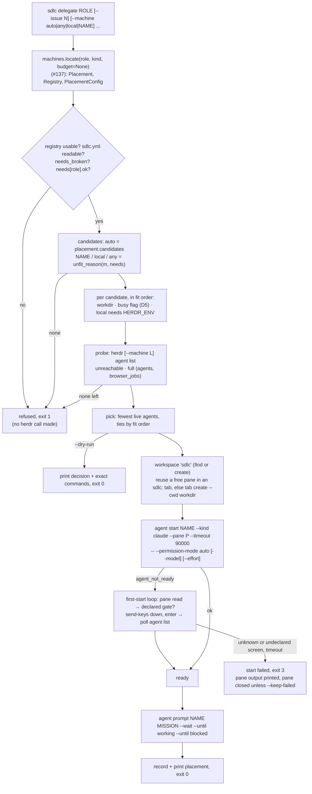

# `sdlc delegate <phase|agent>`: place, start in workdir, clear first-start gates

## Goal

Start a phase or agent on the machine its placement picks, and say where it went. This issue ships:
- `sdlc delegate <role>`: it picks by fit, then by load, starts a Claude Code agent through herdr in
  the machine's `workdir`, clears the first-start gates the registry declares, briefs the agent with
  a mission whose only return path is GitHub, prints the placement, and records it;
- `--dry-run`, which prints the decision and the exact commands without changing anything;
- the herdr adapter calls it needs (`plugin/lib/herdr.py`), and a new `plugin/lib/delegate.py`;
- a fake herdr on PATH with a test suite in CI, `just sdlc::delegate`, a CHANGELOG entry, README
  text, and version **0.2.42**;
- a live check: one real read-only job on devbox-n2, and `--machine compute` refused.

Nothing about the resolver changes. #137 says where a role may run, and this issue picks among
those machines and starts the agent.

**Baseline.** This branch starts at #137's final spec (a6c7977). #137's code is still being written.
**Before implementing, merge the latest `origin/dugshub/137-placement-resolver` into this branch**
(merge, not rebase, and never force-push), so `resolve`, `locate`, `Placement`, `unfit_reason`,
`_config_arg` and `PlacementConfig.needs_broken` exist. This spec relies on #137's **contract**:
- **Rule 1 (#136):** when `Registry.usable` is false, `delegate` refuses. The reason is the first
  registry error, or "no registry" when the registry is inert.
- **Rule 2 (#136) and #137's filter 1:** a machine that isn't `ok` is never a target.
  `unfit_reason(machine, needs)` returns `None` when the machine fits, and otherwise the first
  failure: not `ok`, not `assignable`, caps, keeps, secrets.
- **Rule 6:** `locate()` never raises. Its first element is a `Placement` whose `status` is `off`,
  `placed`, `fallback` or `unplaceable`, with `off_cause` set when the status is `off`.
- **Rule 8:** `Placement.candidates` is fit-ordered (local first for `any`), never load-ordered.
  Load, busy flags and `limits` belong to this issue.
- **The opt-in rule:** a repo that sets no target resolves every role `off` (`no-placement`).
- **The needs rules, from the Gate 1.5 re-run's note 1:** `Needs.invalid` records repeats and shape
  errors **whether or not the file opted in** (only the `Issue`s are withheld), and
  `PlacementConfig.needs_broken` is set when the top-level `needs` is repeated or malformed.
  **`delegate` refuses when `config.needs_broken` is set or `not needs.ok`,** and it does so on every
  path, including an explicit `--machine` in a repo that places nothing.

## Approach

### Where this sits



- **`plugin/lib/delegate.py` holds the logic.** It follows `machines.py`'s rules: no output, no
  `sys.exit`, no I/O at import time. It raises `Refused` (nothing was started) or `StartFailed`
  (a pane was used), and returns plain dataclasses. `bin/sdlc` owns all output and exit codes, as in
  #136 and #137.
- **`plugin/lib/herdr.py` grows the calls `delegate` makes,** one function per herdr verb. Each one
  parses herdr's JSON and raises `HerdrError`, which now carries herdr's error `code`. Every herdr
  call `delegate` makes goes through this file, so tests swap in a fake herdr on PATH.
- **`machines.py` is not modified.** Everything placement-shaped comes through #137's public
  surface. That keeps this branch clear of #137's code, which is still being written, and of #138.

### CLI grammar

```
sdlc delegate ROLE [--issue N] [--machine auto|any|local|NAME] [--prompt TEXT|@FILE]
                   [--name NAME] [--kind phase|agent] [--dry-run] [--keep-failed]
                   [--start-timeout SECS] [--registry PATH] [--config FILE]
```

| Flag | Meaning |
|---|---|
| `ROLE` | A phase or agent name, as in `phase_machines` / `agent_machines`. An `sdlc:` prefix is stripped, as #137 does. |
| `--issue N` | The tracker issue the job is for (a positive integer). It goes into the mission and the default agent name. |
| `--machine` | `auto` (default) follows the repo's placement. `any` takes every machine that fits the role's `needs`, local first. `local` is the registry's local machine. `NAME` is one registered machine. These are #137's target words, plus `auto`, which #136 reserved for this flag. |
| `--prompt TEXT\|@FILE` | The task. `@FILE` reads a UTF-8 file. Without it, the mission asks the agent to do the role's work for `--issue`. **Giving neither `--issue` nor `--prompt` is a usage error** (exit 2), because there would be nothing to do. |
| `--name NAME` | The herdr agent name. It must match herdr's `[a-z][a-z0-9_-]{0,31}`, else exit 2. Default: `<role>-<issue>`, or `<role>` when there is no issue. |
| `--kind` | `phase` or `agent`, passed to the resolver as `where --kind` does. |
| `--dry-run` | Decide, which reads herdr (`agent list`, `workspace list`, `tab list`, `pane list`, `pane process-info`), then print the decision and every command that would change something. Changes nothing and writes no record. |
| `--keep-failed` | On a start failure, leave the pane for inspection instead of closing it. |
| `--start-timeout SECS` | How long the agent may take to become ready, first-start gates included. Default 90 (compute's `--timeout 90000`). It must be more than 3 and at most 300, herdr's own bounds for `agent start --timeout`. |
| `--registry`, `--config` | As on `sdlc machines`: `_path_arg` / `_config_arg`, so an empty value is exit 2. |

**Exit codes:**

| Exit | When |
|---|---|
| 0 | The agent started and herdr saw it working or blocked after the brief. With `--dry-run`: a machine was chosen. |
| 1 | **Refused.** Nothing was started and no pane was touched. Causes: the registry is off or broken, `sdlc.yml` is broken, the role's needs are broken, the placement is `off` or `unplaceable`, an explicit machine is unknown or unfit (compute, or any `assignable: false` box), every candidate is full, busy, unreachable or has no workdir, a tuning value is invalid, an explicit `--name` is already live, or `--issue` has no resolvable repo. |
| 2 | Usage error. |
| 3 | **Start failed** after a machine was chosen: a herdr error while creating the pane, starting the agent or briefing it, a first-start gate that couldn't be cleared, or a timeout. The output says what was left behind. |

Exit 3 is separate from exit 1 so that a script can tell "nothing happened" from "something may be
left on that box".

### Choosing the machine

**1. Trust and fit (#137), before any herdr call.**
- `placement, registry, config = machines.locate(role, kind, registry_file=..., config_file=..., budget=None)`.
- **Registry not usable:** refuse with `placement.reason` when `off_cause` is `no-registry` or
  `registry-errors`. For `no-registry`, add `; sdlc delegate needs a registry (see: sdlc machines)`.
- **`sdlc.yml` broken** (`off_cause` `sdlc-errors`): refuse with `placement.reason`. A file that
  can't be read can't show the role's needs, so this holds for an explicit `--machine` too.
- **Needs:** `needs = config.needs.get(role, machines.Needs())`.
  - If `config.needs_broken`, refuse with `the needs block in <path> is repeated or malformed, so
    <role>'s needs can't be read; fix it (sdlc machines check) before delegating`.
  - If `not needs.ok`, refuse with `needs.<role> has errors in: <sorted keys>` (#137's text).
  - Both checks run for every `--machine` value.
- **The candidate list**, by `--machine`:

  | `--machine` | Candidates | Refused when |
  |---|---|---|
  | `auto` | `placement.candidates` when the status is `placed` or `fallback`. A `fallback` also prints `warning: <placement.reason>` on stderr and goes ahead (D4: the runtime keeps working). | `unplaceable`: refuse with `placement.reason`. `off` / `no-placement`: refuse with `sdlc.yml places nothing, so --machine auto has nowhere to send <role>; place it (phase_machines, agent_machines, default_machine) or name a machine with --machine`. |
  | `NAME` | `[registry.get(NAME)]` | Not registered: `'<NAME>' is not in the registry`, plus `; did you mean '<x>'?` from `difflib.get_close_matches` (#137's text). Unfit: the `unfit_reason` text, e.g. `machine 'compute' is not assignable`. |
  | `local` | `[registry.local]` | Unfit, as above. |
  | `any` | Every registered machine that `unfit_reason` passes, local first, then registry file order, as #137 orders `any`. | None fits: `no machine fits: <m>: <why>; ...` |

  An explicit `--machine` (`NAME`, `local` or `any`) works in a repo that hasn't opted in. The
  opt-in rule governs the repo's map, while an explicit machine is the person choosing. The trust
  filters and `needs` still apply in full. When the repo did place the role somewhere else, the
  output adds `overrides <placement.requested.at> ('<value>')`.
- **`unfit_reason` runs again on every `auto` candidate.** This costs nothing, and it means
  `delegate` never sends work to a machine that isn't `ok` or `assignable`, even if the resolver had
  a bug.
- **No herdr call happens before this step passes.** A refusal here makes no call at all (test D6).

**2. Delegate-only filters, per candidate in fit order.** No I/O except one `stat`. A candidate that
fails is passed over with the reason shown:

| Order | Filter | Reason text (tests match these substrings) |
|---|---|---|
| a | **workdir.** The machine has a `workdir`. This applies to the local machine too: `delegate` only starts agents where the registry says it may. | `no workdir in the registry (sdlc delegate starts agents there)` |
| b | **Busy flag (D5).** The role is *heavy*: `needs.caps` includes `full-suite`, `browser` or `docker` (`HEAVY_CAPS`). The machine is `gaming_sensitive` and has a `busy_flag`, and that file exists. See "The busy flag" below. | `busy: <flag> exists and <role> needs <the heavy caps>` |
| c | **The local herdr session.** For the local machine, `HERDR_ENV` must be `1`. herdr's own rule is never to inspect or control a session from outside it (`herdr --skill`; compute's `_guard`). Remote machines are reached through `--machine` profiles and don't need it. | `this shell is not inside herdr (HERDR_ENV is not 1), so the local herdr server is not used` |

**The busy flag.** D5 says "when the file exists". The spec reads the file **on the box `delegate`
runs on**, the coordinating box where the registry lives, expanding `~` against that box's `HOME`
(as `registry_path` does). This is exact for ADR-009's only gaming-sensitive box, which is the local
one. A remote gaming-sensitive box needs its flag mirrored to the coordinating box; see Open
questions. If the `stat` itself fails (`OSError`), the box counts as busy (fail closed). A machine
that is `gaming_sensitive` with no `busy_flag` has nothing to test, so it is not busy. #136 already
warns about that registry. An invalid `busy_flag` makes the machine not `ok`, so step 1 has already
refused it (#136 rule 3).

The flag applies to **every** `--machine` value, not only to `auto`. This is stricter than D5's
"under `auto`", and it follows ADR-009 §5 ("the gaming flag blocks heavy work"). See Open questions.

**3. Load: probe each remaining candidate.** Run `herdr [--machine <label>] agent list` (the local
machine has no `--machine`), with `herdr.DEFAULT_TIMEOUT` per machine, sequentially:

| Result | Verdict |
|---|---|
| `HerdrError` (unknown label, timeout, herdr missing, bad output) | passed over: `unreachable: <detail>` |
| `limits.agents` is set and `len(agents) >= limits.agents` | passed over: `full: <n> agents, limit <L>`. Every live agent counts, whatever its status: a `done` agent still holds its pane and memory until someone closes it. This matches `sdlc machines check --probe` (`bin/sdlc:146-152`). |
| The role is a **browser job** (`browser` in `needs.caps`), `limits.browser_jobs` is set, and the live browser jobs `>= limits.browser_jobs` | passed over: `full: <b> browser jobs, limit <B>` |
| otherwise | eligible: `<n> agents, limit <L or ->`, plus `, <b> browser jobs, limit <B>` for a browser job |

**Counting browser jobs.** herdr doesn't know which agents drive a browser, but `delegate` does,
because it records every placement (see "The record"). The live browser jobs on machine M are the
records under `delegates/<M>/` with `browser_job: true` whose `name` **and** `pane_id` match a live
agent in M's `agent list`. Agents started some other way are not counted. That limit is documented.

**4. Pick.** Among the eligible candidates, the one with the **fewest live agents** wins. Ties go to
fit order, which puts local first for `any`. If nothing is eligible, refuse with
`no machine can take <role> now: <m>: <why>; <m>: <why>` (exit 1).
- **Load never widens the candidate set.** A single named placement that is full refuses; it does
  not fall back to `default_machine`. To let load choose, place the role on `any`.
- A raw count, not a ratio, because a machine with no `limits.agents` has no ratio. The coordinator's
  own pane counts on the local server, which nudges work off the box you are typing on.
- Two `delegate` runs at the same moment can both pick a machine with one slot left. There is no
  lock. This is documented.

### Starting the agent

All calls on the chosen machine use the same `--machine <label>` prefix, or none for local. **IDs come
from herdr's JSON, never from guesses** (herdr skill; compute's justfile).

**1. The pane (`choose_pane`, read-only, shared by `start` and `--dry-run`).** `delegate` never
splits a pane. One job gets one tab, so there are no narrow panes; compute's "reuse a free pane
before splitting" lesson becomes "reuse a free pane before making a tab". `choose_pane` does only
the lookups below and returns a `PanePlan`. `start` then carries it out, and `--dry-run` prints it.
- **Workspace.** Use the first workspace labelled `sdlc` (`WORKSPACE_LABEL`) from `workspace list`.
  If there is none, run `workspace create --label sdlc --cwd <workdir> --no-focus`, use its
  `root_pane` and rename its tab (`tab rename <tab> sdlc:<name>`). Done.
- **Free pane.** Otherwise, from `pane list --workspace W` and `tab list --workspace W`, take the
  first pane that meets all of these:
  - its tab's label starts with `sdlc:` (`TAB_PREFIX`; tabs this tool made) and holds one pane;
  - no live agent sits on it (its `pane_id` isn't in `agent list`);
  - its `foreground_cwd` equals the workdir;
  - `pane process-info --pane P` shows only a shell in the foreground (`bash`, `zsh`, `sh`, `fish`,
    `dash`).

  Rename its tab to `sdlc:<name>`. These are panes an earlier delegated agent left when it exited.
  herdr's rule is that `agent start` needs a pane at its shell prompt, which the last two checks
  confirm.
- **Otherwise**, run `tab create --workspace W --label sdlc:<name> --cwd <workdir> --no-focus` and
  use `root_pane`.
- **workdir as written.** The local machine's workdir is `~`-expanded here. A remote one is passed
  as written, and the example uses absolute paths.

**2. `agent start`.**

```
herdr [--machine L] agent start <name> --kind claude --pane <P> --timeout <start_timeout*1000> \
  -- --permission-mode auto [--model <model>] [--effort <effort>]
```

- **`--permission-mode auto` is always passed.** `model` and `effort` come from `sdlc.yml` exactly as
  the phase-tuning hook reads them (`phase-tuning.py:153-172`): `phases.<role>.model` wins over
  `phase_models.<role>`, and `phases.<role>.effort` wins over `phase_effort.<role>`. They apply to
  any role, agents included, like the hook. A knob that is unset, `null` or blank is left out, and
  the worker's Claude Code default applies.
  - **A bad value refuses** before any herdr mutation (exit 1): a non-string `model`, or an `effort`
    outside `EFFORTS = (low, medium, high, xhigh, max)`. Text: `phases.<role>.effort 'huge' is not
    one of: low, medium, high, xhigh, max` (or `phase_effort.<role>`). Unlike the hook, `null` is
    unset rather than the string `"null"` (the hook quirk #137 recorded).
  - `max_turns` and `worktree` don't apply to an interactive session, so they are ignored.
  - The tuning comes from `machines.parse_yaml(config.path)`, which re-reads the same file `locate()`
    found. A `RegistryError` there refuses.
- **The session is a plain Claude Code session** briefed with the role. It does not get
  `--agent sdlc:<role>`, because the sdlc plugin may not be installed on the worker (see Open
  questions).
- **The name.**
  - Default `<role>-<issue>` (or `<role>`), sanitised:
    - lower-case it, and turn each run of characters outside `[a-z0-9_-]` into one `-`;
    - strip `-` from both ends, and prefix `agent-` if it doesn't start with a letter;
    - cut it to 32 characters (to `32 - len(suffix)` when a suffix is added).

    If that name is live on the chosen machine (its `agent list` from the probe), the next free
    suffix is used: `-2`, `-3`, ... up to `-9`.
  - An explicit `--name` that is live refuses (exit 1).
  - If `agent start` answers `agent_name_taken` anyway (compute's lesson: an agent still starting
    holds its name but isn't in `agent list` or `agent get`), a default name moves to the next suffix
    on the same pane, at most twice. An explicit `--name` is a start failure (exit 3).
- **Success** returns `{"type": "agent_started", "agent": {...}, "argv": [...]}`. The `argv` herdr
  actually ran is kept for the record and the output.

**3. First start: clearing the gates.** `agent start` returns `agent_not_ready` at once when the new
agent is blocked by a startup dialog (herdr skill). Then `delegate` runs a bounded loop **keyed by
the pane id**, never the agent name, because `agent get <name>` answers `agent_not_found` while an
agent is still starting (compute's lesson).

```
deadline = now + start_timeout; answers = {}
loop:
  if ready(P): break            # agent list has an entry with pane_id == P,
                                #   interactive_ready true, agent_status idle or done
  screen = pane read P --source visible
  gate = the first name in machine.first_start whose GATES[name].patterns match screen
  if gate:
      if answers[gate] == MAX_ANSWERS_PER_GATE (2): fail "<gate> still showing after 2 answers"
      pane send-keys P down; sleep GATE_KEY_PAUSE (0.3 s); pane send-keys P enter
      answers[gate] += 1
  elif a gate NOT in machine.first_start matches:
      fail "the screen shows <gate>, which <machine> doesn't declare; add it to first_start in the registry"
  elif now > deadline: fail "agent was not ready within <s>s"
  sleep POLL (0.5 s)
```

- **The registry declares which gates may be answered.** Pressing Down then Enter on an unknown
  dialog could pick anything, so the loop never does:
  - a known gate that the machine doesn't declare fails **at once**, with the hint to add it to
    `first_start`;
  - a screen that matches no known gate is never answered. The loop keeps polling, because the screen
    may still be drawing, and fails with the screen at the deadline.
- **Down, then Enter, as two calls with a pause.** Sent in one call, the two keys can reach Claude
  Code's input handler as one chunk. I checked the dialogs in Claude Code 2.1.310's binary:
  - **The trust prompt** is built with `cancelFirst: true` and `focus: "cancel"`, so it shows
    `No, exit` first and focused, then `Yes, I trust this folder`. Down then Enter picks **trust**.
    (When the folder has risky settings, the cancel option reads "No, continue without these
    permissions", in the same position.)
  - **The fullscreen notice** ("Try the new fullscreen renderer?") shows `Yes, try it` first and
    focused, then `Not now`. Down then Enter picks **Not now**, which keeps the classic renderer.
    That suits a herdr pane: alternate-screen rows never reach the scrollback that
    `pane read --source recent` reads.
- **The recognisers** match case-insensitively on whitespace-collapsed text:
  - `trust-prompt`: `yes, i trust this folder`, or `is this a project you created or one you trust`;
  - `fullscreen-notice`: `try the new fullscreen renderer`.

  The live check confirms them on devbox-n2's Claude Code version. If they differ there, the
  implementer updates `GATES`, and records the version and the screen text in the implementation
  notes.
- **The pane may hold a differently named agent.** If the ready entry has no name, or a name other
  than `<name>`, run `agent rename <P> <name>` once; if that fails, it is a start failure.
- **This covers 0, 1 and 2 gates and the timeout:**
  - **0:** `agent start` succeeds, and no keys are sent.
  - **1:** one round, then ready.
  - **2:** trust, then the notice.
  - **Stuck:** a screen that doesn't change makes the gate's third match fail.
  - **Unknown dialog:** times out with the screen.

**4. Brief.**

```
herdr [--machine L] agent prompt <name> <mission> --wait --until working --until blocked --timeout 60000
```

- It returns as soon as herdr sees the agent take the prompt. `delegate` never waits for the job
  itself.
- `agent_blocked` (refused before any input is sent, so a retry can't submit twice) or
  `agent_not_ready` means a dialog appeared after start. Run the gate loop once more with a fresh
  `start_timeout` budget, then retry the prompt once. **That is "while start/prompt returns
  `agent_not_ready`".**
- `agent_prompt_stalled`, `timeout` or any other error is a start failure (exit 3). It is **not
  retried**, because the prompt may have been delivered (herdr skill).
- A final status of `blocked` is still exit 0, with `warning: <name> is blocked on a dialog; read it
  with: <read command>`.

**5. Failure cleanup.**
- **Before the agent is ready** (pane setup, `agent start`, the gate loop): capture
  `pane read P --source recent-unwrapped --lines 40`. Then close the pane with `pane close P`,
  unless `--keep-failed` was given. This is compute's fallback, and it works even when `agent get`
  can't find the agent.
- **After the agent is ready** (the brief failed): the pane is **never** closed. The agent is up, and
  the person may prompt it by hand. The record is written either way.
- The output names what was left: `left behind: nothing (pane <P> closed)`, or
  `left behind: pane <P>`, with the `read` and `stop` commands.
- A failed `pane close` is reported with the manual command; it doesn't change the exit code (3).

### The mission

Composed by `mission_text()`; at most `MISSION_MAX` (64 KiB, inside Linux's 128 KiB limit on one
argument); a longer `--prompt` is a usage error. Template (bracketed parts appear only when they
apply):

```
You were started by `sdlc delegate` on <machine> to do the <role> work[ for issue #<n> in <owner/repo>].

Results come back through GitHub only: push a branch, or comment on the issue or pull request. Nothing
is read back from this box afterwards, not files and not this terminal. If you cannot push or comment,
say why in one final message and stop.

You are in <workdir> on <machine>.[ This box is disposable: anything you don't push is lost.] Make your
own working copy for this job under <workdir>/<name> (clone the repository there, or add a git worktree
from an existing clone) and leave everything else in <workdir> alone.
[
Issue: gh issue view <n> --repo <owner/repo>]

Task:
<--prompt text, or: "Do the <role> work for issue #<n>: read the issue and what it links to, then report back as above.">
```

- "This box is disposable" appears when the machine's `persistence` is `disposable`.
- **`<owner/repo>`** is `sdlc.yml`'s `repo:` when it is a string `owner/name`. Otherwise it comes from
  `git -C <project root> remote get-url origin`, parsed as a GitHub URL (ssh or https, with or without
  `.git`), with a 5-second timeout. The project root is the directory holding `.claude/` when
  `config.path` is `<root>/.claude/sdlc.yml`, and otherwise the current directory (for example,
  when `--config` names some other file).
  - With `--issue` and no repo, refuse (exit 1): `can't tell which GitHub repository issue #<n> is
    in; set repo: <owner>/<name> in .claude/sdlc.yml`.
  - Without `--issue`, the repo is optional.
- **GitHub is the only return path** (ADR-009 §3, plan out-of-scope). `transport.ssh` is never used
  and nothing is fetched back.

### The printed placement and the record

**On success** (stdout, ASCII; the first line is the answer, so `| head -1` works):

```
reviewer-139: worker-2
  role:        reviewer (phase), issue #139 in owner/repo
  placement:   any (phase_machines.reviewer)
  considered:  workstation: no workdir in the registry (sdlc delegate starts agents there)
               worker-1: full: 4 agents, limit 4
               worker-2: 1 agent, limit 4   <- picked
               control: machine 'control' is not assignable
  where:       herdr:worker-2, workspace w3 (sdlc), tab w3:t4 (sdlc:reviewer-139), pane w3:p4
  workdir:     /home/agent/work
  claude:      claude --permission-mode auto --model fable --effort xhigh
  first start: trust-prompt, fullscreen-notice answered
  status:      working
  results:     GitHub only (a pushed branch, or a comment on issue #139)
  record:      /home/me/.local/state/sdlc/delegates/worker-2/reviewer-139.json
  check:       herdr --machine worker-2 agent get reviewer-139
  read:        herdr --machine worker-2 pane read w3:p4 --source recent-unwrapped --lines 120
  stop:        herdr --machine worker-2 pane close w3:p4
```

- **`placement`**:
  - with `auto`, `<value> (<requested.at>)`, or `<m> (default target)`; a `fallback` adds
    `, fallback` and prints the warning;
  - with an explicit machine, `--machine <value>`, plus `; overrides <at> ('<v>')` when that applies.
- **`considered`** has one line per machine that was judged, in this order:
  - the candidates in fit order, with their verdicts;
  - then the resolver's `rejected` entries (`<key>: <why>`).
- **`claude`** shows the `argv` herdr reported (with `claude` first). Under `--dry-run` it shows the
  intended arguments.
- **`first start`** is `none shown`, or the gates that were answered.
- **On the local machine** the commands have no `--machine`, and `where:` says `local`.
- **Commands are `shlex.quote`d,** so they can be pasted.

**`--dry-run`** prints the same decision lines with ` (dry run: nothing started)` on the first line.
In place of `where`, `status` and `record` it prints:
- `would run:`, then each mutating command in order, with placeholders `<new-pane>` / `<new-tab>`
  where herdr would assign an ID;
- the gate step, as `if agent start answers agent_not_ready: pane read <pane> --source visible, then
  pane send-keys <pane> down / enter, for: <declared gates>`;
- the prompt command with `"$MISSION"`;
- `mission:`, followed by the full mission text indented with `    | `.

It makes no mutating call and writes no record.

**On refusal** (stderr, exit 1): `sdlc delegate: refused: <reason>`, followed by the `considered`
lines that exist so far. **On a start failure** (stderr, exit 3):
- `sdlc delegate: start failed on <machine>: <why>`;
- `  pane <P> output (last 40 lines):` with each line indented `    | `;
- `  left behind: ...`;
- the `read` and `stop` lines when a pane remains.

**The record.**
- **Where:** `${XDG_STATE_HOME:-$HOME/.local/state}/sdlc/delegates/<machine>/<name>.json`, written
  after the agent is ready and updated after the brief. Keying by machine as well as name matters,
  because herdr names are unique only per server, so two machines can each have `reviewer-139`.
- **Why it exists:** later commands, and a person, find the worker without environment variables
  (compute's `results/.machine/<name>`). It is also how browser jobs are counted.
- **Fields:** `name`, `role`, `kind`, `issue`, `repo`, `machine`, `herdr` (the label, or `null` for
  local), `workspace_id`, `tab_id`, `pane_id`, `workdir`, `browser_job`, `claude_args`, `argv`,
  `first_start` (the gates answered), `briefed`, `status`, `started_at` (UTC ISO-8601).
- **A failed write** (`OSError`) prints `warning: could not write the record: <why>` and leaves the
  exit code unchanged. The printed placement already carries every field.

### `herdr.py`: the adapter grows

- **`HerdrError(detail, returncode=None, code=None)`.** `code` is herdr's error code when stderr is
  herdr's JSON error (`{"error": {"code", "message"}, "id"}`, exit 1, as checked against 0.9.5).
  Then `detail` is `<code>: <message>`. Text errors (exit 2, for example
  `error: unknown machine 'x'; use \`herdr machine list\``) keep today's first-line detail.
- **The existing messages are kept,** so #136's probe tests (`machines.test.sh:400-433`) pass
  unchanged:
  - `herdr not found on PATH`;
  - `timed out after <t>s`;
  - the first stderr line;
  - `unexpected output`.
- **One private runner, `_call(machine, args, timeout)`,** builds `["herdr", "--machine", label,
  *args]` (no `--machine` when `machine is None`). It runs the command with `stdin=DEVNULL` and
  captured output, returns the parsed `result` object, and raises `HerdrError` on every failure.
  - `agent_list` is reimplemented on it, with the same behaviour.
  - `argv(machine, *args)` returns the same list for `--dry-run` printing.
- **The functions:**
  - `workspace_list`, `workspace_create`;
  - `tab_list`, `tab_create`, `tab_rename`;
  - `pane_list`, `pane_foreground`, `pane_read`, `pane_send_keys`, `pane_close`;
  - `agent_start`, `agent_prompt`, `agent_rename`.

  Signatures are under Interfaces. The result shapes are from `herdr api schema --json` (0.9.5):
  - `workspace_created` → `workspace`, `tab`, `root_pane`;
  - `tab_created` → `tab`, `root_pane`;
  - `pane_read` → `read.text`;
  - `pane_process_info` → `process_info.foreground_processes[].name`;
  - `agent_started` → `agent`, `argv`;
  - `agent_prompted` → `agent`.
- **`agent_start`'s subprocess timeout** is `start_timeout + DEFAULT_TIMEOUT`, so herdr's own
  `--timeout` fires first.

## File-level plan

### Create

- **`plugin/lib/delegate.py`** holds the logic under "Approach". It follows #136's module rules:
  - no stdout/stderr, no `sys.exit`, no import-time I/O, Python >= 3.8, stdlib only;
  - YAML only through `machines.parse_yaml`.

  It imports `machines` and `herdr`.
  - **Pure parts, unit-tested directly:**
    - `tuning_for(doc, role)`;
    - `is_heavy(needs)`, `is_browser_job(needs)`;
    - `default_name(role, issue, taken)`;
    - `repo_from_remote(url)`;
    - `mission_text(...)`;
    - `match_gate(screen, names)`.
  - **I/O parts:**
    - `busy_reason(machine, role, needs, env)` (one `stat`);
    - the per-candidate probe inside `decide(...)`, which covers everything up to the pane choice
      (read-only herdr calls only);
    - `choose_pane(decision)` (read-only), then `plan_commands(...)` for `--dry-run`, or
      `start(decision, ...)` for a real run;
    - `read_records(machine, env)`, `write_record(...)`.
  - **A herdr error inside `choose_pane`** is a `StartFailed` with no pane, so exit 3. Under
    `--dry-run` the message reads `dry run: herdr failed on <machine>: <detail>`.
  - **`start` takes `sleep` and `clock`,** so that Python-level tests can drive the gate loop without
    waiting.
  - **A guard:** `assert set(GATES) == set(machines.FIRST_START_GATES)`, as a module-level check in
    the tests (not at import time), so a new registry gate name can't ship without a recogniser.
- **`plugin/lib/fake-herdr.py`** is the fake `herdr` for the tests. It is a stateful Python script
  that the suite links onto PATH as `herdr`.
  - **Scenario** (`$FAKE_HERDR_DIR/scenario.json`), keyed by machine label (`""` for the local
    server). Each entry can set:
    - `agents` (a count of pre-existing working agents, named `busy1`...);
    - `unreachable` (prints herdr 0.9.5's unknown-machine text, exit 2) or `hang` (sleeps 30 s);
    - `workspaces` (with an existing `sdlc` workspace, and optional free or occupied panes in
      `sdlc:` tabs, each with `cwd` and a foreground process);
    - `gates` (the dialogs a new agent shows, in order: `trust-prompt`, `fullscreen-notice`,
      `unknown`);
    - `stuck` (keys don't advance the dialog);
    - `start_error` / `prompt_error` (a herdr error code to return);
    - `name_taken_once` (the first `agent start` answers `agent_name_taken`).
  - **State** (`state.json`) holds workspaces, tabs, panes, agents, each pane's screen, the pending
    key, and the prompts received.
  - **Every call** appends `{"machine": <label|"">, "argv": [...]}` to `calls.jsonl`.
  - **Output** mimics herdr 0.9.5:
    - successes print `{"id": "cli:<group>:<verb>", "result": {...}}` to stdout, exit 0;
    - server errors print `{"error": {"code", "message"}, "id"}` to stderr, exit 1;
    - an unknown verb prints `fake herdr: unsupported: ...`, exit 2.
  - **Dialogs** use Claude Code 2.1.310's real strings:
    - trust: a "Quick safety check: Is this a project you created or one you trust?" title over
      `❯ 1. No, exit` / `2. Yes, I trust this folder`;
    - fullscreen: "Try the new fullscreen renderer?" over `❯ 1. Yes, try it` / `2. Not now`.
  - **Keys:** `down` followed by `enter` advances to the next dialog, or to ready, when the agent
    gets its name in `agent list` with `interactive_ready: true` and `agent_status: idle`. A bare
    `enter` on the trust dialog picks "No, exit": the agent exits and the pane shows a shell prompt.
  - **`agent get`** answers `agent_not_found` while an agent is starting, as compute saw.
- **`plugin/lib/delegate.test.sh`** is the suite. It follows `machines.test.sh` and
  `placement.test.sh` conventions:
  - paths from `$0`;
  - `ok`/`bad` counters, `TMP` with a `trap`;
  - `export HOME="$TMP/home"`, with `SDLC_MACHINES`, `XDG_CONFIG_HOME`, `XDG_STATE_HOME` and
    `CLAUDE_PROJECT_DIR` unset;
  - `PYTHONDONTWRITEBYTECODE=1`;
  - the same backend detection and `noyaml` shadow;
  - `SDLC_REQUIRE_BOTH_BACKENDS` honoured;
  - a summary line `delegate: N passed, M failed`, with the exit status taken from the fail count.

  Its parts:
  - **Part A** is one Python heredoc for the pure functions. It prints `rows: N` first, and bash
    checks the exit status and the `ok:` count, as #137 does.
  - **Part B** runs the CLI against the fake herdr. Rows marked [both] run once per backend.
  - **Every Part B row** gets a fresh `$FAKE_HERDR_DIR` and a fresh `$TMP/home`, and runs with
    `HERDR_ENV=1` unless the row says otherwise.
  - **Timeouts are short** (`--start-timeout 4`, and probe timeouts by row), so the suite stays under
    a minute.

### Modify

- **`plugin/lib/herdr.py`**: as under "`herdr.py`: the adapter grows". Update the docstring: it no
  longer says "#139 extends this file", and it now lists the verbs and the `HerdrError.code` field.
- **`plugin/bin/sdlc`**:
  - **Add the `delegate` top-level subparser** with the grammar above. Reuse `_path_arg` and #137's
    `_config_arg`. Add:
    - `_issue_arg` (a positive integer);
    - `_name_arg` (herdr's pattern; a usage error otherwise);
    - `_start_timeout_arg` (more than 3 and at most 300; reuse `_timeout_arg`'s parsing);
    - `--prompt` parsing (`@FILE` read as UTF-8; an unreadable file, or a mission over
      `MISSION_MAX`, is exit 2).
  - **`cmd_delegate`** calls `delegate.decide()`, then either prints the dry run or calls
    `delegate.start()`. It maps `Refused` → 1, `StartFailed` → 3 and success → 0, and prints in the
    formats under "The printed placement".
  - **The docstring:** add the `delegate` grammar and exit codes, and remove "reserved, not built
    here: `sdlc delegate`". **Top-level metavar:** `{machines,delegate}`.
- **`plugin/sdlc.justfile`**: add a recipe after `machines` (`:88-94`), in the same group, with the
  same `[positional-arguments]` and `cd ..`:

  ```just
  # start a phase or agent on the machine its placement picks; --dry-run shows the decision first.
  [group('machines')]
  [positional-arguments]
  delegate *args:
      @cd .. && python3 "${CLAUDE_PLUGIN_DIR:-$(dirname "$(realpath .claude/sdlc.justfile)")}/bin/sdlc" delegate "$@"
  ```

  `cd ..` lands at the project root, so `locate()` finds `.claude/sdlc.yml` and `git remote` finds
  the repo.
- **`.github/workflows/verify.yml`**: add a step after "Placement resolver tests" (#137), with the
  same env. Don't rename the job, because its `name:` is a required check.

  ```yaml
  - name: Delegate tests
    env:
      SDLC_REQUIRE_BOTH_BACKENDS: "1"
    run: bash plugin/lib/delegate.test.sh
  ```

- **`plugin/machines.example.yaml`**: comments only, so #136 case 1 (0 errors, 0 warnings) still
  holds.
  - On `busy_flag`: add "(a path on this box, the one you coordinate from)".
  - On `workdir`: "where `sdlc delegate` starts agents (it needs one on every machine it uses)".
  - On `worker-1`'s `limits`: "`agents` and `browser_jobs` cap what `sdlc delegate` sends here".
  - On `first_start`: "dialogs `sdlc delegate` may answer (Down, Enter) on a fresh box or directory".
  - Under `workstation`: `# workdir: ...   # set it to let sdlc delegate start agents here too`,
    commented out.
- **`plugin/.claude-plugin/plugin.json`**: `version` 0.2.41 → **0.2.42**. This assumes #137 ships as
  0.2.41. #138 runs in parallel. **Whichever of #138 and #139 merges second rebases onto the
  other** (or merges it in) and takes **0.2.43**, moving its CHANGELOG heading to match.
- **`CHANGELOG.md`**: add a new top entry, `## [0.2.42] — <date>` /
  `### Added — sdlc delegate: start a phase or agent on another machine`.
  - **Why:** the registry (0.2.40) and placement (0.2.41) say where work may run, but starting it there
    was still done by hand, including the dialogs a fresh Claude Code shows. `delegate` picks the
    machine (trust first, then load), starts the agent in the machine's `workdir`, answers the
    first-start dialogs the registry declares, and briefs it. Results come back through GitHub only.
  - **Bullets:**
    - the grammar and the `--machine` words;
    - picking: fit, then fewest live agents, with `limits.agents` and `limits.browser_jobs` as caps,
      and full or unreachable machines skipped;
    - the busy flag for heavy roles;
    - the refusals: unassignable, unfit or not-`ok` machines, broken needs; exit 1;
    - `--permission-mode auto` plus `model`/`effort` from `phases`;
    - the first-start loop, and that it never answers an undeclared dialog;
    - `--dry-run`;
    - the record, and exit 3;
    - the tests in CI.

  Generic names only.
- **`README.md`**: in `## Machines`, replace the closing sentence #137 leaves ("starting work on
  another box comes in a later release") with a short subsection,
  `### Starting work on another box: sdlc delegate`. It covers:
  - one example, `sdlc delegate validator --issue 42`, with `--dry-run` first;
  - how a machine is chosen (trust and fit, then load);
  - that `workdir` is needed;
  - the busy flag (read on this box);
  - `first_start`;
  - GitHub as the only return path;
  - the record path;
  - how to check on the agent or stop it (the printed `check`/`read`/`stop` lines);
  - the exit codes;
  - that the local machine is used only from inside herdr.

## Interfaces

```python
# ── plugin/lib/herdr.py (after) ──────────────────────────────────────────────
DEFAULT_TIMEOUT = 15.0

class HerdrError(Exception):
    def __init__(self, detail: str, returncode: Optional[int] = None, code: Optional[str] = None): ...
    # code: herdr's JSON error code ("agent_not_ready", "agent_name_taken", "agent_not_found",
    #       "agent_blocked", "agent_prompt_stalled", "timeout", ...), else None

def available() -> bool: ...                                                   # unchanged
def argv(machine: Optional[str], *args: str) -> List[str]: ...                # ["herdr", ("--machine", m)?, *args]
def agent_list(machine: Optional[str] = None, *, timeout: float = DEFAULT_TIMEOUT) -> List[dict]: ...  # unchanged behaviour
def workspace_list(machine: Optional[str], *, timeout: float = DEFAULT_TIMEOUT) -> List[dict]: ...
def workspace_create(machine: Optional[str], label: str, cwd: str, *, timeout: float = DEFAULT_TIMEOUT) -> dict: ...  # {workspace, tab, root_pane}; --no-focus
def tab_list(machine: Optional[str], workspace_id: str, *, timeout: float = DEFAULT_TIMEOUT) -> List[dict]: ...
def tab_create(machine: Optional[str], workspace_id: str, label: str, cwd: str, *, timeout: float = DEFAULT_TIMEOUT) -> dict: ...  # {tab, root_pane}; --no-focus
def tab_rename(machine: Optional[str], tab_id: str, label: str, *, timeout: float = DEFAULT_TIMEOUT) -> None: ...
def pane_list(machine: Optional[str], workspace_id: str, *, timeout: float = DEFAULT_TIMEOUT) -> List[dict]: ...
def pane_foreground(machine: Optional[str], pane_id: str, *, timeout: float = DEFAULT_TIMEOUT) -> List[str]: ...  # foreground process names
def pane_read(machine: Optional[str], pane_id: str, *, source: str = "visible", lines: Optional[int] = None,
              timeout: float = DEFAULT_TIMEOUT) -> str: ...                    # result.read.text
def pane_send_keys(machine: Optional[str], pane_id: str, keys: Sequence[str], *, timeout: float = DEFAULT_TIMEOUT) -> None: ...
def pane_close(machine: Optional[str], pane_id: str, *, timeout: float = DEFAULT_TIMEOUT) -> None: ...
def agent_start(machine: Optional[str], name: str, pane_id: str, *, kind: str = "claude",
                args: Sequence[str] = (), start_timeout: float = 90.0) -> dict: ...   # {agent, argv}; --timeout start_timeout*1000
def agent_prompt(machine: Optional[str], target: str, text: str, *,
                 until: Sequence[str] = ("working", "blocked"), timeout: float = 60.0) -> dict: ...  # result.agent
def agent_rename(machine: Optional[str], target: str, name: str, *, timeout: float = DEFAULT_TIMEOUT) -> None: ...

# ── plugin/lib/delegate.py ───────────────────────────────────────────────────
# Module rules as machines.py: no output, no sys.exit, no import-time I/O, stdlib only.
MACHINE_WORDS = ("auto", "any", "local")        # plus a registered name
HEAVY_CAPS = ("full-suite", "browser", "docker")  # D5
BROWSER_CAP = "browser"
EFFORTS = ("low", "medium", "high", "xhigh", "max")
AGENT_NAME = r"[a-z][a-z0-9_-]{0,31}"           # herdr's rule for live agent names (fullmatch)
WORKSPACE_LABEL = "sdlc"
TAB_PREFIX = "sdlc:"
SHELLS = ("bash", "zsh", "sh", "fish", "dash")
START_TIMEOUT = 90.0                            # seconds; --start-timeout default (compute: --timeout 90000)
PROMPT_TIMEOUT = 60.0
POLL = 0.5
GATE_KEY_PAUSE = 0.3
MAX_ANSWERS_PER_GATE = 2
MISSION_MAX = 64 * 1024
STATE_RELPATH = "sdlc/delegates"                # under ${XDG_STATE_HOME:-~/.local/state}

@dataclass(frozen=True)
class Gate:
    name: str                                   # one of machines.FIRST_START_GATES
    patterns: Tuple[str, ...]                   # lower-case substrings of the whitespace-collapsed visible screen
    keys: Tuple[str, ...] = ("down", "enter")   # sent as separate calls, GATE_KEY_PAUSE apart

GATES: Dict[str, Gate]                          # "trust-prompt", "fullscreen-notice" (see First start)

class Refused(Exception):                       # exit 1; nothing started, no pane touched
    reason: str
    considered: Tuple["Verdict", ...]

class StartFailed(Exception):                   # exit 3; a machine was chosen
    reason: str
    machine: str
    pane_id: Optional[str]
    output: str                                 # last 40 lines of the pane, "" if none
    pane_closed: bool
    record_path: Optional[Path]

@dataclass(frozen=True)
class Tuning:
    model: Optional[str]
    effort: Optional[str]
    source: Dict[str, str]                      # knob -> "phases.<role>.model" | "phase_models.<role>" | ...

@dataclass(frozen=True)
class Verdict:
    machine: str
    eligible: bool
    why: str                                    # "1 agent, limit 4" | "full: 4 agents, limit 4" | "busy: ..." | unfit_reason text
    agents: Optional[int] = None
    live_names: FrozenSet[str] = frozenset()

@dataclass(frozen=True)
class Decision:
    role: str
    kind: Optional[str]
    name: str
    machine: machines.Machine
    label: Optional[str]                        # herdr --machine label; None = the local server
    workdir: str                                # as passed to herdr (local: ~-expanded)
    placement: machines.Placement
    via: str                                    # "phase_machines.reviewer" | "default target" | "--machine NAME"
    overrides: Optional[str]                    # "<at> ('<value>')" when --machine overrides the repo's placement
    considered: Tuple[Verdict, ...]
    tuning: Tuning
    claude_args: Tuple[str, ...]                # ("--permission-mode", "auto", ["--model", m], ["--effort", e])
    browser_job: bool
    issue: Optional[int]
    repo: Optional[str]                         # "owner/name"
    mission: str

@dataclass(frozen=True)
class PanePlan:
    action: str                                 # "create-workspace" | "reuse-pane" | "create-tab"
    workspace_id: Optional[str]                 # None when action == "create-workspace"
    tab_id: Optional[str]                       # the free pane's tab (reuse-pane), else None
    pane_id: Optional[str]                      # the free pane (reuse-pane), else None

@dataclass(frozen=True)
class Started:
    decision: Decision
    workspace_id: str
    tab_id: str
    pane_id: str
    argv: Tuple[str, ...]                       # as herdr reported it (agent_started.argv)
    gates_answered: Tuple[str, ...]
    status: str                                 # agent_status after the brief
    record_path: Optional[Path]
    record_error: Optional[str]

def tuning_for(doc: object, role: str) -> Tuning: ...            # pure; grouped beats flat; raises Refused on a bad value
def is_heavy(needs: machines.Needs) -> bool: ...                 # needs.caps ∩ HEAVY_CAPS
def is_browser_job(needs: machines.Needs) -> bool: ...
def busy_reason(machine: machines.Machine, role: str, needs: machines.Needs,
                env: Optional[Mapping[str, str]] = None) -> Optional[str]: ...   # stat on this box; OSError -> busy
def default_name(role: str, issue: Optional[int], taken: Iterable[str]) -> str: ...  # sanitised, suffix -2..-9; Refused when all taken
def repo_from_remote(url: str) -> Optional[str]: ...             # pure; github ssh/https -> "owner/name"
def match_gate(screen: str, names: Iterable[str]) -> Optional[str]: ...        # first gate in `names` whose patterns match
def mission_text(*, role: str, kind: Optional[str], machine: machines.Machine, workdir: str, name: str,
                 issue: Optional[int], repo: Optional[str], prompt: Optional[str]) -> str: ...  # pure
def read_records(machine: str, env: Optional[Mapping[str, str]] = None) -> List[dict]: ...    # tolerant: skips unreadable files
def decide(role: str, *, kind: Optional[str] = None, machine_arg: str = "auto",
           issue: Optional[int] = None, prompt: Optional[str] = None, name: Optional[str] = None,
           registry_file: Optional[str] = None, config_file: Optional[str] = None,
           env: Optional[Mapping[str, str]] = None, cwd: Optional[str] = None,
           probe_timeout: float = herdr.DEFAULT_TIMEOUT) -> Decision: ...
           # trust + fit + filters + probe + pick + tuning + mission; read-only herdr calls only; raises Refused
def choose_pane(decision: Decision, *, timeout: float = herdr.DEFAULT_TIMEOUT) -> PanePlan: ...
           # read-only: workspace list, tab list, pane list, agent list, pane process-info; raises StartFailed on a herdr error
def plan_commands(decision: Decision, plan: PanePlan, *, start_timeout: float = START_TIMEOUT) -> List[str]: ...
           # --dry-run: each mutating command start() would run, shlex-quoted, <new-pane>/<new-tab> placeholders
def start(decision: Decision, *, start_timeout: float = START_TIMEOUT, keep_failed: bool = False,
          env: Optional[Mapping[str, str]] = None,
          sleep: Callable[[float], None] = time.sleep,
          clock: Callable[[], float] = time.monotonic) -> Started: ...   # raises StartFailed
def write_record(started: Started, env: Optional[Mapping[str, str]] = None) -> Path: ...  # raises OSError; start() catches

# ── plugin/bin/sdlc (grammar added) ──────────────────────────────────────────
# sdlc delegate ROLE [--issue N] [--machine auto|any|local|NAME] [--prompt TEXT|@FILE] [--name NAME]
#                    [--kind phase|agent] [--dry-run] [--keep-failed] [--start-timeout SECS]
#                    [--registry PATH] [--config FILE]
# exit: 0 started (dry run: decided) · 1 refused, nothing started · 2 usage · 3 start failed after choosing a machine
```

## Tests

Everything is in `plugin/lib/delegate.test.sh`, which CI runs with `SDLC_REQUIRE_BOTH_BACKENDS=1`.
Run it locally with `nice -n 19 bash plugin/lib/delegate.test.sh`. It never reaches the network or a
real herdr: PATH holds `python3`, the fake `herdr` and, for [yq] rows, `yq`.

**Fixtures.**
- **`REG`** has five machines:
  - `workstation`: local; `workdir: $TMP/ws`; caps `edit, test, browser`; secrets `dev`;
    `busy_flag: $TMP/busy`;
  - `worker-1`: herdr `worker-1`; workdir `/w1`; caps `edit, test, browser, docker, full-suite`;
    `limits: {agents: 4, browser_jobs: 2}`; `first_start: [trust-prompt, fullscreen-notice]`;
    `persistence: disposable`;
  - `worker-2`: as `worker-1`, but herdr `worker-2` and workdir `/w2`;
  - `control`: `role: control-plane`, `assignable: false`;
  - `broken`: herdr `broken`, `limits: {cores: 0}`, so it is not `ok`.
- **`CFG_ANY`** = `repo: owner/repo`, `phase_machines: {reviewer: any}`,
  `phases: {reviewer: {model: fable, effort: xhigh}}`.
- **The fake herdr scenario's default:** `""` (local) with 2 agents, `worker-1` with 3, `worker-2`
  with 1, and no gates.
- **`calls`** is `calls.jsonl`, parsed. **"Mutating"** means any verb other than `agent list`,
  `workspace list`, `tab list`, `pane list`, `pane read` or `pane process-info`.

**Part A, the pure functions (one heredoc, no herdr, no YAML backend):**

| # | Case | Expect |
|---|---|---|
| A1 | `tuning_for`: grouped `phases.r.model` beside flat `phase_models.r` | grouped wins; `source["model"] == "phases.r.model"` |
| A2 | flat only; then neither | `phase_effort.r` is used; then `Tuning(None, None, {})` |
| A3 | `null` and blank values | unset (not `"null"`) |
| A4 | `effort: huge`; `model: 3` | `Refused`, with `is not one of: low, medium, high, xhigh, max` / `phases.r.model` |
| A5 | `is_heavy`: caps `[browser]`, `[docker]`, `[full-suite]`, `[edit]`, `()` | True ×3, False ×2. `is_browser_job` is true only for `browser` |
| A6 | `default_name("reviewer", 139, set())`; with `{"reviewer-139"}` taken; `("Browser Pilot!", None, ...)`; `("9lives", None, ...)`; a 40-character role with a suffix needed; all 9 taken | `reviewer-139`; `reviewer-139-2`; `browser-pilot`; `agent-9lives`; matches `AGENT_NAME` and is ≤ 32 characters, suffix included; `Refused` |
| A7 | `repo_from_remote` on `git@github.com:o/r.git`, `https://github.com/o/r`, `https://github.com/o/r.git`, `ssh://git@github.com/o/r`, a gitlab URL | `o/r` ×4; `None` |
| A8 | `match_gate` on the two fake dialog screens (mixed case, extra spaces), restricted to declared names | the right gate; `None` for an undeclared gate and for a plain prompt `> ` |
| A9 | `mission_text` with issue, repo, a disposable machine and a prompt | contains `GitHub only`, `push a branch, or comment`, `<workdir>/<name>`, `gh issue view 139 --repo o/r`, `disposable`, and the prompt; ≤ `MISSION_MAX` |
| A10 | `mission_text` with no prompt; with a durable machine | the default task names the role and issue; no `disposable` |
| A11 | `set(GATES) == set(machines.FIRST_START_GATES)` | true |

**Part B, the CLI against the fake herdr.** All rows use `REG` unless they say otherwise.

| # | Case (acceptance item) | Run | Expect |
|---|---|---|---|
| D1 | **[both] fit + load picking** | `CFG_ANY`; `delegate reviewer --issue 139` | Exit 0. First line `reviewer-139: worker-2`. `considered` has `workstation: 2 agents`, `worker-1: 3 agents, limit 4`, `worker-2: 1 agent, limit 4   <- picked`, `control: machine 'control' is not assignable`, and `broken: machine 'broken' has registry errors in:`. Every call after the probes carries `--machine worker-2`. |
| D2 | tie → fit order | `CFG_ANY`; local, `worker-1` and `worker-2` all at 1 agent | `workstation` is picked (local first). Its calls have no `--machine`. |
| D3 | **full machine skipped** | `CFG_ANY`; `worker-2` at 4 agents, local at 9 | `worker-1` is picked; `worker-2: full: 4 agents, limit 4` |
| D4 | **unreachable skipped** | `CFG_ANY`; (a) `worker-2` `unreachable`, through the CLI; (b) `worker-2` `hang`, through `decide(..., probe_timeout=1)` | (a) exit 0 on `worker-1`, with `worker-2: unreachable: error: unknown machine 'worker-2'`; (b) the decision is `worker-1`, with `worker-2: unreachable: timed out after 1s`. See the note under the table. |
| D5 | everything full or unreachable | `CFG_ANY`; local `HERDR_ENV` unset, `worker-1` at 4, `worker-2` unreachable | Exit 1. Stderr has `refused: no machine can take reviewer now` and all three reasons. `calls` has no mutating verb. |
| D6 | **compute refused** | `delegate reviewer --issue 139 --machine control` | Exit 1; stderr has `machine 'control' is not assignable`; **`calls` is empty** |
| D6b | **any unassignable machine refused**, also in a repo that places nothing | as D6 with `--config` of `{}` | Exit 1 with the same reason; `calls` empty |
| D7 | unknown and not-`ok` machines | `--machine worker-9`; `--machine broken` | Exit 1: `'worker-9' is not in the registry; did you mean 'worker-1'?`; `has registry errors in:`. `calls` empty. |
| D8 | needs refuse an explicit machine | `{needs: {reviewer: {keeps: [datasets]}}}`; `--machine worker-1` | Exit 1, `lacks keeps: datasets`. Not opted in, so this also shows that needs apply without opt-in. |
| D9 | **broken needs refuse, opted in or not** | (a) `needs: {reviewer: {secrets: staging}}` with `--machine worker-1`; (b) top-level `needs:` written twice, no target, `--machine worker-1`; (c) the same as (b) plus `CFG_ANY`'s placement | (a) exit 1 with `needs.reviewer has errors in: secrets`; (b) and (c) exit 1 with `the needs block in`. `calls` is empty in each. |
| D10 | **off causes** | no registry (`HOME` empty); registry with two local machines; unparseable `sdlc.yml` (`phase_machines: [`) | Each exits 1, with `no machine registry` + `sdlc delegate needs a registry`; `the registry has errors`; `sdlc.yml has errors`. `calls` empty. |
| D11 | not opted in: auto refuses, an explicit machine works | `{}`; `delegate reviewer --issue 1`; then `--machine worker-2` | First: exit 1, `sdlc.yml places nothing`, `calls` empty. Second: exit 0 on `worker-2`. |
| D12 | **busy flag** | `phase_machines: {validator: any}`, `needs: {validator: [browser]}`, worker-1 and worker-2 at 4 agents; `touch $TMP/busy` | Exit 1, `workstation: busy: $TMP/busy exists and validator needs browser`. With the flag removed: exit 0 on `workstation`. A non-heavy role (`reviewer: any`) with the flag present: `workstation` is still eligible. `--machine workstation` for `validator` with the flag present: exit 1, busy. |
| D13 | browser jobs | `needs: {validator: [browser]}`; two records under `delegates/worker-1/` with `browser_job: true` whose name+pane match live agents in the worker-1 scenario; a third record whose pane doesn't match; `--machine worker-1` | Exit 1, `full: 2 browser jobs, limit 2`. A non-browser role on `--machine worker-1` gives exit 0. |
| D14 | no workdir; local outside herdr | `REG` with `workstation` lacking `workdir`, `CFG_ANY`; then `HERDR_ENV` unset with the workdir back | `workstation: no workdir in the registry`; then `workstation: this shell is not inside herdr`. In both, `calls` has no local-server call. |
| D15 | **first start, 0 gates** | `--machine worker-1`, no gates | Exit 0, `first start: none shown`, no `send-keys` call |
| D16 | **first start, 1 gate** | `gates: [trust-prompt]` | Exit 0. In `calls`: `agent start`, then `pane read <P> --source visible`, `pane send-keys <P> down`, `pane send-keys <P> enter`, in that order. `first start: trust-prompt answered`. |
| D17 | **first start, 2 gates** | `gates: [trust-prompt, fullscreen-notice]` | Exit 0; two down/enter pairs; `trust-prompt, fullscreen-notice answered` |
| D18 | **first start, timeout** | `gates: [trust-prompt]`, `stuck: true`, `--start-timeout 4` | Exit 3. Stderr has `trust-prompt still showing after 2 answers`, the pane output (`Yes, I trust this folder`) and `left behind: nothing (pane <P> closed)`. A `pane close <P>` call was made, and there are exactly 2 `down` calls. |
| D19 | undeclared or unknown dialog | (a) `worker-1` with `first_start: []` and `gates: [trust-prompt]`; (b) `gates: [unknown]`; both `--start-timeout 4` | (a) exit 3 with `doesn't declare`; (b) exit 3 with `was not ready within 4s`. **Neither sends any key.** |
| D20 | `--keep-failed` | D18 with `--keep-failed` | Exit 3; no `pane close`; `left behind: pane <P>`, with the `stop:` command |
| D21 | **agent arguments** | `CFG_ANY` → `worker-2` | The `agent start` argv ends with `-- --permission-mode auto --model fable --effort xhigh`, and it has `--kind claude --pane <P> --timeout 90000`. With no tuning, it ends `-- --permission-mode auto`. With `phase_models: {reviewer: opus}` and a grouped `model: fable`, `fable` is used. |
| D22 | bad tuning refuses before any mutation | `phases: {reviewer: {effort: huge}}` | Exit 1; `calls` has no mutating verb |
| D23 | **mission** | `CFG_ANY`, `--prompt @$TMP/task.md` | The fake's recorded prompt contains `GitHub only`, `/w2/reviewer-139`, `issue #139 in owner/repo` and the file's text. The prompt call has `--wait --until working --until blocked`. |
| D24 | prompt usage | no `--issue`, no `--prompt`; `--prompt @/nope`; `--name Bad!`; `--start-timeout 3`; `--issue 0` | Each exits 2 |
| D25 | issue without repo | `{phase_machines: {reviewer: worker-1}}`, no `repo:`, run from a directory with no git remote | Exit 1, `can't tell which GitHub repository`. With `repo:` set, exit 0. |
| D26 | **dry run** | `CFG_ANY`, `--dry-run` | Exit 0. First line ends `(dry run: nothing started)`. Output has `would run:`, `agent start reviewer-139 --kind claude`, `--permission-mode auto`, `if agent start answers agent_not_ready`, and `mission:` followed by `GitHub only`. **`calls` has only read-only verbs**, and no record file exists. |
| D27 | **record** | D1 | `delegates/worker-2/reviewer-139.json` exists under `$TMP/home/.local/state/sdlc/`, with `machine`, `herdr`, `pane_id`, `argv`, `browser_job`, `briefed: true` and `status: working`. Output has `record:` with that path, and `check:`/`read:`/`stop:` lines with `--machine worker-2`. With `XDG_STATE_HOME=$TMP/st`, the record goes there. |
| D28 | workspace and pane reuse | (a) no `sdlc` workspace; (b) an `sdlc` workspace with a free pane (in an `sdlc:` tab, no agent, `cwd` /w2, foreground `bash`); (c) the same pane with foreground `node`; (d) the same pane with a live agent | (a) `workspace create --label sdlc --cwd /w2 --no-focus` plus `tab rename`; (b) no `tab create`, and a `tab rename <tab> sdlc:reviewer-139`; (c) and (d) `tab create --workspace <W> --label sdlc:reviewer-139 --cwd /w2 --no-focus` |
| D29 | names | (a) `reviewer-139` live on worker-2; (b) the same with `--name reviewer-139`; (c) `name_taken_once` | (a) `reviewer-139-2`; (b) exit 1, `already live`; (c) a second `agent start` with `reviewer-139-2` on the same pane, exit 0 |
| D30 | brief failures | (a) `prompt_error: agent_prompt_stalled`; (b) `prompt_error: agent_blocked` once, with a declared gate on screen | (a) exit 3; no `pane close`; record has `briefed: false`; `left behind: pane`. (b) one more gate round, then the prompt is retried once; exit 0 |
| D31 | herdr missing | PATH without `herdr`, `CFG_ANY` | Exit 1; every candidate has `unreachable: herdr not found on PATH` |
| D32 | the #136 suite still passes | `bash plugin/lib/machines.test.sh` | exit 0 with unchanged counts (the adapter refactor keeps the probe messages) |

**About D4 (b).** A `hang` fake sleeps 30 s, while `herdr.DEFAULT_TIMEOUT` is 15 s. Don't add an
environment knob or a CLI flag just for tests. Call `delegate.decide(..., probe_timeout=1)` from a
small Python heredoc in Part B, with the fake herdr on PATH.

**Checks for the validator, outside the test file:**
- `SDLC_REQUIRE_BOTH_BACKENDS=1 bash plugin/lib/delegate.test.sh`, `... placement.test.sh` and
  `... machines.test.sh`, plus `bash plugin/hooks/phase-tuning.test.sh`: each exits 0.
- **Genericity grep**, which must print nothing:
  `grep -rniE 'maplelog|devbox|node2|10\.88\.|game' plugin/lib/delegate.py plugin/lib/herdr.py plugin/lib/fake-herdr.py plugin/lib/delegate.test.sh plugin/bin/sdlc plugin/machines.example.yaml`.
  Apply the same pattern to the `+` lines of the README, CHANGELOG and `verify.yml` diff.
- `bash plugin/scripts/verify-version-bump.sh` reports a bump to 0.2.42 (or 0.2.43; see the version
  note).
- `just sdlc::verify` exits 0, and `claude plugin validate ./plugin` passes apart from the
  pre-existing icon warning.
- `just sdlc::delegate reviewer --issue 1 --dry-run` from the repo root, with no registry, exits 1
  with `no machine registry`.
- `git ls-files -s plugin/bin/sdlc` still shows mode 100755.

**Live check (acceptance). The implementer runs it on devbox, everything at `nice -n 19`, from
inside herdr (`HERDR_ENV=1`).**
- Don't create `~/.config/sdlc/machines.yaml`; it is Doug's to write. Use a temporary registry
  and config:

  ```bash
  LIVE=$(mktemp -d)
  cat > "$LIVE/machines.yaml" <<'EOF'
  machines:
    devbox: {transport: local, caps: [edit, test, browser], keeps: [checkouts, services], secrets: dev}
    devbox-n2:
      transport: {herdr: devbox-n2}
      workdir: /root/work
      limits: {cores: 12, mem_gb: 16, browser_jobs: 3, agents: 10}
      caps: [edit, test, browser, docker, full-suite]
      secrets: none
      persistence: disposable
      first_start: [trust-prompt, fullscreen-notice]
    compute: {role: control-plane, assignable: false}
  EOF
  printf 'repo: pattern-stack/claudecode-patterns\nphase_machines: {reviewer: any}\nphases: {reviewer: {model: sonnet, effort: low}}\n' > "$LIVE/sdlc.yml"
  ```

  `agents: 10` leaves room: on 2026-10-25 devbox-n2 ran 5 `done` agents (`web437`, `web438`,
  `webart`, `val441`, `lv441`) in workspace `w2` (`maplelog-workers`). Read the live count first
  with `herdr --machine devbox-n2 agent list`.
- **The job:** `$LIVE/task.md` asks the agent to:
  - read branch `dugshub/139-sdlc-delegate` of the public repo, with a shallow clone under its own
    working copy;
  - post **exactly one** comment on the #139 PR. The comment starts with
    `delegate live check: <agent name> on $(hostname)` and has three bullets on what the branch
    changes;
  - push nothing, edit nothing, run no tests, post nothing else.
- **Steps:**
  1. **Dry run.**
     `nice -n 19 python3 plugin/bin/sdlc delegate reviewer --issue 139 --registry "$LIVE/machines.yaml" --config "$LIVE/sdlc.yml" --prompt @"$LIVE/task.md" --dry-run`
     must exit 0 with first line `reviewer-139: devbox-n2 (dry run: nothing started)`. `considered`
     must show `devbox: no workdir` and `compute: machine 'compute' is not assignable`.
     `herdr --machine devbox-n2 tab list --workspace <w>` must be the same before and after.
  2. **The real run,** with the same command without `--dry-run`. It must exit 0 with
     `status: working`, a `where:` line on devbox-n2, and a record whose `argv` contains
     `--permission-mode auto`, `--model sonnet` and `--effort low`.
     - Note which first-start gates appeared (`first start:`). If none did, because `/root/work` is
       already trusted, say so; the fake-herdr rows cover the loop.
     - If a gate's screen text differs from `GATES`, fix the recogniser, re-run, and record the
       worker's `claude --version` and the screen.
  3. **The result comes back through GitHub.** Poll
     `gh api repos/pattern-stack/claudecode-patterns/issues/<PR>/comments` (REST) for up to 15
     minutes, until one comment starts `delegate live check: reviewer-139 on`. It must name
     devbox-n2's hostname.
  4. **Refusals** (each exits 1 with no change on devbox-n2):
     - `... delegate reviewer --issue 139 --registry "$LIVE/machines.yaml" --config "$LIVE/sdlc.yml" --machine compute`
       must print `machine 'compute' is not assignable`;
     - `--machine nosuch` must print `is not in the registry`.
  5. **Clean up:**
     - run the printed `stop:` command (`herdr --machine devbox-n2 pane close <P>`);
     - close the `sdlc` workspace only if this run created it and it is empty;
     - `rm -rf "$LIVE"`, and the record if `XDG_STATE_HOME` wasn't pointed into `$LIVE`.
- **Record in the implementation notes:**
  - the four outputs;
  - the comment URL;
  - the JSON shapes herdr actually returned for `agent start` and `pane read`;
  - any difference from the fake.
- **Only read-only jobs go to devbox-n2.** The guard is now installed there (HQ → compute, after
  §3), so this test may run, but a job that writes is out of scope for this check.

## Out of scope

- **The phase-tuning hint:** #138. The hook isn't touched here, and #138's hint text already uses
  `sdlc delegate <role> --issue <n>`, which is this grammar.
- **Any change to the resolver,** the `sdlc.yml` keys or the registry schema. That includes a new
  `first_start` gate name, a registry field for the worker's plugins, and making a missing `workdir`
  a `check` error. #136's warning stays as it is.
- **Fetching results over ssh**, or any use of `transport.ssh`. GitHub is the return path (plan,
  ADR-009 §3).
- **Follow-up commands** (`sdlc delegate status|stop|brief`). The record makes them possible, and
  the printed `check`/`read`/`stop` lines cover them for now.
- **Machine lifecycle,** gh auth or tool installs on workers, the guard hook on workers (done by
  HQ), and anything on compute.
- **Porting MapleLog's leads to `delegate`** (HQ step 4).
- **Locking against concurrent `delegate` runs.** A load ratio, CPU or memory sampling.
- **`--agent sdlc:<role>`, and pass-through arguments to `claude`.**

## Open questions

All have defaults, and none blocks implementation.

- **Where the busy flag is read.** On the coordinating box, where the registry is. That is exact for
  ADR-009, whose only gaming-sensitive machine is the local one. A remote gaming-sensitive box would
  need its flag mirrored to this box. The alternative is to test the file on the target, through ssh
  (which the plan keeps out) or a herdr pane command (a mutation, just to read a flag). If a remote
  gaming box ever appears, revisit this with a registry field.
- **The busy flag also refuses an explicit `--machine`.** D5 says "under `auto`" and ADR-009 §5 says
  the flag "blocks heavy work". The default follows the ADR, and the person can remove the flag. The
  alternative is to let an explicit `--machine` override it with a warning.
- **An explicit `--machine` works in a repo that hasn't opted in.** The opt-in rule keeps the repo's
  map inert. A named machine is the person's own choice, and the trust filters and `needs` still
  apply. `auto` refuses there.
- **Load is the count of live agents, `done` included,** with ties going to fit order. That count
  matches `check --probe`, and it is the only measure that exists for a machine with no
  `limits.agents`. A ratio would favour unlimited boxes oddly.
- **The local machine is a delegate target only if it has a `workdir` and this shell is inside
  herdr.** Without a workdir, `any` skips it and goes remote. Setting a local `workdir` is how a
  person says "`delegate` may open tabs in my own session", and nothing else turns that on.
- **A plain Claude Code session, briefed with the role,** not `--agent sdlc:<role>`, because nothing
  says the sdlc plugin is on the worker. If that becomes reliable (a registry `plugins:` field, or a
  probe), `delegate` could add `--agent`.
- **Down, then Enter, verified against Claude Code 2.1.310's dialog definitions:** for the trust
  prompt, cancel-first with focus on cancel; for the fullscreen notice, confirm-first with focus on
  confirm. A future Claude Code that reorders either one would make the loop pick the wrong option.
  The recogniser can't detect that, but the trust case fails safe: "No, exit" ends the agent, the
  loop times out, and the run exits 3. The live check confirms the order on devbox-n2.
- **Unknown dialogs, such as an auto-mode nudge, are never answered.** The run fails with the screen.
  Answering one needs a new gate name in #136's `FIRST_START_GATES` and a recogniser here.
- **On a start failure the pane is closed,** unless `--keep-failed`. The output already holds its
  last 40 lines. After the agent is ready, a pane is never closed.
- **gh on devbox-n2.** The live check needs the worker's `gh` to be authenticated to comment on a
  public repo. If it isn't, the agent reports that and stops (the mission says to), and the
  implementer asks HQ or compute: box toolchain is compute's.
- **Version.** 0.2.42 assumes #137 ships as 0.2.41. #138 runs in parallel: **whichever of #138 and
  #139 merges second rebases and takes 0.2.43.**

---

<!--
The sections below this divider are the **phase execution log**. They are
written by phase agents (reviewer, specifier, implementer, validator) as the
issue progresses through gates. The static spec sections above are the
current implementation contract; the phase sections below are how we got
here. See `instructions.yaml.phases` for ownership and gate mapping.

When `instructions.yaml.implementer_view` is `clean`, sections below this
divider are stripped before the implementer reads the spec.
-->

## Spec Review
<!-- written by: reviewer · gate 1.5 · /sdlc:critique -->
_Awaiting spec critic._

## Design Addendum
<!-- written by: specifier · in response to REVISE verdict on Spec Review -->
_No addendum required._

## Implementation notes
<!-- written by: implementer · gate 2 · /sdlc:develop -->
_Awaiting implementation._

## Diff Review — Adherence
<!-- written by: reviewer · gate 2.5 · /sdlc:review (lens=adherence) -->
_Awaiting adherence review._

## Diff Review — Quality
<!-- written by: reviewer · gate 2.5 · /sdlc:review (lens=quality) -->
_Awaiting quality review._

## Live Validate
<!-- written by: validator · gate 3 -->
_Awaiting validation._
