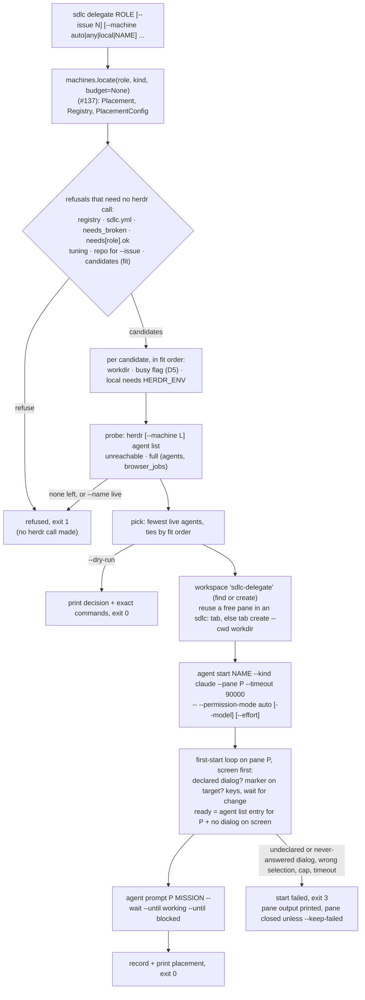

# `sdlc delegate <phase|agent>`: place, start in workdir, clear first-start gates

## Goal

Start a phase or agent on the machine its placement picks, and say where it went. This issue ships:
- `sdlc delegate <role>`, which:
  - picks a machine by fit, then by load;
  - starts a Claude Code agent through herdr in the machine's `workdir`;
  - clears the first-start dialogs the registry declares;
  - briefs the agent with a mission whose only return path is GitHub;
  - prints the placement and records it;
- `--dry-run`, which prints the decision and the exact commands without changing anything;
- the herdr calls it needs (`plugin/lib/herdr.py`), and a new `plugin/lib/delegate.py`;
- a fake herdr on PATH with a test suite in CI, `just sdlc::delegate`, a CHANGELOG entry, README
  text, and version **0.2.42**;
- a live check: real read-only jobs on devbox-n2, and `--machine compute` refused.

Nothing about the resolver changes. #137 says where a role may run, and this issue picks among
those machines and starts the agent.

**Baseline.** #137's code is now on this branch: its head 571d7ff, which includes d6b10b1, was merged
in at 72e929f (merge, not rebase, no force-push). If #137 moves again before implementation, merge it
in the same way. This spec relies on #137's **contract**:
- **Rule 1 (#136):** when `Registry.usable` is false, `delegate` refuses. The reason is the first
  registry error, or "no registry" when the registry is inert.
- **Rule 2 (#136) and `unfit_reason`:** a machine that isn't `ok` is never a target.
  `unfit_reason(machine, needs)` (`machines.py:1185`) returns `None` when the machine fits, and
  otherwise the first failure: not `ok`, not `assignable`, caps, keeps, secrets.
- **Rule 6:** `locate()` never raises. Its first element is a `Placement` whose `status` is `off`,
  `placed`, `fallback` or `unplaceable`, with `off_cause` set when the status is `off`.
  `Placement.target` (`:846`) is the winning target as written.
- **Rule 8:** `Placement.candidates` is fit-ordered (local first for `any`), never load-ordered.
  Load, busy flags and `limits` belong to this issue.
- **Rule 9** (`:55-62`): "A consumer that reads `config.needs` outside `resolve()` (#139's
  `--machine`) MUST refuse when `not config.usable`, when `config.needs_broken` is set, or when
  `not needs.ok` for the role." `Needs.invalid` and `needs_broken` are recorded whether or not the
  file opted in. **Only the `Issue`s are withheld** before opt-in (`:1143-1150`), so `delegate`'s
  refusals state the problem themselves.
- **The opt-in rule:** a repo that sets no target resolves every role `off` (`no-placement`).
- **Two private helpers are reused** rather than re-derived, the way `bin/sdlc` already uses
  `machines._strip_role`. If #137 renames either one, follow the rename.
  - `machines._evaluate(target, registry, needs)` (`:1249`) judges an explicit `any`, `local` or
    machine name with #137's own refusal texts.
  - `machines._r` (`:231`) bounds every user value quoted in a message.

## Approach

### Where this sits



- **`plugin/lib/delegate.py` holds the logic.** It follows `machines.py`'s rules: no output, no
  `sys.exit`, no I/O at import time. It raises `Refused` (nothing was started) or `StartFailed`
  (a machine was chosen), and returns plain dataclasses. `bin/sdlc` owns all output and exit codes,
  as in #136 and #137.
- **`plugin/lib/herdr.py` grows the calls `delegate` makes,** one function per herdr verb. Each one
  parses herdr's JSON and raises `HerdrError`, which now carries herdr's error `code`. Every herdr
  call `delegate` makes goes through this file, so tests swap in a fake herdr on PATH.
- **`machines.py` is not modified.** Everything placement-shaped comes through #137's surface, which
  keeps this branch clear of #137's code and of #138's.

### CLI grammar

```
sdlc delegate ROLE [--issue N] [--machine auto|any|local|NAME] [--prompt TEXT|@FILE]
                   [--name NAME] [--kind phase|agent] [--dry-run] [--keep-failed]
                   [--start-timeout SECS] [--registry PATH] [--config FILE]
```

| Flag | Meaning |
|---|---|
| `ROLE` | A phase or agent name, as in `phase_machines` / `agent_machines`. It is parsed with `bin/sdlc`'s `_role_arg` (`:52`), as `where` does, so an `sdlc:` prefix is stripped and a blank role is exit 2. |
| `--issue N` | The tracker issue the job is for (a positive integer). It goes into the mission and the default agent name. |
| `--machine` | `auto` (default) follows the repo's placement. `any` takes every machine that fits the role's `needs`, local first. `local` is the registry's local machine. `NAME` is one registered machine. These are #137's target words, plus `auto`, which #136 reserved for this flag. |
| `--prompt TEXT\|@FILE` | The task. `@FILE` reads a UTF-8 file. Without it, the mission uses the default task (see "The mission"). **Giving neither `--issue` nor `--prompt` is a usage error** (exit 2), because there would be nothing to do. |
| `--name NAME` | The herdr agent name. It must match herdr's `[a-z][a-z0-9_-]{0,31}`, else exit 2. Default: `<role>-<issue>`, or `<role>` when there is no issue. |
| `--kind` | `phase` or `agent`, passed to the resolver as `where --kind` does. |
| `--dry-run` | Decide, which reads herdr (`agent list`, `workspace list`, `tab list`, `pane list`, `pane process-info`), then print the decision and every command that would change something. Changes nothing and writes no record. |
| `--keep-failed` | On a start failure, leave the pane for inspection instead of closing it. |
| `--start-timeout SECS` | How long the agent may take to become ready, first-start dialogs included. Default 90 (compute's `--timeout 90000`). It must be more than 3 and at most 300, which are herdr's bounds: the API schema's `AgentStartParams.timeout_ms` says "Values must be greater than 3000 and at most 300000" (`herdr api schema --json`), and `agent start --help` gives the 300000 maximum. |
| `--registry`, `--config` | As on `sdlc machines`: `_path_arg` / `_config_arg` (`bin/sdlc:48-49`), so an empty value is exit 2. |

**Exit codes:**

| Exit | When |
|---|---|
| 0 | The agent started and herdr saw it working or blocked after the brief. With `--dry-run`: a machine was chosen. |
| 1 | **Refused.** Nothing was started and no pane was touched. **Every refusal except "full", "unreachable" and "an explicit `--name` is already live" is decided before any herdr call.** Causes: the registry is off or broken; `sdlc.yml` is broken or can't be re-read; the role's needs are broken; a tuning value is invalid; `--issue` has no resolvable repo; the placement is `off` or `unplaceable`; an explicit machine is unknown or unfit (compute, or any `assignable: false` box); every candidate is full, busy, unreachable or has no workdir. |
| 2 | Usage error. |
| 3 | **Start failed** after a machine was chosen: a herdr error while choosing or creating the pane, starting the agent or briefing it; a dialog that couldn't be cleared; or a timeout. The output says what was left behind. |

Exit 3 is separate from exit 1 so that a script can tell "nothing happened" from "something may be
left on that box".

### Choosing the machine

**1. Every refusal that needs no herdr call, in this order.** They come before the candidates are
probed, so they make no herdr call at all (tests D6-D11, D22, D25 assert that `calls` is empty).
- **`locate`:** `placement, registry, config = machines.locate(role, kind, registry_file=..., config_file=..., budget=None)`.
- **The registry isn't usable:** refuse with `placement.reason` when `off_cause` is `no-registry` or
  `registry-errors`. For `no-registry`, add `; sdlc delegate needs a registry (see: sdlc machines)`.
- **`sdlc.yml` is broken** (`off_cause` `sdlc-errors`): refuse with `placement.reason`. A file that
  can't be read can't show the role's needs, so this holds for an explicit `--machine` too.
- **Re-read `sdlc.yml` once.** When `config.path` is set, run `doc = machines.parse_yaml(config.path)`.
  It serves the needs texts, the tuning and `repo:`. A `RegistryError` refuses with `could not
  re-read <path>: <detail>`.
- **The needs.** Take `needs = config.needs.get(role, machines.Needs())`. Each of the checks below
  applies to every `--machine` value (rule 9). Each states the problem itself, because
  `sdlc machines check` withholds needs issues until the file opts in. The hint `; see: sdlc
  machines check` is added only when `config.opted_in`.
  - **`config.needs_broken`:** refuse with `the top-level needs in <path> is written more than once,
    so <role>'s needs can't be trusted` when `"needs"` is in `getattr(doc, "dups", ())`. Otherwise
    `the top-level needs in <path> is not a map (got <type name>), so <role>'s needs can't be
    trusted`.
  - **`not needs.ok`:** refuse with `needs.<role> has errors in: <sorted keys>` (#137's text).
- **Tuning:** `tuning_for(doc, role)`. A bad value refuses (see "`agent start`").
- **The repo:** with `--issue` and no resolvable repo, refuse (see "The mission").
- **The candidate list**, by `--machine`:

  | `--machine` | Candidates | Refused when |
  |---|---|---|
  | `auto` | `placement.candidates` when the status is `placed` or `fallback`. A `fallback` also prints `warning: <placement.reason>` on stderr and goes ahead (D4: the runtime keeps working). | `unplaceable`: refuse with `placement.reason`. `off` / `no-placement`: refuse with `sdlc.yml places nothing, so --machine auto has nowhere to send <role>; place it (phase_machines, agent_machines, default_machine) or name a machine with --machine`. |
  | `any`, `local`, `NAME` | `machines._evaluate(value, registry, needs)` (`:1249`). It returns the fitting machines (for `any`: local first, then registry file order), the refusals, and the text to use when none fit. | No machine fits: refuse with `_evaluate`'s text. For a name that isn't registered: `'<NAME>' is not in the registry; did you mean '<x>'?`. For an unfit one: the `unfit_reason` text, e.g. `machine 'compute' is not assignable`. |

  - An explicit `--machine` works in a repo that hasn't opted in. The opt-in rule governs the
    repo's map, while an explicit machine is the person choosing. Rule 9's refusals and the trust
    filters still apply in full.
  - When the repo did place the role somewhere else, the output adds
    `overrides <placement.requested.at> ('<value>')`.
- **`unfit_reason` runs again on every `auto` candidate.** This costs nothing, and it means
  `delegate` never sends work to a machine that isn't `ok` or `assignable`, even if the resolver had
  a bug.

**2. Delegate-only filters, per candidate in fit order.** These make no herdr call, and the busy
flag costs one `stat`. A candidate that fails is passed over with the reason shown:

| Order | Filter | Reason text (tests match these substrings) |
|---|---|---|
| a | **workdir.** The machine has a `workdir`. This applies to the local machine too: `delegate` only starts agents where the registry says it may. | `no workdir in the registry (sdlc delegate starts agents there)` |
| b | **Busy flag (D5).** The role is *heavy*: `needs.caps` includes `full-suite`, `browser` or `docker` (`HEAVY_CAPS`). The machine is `gaming_sensitive` with a `busy_flag`, and the flag says busy (rules below). | `busy: <flag> exists and <role> needs <the heavy caps>; remove the file when the box is free, or delegate to another machine`. The variants for a flag that can't be checked are below. |
| c | **The local herdr session.** For the local machine, `HERDR_ENV` must be `1`. herdr's own rule is never to inspect or control a session from outside it (`herdr --skill`; compute's `_guard`). Remote machines are reached through `--machine` profiles and don't need it. | `this shell is not inside herdr (HERDR_ENV is not 1), so the local herdr server is not used` |

**The busy flag.**
- **Where it is read.** D5 says "when the file exists". It is read **on the box `delegate` runs
  on**, the coordinating box where the registry lives. This is exact for ADR-009's only
  gaming-sensitive box, which is the local one. A remote gaming-sensitive box needs its flag mirrored
  to the coordinating box; see Open questions.
- **How it is resolved.** A leading `~` is expanded against this box's `HOME`, as `registry_path`
  does. A path that is still not absolute after that is treated as **busy**: `busy: busy_flag
  '<x>' is not an absolute path, so it can't be checked; write it as ~/... or /...`. The just
  recipe's `cd ..` would otherwise change what a relative path means.
- **`os.stat` decides:**
  - success → busy;
  - `FileNotFoundError` (ENOENT) or `NotADirectoryError` (ENOTDIR) → not busy;
  - any other `OSError` → busy (fail closed), as `busy: could not check busy_flag <x> (<error>);
    ...`.
- **A machine that is `gaming_sensitive` with no `busy_flag`** has nothing to test, so it is not
  busy; #136 already warns about that registry. An invalid `busy_flag` makes the machine not `ok`,
  so step 1 has already refused it (#136 rule 3).
- **The flag also refuses an explicit `--machine`.** That is stricter than D5's "under `auto`", but
  D5 grants no override, and ADR-009 §5 and the house rule say the flag blocks heavy work. The
  refusal says how to proceed. The README and CHANGELOG say so.

**3. Load: probe each remaining candidate.** Run `herdr [--machine <label>] agent list` (the local
machine has no `--machine`), with `herdr.DEFAULT_TIMEOUT` per machine, sequentially:

| Result | Verdict |
|---|---|
| `HerdrError` (unknown label, timeout, herdr missing, bad output) | passed over: `unreachable: <detail>` |
| `limits.agents` is set and `len(agents) >= limits.agents` | passed over: `full: <n> agents, limit <L>`. Every live agent counts, whatever its status. **A finished (`done`) agent keeps its slot until someone stops it** with the printed `stop:` command; the README says so. This matches `sdlc machines check --probe` (`bin/sdlc:163-168`). |
| The role is a **browser job** (`browser` in `needs.caps`), `limits.browser_jobs` is set, and the live browser jobs `>= limits.browser_jobs` | passed over: `full: <b> browser jobs, limit <B>` |
| otherwise | eligible: `<n> agents, limit <L or ->`, plus `, <b> browser jobs, limit <B>` for a browser job |

**Counting browser jobs.** herdr doesn't know which agents drive a browser, but `delegate` does,
because it records every placement (see "The record"). The live browser jobs on machine M are the
records under `delegates/<M>/` with `browser_job: true` whose `name` **and** `pane_id` match a live
agent in M's `agent list`. Agents started some other way are not counted. That limit is documented.

**4. Pick and name.** Among the eligible candidates, the one with the **fewest live agents** wins.
Ties go to fit order, which puts local first for `any`. If nothing is eligible, refuse with
`no machine can take <role> now: <m>: <why>; <m>: <why>` (exit 1).
- **Load never widens the candidate set.** A single named placement that is full refuses; it does
  not fall back to `default_machine`. To let load choose, place the role on `any`.
- A raw count, not a ratio, because a machine with no `limits.agents` has no ratio. The coordinator's
  own pane counts on the local server, which nudges work off the box you are typing on.
- Two `delegate` runs at the same moment can both pick a machine with one slot left. There is no
  lock. This is documented.
- **The name** is fixed now, from the winner's `agent list`. See "The name" below. An explicit
  `--name` that is live there refuses (exit 1).

### Starting the agent

All calls on the chosen machine use the same `--machine <label>` prefix, or none for local. **IDs come
from herdr's JSON, never from guesses** (herdr skill; compute's justfile). **After `agent start`,
the agent is addressed by its pane id `P`, never by its name.** herdr's agent commands accept "the
pane ID currently hosting that agent" (herdr skill), and the name binding can lag during startup.
Compute saw `agent get <name>` answer `agent_not_found` for an agent that was still starting.

**1. The pane: `choose_pane`, read-only, shared by `start` and `--dry-run`.**
- **Never split.** One job gets one tab, so there are no narrow panes. Compute's "reuse a free pane
  before splitting" lesson becomes "reuse a free pane before making a tab".
- `choose_pane` makes only the lookups below and returns a `PanePlan`. `start` carries the plan
  out, and `--dry-run` prints it.
- **Workspace.** Use the first workspace labelled `sdlc-delegate` (`WORKSPACE_LABEL`) from
  `workspace list`. A person's own workspace is unlikely to carry that label (neither devbox nor
  devbox-n2 has one). If there is none, the plan is `workspace create --label sdlc-delegate --cwd
  <workdir> --no-focus`, using its `root_pane` and renaming its tab (`tab rename <tab>
  sdlc:<name>`).
- **Free pane.** Otherwise, from `pane list --workspace W` and `tab list --workspace W`, take the
  first pane that meets all of these:
  - its tab's label starts with `sdlc:` (`TAB_PREFIX`; tabs this tool made) and holds one pane;
  - no live agent sits on it (its `pane_id` isn't in `agent list`);
  - its `foreground_cwd` equals the workdir;
  - `pane process-info --pane P` shows only a shell in the foreground (`bash`, `zsh`, `sh`, `fish`,
    `dash`).

  Its tab is renamed to `sdlc:<name>`. These are panes an earlier delegated agent left when it
  exited. herdr requires `agent start` to find the pane at its shell prompt, which the last two
  checks confirm.
- **Otherwise**, `tab create --workspace W --label sdlc:<name> --cwd <workdir> --no-focus`, using its
  `root_pane`.
- **workdir as written.** The local machine's workdir is `~`-expanded here. A remote one is passed
  as written, and the example uses absolute paths.

**2. `agent start`.**

```
herdr [--machine L] agent start <name> --kind claude --pane <P> --timeout <start_timeout*1000> \
  -- --permission-mode auto [--model <model>] [--effort <effort>]
```

- **`--permission-mode auto` is always passed.**
- **`model` and `effort`** come from `sdlc.yml` exactly as the phase-tuning hook reads them
  (`phase-tuning.py:153-172`): `phases.<role>.model` wins over `phase_models.<role>`, and
  `phases.<role>.effort` wins over `phase_effort.<role>`. They apply to any role, agents included,
  like the hook.
  - A knob that is unset, `null` or blank is left out, and the worker's Claude Code default applies.
    Unlike the hook, `null` is unset rather than the string `"null"` (the quirk #137 recorded).
  - **A bad value refuses** in step 1, before any herdr call (exit 1): a non-string `model`, or an
    `effort` outside `EFFORTS = (low, medium, high, xhigh, max)`. The text is `phases.<role>.effort
    'huge' is not one of: low, medium, high, xhigh, max` (or `phase_effort.<role>`). The value is
    quoted with `machines._r`.
  - `max_turns` and `worktree` don't apply to an interactive session, so they are ignored.
- **The session is a plain Claude Code session** briefed with the role. It does not get
  `--agent sdlc:<role>`, because the sdlc plugin may not be installed on the worker. The default
  task points the worker at `sdlc:<role>` when the plugin is there (see "The mission"). Shipping the
  role with `--agents <json>` (2.1.310 has it) is a follow-up; see Out of scope.
- **The name:**
  - **Default:** `<role>-<issue>` (or `<role>`), sanitised:
    - lower-case it, and turn each run of characters outside `[a-z0-9_-]` into one `-`;
    - strip `-` from both ends, and prefix `agent-` if it doesn't start with a letter;
    - cut it to 32 characters (to `32 - len(suffix)` when a suffix is added).

    If that name is live on the chosen machine, the next free suffix is used: `-2`, `-3`, ... up to
    `-9`.
  - **`agent_name_taken` anyway.** `agent start` can answer this even when the name isn't in
    `agent list` or `agent get`, because an agent that is still starting holds the name (compute's
    lesson). Then a default name moves to the next suffix on the same pane, at most twice. An
    explicit `--name` is a start failure (exit 3).
- **Success** returns `{"type": "agent_started", "agent": {...}, "argv": [...]}`. The `argv` herdr
  actually ran is kept for the record and the output. `agent_not_ready` means a startup dialog is up
  (herdr skill), and the loop below takes over. Either way, the loop runs, so a dialog is caught even
  when herdr already reports the agent idle.

**3. First start: clearing the dialogs.** This is a bounded loop on pane `P`. **Each round reads the
screen first**, so a declared dialog is answered even when herdr says the agent is idle (the herdr
skill warns that `idle`/`done` doesn't guarantee an unfamiliar dialog was recognised), and an
undeclared one still fails.

```
deadline = clock() + start_timeout; answers = {}
loop:
  screen = pane read P --source visible
  if NEVER_ANSWER pattern matches: fail "<dialog> is showing; it is never answered automatically: answer it once by hand on <machine>"
  gate = the known gate (GATES) whose patterns match screen, if any
  if gate:
      if gate not in machine.first_start: fail "the screen shows <gate>, which <machine> doesn't declare; add it to first_start in the registry"
      if answers[gate] == MAX_ANSWERS_PER_GATE (2): fail "<gate> still showing after 2 answers"
      answer(gate, screen)            # below: marker check, keys, wait for the screen to change
      answers[gate] += 1
      continue
  entry = the agent list entry with pane_id == P
  if entry and entry.agent == "claude" and entry.agent_status in ("idle", "done")
         and entry.interactive_ready is not False:        # null is accepted
      break                                               # ready: no dialog on screen, agent settled
  if clock() > deadline: fail "agent was not ready within <s>s"
  sleep(POLL)                                             # 0.5 s
```

**`answer(gate, screen)`:**
1. **Wait out the input guard.** Sleep `GATE_KEY_PAUSE` (0.5 s) after a dialog is first seen.
   Claude Code dialogs refuse keys for 150 ms after they open (`refuseInput`), and the auto-mode
   nudge for 500 ms.
2. **Find the selection.** The selection is the line holding the `❯` marker. If it already contains
   the gate's `target_label`, go to step 4 without pressing Down. That covers a dialog that remounts
   with focus on the target: 2.1.310's fullscreen notice does this after a refused dismiss.
3. **Down, then check.** Send `pane send-keys P down`. Re-read the screen every `POLL` for up to
   `KEY_SETTLE` (2 s), until the marker line changes. If the marker line then holds `target_label`,
   go on. Otherwise **send nothing more** and fail with `after Down the selection is '<line>', not
   '<target_label>'; nothing more was sent`.
4. **Enter.** Sleep `GATE_KEY_PAUSE`, then send `pane send-keys P enter`.
5. **Wait for the change.** Re-read every `POLL` until the screen differs from the one Enter was sent
   on, for up to `CLEAR_WAIT` (5 s, never past the deadline). Only then does the loop match again,
   so a screen Claude Code hasn't redrawn yet doesn't get a second answer. If the screen never
   changes, the next round matches the same gate and counts it toward the cap.

**The gates** (`GATES`; Claude Code 2.1.310's dialog definitions, checked in the binary):

| Gate | Recogniser (case-insensitive, whitespace-collapsed) | `target_label` | Why that option |
|---|---|---|---|
| `trust-prompt` | `yes, i trust this folder`, or `is this a project you created or one you trust` | `Yes, I trust this folder` | It is built with `cancelFirst: true`, `focus: "cancel"` and `hideIndexes: true`. It shows `❯ No, exit` (or "No, continue without these permissions") first and focused, and the trust option second, unnumbered. |
| `fullscreen-notice` | `try the new fullscreen renderer` | `Not now` | `❯ 1. Yes, try it` comes first and focused, then `2. Not now`. Declining keeps the classic renderer, which suits a herdr pane: alternate-screen rows never reach the scrollback that `pane read --source recent` reads. It shows while `fullscreenUpsellSeenCount < 3`, so it can come back on a box's first three starts. The loop answers it on every start where it shows. |

- **`NEVER_ANSWER`:** `auto-mode-teach`, recognised by `teach auto mode about your environment`.
  2.1.310 shows "Teach auto mode about your environment?" (Yes / Not now / Don't show again) in auto
  mode, after 5 or more starts and 5 or more auto-mode denials. A well-used worker can reach that,
  possibly during the brief. `delegate` never answers it: the run fails at once with the screen, and
  the README's troubleshooting line says to answer it once by hand on that box. It is not a
  first-start gate, so #136's `FIRST_START_GATES` doesn't change.
- **The marker check guards against a reordered dialog.** If a future Claude Code moves the options,
  Down lands on the wrong label, and the run fails before pressing Enter. The live check confirms
  the recognisers and labels on devbox-n2's version. If they differ there, the implementer updates
  `GATES` and records the version and the screen text in the implementation notes.
- **Renaming the agent.** When the loop ends, the entry for `P` may have `name: null` or another name,
  if the start binding didn't survive `agent_not_ready`. Then run `agent rename P <name>` once. If
  that fails, it is a start failure.
- **What the loop covers:**
  - **0 dialogs:** `agent start` succeeds, the screen shows none, and no keys are sent.
  - **1 or 2 dialogs:** one round each.
  - **A dialog while herdr says idle:** answered (screen first).
  - **An unnamed agent with null readiness:** accepted, then renamed.
  - **A stuck dialog:** fails at the cap.
  - **A wrong selection:** fails before Enter.
  - **An unknown dialog:** fails at the deadline, with the screen.
  - **A never-answered dialog:** fails at once.
- **Every round is recorded** in `startup` (see "The record"): the time, the dialog seen, the action
  taken, and the `agent list` entry's `name`, `agent_status`, `interactive_ready` and
  `launch_pending`. This shows what herdr really reports between `agent_not_ready` and ready.

**4. Brief.**

```
herdr [--machine L] agent prompt <P> <mission> --wait --until working --until blocked --timeout 60000
```

- It returns as soon as herdr sees the agent take the prompt. `delegate` never waits for the job
  itself.
- **A dialog appeared after start:** `agent_blocked` (refused before any input is sent, so a retry
  can't submit twice) or `agent_not_ready`. Run the loop once more with a fresh `start_timeout`
  budget, then retry the prompt once. **That is the issue's "while start/prompt returns
  `agent_not_ready`".**
- **Any other error** (`agent_prompt_stalled`, `timeout`, ...) is a start failure (exit 3). It is
  **not retried**, because the prompt may have been delivered (herdr skill).
- **A final status of `blocked`** is still exit 0, with `warning: <name> is blocked on a dialog; read
  it with: <read command>`.

**5. Failure cleanup.**
- **Before the agent is ready** (pane setup, `agent start`, the loop): capture
  `pane read P --source recent-unwrapped --lines 40`. Then close the pane with `pane close P`, unless
  `--keep-failed` was given. This is compute's fallback, and it works even when `agent get` can't
  find the agent.
- **After the agent is ready** (the brief failed): the pane is **never** closed. The agent is up, and
  the person may prompt it by hand. The record is written either way.
- **The output names what was left:** `left behind: nothing (pane <P> closed)`, or
  `left behind: pane <P>`, with the `read` and `stop` commands.
- **A failed `pane close`** is reported with the manual command. The exit code stays 3.

### The mission

`mission_text()` composes the mission, which is at most `MISSION_MAX` (64 KiB, inside Linux's
128 KiB limit for one argument). A longer `--prompt` is a usage error. The template (bracketed parts
appear only when they apply):

```
You were started by `sdlc delegate` as <name> on <machine>, to do the <role> work[ for issue #<n> in <owner/repo>].

Results come back through GitHub only: push a branch, or comment on the issue or pull request. Nothing
is read back from this box afterwards, not files and not this terminal. Before anything else, run
`gh auth status`. If it fails, print exactly this line and stop:
sdlc-delegate: gh is not logged in on <machine>
If you later cannot push or comment, say why in one final message and stop.

You are in <workdir> on <machine>.[ This box is disposable: anything you don't push is lost.] Make a new
working copy for this job at <workdir>/<name>: clone the repository there, or add a git worktree from
an existing clone. If <workdir>/<name> already exists, it belongs to an earlier job: don't reuse,
change or delete it; use <workdir>/<name>-2, -3, ... (the first that doesn't exist). Leave everything
else in <workdir> alone. When everything you made is pushed or posted, delete your working copy.
[
Issue: gh issue view <n> --repo <owner/repo>]

Task:
<--prompt text, or the default task>
```

- **The default task** (no `--prompt`): `If the sdlc plugin is installed here (the sdlc:<role> agent
  and /sdlc: commands exist), follow the sdlc:<role> agent's instructions for issue #<n>. Otherwise
  do the <role> work for issue #<n>: read the issue and what it links to, then report back as above.`
  This gives a plain session the phase contract whenever it can get it.
- **"This box is disposable"** appears when the machine's `persistence` is `disposable`.
- **A stale clone is never reused or deleted.** Suffixes only avoid *live* agent names, so
  `<workdir>/<name>` can be left over from an earlier job of the same name. The agent takes the next
  free directory instead. On a durable box, that leaves the earlier job's unpushed work intact.
- **The gh line** is fixed text, so a person can grep the pane for it (`read:` command) without
  waiting on GitHub.
- **`<owner/repo>`** is `sdlc.yml`'s `repo:` when that is a string `owner/name`. Otherwise it comes
  from `git -C <project root> remote get-url origin`, parsed as a GitHub URL (ssh or https, with or
  without `.git`), with a 5-second timeout.
  - The project root is the directory holding `.claude/` when `config.path` is
    `<root>/.claude/sdlc.yml`. Otherwise it is the current directory (for example, when `--config`
    names some other file).
  - With `--issue` and no repo, refuse in step 1 (exit 1, no herdr call): `can't tell which GitHub
    repository issue #<n> is in; set repo: <owner>/<name> in .claude/sdlc.yml`.
  - Without `--issue`, the repo is optional.
- **GitHub is the only return path** (ADR-009 §3, plan out-of-scope). `transport.ssh` is never used
  and nothing is fetched back.

### The printed placement and the record

**On success** (stdout, ASCII; the first line is the answer, so `| head -1` works):

```
reviewer-139: worker-2
  role:        reviewer (phase), issue #139 in owner/repo
  placement:   any (phase_machines.reviewer)
  considered:  workstation: no workdir in the registry (sdlc delegate starts agents there)
               worker-1: full: 4 agents, limit 4
               worker-2: 1 agent, limit 4   <- picked
               control: machine 'control' is not assignable
  where:       herdr:worker-2, workspace w3 (sdlc-delegate), tab w3:t4 (sdlc:reviewer-139), pane w3:p4
  workdir:     /home/agent/work
  claude:      claude --permission-mode auto --model fable --effort xhigh
  first start: trust-prompt, fullscreen-notice answered
  status:      working
  results:     GitHub only (a pushed branch, or a comment on issue #139)
  record:      /home/me/.local/state/sdlc/delegates/worker-2/reviewer-139.json
  check:       herdr --machine worker-2 agent get w3:p4
  read:        herdr --machine worker-2 pane read w3:p4 --source recent-unwrapped --lines 120
  stop:        herdr --machine worker-2 pane close w3:p4
```

- **`placement`**:
  - With `auto`, it is `<placement.target> (<requested.at>)`, or `<m> (default target)`. A `fallback`
    adds `, fallback` and prints the warning.
  - With an explicit machine, it is `--machine <value>`, plus `; overrides <at> ('<v>')` when that
    applies.
- **`considered`** has one line per machine that was judged, in this order:
  - the candidates in fit order, with their verdicts;
  - then the resolver's `rejected` entries, or `_evaluate`'s refusals (`<key>: <why>`).
- **`claude`** shows the `argv` herdr reported (with `claude` first). Under `--dry-run` it shows the
  intended arguments.
- **`first start`** is `none shown`, or the dialogs that were answered.
- **`check`** addresses the agent by pane id, like every call after start. On the local machine the
  commands have no `--machine`, and `where:` says `local`.
- **Commands are `shlex.quote`d,** so they can be pasted.

**`--dry-run`** prints the same decision lines with ` (dry run: nothing started)` on the first line.
In place of `where`, `status` and `record` it prints:
- `would run:`, then each mutating command in order, with placeholders `<new-pane>` / `<new-tab>`
  where herdr would assign an ID;
- the dialog step, as `then, for each dialog on pane <pane> that is declared (<gates>): pane
  send-keys <pane> down (unless the selection is already on the target), then enter`;
- the prompt command with `"$MISSION"`;
- `mission:`, followed by the full mission text indented with `    | `.

It makes no mutating call and writes no record.

**On refusal** (stderr, exit 1): `sdlc delegate: refused: <reason>`, followed by the `considered`
lines that exist so far. **On a start failure** (stderr, exit 3):
- `sdlc delegate: start failed on <machine>: <why>`;
- `  pane <P> output (last 40 lines):` with each line indented `    | `;
- `  left behind: ...`;
- the `read` and `stop` lines when a pane remains.

**The record.**
- **Where:** `${XDG_STATE_HOME:-$HOME/.local/state}/sdlc/delegates/<machine>/<name>.json`, written
  after the agent is ready and updated after the brief. Keying by machine as well as name matters,
  because herdr names are unique only per server, so two machines can each have `reviewer-139`.
- **Why it exists:** later commands, and a person, find the worker without environment variables
  (compute's `results/.machine/<name>`). It is also how browser jobs are counted.
- **Fields:** `name`, `role`, `kind`, `issue`, `repo`, `machine`, `herdr` (the label, or `null` for
  local), `workspace_id`, `tab_id`, `pane_id`, `workdir`, `browser_job`, `claude_args`, `argv`,
  `first_start` (the dialogs answered), `startup` (the loop's rounds, at most 30), `briefed`,
  `status`, `started_at` (UTC ISO-8601).
- **A failed write** (`OSError`) prints `warning: could not write the record: <why>`, and the exit
  code stays the same. The printed placement already carries every field.

### `herdr.py`: the adapter grows

- **`HerdrError(detail, returncode=None, code=None)`.** `code` is herdr's error code when stderr is
  herdr's JSON error (`{"error": {"code", "message"}, "id"}`, exit 1, as checked against 0.9.5).
  Then `detail` is `<code>: <message>`. Text errors (exit 2, for example
  `error: unknown machine 'x'; use \`herdr machine list\``) keep today's first-line detail.
- **The existing messages are kept,** so #136's probe tests (`machines.test.sh:403-436`) pass
  unchanged:
  - `herdr not found on PATH`;
  - `timed out after <t>s`;
  - the first stderr line;
  - `unexpected output`.
- **One private runner, `_call(machine, args, timeout)`,** builds `["herdr", "--machine", label,
  *args]` (no `--machine` when `machine is None`). It runs the command with `stdin=DEVNULL` and
  captured output, returns the parsed `result` object, and raises `HerdrError` on every failure.
  - `agent_list` is reimplemented on it, with the same behaviour.
  - `argv(machine, *args)` returns the same list for `--dry-run` printing.
- **The functions:**
  - `workspace_list`, `workspace_create`;
  - `tab_list`, `tab_create`, `tab_rename`;
  - `pane_list`, `pane_foreground`, `pane_read`, `pane_send_keys`, `pane_close`;
  - `agent_start`, `agent_prompt`, `agent_rename`.

  Signatures are under Interfaces. The result shapes are from `herdr api schema --json` (0.9.5):
  - `workspace_created` → `workspace`, `tab`, `root_pane`;
  - `tab_created` → `tab`, `root_pane`;
  - `pane_read` → `read.text`;
  - `pane_process_info` → `process_info.foreground_processes[].name`;
  - `agent_started` → `agent`, `argv`;
  - `agent_prompted` → `agent`.
- **`agent_start`'s subprocess timeout** is `start_timeout + DEFAULT_TIMEOUT`, so herdr's own
  `--timeout` fires first.

## File-level plan

### Create

- **`plugin/lib/delegate.py`** holds the logic under "Approach". It follows #136's module rules:
  - no stdout/stderr, no `sys.exit`, no import-time I/O, Python >= 3.8, stdlib only;
  - YAML only through `machines.parse_yaml`.

  It imports `machines` and `herdr`.
  - **Pure parts, unit-tested directly:**
    - `tuning_for(doc, role)`;
    - `is_heavy(needs)`, `is_browser_job(needs)`;
    - `default_name(role, issue, taken)`;
    - `repo_from_remote(url)`;
    - `mission_text(...)`;
    - `match_gate(screen)`, `selected_line(screen)`.
  - **I/O parts:**
    - `busy_reason(machine, role, needs, env)` (one `stat`);
    - `decide(...)`, which does step 1 with no herdr call, then the per-candidate probes;
    - `choose_pane(decision)` (read-only), then `plan_commands(...)` for `--dry-run`, or
      `start(decision, ...)` for a real run;
    - `read_records(machine, env)`, `write_record(...)`.
  - **A herdr error inside `choose_pane`** is a `StartFailed` with no pane, so exit 3. Under
    `--dry-run` the message reads `dry run: herdr failed on <machine>: <detail>`.
  - **`start` takes `sleep` and `clock`,** so that Python-level tests can drive the loop without
    waiting.
  - **A test asserts** `set(GATES) == set(machines.FIRST_START_GATES)`, so that a new registry gate
    name can't ship without a recogniser and a target label.
- **`plugin/lib/fake-herdr.py`** is the fake `herdr` for the tests. It is a stateful Python script
  that the suite links onto PATH as `herdr`.
  - **Scenario** (`$FAKE_HERDR_DIR/scenario.json`), keyed by machine label (`""` for the local
    server). Each entry can set:
    - `agents`: a count of pre-existing working agents, named `busy1`... on panes `w9:p1`...;
    - `unreachable` (prints herdr 0.9.5's unknown-machine text, exit 2), or `hang` (sleeps 30 s);
    - `workspaces`: an existing `sdlc-delegate` workspace, with optional free or occupied panes in
      `sdlc:` tabs, each with a `cwd` and a foreground process;
    - `gates`: the dialogs a new agent shows, in order: `trust-prompt`, `fullscreen-notice`,
      `auto-mode-teach`, `unknown`;
    - `idle_with_gate`: `agent start` succeeds, and `agent list` says `idle`, while the first dialog
      is still on screen;
    - `unnamed_after_gate`: after the last dialog, the agent's entry has `name: null` and
      `interactive_ready: null` until `agent rename`;
    - `focus_target`: the fullscreen notice opens with the marker on `Not now`;
    - `marker_stuck`: `down` doesn't move the marker;
    - `stuck`: `enter` doesn't close the dialog;
    - `redraw_lag`: N pane reads after a key still return the old screen;
    - `start_error` / `prompt_error`, or `prompt_error_once`: a herdr error code to return;
    - `name_taken_once`: the first `agent start` answers `agent_name_taken`.
  - **State** (`state.json`) holds:
    - workspaces, tabs, panes and agents;
    - each pane's screen and marker position;
    - the prompts received, with their targets.
  - **Every call** appends `{"machine": <label|"">, "argv": [...]}` to `calls.jsonl`.
  - **Output** mimics herdr 0.9.5:
    - successes print `{"id": "cli:<group>:<verb>", "result": {...}}` to stdout, exit 0;
    - server errors print `{"error": {"code", "message"}, "id"}` to stderr, exit 1;
    - an unknown verb prints `fake herdr: unsupported: ...`, exit 2.
  - **Agent targets.** Commands accept a live name or the pane id hosting the agent, as herdr does.
    `agent get <name>` answers `agent_not_found` while an agent is still starting, as compute saw.
  - **Dialogs** use 2.1.310's strings and layout:
    - **trust:** the "Quick safety check: Is this a project you created or one you trust?" title,
      then **unnumbered** `❯ No, exit` / `  Yes, I trust this folder` (`hideIndexes`);
    - **fullscreen:** "Try the new fullscreen renderer?", then `❯ 1. Yes, try it` / `  2. Not now`;
    - **auto-mode-teach:** "Teach auto mode about your environment?", then `❯ 1. Yes` /
      `2. Not now` / `3. Don't show again`.
  - **Keys:**
    - `down` moves the `❯` marker one option.
    - `enter` picks the marked option, and the next dialog or ready follows. Ready means the agent's
      entry has its name, `interactive_ready: true` and `agent_status: idle`, unless
      `unnamed_after_gate` is set.
    - `enter` on the trust dialog's `No, exit` ends the agent, and the pane shows a shell prompt.
- **`plugin/lib/delegate.test.sh`** is the suite. It follows the conventions of `machines.test.sh`
  and `placement.test.sh`:
  - paths from `$0`;
  - `ok`/`bad` counters, `TMP` with a `trap`;
  - `export HOME="$TMP/home"`, with `SDLC_MACHINES`, `XDG_CONFIG_HOME`, `XDG_STATE_HOME` and
    `CLAUDE_PROJECT_DIR` unset;
  - `PYTHONDONTWRITEBYTECODE=1`;
  - the same backend detection and `noyaml` shadow;
  - `SDLC_REQUIRE_BOTH_BACKENDS` honoured;
  - a summary line `delegate: N passed, M failed`, with the exit status taken from the fail count.

  Its parts:
  - **Part A** is one Python heredoc for the pure functions. It prints `rows: N` first, and bash
    checks the exit status and the `ok:` count, as #137 does.
  - **Part B** runs the CLI against the fake herdr, **from `$TMP/cwd`**, a directory with no `.git`
    and no `.claude`.
    - Every row passes `--registry` and `--config` explicitly unless it says otherwise. So no row
      depends on the checkout the suite runs in.
    - Rows marked [both] run once per backend.
    - Every row gets a fresh `$FAKE_HERDR_DIR` and `$TMP/home`, and runs with `HERDR_ENV=1` unless
      the row says otherwise.
  - **Timeouts are short where the row tests a deadline** (`--start-timeout 4`), and 20 s where the
    row ends early (D18, D20), so the suite stays under a minute on a loaded box.

### Modify

- **`plugin/lib/herdr.py`**: as under "`herdr.py`: the adapter grows". In the docstring, replace "#139
  extends this file" with the list of verbs and the `HerdrError.code` field.
- **`plugin/bin/sdlc`**:
  - **Add the `delegate` top-level subparser** with the grammar above. Reuse `_role_arg`,
    `_path_arg`, `_config_arg` and `_timeout_arg`'s parsing. Add:
    - `_issue_arg` (a positive integer);
    - `_name_arg` (herdr's pattern; a usage error otherwise);
    - `_start_timeout_arg` (more than 3 and at most 300);
    - `--prompt` parsing: `@FILE` is read as UTF-8, and an unreadable file or a mission over
      `MISSION_MAX` is exit 2.
  - **`cmd_delegate`** calls `delegate.decide()`, then either prints the dry run or calls
    `delegate.start()`. It maps `Refused` → 1, `StartFailed` → 3 and success → 0, and prints in the
    formats under "The printed placement".
  - **The docstring** gets the `delegate` grammar and exit codes. The "Reserved for a later release,
    not built here: `sdlc delegate`" line (`:16`) goes.
  - **The top-level subparser metavar stays `COMMAND`** (`:267`). It is unchanged.
- **`plugin/sdlc.justfile`**: add a recipe after `machines` (`:89-94`), in the same group, with the
  same `[positional-arguments]` and `cd ..`:

  ```just
  # start a phase or agent on the machine its placement picks; --dry-run shows the decision first.
  [group('machines')]
  [positional-arguments]
  delegate *args:
      @cd .. && python3 "${CLAUDE_PLUGIN_DIR:-$(dirname "$(realpath .claude/sdlc.justfile)")}/bin/sdlc" delegate "$@"
  ```

  `cd ..` lands at the project root, so `locate()` finds `.claude/sdlc.yml` and `git remote` finds
  the repo.
- **`.github/workflows/verify.yml`**: add a step after "Placement resolver tests" (`:76-79`), with the
  same env. Don't rename the job, because its `name:` is a required check.

  ```yaml
  - name: Delegate tests
    env:
      SDLC_REQUIRE_BOTH_BACKENDS: "1"
    run: bash plugin/lib/delegate.test.sh
  ```

- **`plugin/machines.example.yaml`**: comments only, so #136 case 1 (0 errors, 0 warnings) still
  holds.
  - On `busy_flag` (`:19`): add "(an absolute or ~ path on this box, the one you coordinate from)".
  - On `workdir` (`:26`): "where `sdlc delegate` starts agents (it needs one on every machine it
    uses)".
  - On `worker-1`'s `limits` (`:28`): "`agents` and `browser_jobs` cap what `sdlc delegate` sends here".
  - On `first_start` (`:34`): "dialogs `sdlc delegate` may answer on a fresh box or directory".
  - Under `workstation`: `# workdir: ...   # set it to let sdlc delegate start agents here too`,
    commented out.
- **`plugin/.claude-plugin/plugin.json`**: `version` 0.2.41 → **0.2.42**. 0.2.41 is #137's, now on
  this branch. #138 runs in parallel. **Whichever of #138 and #139 merges second rebases onto the
  other** (or merges it in) and takes **0.2.43**, moving its CHANGELOG heading to match.
- **`CHANGELOG.md`**: add a new top entry above `## [0.2.41]`: `## [0.2.42] — <date>` /
  `### Added — sdlc delegate: start a phase or agent on another machine`.
  - **Why:** the registry (0.2.40) and placement (0.2.41) say where work may run, but starting it
    there was still done by hand, including the dialogs a fresh Claude Code shows. `delegate` picks
    the machine (trust first, then load), starts the agent in the machine's `workdir`, answers the
    first-start dialogs the registry declares, and briefs it. Results come back through GitHub only.
  - **Bullets:**
    - the grammar and the `--machine` words;
    - picking: fit, then fewest live agents, with `limits.agents` and `limits.browser_jobs` as caps,
      full or unreachable machines skipped, and finished agents counting until stopped;
    - the busy flag for heavy roles, **an explicit `--machine` included**;
    - the refusals (unassignable, unfit or not-`ok` machines, broken needs), exit 1, decided before
      any herdr call;
    - `--permission-mode auto`, plus `model`/`effort` from `phases`;
    - the first-start loop: it never answers an undeclared dialog, checks the selection before Enter,
      and never answers the auto-mode prompt;
    - `--dry-run`;
    - the record, and exit 3;
    - the tests in CI.

  Generic names only.
- **`README.md`**: in `## Machines`, replace the sentence "Starting work on another box comes in a
  later release." (`:269`) with a subsection, `### Starting work on another box: sdlc delegate`. It
  covers:
  - one example, `sdlc delegate validator --issue 42`, with `--dry-run` first;
  - how a machine is chosen (trust and fit, then load);
  - that `workdir` is needed, and that the local machine is used only from inside herdr;
  - **the busy flag:** read on this box, it blocks heavy roles even with an explicit `--machine`;
    remove the file when the box is free, or name another machine;
  - **load:** finished agents count until you stop them with the printed `stop:` command;
  - `first_start`, and that the fullscreen notice can come back on a box's first three starts;
  - GitHub as the only return path, and the `gh auth status` line to grep for;
  - the record path;
  - how to check on the agent or stop it (the printed `check`/`read`/`stop` lines);
  - the exit codes;
  - **troubleshooting:** an exit 3 showing a dialog `delegate` doesn't know (such as "Teach auto mode
    about your environment?") means answering it once by hand on that box.

## Interfaces

```python
# ── plugin/lib/herdr.py (after) ──────────────────────────────────────────────
DEFAULT_TIMEOUT = 15.0

class HerdrError(Exception):
    def __init__(self, detail: str, returncode: Optional[int] = None, code: Optional[str] = None): ...
    # code: herdr's JSON error code ("agent_not_ready", "agent_name_taken", "agent_not_found",
    #       "agent_blocked", "agent_prompt_stalled", "timeout", ...), else None

def available() -> bool: ...                                                   # unchanged
def argv(machine: Optional[str], *args: str) -> List[str]: ...                # ["herdr", ("--machine", m)?, *args]
def agent_list(machine: Optional[str] = None, *, timeout: float = DEFAULT_TIMEOUT) -> List[dict]: ...  # unchanged behaviour
def workspace_list(machine: Optional[str], *, timeout: float = DEFAULT_TIMEOUT) -> List[dict]: ...
def workspace_create(machine: Optional[str], label: str, cwd: str, *, timeout: float = DEFAULT_TIMEOUT) -> dict: ...  # {workspace, tab, root_pane}; --no-focus
def tab_list(machine: Optional[str], workspace_id: str, *, timeout: float = DEFAULT_TIMEOUT) -> List[dict]: ...
def tab_create(machine: Optional[str], workspace_id: str, label: str, cwd: str, *, timeout: float = DEFAULT_TIMEOUT) -> dict: ...  # {tab, root_pane}; --no-focus
def tab_rename(machine: Optional[str], tab_id: str, label: str, *, timeout: float = DEFAULT_TIMEOUT) -> None: ...
def pane_list(machine: Optional[str], workspace_id: str, *, timeout: float = DEFAULT_TIMEOUT) -> List[dict]: ...
def pane_foreground(machine: Optional[str], pane_id: str, *, timeout: float = DEFAULT_TIMEOUT) -> List[str]: ...  # foreground process names
def pane_read(machine: Optional[str], pane_id: str, *, source: str = "visible", lines: Optional[int] = None,
              timeout: float = DEFAULT_TIMEOUT) -> str: ...                    # result.read.text
def pane_send_keys(machine: Optional[str], pane_id: str, keys: Sequence[str], *, timeout: float = DEFAULT_TIMEOUT) -> None: ...
def pane_close(machine: Optional[str], pane_id: str, *, timeout: float = DEFAULT_TIMEOUT) -> None: ...
def agent_start(machine: Optional[str], name: str, pane_id: str, *, kind: str = "claude",
                args: Sequence[str] = (), start_timeout: float = 90.0) -> dict: ...   # {agent, argv}; --timeout start_timeout*1000
def agent_prompt(machine: Optional[str], target: str, text: str, *,
                 until: Sequence[str] = ("working", "blocked"), timeout: float = 60.0) -> dict: ...  # result.agent; delegate passes target = pane id
def agent_rename(machine: Optional[str], target: str, name: str, *, timeout: float = DEFAULT_TIMEOUT) -> None: ...

# ── plugin/lib/delegate.py ───────────────────────────────────────────────────
# Module rules as machines.py: no output, no sys.exit, no import-time I/O, stdlib only.
MACHINE_WORDS = ("auto", "any", "local")        # plus a registered name
HEAVY_CAPS = ("full-suite", "browser", "docker")  # D5
BROWSER_CAP = "browser"
EFFORTS = ("low", "medium", "high", "xhigh", "max")
AGENT_NAME = r"[a-z][a-z0-9_-]{0,31}"           # herdr's rule for live agent names (fullmatch)
WORKSPACE_LABEL = "sdlc-delegate"
TAB_PREFIX = "sdlc:"
SHELLS = ("bash", "zsh", "sh", "fish", "dash")
MARKER = "❯"                               # ❯, Claude Code's selection marker
START_TIMEOUT = 90.0                            # seconds; --start-timeout default (compute: --timeout 90000)
PROMPT_TIMEOUT = 60.0
POLL = 0.5
GATE_KEY_PAUSE = 0.5                            # after a dialog is first seen, and between Down and Enter
KEY_SETTLE = 2.0                                # wait for the marker to move after Down
CLEAR_WAIT = 5.0                                # wait for the screen to change after Enter
MAX_ANSWERS_PER_GATE = 2
MAX_STARTUP_ROUNDS_RECORDED = 30
MISSION_MAX = 64 * 1024
STATE_RELPATH = "sdlc/delegates"                # under ${XDG_STATE_HOME:-~/.local/state}
GH_NOT_LOGGED_IN = "sdlc-delegate: gh is not logged in on {machine}"

@dataclass(frozen=True)
class Gate:
    name: str                                   # a machines.FIRST_START_GATES name
    patterns: Tuple[str, ...]                   # lower-case substrings of the whitespace-collapsed visible screen
    target_label: str                           # the option to pick: "Yes, I trust this folder" | "Not now"

GATES: Dict[str, Gate]                          # "trust-prompt", "fullscreen-notice" (see First start)
NEVER_ANSWER: Dict[str, Tuple[str, ...]]        # {"auto-mode-teach": ("teach auto mode about your environment",)}

class Refused(Exception):                       # exit 1; nothing started, no pane touched
    reason: str
    considered: Tuple["Verdict", ...]

class StartFailed(Exception):                   # exit 3; a machine was chosen
    reason: str
    machine: str
    pane_id: Optional[str]
    output: str                                 # last 40 lines of the pane, "" if none
    pane_closed: bool
    record_path: Optional[Path]

@dataclass(frozen=True)
class Tuning:
    model: Optional[str]
    effort: Optional[str]
    source: Dict[str, str]                      # knob -> "phases.<role>.model" | "phase_models.<role>" | ...

@dataclass(frozen=True)
class Verdict:
    machine: str
    eligible: bool
    why: str                                    # "1 agent, limit 4" | "full: 4 agents, limit 4" | "busy: ..." | unfit_reason text
    agents: Optional[int] = None
    live_names: FrozenSet[str] = frozenset()

@dataclass(frozen=True)
class Decision:
    role: str
    kind: Optional[str]
    name: str
    machine: machines.Machine
    label: Optional[str]                        # herdr --machine label; None = the local server
    workdir: str                                # as passed to herdr (local: ~-expanded)
    placement: machines.Placement
    via: str                                    # "any (phase_machines.reviewer)" | "worker-1 (default target)" | "--machine NAME"
    overrides: Optional[str]                    # "<at> ('<value>')" when --machine overrides the repo's placement
    considered: Tuple[Verdict, ...]
    tuning: Tuning
    claude_args: Tuple[str, ...]                # ("--permission-mode", "auto", ["--model", m], ["--effort", e])
    browser_job: bool
    issue: Optional[int]
    repo: Optional[str]                         # "owner/name"
    mission: str

@dataclass(frozen=True)
class PanePlan:
    action: str                                 # "create-workspace" | "reuse-pane" | "create-tab"
    workspace_id: Optional[str]                 # None when action == "create-workspace"
    tab_id: Optional[str]                       # the free pane's tab (reuse-pane), else None
    pane_id: Optional[str]                      # the free pane (reuse-pane), else None

@dataclass(frozen=True)
class Started:
    decision: Decision
    workspace_id: str
    tab_id: str
    pane_id: str                                # every call after agent start targets this
    argv: Tuple[str, ...]                       # as herdr reported it (agent_started.argv)
    gates_answered: Tuple[str, ...]
    startup: Tuple[dict, ...]                   # the loop's rounds: t, dialog, action, agent entry fields
    status: str                                 # agent_status after the brief
    record_path: Optional[Path]
    record_error: Optional[str]

def tuning_for(doc: object, role: str) -> Tuning: ...            # pure; grouped beats flat; raises Refused on a bad value
def is_heavy(needs: machines.Needs) -> bool: ...                 # needs.caps ∩ HEAVY_CAPS
def is_browser_job(needs: machines.Needs) -> bool: ...
def busy_reason(machine: machines.Machine, role: str, needs: machines.Needs,
                env: Optional[Mapping[str, str]] = None) -> Optional[str]: ...
    # one os.stat on this box: ENOENT/ENOTDIR -> None; success or other OSError -> busy; relative path -> busy
def default_name(role: str, issue: Optional[int], taken: Iterable[str]) -> str: ...  # sanitised, suffix -2..-9; Refused when all taken
def repo_from_remote(url: str) -> Optional[str]: ...             # pure; github ssh/https -> "owner/name"
def match_gate(screen: str) -> Optional[str]: ...                # a GATES or NEVER_ANSWER name whose patterns match, else None
def selected_line(screen: str) -> Optional[str]: ...             # the line holding MARKER, whitespace-collapsed
def mission_text(*, role: str, kind: Optional[str], machine: machines.Machine, workdir: str, name: str,
                 issue: Optional[int], repo: Optional[str], prompt: Optional[str]) -> str: ...  # pure
def read_records(machine: str, env: Optional[Mapping[str, str]] = None) -> List[dict]: ...    # tolerant: skips unreadable files
def decide(role: str, *, kind: Optional[str] = None, machine_arg: str = "auto",
           issue: Optional[int] = None, prompt: Optional[str] = None, name: Optional[str] = None,
           registry_file: Optional[str] = None, config_file: Optional[str] = None,
           env: Optional[Mapping[str, str]] = None, cwd: Optional[str] = None,
           probe_timeout: float = herdr.DEFAULT_TIMEOUT) -> Decision: ...
           # step 1 (no herdr call), then filters, probes (agent list only), pick, name; raises Refused
def choose_pane(decision: Decision, *, timeout: float = herdr.DEFAULT_TIMEOUT) -> PanePlan: ...
           # read-only: workspace list, tab list, pane list, agent list, pane process-info; raises StartFailed on a herdr error
def plan_commands(decision: Decision, plan: PanePlan, *, start_timeout: float = START_TIMEOUT) -> List[str]: ...
           # --dry-run: each mutating command start() would run, shlex-quoted, <new-pane>/<new-tab> placeholders
def start(decision: Decision, plan: PanePlan, *, start_timeout: float = START_TIMEOUT, keep_failed: bool = False,
          env: Optional[Mapping[str, str]] = None,
          sleep: Callable[[float], None] = time.sleep,
          clock: Callable[[], float] = time.monotonic) -> Started: ...   # raises StartFailed
def write_record(started: Started, env: Optional[Mapping[str, str]] = None) -> Path: ...  # raises OSError; start() catches

# ── plugin/bin/sdlc (grammar added) ──────────────────────────────────────────
# sdlc delegate ROLE [--issue N] [--machine auto|any|local|NAME] [--prompt TEXT|@FILE] [--name NAME]
#                    [--kind phase|agent] [--dry-run] [--keep-failed] [--start-timeout SECS]
#                    [--registry PATH] [--config FILE]
# exit: 0 started (dry run: decided) · 1 refused, nothing started · 2 usage · 3 start failed after choosing a machine
```

## Tests

Everything is in `plugin/lib/delegate.test.sh`, which CI runs with `SDLC_REQUIRE_BOTH_BACKENDS=1`.
Run it locally with `nice -n 19 bash plugin/lib/delegate.test.sh`. It never reaches the network or a
real herdr: PATH holds `python3`, the fake `herdr` and, for [yq] rows, `yq`.

**Fixtures.**
- **`REG`** has five machines:
  - `workstation`: local; `workdir: $TMP/ws`; caps `edit, test, browser`; secrets `dev`;
    `busy_flag: $TMP/busy`;
  - `worker-1`: herdr `worker-1`; workdir `/w1`; caps `edit, test, browser, docker, full-suite`;
    `limits: {agents: 4, browser_jobs: 2}`; `first_start: [trust-prompt, fullscreen-notice]`;
    `persistence: disposable`;
  - `worker-2`: as `worker-1`, but herdr `worker-2` and workdir `/w2`;
  - `control`: `role: control-plane`, `assignable: false`;
  - `broken`: herdr `broken`, `limits: {cores: 0}`, so it is not `ok`.
- **`CFG_ANY`** = `repo: owner/repo`, `phase_machines: {reviewer: any}`,
  `phases: {reviewer: {model: fable, effort: xhigh}}`.
- **`CFG_W1`** = `repo: owner/repo`, `phase_machines: {reviewer: worker-1}`. Rows D15-D21 and
  D33-D38 use it with `delegate reviewer --issue 139`.
- **The fake herdr scenario's default:** `""` (local) with 2 agents, `worker-1` with 3, `worker-2`
  with 1, and no dialogs.
- **`calls`** is `calls.jsonl`, parsed. **"Mutating"** means any verb other than `agent list`,
  `workspace list`, `tab list`, `pane list`, `pane read` or `pane process-info`. **"In order"** means
  as a subsequence of `calls`, because `agent list` and `pane read` calls come in between.

**Part A, the pure functions (one heredoc, no herdr, no YAML backend):**

| # | Case | Expect |
|---|---|---|
| A1 | `tuning_for`: grouped `phases.r.model` beside flat `phase_models.r` | grouped wins; `source["model"] == "phases.r.model"` |
| A2 | flat only; then neither | `phase_effort.r` is used; then `Tuning(None, None, {})` |
| A3 | `null` and blank values | unset (not `"null"`) |
| A4 | `effort: huge`; `model: 3` | `Refused`, with `is not one of: low, medium, high, xhigh, max` / `phases.r.model` |
| A5 | `is_heavy`: caps `[browser]`, `[docker]`, `[full-suite]`, `[edit]`, `()` | True ×3, False ×2. `is_browser_job` is true only for `browser` |
| A6 | `default_name("reviewer", 139, set())`; with `{"reviewer-139"}` taken; `("Browser Pilot!", None, ...)`; `("9lives", None, ...)`; a 40-character role with a suffix needed; all 9 taken | `reviewer-139`; `reviewer-139-2`; `browser-pilot`; `agent-9lives`; matches `AGENT_NAME` and is ≤ 32 characters, suffix included; `Refused` |
| A7 | `repo_from_remote` on `git@github.com:o/r.git`, `https://github.com/o/r`, `https://github.com/o/r.git`, `ssh://git@github.com/o/r`, a gitlab URL | `o/r` ×4; `None` |
| A8 | `match_gate` on the fake's trust, fullscreen and auto-mode screens (mixed case, extra spaces), and on a plain prompt `> ` | `trust-prompt`, `fullscreen-notice`, `auto-mode-teach`, `None` |
| A8b | `selected_line` on the trust screen; on the fullscreen screen after a `down` | `❯ No, exit`; `❯ 2. Not now` |
| A9 | `mission_text` with issue, repo, a disposable machine and a prompt | Contains `as reviewer-139 on`, `GitHub only`, `gh auth status`, the exact `GH_NOT_LOGGED_IN` line, `push a branch, or comment`, `<workdir>/<name>`, `don't reuse, change or delete it`, `delete your working copy`, `gh issue view 139 --repo o/r`, `disposable`, and the prompt. Length ≤ `MISSION_MAX`. |
| A10 | `mission_text` with no prompt; with a durable machine | the default task names `sdlc:reviewer` and issue 139; no `disposable` |
| A11 | `set(GATES) == set(machines.FIRST_START_GATES)`, and `NEVER_ANSWER` is disjoint from `GATES` | true |

**Part B, the CLI against the fake herdr.** All rows run from `$TMP/cwd`, with `REG`, unless they say
otherwise.

| # | Case (acceptance item) | Run | Expect |
|---|---|---|---|
| D1 | **[both] fit + load picking** | `CFG_ANY`; `delegate reviewer --issue 139` | Exit 0. First line `reviewer-139: worker-2`. `considered` has `workstation: 2 agents`, `worker-1: 3 agents, limit 4`, `worker-2: 1 agent, limit 4   <- picked`, `control: machine 'control' is not assignable`, and `broken: machine 'broken' has registry errors in:`. Every call after the probes carries `--machine worker-2`. |
| D2 | tie → fit order | `CFG_ANY`; local, `worker-1` and `worker-2` all at 1 agent | `workstation` is picked (local first). Its calls have no `--machine`. |
| D3 | **full machine skipped** | `CFG_ANY`; `worker-2` at 4 agents, local at 9 | `worker-1` is picked; `worker-2: full: 4 agents, limit 4` |
| D4 | **unreachable skipped** | `CFG_ANY`; (a) `worker-2` `unreachable`, through the CLI; (b) `worker-2` `hang`, through `decide(..., probe_timeout=1)` | (a) exit 0 on `worker-1`, with `worker-2: unreachable: error: unknown machine 'worker-2'`; (b) the decision is `worker-1`, with `worker-2: unreachable: timed out after 1s`. See the note under the table. |
| D5 | everything full or unreachable | `CFG_ANY`; local `HERDR_ENV` unset, `worker-1` at 4, `worker-2` unreachable | Exit 1. Stderr has `refused: no machine can take reviewer now` and all three reasons. `calls` has no mutating verb. |
| D6 | **compute refused** | `CFG_ANY`; `--machine control` | Exit 1; stderr has `machine 'control' is not assignable`; **`calls` is empty** |
| D6b | **any unassignable machine refused**, also in a repo that places nothing | as D6, with `--config` of `{repo: owner/repo}` | Exit 1 with the same reason; `calls` empty |
| D7 | unknown and not-`ok` machines | `CFG_ANY`; `--machine worker-9`; `--machine broken` | Exit 1: `'worker-9' is not in the registry; did you mean 'worker-1'?`; `has registry errors in:`. `calls` empty. |
| D8 | needs refuse an explicit machine | `{repo: owner/repo, needs: {reviewer: {keeps: [datasets]}}}`; `--machine worker-1` | Exit 1, `lacks keeps: datasets`. The file isn't opted in, so this also shows that needs apply without opt-in. `calls` empty. |
| D9 | **broken needs refuse, opted in or not** | (a) `{repo: owner/repo, needs: {reviewer: {secrets: staging}}}`, `--machine worker-1`; (b) top-level `needs:` written twice, no target, `--machine worker-1`; (c) `needs: browser`, no target, `--machine worker-1`; (d) as (a) plus `CFG_ANY`'s placement | (a) exit 1 with `needs.reviewer has errors in: secrets`, and **no** `sdlc machines check` hint; (b) `the top-level needs in` and `is written more than once`; (c) `is not a map (got str)`; (d) the (a) text plus `; see: sdlc machines check`. `calls` is empty in each. |
| D10 | **off causes** | no registry (`HOME` empty, no `--registry`); registry with two local machines; unparseable `sdlc.yml` (`phase_machines: [`) | Each exits 1, with `no machine registry` + `sdlc delegate needs a registry`; `the registry has errors`; `sdlc.yml has errors`. `calls` empty. |
| D11 | not opted in: auto refuses, an explicit machine works | `{repo: owner/repo}` (which doesn't opt in); `delegate reviewer --issue 1`; then `--machine worker-2` | First: exit 1, `sdlc.yml places nothing`, `calls` empty. Second: exit 0 on `worker-2`. |
| D12 | **busy flag** | `{repo: owner/repo, phase_machines: {validator: any}, needs: {validator: [browser]}}`; worker-1 and worker-2 at 4 agents; `touch $TMP/busy` | Exit 1, with `workstation: busy: $TMP/busy exists and validator needs browser; remove the file when the box is free, or delegate to another machine`. With the flag removed: exit 0 on `workstation`. A non-heavy role (`reviewer: any`) with the flag present: `workstation` is still eligible. `--machine workstation` for `validator` with the flag present: exit 1, busy, and `calls` has no herdr call for the local server. |
| D12b | flag paths | (a) `busy_flag: rel/flag`; (b) `busy_flag: $TMP/afile/flag`, where `$TMP/afile` is a file (ENOTDIR); (c) a 5000-character flag path (ENAMETOOLONG) | (a) busy, `is not an absolute path`; (b) not busy; (c) busy, `could not check busy_flag` |
| D13 | browser jobs | `needs: {validator: [browser]}`; two records under `delegates/worker-1/` with `browser_job: true` whose name and pane match the scenario's `busy1`/`w9:p1` and `busy2`/`w9:p2`; a third record whose pane doesn't match; `--machine worker-1` | Exit 1, `full: 2 browser jobs, limit 2`. A non-browser role on `--machine worker-1` gives exit 0. |
| D14 | no workdir; local outside herdr | `REG` with `workstation` lacking `workdir`, `CFG_ANY`; then `HERDR_ENV` unset, with the workdir back | `workstation: no workdir in the registry`; then `workstation: this shell is not inside herdr`. In both, `calls` has no local-server call. |
| D15 | **first start, 0 dialogs** | `CFG_W1`, no dialogs | Exit 0, `first start: none shown`, no `send-keys` call |
| D16 | **first start, 1 dialog** | `CFG_W1`, `gates: [trust-prompt]` | Exit 0. In order: `agent start`, `pane read <P> --source visible`, `pane send-keys <P> down`, `pane send-keys <P> enter`, `agent prompt <P>`. `first start: trust-prompt answered`. |
| D17 | **first start, 2 dialogs** | `CFG_W1`, `gates: [trust-prompt, fullscreen-notice]` | Exit 0; two down/enter pairs; `trust-prompt, fullscreen-notice answered` |
| D18 | **answer cap** | `CFG_W1`, `gates: [trust-prompt]`, `stuck: true`, `--start-timeout 20` | Exit 3. Stderr has `trust-prompt still showing after 2 answers`, the pane output (`Yes, I trust this folder`) and `left behind: nothing (pane <P> closed)`. A `pane close <P>` call was made, and there are exactly 2 `down` and 2 `enter` calls. |
| D19 | undeclared or unknown dialog | (a) `worker-1` with `first_start: []` and `gates: [trust-prompt]`, `--start-timeout 20`; (b) `gates: [unknown]`, `--start-timeout 4` | (a) exit 3 with `doesn't declare`; (b) exit 3 with `was not ready within 4s`. **Neither sends any key.** |
| D20 | `--keep-failed` | D18 with `--keep-failed` (`--start-timeout 20`) | Exit 3; no `pane close`; `left behind: pane <P>`, with the `stop:` command |
| D21 | **agent arguments** | `CFG_ANY` → `worker-2`; then variants | The `agent start` argv ends with `-- --permission-mode auto --model fable --effort xhigh`, and it has `--kind claude --pane <P> --timeout 90000`. With `CFG_W1` (no tuning), it ends `-- --permission-mode auto`. With `phase_models: {reviewer: opus}` and a grouped `model: fable`, `fable` is used. |
| D22 | bad tuning refuses before any herdr call | `CFG_W1` + `phases: {reviewer: {effort: huge}}` | Exit 1; **`calls` is empty** |
| D23 | **mission** | `CFG_ANY`, `--prompt @$TMP/task.md` | The fake's recorded prompt targets `<P>`, and contains `GitHub only`, `gh auth status`, `/w2/reviewer-139`, `issue #139 in owner/repo` and the file's text. The prompt call has `--wait --until working --until blocked`. |
| D24 | usage | no `--issue` and no `--prompt`; `--prompt @/nope`; `--name Bad!`; `--start-timeout 3`; `--issue 0`; role `sdlc:` | Each exits 2 |
| D25 | issue without repo | `{phase_machines: {reviewer: worker-1}}` with no `repo:`, from `$TMP/cwd` (no git) | Exit 1, `can't tell which GitHub repository`; **`calls` is empty**. With `repo:` set, exit 0. |
| D26 | **dry run** | `CFG_ANY`, `--dry-run` | Exit 0. The first line ends `(dry run: nothing started)`. Output has `would run:`, `workspace create --label sdlc-delegate`, `agent start reviewer-139 --kind claude`, `--permission-mode auto`, `then, for each dialog`, and `mission:` followed by `GitHub only`. **`calls` has only read-only verbs**, and no record file exists. |
| D27 | **record** | D1 | `delegates/worker-2/reviewer-139.json` exists under `$TMP/home/.local/state/sdlc/`, with `machine`, `herdr`, `pane_id`, `argv`, `browser_job`, `startup` (a list), `briefed: true` and `status: working`. The output's `record:` line gives that path, and the `check:`/`read:`/`stop:` lines have `--machine worker-2` and the pane id. With `XDG_STATE_HOME=$TMP/st`, the record goes there. |
| D28 | workspace and pane reuse | (a) no `sdlc-delegate` workspace; (b) an `sdlc-delegate` workspace with a free pane (in an `sdlc:` tab, no agent, `cwd` /w2, foreground `bash`); (c) the same pane with foreground `node`; (d) the same pane with a live agent; (e) a workspace labelled `sdlc` only | (a) `workspace create --label sdlc-delegate --cwd /w2 --no-focus` plus `tab rename`; (b) no `tab create`, and a `tab rename <tab> sdlc:reviewer-139`; (c), (d) and (e) `tab create` or `workspace create` as appropriate, and the `sdlc` workspace is not used |
| D29 | names | (a) `reviewer-139` live on worker-2; (b) the same with `--name reviewer-139`; (c) `name_taken_once` | (a) `reviewer-139-2`; (b) exit 1, `already live`; (c) a second `agent start` with `reviewer-139-2` on the same pane, exit 0 |
| D30 | brief failures | (a) `prompt_error: agent_prompt_stalled`; (b) `prompt_error_once: agent_blocked`, with a declared dialog put on screen at that moment | (a) exit 3; no `pane close`; the record has `briefed: false`; `left behind: pane`. (b) one more dialog round, then a second `agent prompt <P>`; exit 0 |
| D31 | herdr missing | PATH without `herdr`, `CFG_ANY` | Exit 1; every candidate has `unreachable: herdr not found on PATH` |
| D32 | the #136 suite still passes | `bash plugin/lib/machines.test.sh` | Exit 0 with unchanged counts (the adapter refactor keeps the probe messages) |
| D33 | **unnamed agent, null readiness** (the blocker) | `CFG_W1`, `gates: [trust-prompt]`, `unnamed_after_gate: true` | Exit 0. Ready is accepted with `interactive_ready: null`. `agent rename <P> reviewer-139` is called exactly once, and `agent prompt <P>` follows it. The record's `startup` shows `name: null`. |
| D34 | **selection check** | `CFG_W1`, `gates: [trust-prompt]`, `marker_stuck: true`, `--start-timeout 20` | Exit 3, `after Down the selection is`; exactly one `down` and **zero** `enter` |
| D35 | selection already on target | `CFG_W1`, `gates: [fullscreen-notice]`, `focus_target: true` | Exit 0; one `enter`, **no** `down` |
| D36 | **stale screen** | `CFG_W1`, `gates: [trust-prompt]`, `redraw_lag: 2` | Exit 0; exactly one `down`/`enter` pair (no second answer) |
| D37 | **auto-mode prompt never answered** | `CFG_W1`, `gates: [auto-mode-teach]`, `--start-timeout 20` | Exit 3 with `is never answered automatically`; no keys; the pane output names the dialog |
| D38 | **dialog while herdr says idle** | `CFG_W1`, `gates: [trust-prompt]`, `idle_with_gate: true` | Exit 0. `agent start` succeeded, yet the dialog is answered (one `down`/`enter`) before `agent prompt`. |

**About D4 (b).** A `hang` fake sleeps 30 s, while `herdr.DEFAULT_TIMEOUT` is 15 s. Don't add an
environment knob or a CLI flag just for tests. Call `delegate.decide(..., probe_timeout=1)` from a
small Python heredoc in Part B, with the fake herdr on PATH.

**Checks for the validator, outside the test file:**
- These each exit 0:
  - `SDLC_REQUIRE_BOTH_BACKENDS=1 bash plugin/lib/delegate.test.sh`;
  - the same for `placement.test.sh` and `machines.test.sh`;
  - `bash plugin/hooks/phase-tuning.test.sh`.
- **Genericity grep**, which must print nothing:
  `grep -rniE 'maplelog|devbox|node2|10\.88\.|game' plugin/lib/delegate.py plugin/lib/herdr.py plugin/lib/fake-herdr.py plugin/lib/delegate.test.sh plugin/bin/sdlc plugin/machines.example.yaml`.
  Apply the same pattern to the `+` lines of the README, CHANGELOG and `verify.yml` diff.
- `bash plugin/scripts/verify-version-bump.sh` reports a bump to 0.2.42 (or 0.2.43; see the version
  note).
- `just sdlc::verify` exits 0, and `claude plugin validate ./plugin` passes apart from the
  pre-existing icon warning.
- `just sdlc::delegate reviewer --issue 1 --dry-run` from the repo root, with no registry, exits 1
  with `no machine registry`.
- `git ls-files -s plugin/bin/sdlc` still shows mode 100755.

**Live check (acceptance). The implementer runs it on devbox, everything at `nice -n 19`, from
inside herdr (`HERDR_ENV=1`).** Don't create `~/.config/sdlc/machines.yaml`; it is Doug's to write.
Only read-only jobs go to devbox-n2. The guard is installed there now (HQ → compute, after §3), but a
job that writes is out of scope for this check.

- **Step 0: setup.**
  - Open the #139 **draft** PR (base `dugshub/137-placement-resolver`) before anything else. The jobs
    comment on that PR (`<PR>`).
  - HQ confirms separately that `gh` is logged in on devbox-n2. The mission checks it too.
  - Make the temporary files:

    ```bash
    LIVE=$(mktemp -d); export XDG_STATE_HOME="$LIVE/state"   # the record lands inside $LIVE
    cat > "$LIVE/machines.yaml" <<'EOF'
    machines:
      devbox: {transport: local, caps: [edit, test, browser], keeps: [checkouts, services], secrets: dev}
      devbox-n2:
        transport: {herdr: devbox-n2}
        workdir: /root/work
        limits: {cores: 12, mem_gb: 16, browser_jobs: 3, agents: 10}
        caps: [edit, test, browser, docker, full-suite]
        secrets: none
        persistence: disposable
        first_start: [trust-prompt, fullscreen-notice]
      compute: {role: control-plane, assignable: false}
    EOF
    sed 's#workdir: /root/work#workdir: /tmp#' "$LIVE/machines.yaml" > "$LIVE/machines-fresh.yaml"
    printf 'repo: pattern-stack/claudecode-patterns\nphase_machines: {reviewer: any}\nphases: {reviewer: {model: sonnet, effort: low}}\n' > "$LIVE/sdlc.yml"
    ```

  - `agents: 10` leaves room. On 2026-10-25 devbox-n2 ran 5 `done` agents (`web437`, `web438`,
    `webart`, `val441`, `lv441`) in workspace `w2` (`maplelog-workers`), and they keep their slots
    until stopped. Read the live count first with `herdr --machine devbox-n2 agent list`.
  - **`$LIVE/task.md`** asks the agent to:
    - read branch `dugshub/139-sdlc-delegate` of the public repo, with a shallow clone in its own
      working copy;
    - post **exactly one** comment on `<PR>`, starting `delegate live check: <your agent name> on
      $(hostname)` (the mission states the agent name), with three bullets on what the branch
      changes;
    - push nothing, edit nothing, run no tests, post nothing else.

    The mission's own last step deletes the clone.
- **Step 1: dry run.** Snapshot devbox-n2 first:
  - `workspace list` as the set of `(workspace_id, label, tab_count, pane_count)`;
  - `agent list` as the set of `(name, pane_id)`.

  Compare sets rather than statuses, because the `done` agents' fields can change. Then:

  `nice -n 19 python3 plugin/bin/sdlc delegate reviewer --issue 139 --registry "$LIVE/machines.yaml" --config "$LIVE/sdlc.yml" --prompt @"$LIVE/task.md" --dry-run`

  It must exit 0, with first line `reviewer-139: devbox-n2 (dry run: nothing started)`.
  - `considered` must show `devbox: no workdir` and `compute: machine 'compute' is not assignable`.
  - `would run:` must start with `workspace create --label sdlc-delegate`, because no such workspace
    exists today.
  - Both snapshots must be identical afterwards.
- **Step 2: run (a), the normal workdir.**
  - Run the same command without `--dry-run`. It must exit 0, with `status: working`, a `where:`
    line on devbox-n2, and a record whose `argv` contains `--permission-mode auto`, `--model sonnet`
    and `--effort low`.
  - About 60 s later, run the printed `read:` command once. If it shows `sdlc-delegate: gh is not
    logged in on devbox-n2`, stop and hand that to HQ; don't poll GitHub.
  - Otherwise poll `gh api repos/pattern-stack/claudecode-patterns/issues/<PR>/comments` (REST) for up
    to 15 minutes, until one comment starts `delegate live check: reviewer-139 on`. It must name
    devbox-n2's hostname. On a timeout, run `read:` again before concluding anything.
  - Then run the printed `stop:` command.
- **Step 3: run (b), a fresh untrusted directory.** This makes the loop meet real dialogs at least
  once. Trust covers children, not parents, so `/tmp` (an existing directory the workers haven't
  used) should show the trust prompt.
  - Run `... delegate reviewer --issue 139 --registry "$LIVE/machines-fresh.yaml" --config "$LIVE/sdlc.yml" --prompt @"$LIVE/task.md" --name reviewer-139b`.
  - It must exit 0, and `first start:` should list `trust-prompt` (and `fullscreen-notice` if that
    box hasn't declined it three times yet).
  - Check the comment the same way as in step 2, then `stop:`.
  - If no dialog shows even here, record that, with the record's `startup`.
- **Step 4: refusals.** Each must exit 1 and leave the step 1 snapshots unchanged:
  - `... --machine compute` must print `machine 'compute' is not assignable`;
  - `--machine nosuch` must print `is not in the registry`.
- **Step 5: clean up.**
  - **Panes:** both `stop:` commands closed the panes. herdr closes a tab when its last pane closes,
    so each job's tab should be gone.
  - **The workspace:** whether herdr also drops a workspace left with no tabs hasn't been checked.
    So run (b) may find run (a)'s `sdlc-delegate` workspace and add a tab to it, or create a new
    one. Afterwards, if `workspace list` still shows an `sdlc-delegate` workspace (empty, or with
    only a shell tab), close it with `herdr --machine devbox-n2 workspace close <w>`. This check
    created it, so closing it is allowed. Record what herdr did.
  - **Clones:** both jobs delete their own clone (`/root/work/reviewer-139`, `/tmp/reviewer-139b`). If
    either remains, say so; it sits on a disposable box.
  - **Local files:** `rm -rf "$LIVE"` removes the temporary files and both records.
- **Record in the implementation notes, before the `rm`:**
  - the five outputs (dry run, run (a), run (b), the two refusals);
  - both comment URLs;
  - both records' `startup` arrays, with `name`, `interactive_ready` and `launch_pending` between
    `agent_not_ready` and ready, which is what the blocker asked to see;
  - the JSON herdr actually returned for `agent start` and `pane read`;
  - devbox-n2's `claude --version` (from the pane);
  - any difference from the fake, with the fake and `GATES` updated to match.

## Out of scope

- **The phase-tuning hint:** #138. The hook isn't touched here, and #138's hint text already uses
  `sdlc delegate <role> --issue <n>`, which is this grammar.
- **Any change to the resolver,** the `sdlc.yml` keys or the registry schema. That includes:
  - a new `first_start` gate name;
  - a registry field for the worker's plugins;
  - making a missing `workdir` a `check` error (#136's warning stays as it is).
- **Fetching results over ssh**, or any use of `transport.ssh`. GitHub is the return path (plan,
  ADR-009 §3).
- **Follow-up commands** (`sdlc delegate status|stop|gc`), including freeing the slots of finished
  agents. The record makes them possible, and the printed `check`/`read`/`stop` lines cover them for
  now.
- **Shipping the role definition to the worker** with `claude --agents <json>` (2.1.310 has it), or
  `--agent sdlc:<role>`. Pass-through arguments to `claude` are out too.
- **Machine lifecycle,** gh auth or tool installs on workers, the guard hook on workers (done by
  HQ), and anything on compute.
- **Porting MapleLog's leads to `delegate`** (HQ step 4).
- **Locking against concurrent `delegate` runs,** a load ratio, and CPU or memory sampling.

## Open questions

These are open, and each has a default:
- **Where the busy flag is read.** On the coordinating box, where the registry is. That is exact for
  ADR-009, whose only gaming-sensitive machine is the local one. A remote gaming-sensitive box would
  need its flag mirrored there. The alternative is to test the file on the target, through ssh
  (which the plan keeps out) or a herdr pane command (a mutation, just to read a flag). If a remote
  gaming box ever appears, revisit this with a registry field.
- **A dialog that neither Claude Code nor herdr flags.** Ready requires that no *known* dialog is on
  screen. If herdr reports `idle` while an unknown dialog is up, the brief could be typed into it.
  `agent prompt` refuses with `agent_blocked` for any dialog herdr recognises, so the remaining risk
  is a dialog both miss. The live check's `startup` records show how often herdr flags these.
- **The default task names `sdlc:<role>`** and asks the worker to follow it when the plugin is
  there. Whether to require `--prompt` for phases instead can wait for real use.
- **Version.** 0.2.42, with #137's 0.2.41 now on this branch. #138 runs in parallel: **whichever of
  #138 and #139 merges second rebases and takes 0.2.43.**

Decided at Gate 1.5, recorded here so they aren't reopened:
- the busy flag refuses an explicit `--machine`, with a refusal that says how to proceed;
- an explicit `--machine` works without the repo opting in, with rule 9 applied;
- load counts finished agents until they are stopped;
- the worker gets a plain session, and `--agents <json>` is a follow-up;
- `HERDR_ENV` is required only for the local server;
- the workspace label is `sdlc-delegate`;
- a stale clone directory is never reused or deleted.

---

<!--
The sections below this divider are the **phase execution log**. They are
written by phase agents (reviewer, specifier, implementer, validator) as the
issue progresses through gates. The static spec sections above are the
current implementation contract; the phase sections below are how we got
here. See `instructions.yaml.phases` for ownership and gate mapping.

When `instructions.yaml.implementer_view` is `clean`, sections below this
divider are stripped before the implementer reads the spec.
-->

## Spec Review
<!-- written by: reviewer · gate 1.5 · /sdlc:critique · lens=mixed -->

**Target:** `.ai-docs/stacks/machines/specs/139.md` @ `ad2edee`
**Against:** issue #139 · `plan.yaml` D1-D5 (binding; D5 = the busy flag) · ADR-009 §3-§5 · compute's `~/orchestra/justfile` and its three lessons (`to-compute.md` "compute → HQ" §1) · #137's code at `origin/dugshub/137-placement-resolver` `e3d0a46` (PR #141: `machines.py` `locate`, `unfit_reason`, `needs_broken`, consumer rule 9) · `plugin/lib/herdr.py` · herdr 0.9.5 (`--help` for each subcommand, `--skill`, `api schema --json`) · Claude Code 2.1.310's binary · devbox-n2's live `agent list` / `workspace list` (read-only)
**Verdict:** REVISE

**Checked and holds** (so the re-run need not re-derive it):
- **Trust boundary.** Every `--machine` value reaches `unfit_reason` before any herdr call:
  - `auto` re-checks `placement.candidates`;
  - `any`, `local` and a name call `unfit_reason` directly.

  Rule 9's three refusals (`not config.usable`, `needs_broken`, `not needs.ok`) run on every path, including an explicit machine in a repo that places nothing. `locate()` returns `config=None` when the registry is unusable, and the spec refuses on the registry first, so it never reads `None.needs`. `compute` (`assignable: false`, no transport) loads as `ok` and refuses with `machine 'compute' is not assignable`. D6, D6b and D7 assert that `calls` is empty.
- **Dialogs in 2.1.310's binary.**
  - The trust prompt is `dr({cancelFirst:!0, focus:"cancel", hideIndexes:!0, confirmLabel:"Yes, I trust this folder", cancelLabel: u ? "No, continue without these permissions" : "No, exit"})`. `dr` orders its options `cancelFirst ? [cancel, confirm] : [confirm, cancel]`, so Down then Enter picks **trust**.
  - The fullscreen notice is `dr({focus: refused==="dismiss" ? "cancel" : "confirm", confirmLabel:"Yes, try it", cancelLabel:"Not now"})`, so Down then Enter picks **Not now**.
  - Both recogniser strings match the dialog titles.
- **herdr 0.9.5.**
  - Every flag the spec uses exists: `workspace create --label --cwd --no-focus`, `tab create --workspace --label --cwd --no-focus`, `tab rename`, `pane list --workspace`, `pane process-info --pane`, `pane read --source visible|recent-unwrapped --lines`, `pane send-keys <pane> <key>...`, `pane close`, `agent start NAME --kind claude --pane P --timeout MS -- ARGS` (max 300000), `agent prompt T TEXT --wait --until S` (repeatable) `--timeout`, `agent rename T NAME`.
  - The result shapes match `api schema`: `workspace_created.{workspace,tab,root_pane}`, `tab_created.{tab,root_pane}`, `pane_read.read.text`, `pane_process_info.process_info.foreground_processes[].name`, `agent_started.{agent,argv}`, plus `PaneInfo.foreground_cwd` and `TabInfo.pane_count`.
  - JSON errors go to stderr with exit 1 (`{"error":{"code","message"},"id":"cli:request"}`). An unknown machine prints text and exits 2.
  - `claude --effort` takes exactly `low, medium, high, xhigh, max`, and `--permission-mode auto` is a valid choice.
- **devbox-n2 today.**
  - 5 `done` agents (`web437`, `web438`, `webart`, `val441`, `lv441`) sit in `w2` (`maplelog-workers`, 8 tabs, 8 panes). The focused workspace is `w1 '~'`, and there is no `sdlc` workspace.
  - `delegate` would create one with `--no-focus` and never touches a tab without the `sdlc:` prefix. `reviewer-139` is not live, so the sequence leaves those agents alone.
  - Load reads 5 against the live registry's `agents: 10`.
- **Compute's three lessons** are each taken:
  - first-start gates: the loop;
  - the `agent_not_found` / `agent_name_taken` race: the pane-keyed loop, `pane close` by id, and the suffix retry;
  - the result file over ssh: dropped, GitHub only.
- **Genericity:** the grep is clean today on `herdr.py`, `bin/sdlc` and `machines.example.yaml` at e3d0a46.

**Blockers (1):**
- [`§ Starting the agent` 3: the `ready(P)` line and "The pane may hold a differently named agent" · `§ File-level plan` fake-herdr "Keys"] **The ready test can't see the unnamed agent that the rename step exists for.**
  - `ready(P)` requires `interactive_ready true`. On a real herdr 0.9.5 server, `agent list` reports `interactive_ready: null` (with `name: null`) for a Claude agent that herdr detected rather than started. On devbox's own server today, 3 of 12 entries look like that, and every named entry has `true`.
  - The spec's next bullet renames an entry "with no name". That is exactly the case herdr reports with `null`, so under this predicate the rename branch is unreachable.
  - If the start binding doesn't survive `agent_not_ready`, the agent comes back unnamed and the loop never sees "ready". Then every gated first start ends in exit 3, with the pane closed after the gates were cleared.
  - The evidence points both ways. Compute saw `agent get` answer `agent_not_found` during startup, which suggests the binding may not survive; the herdr skill says the name is kept. The fake models only the second (named, `interactive_ready: true`), and the live check can't settle it if `/root/work` is already trusted.
  - The herdr skill also warns that `idle`/`done` doesn't "guarantee that an unfamiliar approval dialog was recognized", and the loop tests `ready` before it reads the screen.

  · _Fix:_
  - Ready = an `agent list` entry with `pane_id == P`, `agent == "claude"`, `agent_status` in (`idle`, `done`) and `interactive_ready` not `false` (`null` accepted), **and** a visible screen that matches no known gate. Read the screen first in each round, so a declared gate is answered even when herdr already says idle, and an undeclared one still fails.
  - After start, address the agent by pane id: `agent prompt <P> ...` and `agent rename <P> <name>`. Agent commands accept "the pane ID currently hosting that agent" (herdr skill), so the brief stops depending on the name binding.
  - Add a fake-herdr scenario key (e.g. `unnamed_after_gate`): the agent comes back from `agent_not_ready` with `name: null` and `interactive_ready: null`. Add a row: one declared gate, then ready, `agent rename <P> reviewer-139` called once, exit 0.

**Notes (11):**
- [`§ First start` "Down, then Enter, as two calls with a pause" · the stuck rule] **Check which option is selected before pressing Enter, and wait for the screen to change before matching again.** Two races remain:
  - **(a) A stale screen.** After Down and Enter, the loop sleeps 0.5 s and reads again. If Claude Code hasn't redrawn yet, the same gate matches a second time and gets another Down and Enter, which counts toward the cap. Those keys land on whatever screen comes next.
  - **(b) Position depends on focus.** In 2.1.310 the fullscreen notice remounts with focus on "Not now" after a refused dismiss (`focus: refused==="dismiss" ? "cancel" : "confirm"`, keyed by `attempts`). Some dialogs also drop keys that arrive too soon: a 150 ms `refuseInput` window (`aL=150`), and 500 ms on the auto-mode nudge (`wFe=500`).

  Fix:
  - Send Down, read the screen again, and press Enter only if the `❯` line holds the intended label ("Yes, I trust this folder" or "Not now"). Otherwise send nothing more, and fail on the next match.
  - After Enter, poll until the screen stops matching that gate (bounded by the deadline) before the next match counts.
  - Carry the label in `Gate` (e.g. `target_label`). This also covers the open question's "a future Claude Code that reorders either one" without touching the recognisers.
- [`§ Choosing the machine` 1-4 · D22, D25] **Run the refusals that don't depend on the machine before the probes.**
  - Bad tuning, `--issue` with no resolvable repo, and a failed tuning re-read are independent of the machine. Today `decide()` reaches them only after `agent list` has run on every candidate, and D22 asserts only "no mutating verb".
  - Run these checks right after step 1, and assert in D22 and D25 that `calls` is empty.
  - Then every refusal except full, unreachable, busy and "name already live" makes no herdr call at all.
- [`§ Live check` steps 2-3 · Open questions "gh on devbox-n2"] **The live check has two unchecked prerequisites.**
  - **No #139 PR exists yet.** Only #140 and #141 are open for this stack. Either open a draft PR before step 2, or point the job at issue #139.
  - **Posting needs an authenticated `gh` on devbox-n2.** The repo is public, so the shallow clone needs no auth, but the comment does. I couldn't check this from here.
  - If `gh` isn't authenticated, the agent's "say why in one final message" goes to a terminal nothing reads, and step 3 spends 15 minutes polling. Add a step 0 (ask compute or HQ, or check the pane after start). On a poll timeout, run the printed `read:` command before concluding anything.
- [`§ Live check` step 2 "If none did, because /root/work is already trusted"] **Make the loop run against real herdr at least once.**
  - The fake encodes herdr behaviour that nobody has verified (see the blocker).
  - If no gate shows on `/root/work`, run step 2 once more, with the temporary registry's `workdir` set to an existing directory that Claude Code hasn't trusted on devbox-n2 (e.g. `/tmp`).
  - Record the `agent list` entry for P between `agent_not_ready` and ready: `name`, `interactive_ready`, `launch_pending`.
  - The existing workers ran in `/root/work/wt-*`, and trust covers children, not parents, so `/root/work` itself is likely untrusted. Don't rely on it.
- [`§ Tests` D11, Part B setup] **Some Part B rows depend on the working directory.**
  - D11's second run (`{}` config, `--issue 1`, `--machine worker-2`, expecting exit 0) has no `repo:`. It passes only because the suite runs from a checkout whose `origin` is on GitHub; D25 tests the opposite case.
  - A row without `--config` also walks up from the cwd to the repo's own `.claude/sdlc.yml`, because `CLAUDE_PROJECT_DIR` is unset.
  - Fix: pin Part B's cwd to `$TMP/cwd` (no `.git`), and give D11 `repo: owner/repo`, which still doesn't opt the file in.
- [`§ Tests` D18 · "Timeouts are short"] **D18 is tight under `nice -n 19`.**
  - Each round starts about four fake-herdr Python processes (`agent list`, `pane read`, two `send-keys`) and sleeps 0.3 s + 0.5 s. Three rounds inside `--start-timeout 4` leave little margin on a loaded box.
  - If the deadline fires first, the message reads "was not ready within 4s" and the row fails.
  - The cap path ends early anyway, so give D18 and D20 `--start-timeout 20`. Keep 4 s for D19(b), which is the deadline case.
  - Rename D18 to "answer cap".
- [`§ Choosing the machine` 1, the `needs_broken` / `not needs.ok` refusal texts] **The refusal points to `sdlc machines check`, which hides the detail when the file hasn't opted in.**
  - `read_placement` holds back `needs` `Issue`s until opt-in (`machines.py:1091-1097` at e3d0a46) and prints only "needs has no effect until something is placed". So with an explicit `--machine` in such a repo, the suggested command doesn't show the problem.
  - Say the problem in the refusal itself: top-level `needs` "is written more than once" or "is not a map", and for a role, its bad keys. Otherwise drop the `check` hint when `not config.opted_in`.
- [`§ Open questions` "Load is the count of live agents, `done` included"] **Agreed, but `delegate` never frees a slot.**
  - Agents finish and stay `done` until someone runs the printed `stop:` command. devbox-n2 already holds 5 of the live registry's `agents: 10`.
  - The README subsection should say that finished workers count until they are stopped, and point to the follow-up (`sdlc delegate stop|gc`, already under Out of scope).
- [`§ Starting the agent` 2 "A plain Claude Code session" · `§ The mission` default task] **A plain session is the right default, but the default task is too thin for a phase.**
  - "Do the reviewer work for issue #139" gives a plain Claude Code session no phase contract.
  - Either require `--prompt` for `--kind phase`, or add one line to the mission: "If the sdlc plugin is available here (`/sdlc:` commands exist), follow `sdlc:<role>`."
  - For the open question's follow-up: 2.1.310 has `--agents <json>`, an inline agent definition. That is a way to ship the role without the plugin on the worker. Record it as a follow-up, not as part of this issue.
- [`§ Choosing the machine` "The busy flag" · `§ Open questions` 2] **Being stricter than D5 is acceptable.** D5 grants no override, and both ADR-009 §5 and the house rule say the flag blocks heavy work. Make the behaviour visible and actionable:
  - Refusal text: `busy: <flag> exists and <role> needs <caps>; remove the file when the box is free, or delegate to another machine`.
  - CHANGELOG and README: say that the flag also refuses an explicit `--machine`.

  I'd keep two other choices as written:
  - **`--machine` without opt-in.** #137's Out of scope hands that decision to #139 together with rule 9, and the spec applies rule 9.
  - **The `HERDR_ENV` check for the local server only.** Compute's `_guard` gates every recipe, but herdr's rule is about the focused local session.
- [`§ Open questions` "Unknown dialogs" · README] **Two more dialogs are worth documenting; neither is a fresh-box gate.**
  - "Teach auto mode about your environment?" (Yes / Not now / Don't show again) shows only in auto mode, after 5 or more startups (`PEt=5`) and 5 or more auto-mode denials (`bG=5`). A well-used worker can reach that, possibly at the brief.
  - The fullscreen upsell shows up to 3 times (`fullscreenUpsellSeenCount < CFt=3`), so `fullscreen-notice` can come back after the first start. The loop handles it on every start, which is right.
  - Add one troubleshooting line to the README: an exit 3 that shows an unknown dialog means answering it once by hand on that box.

**Nits (9):**
- [`§ File-level plan` fake-herdr "Dialogs"] 2.1.310 renders the trust prompt with `hideIndexes: !0`, so it shows `❯ No, exit` / `Yes, I trust this folder`, without `1.` / `2.`. The fullscreen notice is numbered. The fake should match.
- [`§ The busy flag`] **The stat rule, read literally, makes a missing flag mean busy.** It says "If the `stat` itself fails (`OSError`), the box counts as busy", but `FileNotFoundError` is an `OSError`.
  - Say instead: `ENOENT` / `ENOTDIR` mean not busy, and any other `OSError` means busy.
  - Also say how a relative `busy_flag` is resolved, or treat one as busy: the just recipe's `cd ..` moves the cwd.
- [frontmatter `related`, `§ Approach`] **The `bin/sdlc` and `machines.py` line refs are right at ad2edee but shift after the required #137 merge.** At e3d0a46:
  - `_probe`: 143-165 (count and limit at 157-162);
  - `_config_arg`: 46;
  - `build_parser`: 259-293;
  - `FIRST_START_GATES`: 84;
  - `Machine` fields: 129-140.
- [`§ File-level plan` bin/sdlc] "Top-level metavar: `{machines,delegate}`": it is `COMMAND` today. Keep `COMMAND`, or say this changes it.
- [`§ CLI grammar` `--start-timeout`] The spec gives the bounds as "more than 3", calling them herdr's own. herdr 0.9.5's help says only `default: 30000; max: 300000`. Cite where the lower bound comes from, or call it this tool's floor.
- [`§ Starting the agent` 1, `WORKSPACE_LABEL = "sdlc"`] A person's own workspace named `sdlc` would collect the delegated tabs. `sdlc-delegate` is less likely to collide. Neither devbox nor devbox-n2 has an `sdlc` workspace today.
- [`§ Live check` steps 1 and 5] **Step 1's before/after check and step 5's cleanup need tightening.**
  - `tab list --workspace <w>` before and after is undefined when no `sdlc` workspace exists. Snapshot `workspace list` and `agent list` instead.
  - Set `XDG_STATE_HOME="$LIVE/state"` up front, so cleanup is a single `rm -rf`.
  - herdr closes a tab when its last pane closes. Say whether the new workspace is expected to disappear along with it.
  - The job's clone at `/root/work/reviewer-139` stays on devbox-n2. Either have the task delete it after commenting, or say that it is left on the disposable box.
- [`§ The mission`] `<workdir>/<name>` may already exist from an earlier job with the same name, because suffixes only avoid live names. Tell the agent to start fresh if it does.
- [`§ Tests` D16, D15-D21] **Two clarifications.**
  - "In that order" should say subsequence, because `agent list` calls come in between.
  - Name the config that D15-D21 use, since the repo rule applies whenever `--issue` is given.

**Reviewed by:** reviewer agent · 2026-10-25T19:52:56Z

## Design Addendum
<!-- written by: specifier · in response to REVISE verdict on Spec Review -->
<!-- specifier · 2026-10-25 · responds to Spec Review REVISE @ bb631a6; lead's decisions applied -->

**Revision:** I rewrote the static sections above in place, so they stand on their own as the
current contract. This log records what changed and why. Every finding is adopted, following the
lead's decision on each.

**Base: #137's code is merged in.** `origin/dugshub/137-placement-resolver` head 571d7ff was merged
at 72e929f (merge only, no rebase, no force-push). It includes d6b10b1; the one commit on top of that
is a reviewer log. Against the merged code:
- **Line references re-checked and updated** in the frontmatter, Baseline and File-level plan:
  - `machines.py`: rule 9 is `:55-62`, `FIRST_START_GATES` `:84`, the `Machine` fields `:130-141`,
    `unfit_reason` `:1185`, `_evaluate` `:1249`, `locate` `:1434`;
  - `bin/sdlc`: `_config_arg` `:49`, `_role_arg` `:52`, `_probe` `:149-170`, `build_parser`
    `:265-299`;
  - `machines.test.sh`: the probe cases are `:403-436`;
  - `verify.yml`: "Placement resolver tests" is `:76-79`;
  - `README.md`: the sentence to replace is `:269`.
- **Version.** `plugin.json` is now 0.2.41 on this branch, so 0.2.42 stands.
- **Two private helpers are now reused,** as `bin/sdlc` already reuses `_strip_role`:
  - `machines._evaluate` judges an explicit `--machine any|local|NAME` with #137's own refusal
    texts, instead of re-deriving them;
  - `machines._r` bounds the user values quoted in messages (d6b10b1's alias-bomb fix).
- **`ROLE` is parsed with `_role_arg`,** as `where` does.

**Blocker: the ready test couldn't see an unnamed agent. Adopted as proposed.**
- **Ready** is now an `agent list` entry with `pane_id == P`, `agent == "claude"`, `agent_status` in
  (`idle`, `done`) and `interactive_ready is not False` (`null` is accepted), **and** a screen that
  shows no known dialog.
- **Every round reads the screen first,** so a declared dialog is answered even while herdr says
  idle, and an undeclared one still fails.
- **After `agent start`, everything addresses the pane id:** `agent prompt <P>`, `agent rename <P>
  <name>`, and the printed `check:` line (`agent get <P>`).
- **Fake herdr:** new `unnamed_after_gate` and `idle_with_gate` scenarios. **Tests:** D33 (one
  declared dialog, then ready with `name: null` and `interactive_ready: null`; one `agent rename <P>
  reviewer-139`; exit 0) and D38.
- **The record** gains `startup`, the loop's rounds with the `agent list` entry's `name`,
  `agent_status`, `interactive_ready` and `launch_pending`. Run (b) of the live check uses it to
  settle what herdr really reports.

**Refusals first. Adopted.** Step 1 of "Choosing the machine" now holds every refusal that needs no
herdr call, in a fixed order:
1. registry;
2. `sdlc.yml`;
3. one re-read of `sdlc.yml`;
4. `needs_broken`;
5. `needs.ok`;
6. tuning;
7. the repo for `--issue`;
8. the fit-filtered candidates.

The exit-code table says that only "full", "unreachable" and "an explicit `--name` is already live"
come after a herdr call. D22 and D25 now assert that `calls` is empty, as D6-D11 do.

**Dialog hardening. Adopted.**
- **`Gate` carries a `target_label`:** "Yes, I trust this folder", or "Not now".
- **The selection is checked before Enter:**
  - if the `❯` line already holds the target (a fullscreen notice remounted with focus on "Not
    now"), only Enter is sent;
  - otherwise Down is sent, and the marker is checked again after the screen redraws (up to 2 s).
    If it isn't on the target, nothing more is sent and the run fails.
- **After Enter, the loop waits for the screen to change** (up to 5 s, never past the deadline)
  before it matches again, so a screen that hasn't been redrawn doesn't get a second answer.
- **`GATE_KEY_PAUSE` is now 0.5 s,** both after a dialog is first seen and between keys. That covers
  the 150 ms `refuseInput` window and the 500 ms auto-mode nudge window.
- **New `NEVER_ANSWER` recogniser** for "Teach auto mode about your environment?". It fails at once,
  and the README's troubleshooting line says to answer it once by hand.
- **The fullscreen notice** can show on a box's first three starts (`fullscreenUpsellSeenCount < 3`,
  confirmed in 2.1.310); this is documented.
- **The fake's trust dialog is now unnumbered** (`hideIndexes`). The fullscreen notice stays
  numbered.
- **Tests:** D34 (wrong selection: one `down`, no `enter`), D35 (already on target: `enter` only),
  D36 (stale screen: one answer), D37 (auto-mode prompt: no keys). D18 is renamed "answer cap".

**Live check. Adopted.**
- **Step 0:** open the #139 draft PR first; the jobs comment on it. HQ confirms gh on devbox-n2
  separately.
- **The mission now starts with `gh auth status` in every run.** If gh isn't logged in, it prints the
  fixed line `sdlc-delegate: gh is not logged in on <machine>` and stops. The implementer reads the
  pane once, about 60 s in, before polling GitHub.
- **Two runs:** (a) in `/root/work`, and (b) in `/tmp`, a fresh untrusted directory, with
  `--name reviewer-139b`, so the loop meets real dialogs at least once.
- **The mission ends by deleting its own working copy.**
- **`XDG_STATE_HOME="$LIVE/state"`,** so cleanup is one `rm -rf`.
- **The dry-run check** compares snapshots of `workspace list` and `agent list` as sets of IDs and
  labels. That is well defined when no `sdlc-delegate` workspace exists yet, which is today's state.
- **Cleanup** says what is expected when a tab's last pane closes, and what to do if an empty
  workspace remains.

**Busy flag. Adopted.**
- **It refuses an explicit `--machine` too,** with `...; remove the file when the box is free, or
  delegate to another machine`. The README and CHANGELOG say so.
- **The stat rule is exact now:**
  - ENOENT or ENOTDIR means not busy;
  - any other `OSError` means busy;
  - a path that isn't absolute after `~` expansion means busy (the just recipe's `cd ..` would
    change what it means).
- **Test:** D12b.

**Load. Adopted.** Finished agents keep their slots until they are stopped, and the README says so.
A `stop|gc` follow-up is under Out of scope.

**Plain session. Kept.**
- **The default task** (no `--prompt`) names the `sdlc:<role>` agent and tells the worker to follow
  it when the plugin is installed there.
- **`claude --agents <json>`** is recorded as a follow-up under Out of scope.

**Tests. Adopted.**
- **Part B runs from `$TMP/cwd`** (no `.git`, no `.claude`), and every row passes `--registry` and
  `--config`.
- **D11's config is `{repo: owner/repo}`,** which doesn't opt in.
- **D18 and D20 use `--start-timeout 20`;** D19(b) keeps 4 s.
- **"In order"** means a subsequence of `calls`.
- **D15-D21 and D33-D38 use the new `CFG_W1`.**

**Needs refusal texts.** The texts now state the problem themselves: "written more than once", or
"not a map (got <type>)" for the top-level block; the bad keys for a role. The
`; see: sdlc machines check` hint appears only when the file has opted in, since `check` withholds
needs issues before that. Test: D9 (a)-(d).

**Nits. All adopted.**
- The workspace label is `sdlc-delegate`. D28(e) checks that a plain `sdlc` workspace isn't used.
- A stale `<workdir>/<name>` is never reused or deleted; the agent takes the next free `-2`, `-3`...
- The top-level metavar stays `COMMAND` (`bin/sdlc:267`).
- The 3 s floor on `--start-timeout` is cited to herdr's API schema (`AgentStartParams.timeout_ms`,
  "greater than 3000").
- The other line references were refreshed after the merge, as listed above.

**Unchanged:**
- the grammar, the exit codes and the `--machine` words;
- the trust-then-load pick, where load never widens the candidate set;
- one tab per job, with no splits;
- the mission's GitHub-only rule;
- the record path;
- the file list (create `delegate.py`, `fake-herdr.py`, `delegate.test.sh`; modify `herdr.py`,
  `bin/sdlc`, `sdlc.justfile`, `verify.yml`, `machines.example.yaml`, `plugin.json`, CHANGELOG,
  README);
- version 0.2.42, and the note that the second of #138 and #139 to merge takes 0.2.43.

## Implementation notes
<!-- written by: implementer · gate 2 · /sdlc:develop -->
_Awaiting implementation._

## Diff Review — Adherence
<!-- written by: reviewer · gate 2.5 · /sdlc:review (lens=adherence) -->
_Awaiting adherence review._

## Diff Review — Quality
<!-- written by: reviewer · gate 2.5 · /sdlc:review (lens=quality) -->
_Awaiting quality review._

## Live Validate
<!-- written by: validator · gate 3 -->
_Awaiting validation._
